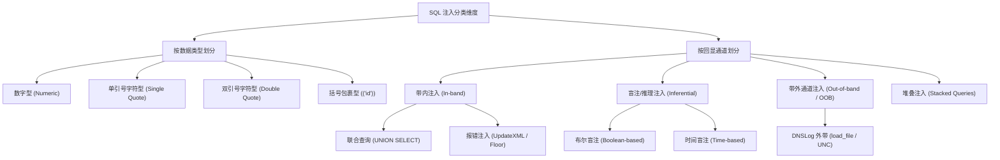

# 🎯 SQL注入分类与闭合判断深度精解

> **学习目标**：掌握 SQL 注入的全景分类，彻底理解“闭合符”的底层原理，学会通过 MySQL 错误回显信息反推后端 SQL 模板结构，掌握在过滤注释符情况下的无注释语法自闭合技巧。

---

## 0. 基础前置认知与小白扫盲：什么是 SQL 闭合？

> [!NOTE] 模块前置语言与工具清单
> - **前置通关必备**：零基础读者强烈建议先通读全局导航 **[[01-零基础入门前置指南与黑话工具字典]]**，掌握安全法律红线、终端命令行、HTTP 报文骨架与黑话字典！
> - **环境依赖**：具备基础 Web 浏览器（Chrome/Firefox）抓包认知或轻量 Python 脚本执行能力。


### 1. 通俗比喻：电车轨道扳道工与引号对话
* **为什么会有 SQL 注入？**
  * 后端程序员为了查询用户数据，在代码里写了一句模板：
    `SELECT * FROM users WHERE username = '用户输入的内容';`
  * 正常用户输入 `alice`，语句变成：
    `SELECT * FROM users WHERE username = 'alice';` —— 正常执行。
  * **黑客的越界输入**：如果黑客输入了一个单引号 `'`，语句变成：
    `SELECT * FROM users WHERE username = ''';` —— 语法当场崩溃报错！
* **什么是“闭合（Quote Closure）”？**
  * 在 SQL 语法中，程序员用单引号 `'` 或双引号 `"` 把字符串包裹起来，告诉数据库“这只是一段普通文字，不要当作指令去执行”。
  * **闭合的物理本质**：黑客主动输入一个单引号 `'`，提前结束程序员原本设定的字符串包裹范围；然后再输入自己的恶意指令（如 `OR 1=1`）；最后加上注释符（如 `--+` 或 `#`），把程序员原本写在后面的那个后引号强行变成注释忽略掉！

---

### 2. 核心闭合符号与注释符逐字拆解速查表
| 符号 / 片段 | 真实含义与底层机理 | 为什么需要这样写？ |
| :--- | :--- | :--- |
| **`'` (单引号)** | 字符型常量的开始或结束边界 | 提前闭合原语句中前端的左单引号，脱离字符束缚，进入 SQL 命令解析态！ |
| **`")` (双引号+右括号)** | 复合闭合边界 | 很多开发者的代码写成 `WHERE id = ("$input")`，此时必须连同括号一同闭合！ |
| **`--+` (SQL 注释符)** | SQL 标准单行注释（`--` 紧跟一个空格） | 在 URL 地址栏中，直接敲空格会被浏览器吃掉或解析异常，因此用 `+` 代表 URL 编码后的空格！`--+` 会让数据库把这行之后的所有原有 SQL 代码全部丢弃！ |
| **`#` (MySQL 专有注释)** | MySQL 单行行尾截断符 | 在 URL 传输中常写为 `%23`（`#` 的 URL 编码），直接将后面的闭合引号和多余逻辑一刀切断！ |

---

### 💡 读前必看：本篇语言与工具前置清单
* **必须具备的后端与网络基础**：
  * **SQL 查询句式**：`SELECT * FROM users WHERE id = 1` 代表“从 `users` 用户表中找出编号 `id` 等于 1 的所有字段信息”。
  * **后端传参逻辑（URL $\to$ `$_GET['id']`）**：
    * 当你在浏览器地址栏输入 `http://site.com/user.php?id=1` 时，问号后面的键值对就是 HTTP GET 参数。
    * PHP 后端引擎会自动把参数装进预定义数组 `$_GET` 中，`$id = $_GET['id']` 的意思就是“把前端传来的字符串 `'1'` 赋值给后端变量 `$id`”。
    * 漏洞根源：如果开发者写出 `$sql = "SELECT * FROM users WHERE id = " . $id;`，就会发生“用户输入直接拼成 SQL 指令”，此时如果输入 `1 OR 1=1`，整条 SQL 逻辑就被攻击者劫持！
* **本篇核心术语极简图解**：
  * **`information_schema`（MySQL 自带的总账本字典库）**：
    * 生活比喻：就像省图书馆前台的“全局总目录索引卡”。
    * 只要是 MySQL 5.0 以上版本，系统自带一个名为 `information_schema` 的只读数据库。里面登记了全校所有的库名（`schemata` 表）、每个库下的所有表名（`tables` 表）、以及每张表下的所有字段列名（`columns` 表）。
    * 攻击者一旦拿到 SQL 注入点，根本不需要盲猜目标有什么表，直接向这个总账本发起查询即可实现“数据库全景透视”！
  * **`URL 编码`（为什么地址栏会把空格变成 `%20` 或 `+`）**：
    * 浏览器规范要求 URL 只能传输 ASCII 字符，且不能直接携带空格、井号 `#` 等控制符。
    * 空格会被编码为 `%20` 或 `+`；井号（在 SQL 中代表单行注释）会被编码为 `%23`；单引号会被编码为 `%27`。发包时若发现特殊符号被后端丢弃，必须手动进行 URL 编码。

## 一、SQL 注入的完整分类维度

在 CTF 赛题与实战渗透中，SQL 注入通常从两个正交维度进行划分：**按数据处理类型** 与 **按攻击与回显方式**。



---

## 二、闭合判断核心机制：为什么要“闭合”？

### 1. 闭合的底层本质
后端 Web 程序接收到用户输入的参数后，会将其填充进预定义的 SQL 模板中：
```sql
SELECT * FROM users WHERE id = '$id' LIMIT 0,1;
```
如果直接输入恶意代码 `UNION SELECT 1,2,3`，后端的 SQL 语句会变成：
```sql
SELECT * FROM users WHERE id = 'UNION SELECT 1,2,3' LIMIT 0,1;
```
此时，整个攻击 Payload 仅仅被数据库当作一个**普通的字符串字面量（Literal String）**，根本不会被 SQL 语法解析器解释为指令。

> **闭合的核心目的**：通过人为输入相应的符号（如 `'`、`"`、`)`），提前**强行终结**原本属于数据的边界，使后续输入的字符直接暴露给 SQL 解析器，被当作指令执行！

---

## 三、闭合方式与探测 Payload 逐参数拆解

### 1. 数字型注入 (Numeric)
* **后端常见代码**：`SELECT * FROM users WHERE id = $id;`
* **判断逻辑**：无需闭合符，直接利用算术或逻辑运算验证。

#### 🔍 探测 Payload 与参数拆解：
| 探测 Payload | 实际拼接后的 SQL 语句 | 逻辑判断行为 | 结果判定 |
| :--- | :--- | :--- | :--- |
| `?id=1 AND 1=1` | `WHERE id = 1 AND 1=1` | `1=1` 永远为真，整条逻辑表达式结果为真。 | 页面正常回显 ID 为 1 的数据。 |
| `?id=1 AND 1=2` | `WHERE id = 1 AND 1=2` | `1=2` 为假，`AND` 运算整体为假。 | 页面数据消失、变空白或提示用户不存在。 |
| `?id=2-1` | `WHERE id = 2-1` | 数据库底层执行数学运算 `2 - 1 = 1`。 | 若页面返回 ID 为 1 的数据，100% 确认存在数字型注入。 |

---

### 2. 字符型注入 (String)
* **后端常见代码**：`SELECT * FROM users WHERE id = '$id';`

#### 🔍 经典单引号判断法与报错剖析：
当我们输入 `?id=1'` 时，后端语句变成：
```sql
SELECT * FROM users WHERE id = '1'' LIMIT 0,1;
```
此时 MySQL 会直接返回报错：
```text
You have an error in your SQL syntax; check the manual that corresponds to your MySQL server version for the right syntax to use near ''1'' LIMIT 0,1' at line 1
```

> [!IMPORTANT]
> **报错信息的“两头看中间”逆向破译法**：
> MySQL 的报错格式是：`near '【发生错误的具体位置及后续内容】' at line X`。
> 上述报错最外层的一对单引号是 MySQL 报错提示自带的包裹符；
> 剥离外层后，里面实际报错内容为：`'1'' LIMIT 0,1`。
> 可以清晰看到：数字 `1` 后面有一个多出来的单引号 `'` 无法配对闭合，这就是产生语法的根源！据此可确凿断定闭合符为 **单引号 `'`**。

---

### 3. 常见闭合类型与注释对照矩阵

在黑盒测试时，应按如下优先级顺序进行闭合探测：

| 闭合类型 | 探测 Payload | 后端原始模板示意 | 注入后完整语句结构 |
| :--- | :--- | :--- | :--- |
| **单引号** | `?id=1' --+` | `WHERE id='$id'` | `WHERE id='1' --+'` |
| **双引号** | `?id=1" --+` | `WHERE id="$id"` | `WHERE id="1" --+"` |
| **单引号+单括号** | `?id=1') --+` | `WHERE id=('$id')` | `WHERE id=('1') --+')` |
| **双引号+单括号** | `?id=1") --+` | `WHERE id=("$id")` | `WHERE id=("1") --+")` |
| **单引号+双括号** | `?id=1')) --+` | `WHERE id=(('$id'))` | `WHERE id=(('1')) --+'))` |

---

## 四、注释符机制与跨数据库语法差异

当成功闭合前置边界后，后端 SQL 语句后半段残留的原生代码（如 `' LIMIT 0,1` 或 `' AND status=1`）必须予以处理。通常有两种方案：**注释截断法** 与 **语法自闭合法**。

### 1. 注释截断法（常用）

| 注释符写法 | 适用数据库 | 底层规则与注意事项 |
| :--- | :--- | :--- |
| `--+` | MySQL, MSSQL, PostgreSQL | `--` 是 SQL 标准行注释，其后**必须紧跟至少一个空格**。在 URL 传参时空格会被浏览器吃掉，因此必须用 `+`（URL 解码为空格）占位。 |
| `%23` (`#`) | MySQL | `#` 是 MySQL 专有行注释。在浏览器 URL 中 `#` 是锚点符号，不会传给服务器，因此必须进行 URL 编码写为 `%23`。 |
| `/*...*/` | MySQL, Oracle, MSSQL, PG | 行内注释。可用于闭合前后语句，或绕过 WAF 空格检测。例如：`?id=1'/**/UNION/**/SELECT...` |
| `;%00` | 特殊情况/历史版本 | 截断字符（Null Byte）。在某些 PHP 历史版本中可直接截断字符串。 |

---

### 2. 无注释环境下的“语法自闭合法”（CTF 核心考点）

> [!WARNING]
> **CTF 高频陷阱**：很多赛题 WAF 会把 `--`、`#`、`/*` 完全过滤，此时无法截断后面的 SQL 代码，怎么办？
> **解法**：不使用任何注释符，通过精心构造逻辑，**将原 SQL 语句的后半段强行吸收为一个合法的字符串**！

#### 示例场景：
后端代码：`SELECT * FROM users WHERE username = '$name' AND is_admin = 0;`

如果我们想让查询逻辑变为真，且注释符被禁用：
* **Payload**：`admin' OR '1'='1`
* **拼接后完整语句**：
```sql
SELECT * FROM users WHERE username = 'admin' OR '1'='1' AND is_admin = 0;
```
#### 🔍 逐参数拆解：
1. `admin'`：闭合了前面的单引号；
2. `OR`：注入攻击者期望的逻辑操作符；
3. `'1'='1`：前面有一个 `'1'`，后面拼接原代码残留的 `' AND is_admin = 0`，正好与原语句尾部的单引号自动闭合，构成合法的字符串字面量对比 `'1' = '1 AND is_admin = 0'`（或数值转换判断）！整条 SQL 语法完全合法，零报错通过。

---

## 五、实战对比演练：Sqli-Labs Less 1 ~ 4 源码与闭合对抗

为了彻底掌握闭合判断，我们直接对比 `sqli-labs` 前 4 关的后端核心 PHP 源码：

```php
// Less-1: 单引号字符型
$sql = "SELECT * FROM users WHERE id='$id' LIMIT 0,1";
// 破解 Payload: ?id=1' --+

// Less-2: 纯数字型
$sql = "SELECT * FROM users WHERE id=$id LIMIT 0,1";
// 破解 Payload: ?id=1 AND 1=1 (无需任何引号)

// Less-3: 单引号 + 括号型
$sql = "SELECT * FROM users WHERE id=('$id') LIMIT 0,1";
// 破解 Payload: ?id=1') --+

// Less-4: 双引号 + 括号型
$sql = "SELECT * FROM users WHERE id=(\"$id\") LIMIT 0,1";
// 破解 Payload: ?id=1\") --+
```

### 复现诊断流程（黑盒实战标准 SOP）：
1. 传入 `?id=1'`：
   * 若页面正常无变化 $\rightarrow$ 怀疑是数字型或双引号型；测试 `?id=2-1`，若变为 1 则为数字型。
   * 若页面报错，且报错信息形如 `near ''1'' LIMIT 0,1'` $\rightarrow$ **确认是单引号字符型（Less-1）**。
   * 若页面报错，且报错信息形如 `near ''1') LIMIT 0,1'` $\rightarrow$ **确认是单引号+括号型（Less-3）**。
2. 传入 `?id=1"`：
   * 若页面报错，且报错信息形如 `near '"1") LIMIT 0,1'` $\rightarrow$ **确认是双引号+括号型（Less-4）**。

---

## 🔗 相关双向链接
- 上级体系：[[02-SQL注入体系]]
- 知识总览：[[00-Web安全与CTF知识地图总览]]
- 后续利用：[[联合查询注入原理与全参数拆解]]
- 盲注进阶：[[布尔盲注脚本编写与二分法优化]]

---
## 纵深防御与安全加固基线

> [!IMPORTANT]
> **开发与运维安全红线**：单纯依靠客户端校验或在黑名单中过滤单引号 `'`、注释符 `#` 属于掩耳盗铃，极易被多重编码或异化语法绕过。必须实施纵深防御：

1. **底层全面采用预编译参数化查询（Prepared Statements）**：
   * 无论采用 PHP PDO、Java MyBatis 还是 Python 数据库驱动，核心业务查询必须强制使用参数化预编译。
   * **原理**：预编译机制将 SQL 语句的“语法结构编译”与“参数数据填充”在数据库内核层面彻底解耦。用户传入的输入无论包含多少引号、括号或恶意指令，仅被作为纯粹的字符串字面量解析，从根源上终结闭合逃逸。
   ```php
   // 安全示范：PDO 参数化查询
   $stmt = $pdo->prepare('SELECT id, username, email FROM users WHERE username = :name');
   $stmt->execute(['name' => $userInput]);
   $user = $stmt->fetch();
   ```

2. **数据库账号最小特权运行原则（Least Privilege）**：
   * Web 应用程序严禁使用 `root` 或具备 `DBA` 特权的超管账号连接数据库。
   * 为当前 Web 业务创建独立的专用低权限账号，严格剥离跨库读取权限，并剥离敏感存储过程和文件操作权限（禁止具备 `FILE`、`SUPER`、`CREATE USER` 特权），禁止任意读取 `information_schema` 元数据。

3. **输入强类型约束与现代语义分析 WAF 协同**：
   * 对于数字型参数（如商品 ID、分页页码），在后端路由或控制器层强制执行整数转换（如 `intval($_GET['id'])`）或强类型断言，非数字直接阻断；
   * 接入支持 AST（抽象语法树）语义分析的新一代 WAF，对请求报文进行词法解析，识别异构闭合尝试并联动动态限流熔断。
