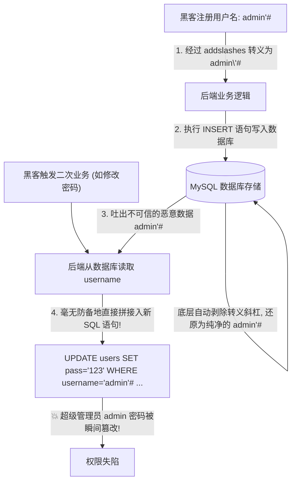
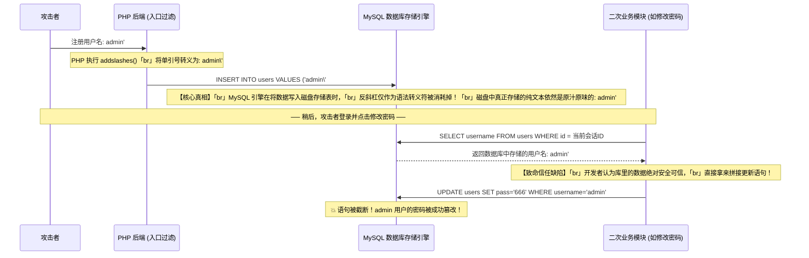

# 🔄 二次注入底层数据流扭转与越权实战深度剖析

> **核心特征**：二次注入（Second-Order Injection）不是在数据被提交的“瞬间”立刻爆炸，而是在数据被安全地“存入数据库”后，在后续的业务流转中被**二次信任并重新拼入新查询**时才引爆。
> 它往往能够**彻底通杀并无视 `addslashes()` 和 `mysqli_real_escape_string()` 等所有转义防护！**

---

## 0. 基础前置认知与小白扫盲：为什么防护函数在二次注入面前形同虚设？

> [!NOTE] 模块前置语言与工具清单
> - **前置通关必备**：零基础读者强烈建议先通读全局导航 **[[01-零基础入门前置指南与黑话工具字典]]**，掌握安全法律红线、终端命令行、HTTP 报文骨架与黑话字典！
> - **环境依赖**：具备基础 Web 浏览器（Chrome/Firefox）抓包认知或轻量 Python 脚本执行能力。


### 1. 通俗比喻：假扮老实人过安检，进城后再掏枪
* **传统注入（单刀直入，当场被抓）**：
  * 黑客在登录框输入 `admin'#`，后端使用了 `addslashes()` 或参数化查询，单引号立刻被转义成 `admin'#`，攻击被当场瓦解。
* **二次注入（潜伏引爆，降维打击）**：
  * **第一阶段：卧底登记（存入数据库）**：
    * 黑客在用户注册页面，注册了一个名字叫 `admin'#` 的新账号；
    * 后端代码老老实实进行了转义：`admin'#`，安全存入 MySQL 数据库的 `users` 表中。
    * **核心底层机理**：**MySQL 数据库在把数据真正写入磁盘表格时，会自动剥掉用于转义的反斜杠 `\`！** 最终在数据库的字段里，静静躺着的依然是原汁原味带单引号的 `admin'#`！
  * **第二阶段：借刀引爆（二次读取并拼接）**：
    * 当黑客登录这个账号，点击“修改密码”，后端程序员心想：“这个用户名是从我自家数据库里读出来的，绝对是可信安全的，不需要再防注入了吧！”
    * 于是程序员直接写下：
      `UPDATE users SET password = '$new_pass' WHERE username = '$username';`
    * 此时数据库读出的 `admin'#` 被原样拼入 SQL 语句，单引号瞬间提前闭合，后面的 `#` 把条件一刀切断，**原本修改自己的密码，瞬间变成了把真正的超级管理员 `admin` 的密码强行改掉！**



---

## 一、为什么转义函数在二次注入面前形同虚设？

很多初级开发者认为：只要在入口处对所有用户输入调用了 `addslashes()`，系统就绝不可能存在 SQL 注入。这是对数据库底层持久化存储机制的重大误解。

### 1. 转义字符在数据库中的“自动脱壳”过程



> [!IMPORTANT]
> **底层核心**：
> `addslashes()` 的作用**仅仅是保证当前这条 `INSERT` 语句不会发生语法崩溃**。
> 一旦数据入库，数据本身是**不带任何反斜杠**的原生字符串。当应用程序在另外一个功能中将这条“干净的”数据重新取出发给数据库时，如果没有做二次预编译，原有的恶意单引号就会立刻“复活”，重构 SQL 语法树！

---

## 二、经典实战大题：Sqli-Labs Less-24 白盒代码审计与越权

Less-24 是最经典的二次注入教学靶场，模拟了完整的“用户注册 $\rightarrow$ 密码重置”业务闭环。

---

### 1. 第一阶段：注册恶意账户（入库埋雷）

#### 后端注册源码（`login_create.php`）：
```php
$username = mysqli_real_escape_string($con, $_POST['username']);
$password = mysqli_real_escape_string($con, $_POST['password']);

$sql = "INSERT INTO users (username, password) VALUES ('$username', '$password')";
$result = mysqli_query($con, $sql);
```

#### 🔍 攻击操作与参数拆解：
* **注册用户名**：`admin'#`
* **注册密码**：`123456`
* **底层数据流**：
  * `mysqli_real_escape_string` 将输入处理为 `admin\'#`；
  * `INSERT` 语句拼接为：`INSERT INTO users VALUES ('admin\'#', '123456')`，语法完全合法；
  * 数据落盘：数据库 `users` 表中新增一条记录，其 `username` 字段的值是确凿无疑的纯文本 `admin'#`。

---

### 2. 第二阶段：正常登录建立会话（读取信物）

* 攻击者使用账号 `admin'#` 和密码 `123456` 正常登录系统。
* 后端校验账号密码匹配成功后，将当前用户名存入 Session：
```php
$_SESSION['username'] = $row['username']; // 此时 Session 中存储的值即为 "admin'#"
```

---

### 3. 第三阶段：修改密码触发二次注入（引爆破防）

#### 后端修改密码核心源码（`pass_change.php`）：
```php
// 漏洞成因：直接从 Session 中提取未经过滤的用户名进行字符串拼接
$username = $_SESSION['username']; 
$new_pass = $_POST['new_password'];

$sql = "UPDATE users SET password='$new_pass' WHERE username='$username'";
$result = mysqli_query($con, $sql);
```

#### 🔍 拼接后的实际 SQL 执行语句：
```sql
UPDATE users SET password='666' WHERE username='admin'#'
```

#### 🔍 参数与截断效果逐字拆解：
| 语句片段 | 语法解析 | 产生的业务越权后果 |
| :--- | :--- | :--- |
| `UPDATE users SET password='666'` | 准备将密码更新为新值 `666`。 | 正常业务逻辑。 |
| `WHERE username='admin'` | 前单引号闭合了前面代码的单引号，将匹配目标框定为真正的 **`admin` 超级管理员**！ | **攻击目标被非法篡改**！原本应该更新攻击者自己的账号，结果变成了更新主管理员账号。 |
| `'#` | 注释符将原本后端代码中残留的尾部单引号 `'` 彻底注释过滤。 | 保证整条 `UPDATE` 语句完全合法，数据库直接无感知执行更新！ |

* **最终利用结果**：系统提示修改密码成功。攻击者直接退出当前账号，使用 `admin` 账号和刚才输入的新密码 `666` 即可**成功登录系统超级管理员后台！**

---

## 三、CTF 进阶：二次盲注与二次报错

二次注入绝不仅限于修改密码。在更复杂的 CTF 题目中，经常结合盲注与报错注入：

### 1. 二次报错注入
* **注册用户名**：
  ```sql
  admin' AND updatexml(1, concat(0x7e, (SELECT flag FROM flag_tbl)), 1)#
  ```
* **触发场景**：在个人主页、查看发票记录、或者系统后台管理员查看用户列表时触发报错，页面直接向管理员或攻击者打印出 Flag！

### 2. 二次堆叠注入
* **注册个性签名/收件地址**：
  ```sql
  1'; DROP TABLE logs; #
  ```
* **触发场景**：后台定时清理脚本或统计脚本读取地址并拼接时，直接执行二次堆叠操作。

---

## 四、企业级根治防御方案

1. **破除“数据库出库数据即安全”的错误假设**：
   * 必须把数据库查询出来的任何历史数据，均视为与外部用户输入同等级别的“不可信数据源”。
2. **全生命周期预编译（Prepared Statements）**：
   * 不管是 `INSERT` 还是后续的 `UPDATE`、`DELETE`、`SELECT`，必须**全程统一使用参数化占位符 `?`**：
   ```php
   $stmt = $pdo->prepare("UPDATE users SET password = ? WHERE username = ?");
   $stmt->execute([$new_pass, $username]);
   ```
   只要采用预编译，即使用户名为 `admin'#`，数据库也只会把它当成一个叫 `admin'#` 的完整名字进行严格字面值比对，绝不可能发生代码注入！

---

## 🔗 相关双向链接
- 上级模块：[[02-SQL注入体系]]
- 前置基础：[[堆叠注入在多数据库下的利用边界]]
- 下级模块：[[关键字、空白符、编码绕过矩阵]]
- 知识地图：[[00-Web安全与CTF知识地图总览]]
