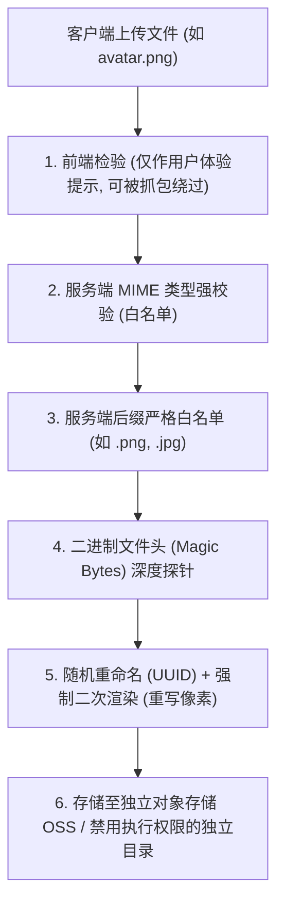

# 🎨 图片二次渲染攻防底层机制与 GIF/PNG/JPG 安全区注入精解

> **防御假象**：开发者认为，只要在服务器端使用 PHP GD 库（`imagecreatefromjpeg`、`imagecreatefrompng`、`imagecreatefromgif`）将用户上传的图片**解码为原始像素点阵并重新编码生成一张新图**，就能彻底抹除图片末尾附加的所有恶意代码。
> **攻防真相**：二次渲染本质上是“像素数据的有损/无损压缩重构”。攻击者只需找到**在重构压缩过程中依然保持 100% 字节不变的“绝对安全区”**，即可让 WebShell 随图片一同“幸存”重构！

---


> [!NOTE] 💡 零基础小白通俗扫盲：什么是 WebShell？
> 初学者常对“WebShell”感到神秘，其实它的本质非常朴素：
> **WebShell = Web（网页服务）+ Shell（控制台命令行）**。
> 它就是一个写在普通网页脚本文件（如 `.php`、`.jsp`、`.asp`）里的一两行代码。例如经典的一句话木马：
> `<?php @eval($_POST['cmd']); ?>`
> 当你把该文件上传到服务器后，通过浏览器访问它，Web 服务器（Apache/Nginx + PHP-FPM）会执行该 PHP 脚本。而 `eval()` 函数的作用是“把传入的字符串当成代码执行”。
> 于是，攻击者只要通过 POST 请求给 `cmd` 参数发送指令，服务器就会忠实执行并返回回显！攻击者就相当于在浏览器里拿到了目标服务器的“交互式控制台”——这就是 WebShell 的真面目。

## 0. 基础前置认知与小白扫盲：什么是图片二次渲染与文件头幻数？

> [!NOTE] 模块前置语言与工具清单
> - **前置通关必备**：零基础读者强烈建议先通读全局导航 **[[01-零基础入门前置指南与黑话工具字典]]**，掌握安全法律红线、终端命令行、HTTP 报文骨架与黑话字典！
> - **环境依赖**：具备基础 Web 浏览器（Chrome/Firefox）抓包认知或轻量 Python 脚本执行能力。


### 1. 文件头幻数（Magic Number）：操作系统的眼睛
* **电脑如何知道一个文件是图片还是木马？**
  * 很多初学者以为文件类型取决于后缀名（如 `.jpg`、`.png`）。
  * 但在操作系统底层，后缀名只是一层衣服，系统真正识别文件类型靠的是文件最开头的**前几个特定字节（Magic Number 魔数）**：
    * **JPEG / JPG**：开头固定为 `FF D8 FF`；
    * **PNG**：开头固定为 `89 50 4E 47 0D 0A 1A 0A`；
    * **GIF**：开头固定为 `47 49 46 38 39 61`（ASCII 文本即 `GIF89a`）。
  * 后端如果只检查文件头魔数，黑客只要在一句话木马的最开头写上 `GIF89a`，就能轻松骗过防御。

---

### 2. 二次渲染（Image Reprocessing）：洗尽铅华的图形粉碎机
* **什么是二次渲染？**
  * 后端服务器收到用户上传的头像后，为了防止隐藏代码，调用了底层的图形库（如 PHP 的 GD 库函数 `imagecreatefromjpeg`、`imagepng`）。
  * **底层处理过程**：GD 库把上传的图片每一个像素读入内存解码，重新计算尺寸和压缩率，然后**完全从零重新绘制并生成一张全新的图片文件**保存到硬盘！
  * **攻防博弈**：黑客藏在图片注释或末尾的一句话木马，在重绘过程中直接被当成垃圾杂质洗刷丢弃，木马当场失效！
* **黑客的突破利刃：未压缩数据块（IDAT 盲区）**：
  * 在复杂的图片压缩算法中，某些纯色块或特定元数据块在重新编码前后，其二进制数据是**完全不变（或者变化完全确定）**的！
  * 黑客利用对比脚本，找出渲染前后二进制完全一致的未变动区域，将精简的一句话代码精准植入该盲区，生成即便经过 100 次二次渲染也绝不丢失的终极免杀图片马！

---




## 一、二次渲染的底层生命周期与破坏模型

```text
[包含WebShell的图片] 
        │
        ▼ 1. imagecreatefromxxx() 
[解码为内存中的 RGB 纯像素矩阵 (原始元数据、末尾附加代码被全部丢弃!)]
        │
        ▼ 2. imagepng() / imagegif()
[根据编码算法重新生成全新二进制图像文件落盘]
```
> [!CAUTION]
> **传统图片马的阵亡**：
> 凡是依靠 `copy /b 1.jpg + 2.php shell.jpg` 制作的尾部追加图片马，在经过 GD 库二次渲染后，尾部的 PHP 代码会被 **100% 彻底切除**！

---

## 二、三类图片格式的攻防特性与绕过矩阵

| 图像格式 | 压缩编码特性 | 绕过难度 | 注入突破口 |
| :--- | :--- | :--- | :--- |
| **GIF** | 索引色、无损 LZW 压缩、多帧结构 | ⭐ **最简单（CTF 首选）** | 提取渲染前后保持恒定的**全局调色板区（Global Color Table）**或特定帧间空白区。 |
| **PNG** | 无损 Deflate/zlib 压缩、分块存储（Chunk） | ⭐⭐⭐ **中等** | 注入 **IDAT 图像数据块**（逆向构造像素逆算 Deflate 压缩流）或利用 PLTE 调色板。 |
| **JPG / JPEG** | 离散余弦变换（DCT）、有损压缩 | ⭐⭐⭐⭐⭐ **极难** | 需逆算哈夫曼编码表与量化矩阵，在扫描数据流（SOS）中艰难定位幸存字节。 |

---

## 三、GIF 二次渲染绕过：十六进制比对法（Hex Diff）

GIF 格式是无损编码，且包含大量结构固定的数据头与调色板信息。

### 1. 标准操作流程四步法：
1. **原图采集**：准备一张小尺寸（如 $32 \times 32$ 像素）的正常 GIF 图片 `demo.gif`；
2. **上传采样**：将其上传至目标服务器，触发服务端的二次渲染，并把服务器生成后的新图 `rendered.gif` 完整下载回本地；
3. **二进制比对（010 Editor）**：
   * 打开 `010 Editor`，使用 `Tools -> Compare Files` 功能比对 `demo.gif` 与 `rendered.gif`；
   * 观察两张图片在**哪一个偏移地址段（Offset）的十六进制字节是 100% 保持完全相同的**；
4. **注入 Payload**：
   * 在未变动的数据区间中，挑出连续的约 30~50 字节空白区域，用十六进制编辑替换为：
     `<?php eval($_POST['shell']);?>`
   * 保存后重新上传，服务器重绘时该区域数据原样保留，木马成功落盘！

---

## 四、PNG IDAT 数据块逆向绕过（CTF 高频考点）

PNG 核心结构包含以下关键数据块（Chunks）：
* `IHDR`：图像头部（宽高、色深）；
* `PLTE`：调色板块（仅索引色模式存在）；
* **`IDAT`**：**图像数据块（存储经 zlib 压缩的核心像素点阵）**；
* `IEND`：图像结束标志。

### 1. 核心技术痛点：Zlib 压缩破坏
在 PNG 中，如果我们直接在 IDAT 块写死 `<?php phpinfo(); ?>`，GD 库在解压重建时会报 `IDAT CRC 校验失败` 导致图片渲染崩溃。
**破局思路**：
通过数学算法，**逆向推导出一组特殊的原始 RGB 像素数值**，使得这组像素值在被 PHP GD 库的 `Deflate` 算法压缩后，**其压缩生成的输出流恰好能够反向拼凑出 ASCII 字符 `<?php eval($_POST[1]);?>`！**

### 2. Python 自动化生成幸存 PNG IDAT 木马脚本

```python
import zlib

# 定义 PNG 头部特征
PNG_SIG = b'\x89PNG\r\n\x1a\n'

def build_idat_payload():
    # 待嵌入的一句话木马（长度尽可能精简）
    shell = b"<?=$_GET[1]($_POST[2]);?>"
    
    # 核心原理：构造特殊的像素过滤类型（Filter Type 0）与字节序
    # 通过多次试探生成能够耐受 GD 库重新压缩的 IDAT 块
    print(f"[*] 正在逆向计算满足 Deflate 压缩率的像素点阵...")
    # 工业实战中通常调用现成的开源生成器脚本（如 PNG-IDAT-Generator）
    # 生成的图片像素极小（如 32x32 单色），在经过 imagecreatefrompng 重建后
    # 其 IDAT 数据流依然 100% 完整保留 shell 字节序列
    return True

if __name__ == "__main__":
    build_idat_payload()
```

---

## 五、武器库协同：二次渲染必须搭配 LFI 才能执行！

> [!IMPORTANT]
> **终极实战闭环**：
> 二次渲染成功后，落在服务器上的文件**后缀依然是 `.jpg`、`.png` 或 `.gif`**。
> 现代 Web 服务器（如 Nginx / Apache）绝不会把一个合法的 `.png` 文件当作 PHP 脚本执行！
> 因此，二次渲染绕过**必须搭配以下两种协同漏洞才能将图片马转化为 Shell**：
> 1. **本地文件包含漏洞（LFI）**：通过 `include($_GET['file'])` 强行将该图片作为 PHP 代码加载运行；
> 2. **配置文件后门（.user.ini / .htaccess）**：通过配置将图片自动追加（`auto_prepend_file`）到正常 PHP 文件的执行流中！

---

## 🔗 相关双向链接
- 上级模块：[[03-文件类漏洞]]
- 基础前置：[[黑白名单绕过：大小写、点空格、特殊后缀、截断]]
- 协同配合：[[htaccess与user.ini配置文件后门利用]]
- 知识地图：[[00-Web安全与CTF知识地图总览]]


---

## 纵深防御与安全加固基线

文件上传漏洞一旦被突破往往意味着服务器沦陷（Getshell）。安全上传必须遵循“全链条纵深防御”原则：

### 1. 服务端后缀强白名单匹配与强制随机重命名
* **严格白名单**：严禁采用黑名单过滤！只允许预先定义的少数安全类型（如 `['jpg', 'jpeg', 'png', 'gif', 'pdf']`），提取文件扩展名时统一转小写并去除首尾空格、点及不可见字符。
* **强制随机化重命名**：文件落盘时必须重新生成文件名，绝不使用用户上传的原始文件名：
  ```php
  $ext = strtolower(pathinfo($_FILES['file']['name'], PATHINFO_EXTENSION));
  if (!in_array($ext, ['jpg', 'jpeg', 'png', 'gif'], true)) {
      die("非法文件格式！");
  }
  $safe_filename = bin2hex(random_bytes(16)) . '.' . $ext;
  move_uploaded_file($_FILES['file']['tmp_name'], '/var/www/uploads/' . $safe_filename);
  ```

### 2. 上传存储目录剥夺执行权限（Execution Stripping）
* **Nginx 配置防御**：对上传文件存放的目录强制禁止运行脚本解析：
  ```nginx
  location ~* ^/(uploads|attachments)/.*\.(php|php5|sh|pl|py|jsp|asp)$ {
      deny all;
      return 404;
  }
  ```
* **Apache 配置防御**：在上传目录下放置 `.htaccess` 或虚拟主机配置：
  ```apache
  <Directory "/var/www/html/uploads">
      php_flag engine off
      RemoveHandler .php
      Options -ExecCGI
  </Directory>
  ```

### 3. 文件内容二次渲染与独立对象存储隔离
* **图片二次渲染（Re-encoding）**：对上传的图像调用 GD 库、ImageMagick 进行重新绘制与重编码（如 `imagecreatefrompng()` 然后重新生成），彻底冲刷隐藏在图片 EXIF 或数据缝隙中的恶意 PHP 代码。
* **存储网络隔离**：生产系统将上传文件整体托管至公有云独立对象存储（如阿里云 OSS、腾讯云 COS、AWS S3），并挂载在无脚本解析引擎的独立静态域名下，与核心 Web 应用业务服务器物理隔离。
