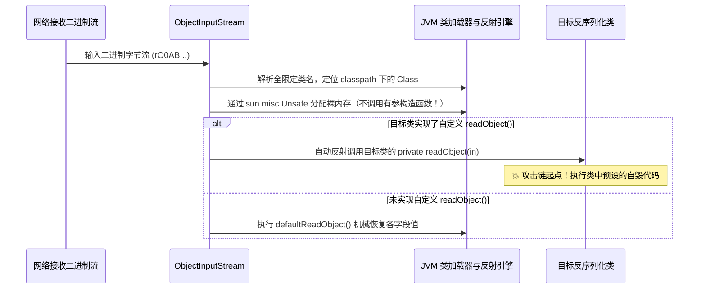

# ☕ Java 原生反序列化底层二进制字节码与 readObject 劫持机制

> **安全领域的经典论断**：如果说 PHP 的反序列化是针对属性的拼接积木，那么 **Java 反序列化就是图灵完备的隐式程序装载**！
> 在 Java 企业级应用（WebLogic、JBoss、Shiro、ActiveMQ）与高阶 CTF 赛题中，Java 反序列化漏洞是攻防双方博弈最激烈的核心高地。

---

## 0. 基础前置认知与小白扫盲：Java 序列化的二进制身份证

> [!NOTE] 模块前置语言与工具清单
> - **前置通关必备**：零基础读者强烈建议先通读全局导航 **[[01-零基础入门前置指南与黑话工具字典]]**，掌握安全法律红线、终端命令行、HTTP 报文骨架与黑话字典！
> - **环境依赖**：具备基础 Web 浏览器（Chrome/Firefox）抓包认知或轻量 Python 脚本执行能力。


### 1. 什么是魔数 `AC ED 00 05`？
* 当你抓取 Java 序列化传输的流量时，你会在十六进制编辑器中看到永远不变的四个神秘字节：
  `AC ED 00 05`
* **解密魔数**：
  * `AC ED`（STREAM_MAGIC）：Java 序列化协议的法定魔数（占 2 字节）；
  * `00 05`（STREAM_VERSION）：Java 序列化数据流的版本号（版本 5，占 2 字节）。
* 无论何时何地，只要在网络数据流或文件头看到 `AC ED 00 05`（Base64 编码通常以 `rO0AB` 开头），就**100% 确认这是 Java 原生序列化数据，立刻可以展开反序列化利用探测！**

---

### 2. `readObject()` 的本质：对象的“重生仪式”
* 序列化是把内存里的对象写成字节（死掉并下葬）；
* 反序列化是把字节重新捏成内存里的对象（重生起死回生）；
* Java 官方允许类开发者在自己的类里编写一个私有的 `readObject()` 方法，用来自定义反序列化时的还原逻辑。
* **安全灾难**：如果开发者在这个“重生仪式”里写了不该写的操作（比如自动读取文件、自动建立网络连接、或者自动回调了外部传入的函数），黑客就能借尸还魂，在对象重生的那一瞬间夺取服务器控制权！

---

## 一、Java 序列化二进制协议与魔数特征

Java 原生序列化数据是以严格的二进制流（Binary Stream）格式组织的。其协议规范（Java Object Serialization Stream Protocol）开头具有不可伪造的特征标志：

### 1. 核心魔数标志与 Base64 指纹
* **十六进制魔数（Magic Number）**：`AC ED`（`STREAM_MAGIC`，数值 `(short) 0xaced`）
* **协议版本号（Stream Version）**：`00 05`（`STREAM_VERSION`，数值 `(short) 5`）
* **合并二进制头**：`\xac\xed\x00\x05`

> [!IMPORTANT]
> **渗透实战嗅探第一法则：记住 `rO0AB`！**
> 当 `\xac\xed\x00\x05` 经过标准 Base64 编码后，其前 5 个字符必然恒定为：
> $$\text{Base64}(\text{AC ED 00 05}) \implies \mathbf{rO0AB...}$$
> **实战结论**：无论在 HTTP 请求头、Cookie（如 Apache Shiro 的 `rememberMe`）、POST 表单参数、还是 WebSocket 消息中，只要抓包看到以 **`rO0AB`** 开头的数据，**100% 确认该处正在传输 Java 原生序列化字节流！**

### 2. 常见二进制 Opcode 标志位
| 十六进制 Opcode | 常量名称 | 含义与解析行为 |
| :--- | :--- | :--- |
| `0x73` | `TC_OBJECT` | 声明紧接着要实例化一个新的 Object 对象。 |
| `0x72` | `TC_CLASSDESC` | 类的描述符开始（包含完整全限定类名和 `serialVersionUID`）。 |
| `0x74` | `TC_STRING` | 声明一个纯字符串。 |
| `0x77` | `TC_BLOCKDATA` | 块数据写入标记。 |
| `0x78` | `TC_ENDBLOCKDATA` | 块数据结束标记。 |

---

## 二、`readObject()` 为什么会成为任意代码执行的源头？

### 1. 反序列化的底层执行流水线
当服务端代码调用 `ObjectInputStream.readObject()` 时，JVM 的底层处理逻辑并非仅仅是赋值，而是经历以下流程：



> [!CAUTION]
> **危险根源**：
> 如果目标类自定义实现了 `private void readObject(ObjectInputStream in)` 方法，JVM 会**无条件、不可中断地自动反射调用它**！
> 开发者如果在 `readObject()` 内部编写了诸如“自动连接远程 URL”、“从 Map 中提取键值”、“解析表达式”等操作，攻击者即可通过精心嵌套的对象属性，将这些操作引导向系统危险函数（Sink）。

---

## 三、Java 反序列化链的三大基石技术

### 1. 为什么必须用反射（Reflection）？
在 Java 中，执行命令最直接的类是 `java.lang.Runtime.getRuntime().exec("calc")`。
**但是，`java.lang.Runtime` 类并没有实现 `java.io.Serializable` 接口！** 这意味着我们**根本无法直接序列化一个 Runtime 对象**发送给服务端。

#### 破局之道：反射执行代码
由于 `Class`、`Method` 等反射元数据是可以间接引用的，攻击者利用提供反射封装的中间链条（如 Commons-Collections 的 `InvokerTransformer`），将反射代码打包执行：

```java
// 标准纯反射调用 Runtime 执行命令代码片段
Class<?> clazz = Class.forName("java.lang.Runtime");
Method getRuntimeMethod = clazz.getMethod("getRuntime");
Object runtimeInstance = getRuntimeMethod.invoke(null); // 静态方法调用
Method execMethod = clazz.getMethod("exec", String.class);
execMethod.invoke(runtimeInstance, "calc.exe");
```

---

### 2. Java 动态代理（Dynamic Proxy）：跨类型适配转换器
在构造复杂的利用链时，我们经常遇到**类型不兼容**的困境：
例如类 A 的 `readObject()` 中只调用了 `Map.get()` 方法，而我们精心构造的恶意攻击载荷却是一个实现了 `InvocationHandler` 的对象，类型完全对不上，无法直接赋值。

#### 动态代理的神级桥梁作用：
* 通过 `Proxy.newProxyInstance()` 动态生成一个实现了 `Map` 接口的代理类；
* 将代理类的调用处理器绑定到包含漏洞的 `InvocationHandler`；
* **效果**：当外部代码调用该代理对象的**任何方法**（如 `map.get()`、`map.entrySet()`、`map.size()`）时，调用都会被 JVM 强制劫持并转发给 `InvocationHandler.invoke()` 执行！动态代理成为了无视接口限制的万能粘合剂。

---

## 四、经典实战验证：最简 Native 反序列化 RCE 靶场

编写一个完全自主可控的最小可复现模型，观察 `readObject` 如何触发 RCE：

```java
import java.io.*;

// 存在漏洞的业务类
class EvilUser implements Serializable {
    private static final long serialVersionUID = 1L;
    public String cmd;

    // 自定义反序列化入口
    private void readObject(ObjectInputStream in) throws IOException, ClassNotFoundException {
        // 先正常读取序列化字段
        in.defaultReadObject();
        // 危险操作：反序列化时自动执行系统命令！
        Runtime.getRuntime().exec(this.cmd);
    }
}

public class ExploitDemo {
    public static void main(String[] args) throws Exception {
        // 1. 攻击者生成 Payload
        EvilUser user = new EvilUser();
        user.cmd = "calc.exe"; // 弹出计算器

        ByteArrayOutputStream baos = new ByteArrayOutputStream();
        ObjectOutputStream oos = new ObjectOutputStream(baos);
        oos.writeObject(user);
        byte[] payloadBytes = baos.toByteArray();

        System.out.println("[+] 成功生成序列化字节，长度: " + payloadBytes.length);
        // 查看开头的十六进制魔数
        System.out.printf("[+] 魔数头: %02X %02X %02X %02X\n", 
            payloadBytes[0], payloadBytes[1], payloadBytes[2], payloadBytes[3]);

        // 2. 服务端接收并执行反序列化
        System.out.println("[*] 服务端开始反序列化...");
        ByteArrayInputStream bais = new ByteArrayInputStream(payloadBytes);
        ObjectInputStream ois = new ObjectInputStream(bais);
        ois.readObject(); // 这一瞬间触发本地计算器弹出！
    }
}
```

---

## 🔗 相关双向链接
- 上级模块：[[07-反序列化漏洞深度专精]]
- 前置基础：[[Phar反序列化：文件格式解析与触发隐藏面]]
- 终极实战：[[CommonsCollections 1与6链深入断点剖析]]
- 知识地图：[[00-Web安全与CTF知识地图总览]]
