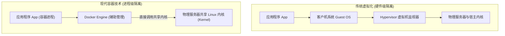
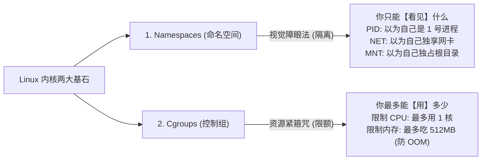
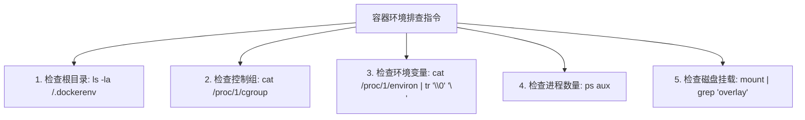

# 🐳 云原生与容器安全基石：Linux 容器底层机制 (Namespace/Cgroups) 剖析与容器环境自动化识别

> **学习指南**：在现代 CTF Web 竞赛与企业级云原生渗透中，你通过 SQL 注入或反序列化拿到的 WebShell，**99% 的情况下都身处于一个隔离的 Docker 容器中**！
> 很多初学者即使在容器里拿到了 `root` 权限，去执行 `cat /flag` 却发现根本没有 Flag，或者根本碰不到宿主机的核心资产。
> 要想完成高维度的“**容器逃逸（Container Escape）**”，必须先吃透：**容器到底是什么？它是如何被 Linux 内核限制住的？我们该如何探测当前环境的特权与边界？**

---


### 容器安全与隔离技术核心术语表（页面级速查词典）
| 术语 | 英文全称 | 核心含义与攻防意义 |
|---|---|---|
| **Namespace** | 命名空间 | Linux 内核提供的轻量级视图隔离技术（包括 PID, Mount, Net, IPC, UTS, User 六大维度），让容器进程只能看见自己的资源。 |
| **Cgroups** | Control Groups (控制组) | Linux 内核对进程组占用的物理资源（CPU、内存、磁盘 I/O）进行配额与统计的限制机制，防止容器进程耗尽宿主机资源（DoS）。 |
| **Rootless** | 无 Root 容器 | 容器内部的 root 用户在宿主机上映射为非特权普通用户，极大降低容器逃逸后的宿主机提权风险。 |
| **Capabilities** | Linux 权能细分 | 将传统的全能 root 权限拆分为 40+ 项独立细粒度特权（如 `CAP_SYS_ADMIN`、`CAP_NET_RAW`），容器默认裁剪大部分高危权能。 |
| **AppArmor / SELinux**| 强制访问控制 (MAC) | 内核级安全增强模块，对容器能访问的文件路径和系统调用实施强制白名单拦截，限制越权行为。 |
| **Docker Socket** | `/var/run/docker.sock` | Docker 守护进程的 Unix 本地通信套接字；若挂载进容器内部，攻击者可直接通过它调用 Docker API 启动特权容器接管宿主机！ |
| **特权容器** | `--privileged` | 开启该参数启动的容器将获得宿主机的几乎全部内核 Capabilities，并且不受 AppArmor 限制，可直接挂载宿主机磁盘逃逸。 |
| **OverlayFS / Rootfs** | 联合文件系统 / 根文件系统 | 容器镜像的分层写时复制（CoW）文件存储机制；底层只读层与顶层可读写层叠加构成容器视角的根目录。 |
| **Cgroup 逃逸** | `release_agent` 逃逸 | 利用旧版本内核中 Cgroups v1 的 `notify_on_release` 机制与 `release_agent` 脚本，在容器内触发宿主机以 root 身份执行任意脚本。 |
| **容器逃逸** | Container Escape | 突破 Linux 内核 Namespace 和 Cgroups 等安全边界，从受限的容器沙箱内部渗透到宿主机物理操作系统并获得宿主权限。 |


> [!NOTE] 模块前置语言与工具清单
> - **前置通关必备**：零基础读者强烈建议先通读全局导航 **[[01-零基础入门前置指南与黑话工具字典]]**，掌握安全法律红线、终端命令行、HTTP 报文骨架与黑话字典！
> - **环境依赖**：具备基础 Web 浏览器（Chrome/Firefox）抓包认知或轻量 Python 脚本执行能力。

## 一、小白零基础扫盲：容器到底是什么？

### 1. 通俗比喻：虚拟机是“独栋精装别墅”，容器是“大平层隔断单间”

* **传统的虚拟机（VMware / VirtualBox，独栋别墅）**：
  * 每开一个虚拟机，都要给它虚拟出一整套完整的硬件（虚拟网卡、虚拟硬盘、虚拟 BIOS），并在上面安装一个几十 GB 大小的完整操作系统（Guest OS）。
  * **特点**：隔离极其彻底，但极其沉重，启动需要几分钟，极其耗费宿主机内存。
* **现代的容器（Docker / Podman，合租房隔断间）**：
  * **核心底层真相**：**容器根本不是一台机器！它本质上只是宿主机 Linux 操作系统里的一个普通的“受限进程”！**
  * 所有的容器和宿主机，**共享同一个 Linux 操作系统内核（Kernel）**！
  * 宿主机只是用隔断墙把这个进程的“视线”遮挡住了，让它误以为自己独占了一整台计算机！



---

### 2. 支撑容器的两大 Linux 内核基石：Namespace 与 Cgroups

Linux 内核是如何在一个共享系统里实现“容器隔离”的？靠的是两项神级技术：



#### 6 大核心 Namespace（命名空间）全景清单：
| Namespace 类型 | 隔离的系统资源 | 攻击者在容器内看到的“障眼法” |
| :--- | :--- | :--- |
| **`PID` (进程隔离)** | 进程树与进程号 | 容器内的 Web 服务在容器里显示为 `PID 1`（天王老子），但在宿主机的 `ps -ef` 里它其实是个编号为 `35142` 的普通进程 |
| **`NET` (网络隔离)** | IP 地址、端口、路由表 | 拥有独立的虚拟网卡 `eth0`，容器内监听 80 端口不会与宿主机真正的 80 端口冲突 |
| **`MNT` (挂载隔离)** | 文件系统挂载点 | 通过 `chroot` 和 `pivot_root` 给容器换了一套根目录视图，让它看不到宿主机真正的磁盘文件 |
| **`UTS` (主机名隔离)**| 主机名（Hostname）与域名 | 容器可以拥有随机生成的主机名（如 `hostname` 显示为 `7c4b1e9d02`） |
| **`IPC` (通信隔离)** | 信号量、共享内存 | 容器间无法直接使用内存共享进行通信 |
| **`USER` (用户隔离)** | 用户 UID 与用户组 GID | 容器内的 `root`（UID 0）通过映射，在宿主机上可以被降级为一个普通非特权用户 |

---

## 二、黑客侦察第一步：如何 100% 确认自己身处容器中？

当你拿到一个 Linux WebShell 终端时，如何一眼看穿自己是身处真机还是在被囚禁的 Docker 容器里？

### 5 大维度检测识别矩阵：



#### 1. 经典黄金标识：`/.dockerenv` 文件
* 在绝大多数 Docker 容器的根目录下，默认都会存在一个名为 `/.dockerenv` 的空标记文件：
  ```bash
  ls -la /.dockerenv
  ```
  * 若该文件存在，**99% 可以确认为 Docker 容器环境**！

#### 2. 内核控制组特征：`/proc/1/cgroup`
* 打印 1 号进程所属的控制组路径：
  ```bash
  cat /proc/1/cgroup
  ```
  * **在普通宿主机上**：显示为 `1:name=systemd:/` 或 `/init.scope`；
  * **在 Docker 容器内**：每一行末尾都会包含明显的 `/docker/<容器长ID>` 字符串！
  * **在 K8s 容器内**：会包含 `/kubepods/...` 字符串！

#### 3. 进程极度冷清现象：`ps aux`
* 真正的 Linux 宿主机有大量的系统守护进程（`systemd`, `cron`, `sshd`, `rsyslog` 等数十上百个进程）；
* **在 Docker 容器内**：由于 PID Namespace 的隔离，执行 `ps aux` 通常**只有极其凄凉的 2~5 个进程**（通常 PID 1 是启动脚本或 Web 服务器进程 `nginx` / `java` / `apache2`）。

#### 4. 文件系统类型：`mount | grep overlay`
* Docker 采用 OverlayFS 联合文件系统来分层构建镜像：
  ```bash
  mount | grep 'overlay on /'
  ```
  * 若看到根目录挂载类型为 `overlay`，且包含 `upperdir=...`、`workdir=...`，证明当前文件系统是由 Docker 动态拼接的可写层！

---

## 三、容器逃逸前置勘测：Linux 特权能力 (Capabilities) 探测

在 Linux 传统的安全模型中，权限只有非黑即白的两种：要么是普通用户（UID > 0），要么是全能 Root（UID = 0）。
为了防止 Root 权限过大，现代 Linux 引入了 **Capabilities（特权能力子集）**，把 Root 的特权拆分成了几十种细粒度的独立开关（例如 `CAP_NET_ADMIN` 允许修改路由，`CAP_CHOWN` 允许改属主）。

> [!CAUTION]
> **危险启示**：
> Docker 在默认启动容器时，**剥离了绝大多数高危特权能力（如禁用挂载硬盘、禁用读写内核模块）**。
> 但如果运维人员为了图方便，启动时加上了 `--privileged`（特权模式）或者错误赋予了某些危险 Capability，**容器就会打开通往宿主机的生死大门！**

### 核心高危 Capabilities 排查：

使用工具查看当前容器所拥有的特权能力：
```bash
# 查看当前进程的 Capabilities
capsh --print
# 或从 proc 提取并在本地解码
cat /proc/self/status | grep CapEff
```

#### 只要拥有以下任意一项，便极可能达成容器逃逸：
* **`CAP_SYS_ADMIN`**：万能管理员特权！拥有此项即可挂载磁盘、操作 cgroups，是逃逸的头号温床。
* **`CAP_SYS_PTRACE`**：允许跟踪和注入其他进程的内存！若容器共享了宿主机的 PID（`--pid=host`），可直接把 Shellcode 注入到宿主机进程中逃逸！
* **`CAP_DAC_READ_SEARCH`**：忽略文件读权限与目录遍历权限，配合 `open_by_handle_at` 系统调用可直接越狱读取宿主机任意文件（Shocker 逃逸）！

---

## 四、CTF 实战靶场案例复现（自动化环境识别与敏感挂载探测）

### 靶场情境：从 Web RCE 到容器侦察实战

假设我们在一个 CTF Web 题目中通过命令注入拿到了一个命令执行回显接口：`http://target.ctf:8080/cmd.php?c=...`。
当前执行用户为 `root`，但我们在当前目录下执行 `ls /` 并没有发现任何 Flag 文件。

### 1. 编写一键自动化容器侦察 Shell 脚本

我们将一系列探测命令合并为单行指令注入执行：

```bash
echo "=== Check Environment ==="; \
[ -f /.dockerenv ] && echo "[!] Found /.dockerenv (Docker Detected)"; \
cat /proc/1/cgroup | grep -E 'docker|kubepods' && echo "[!] Found cgroup signatures"; \
echo "=== Check Capabilities ==="; \
grep CapEff /proc/self/status; \
echo "=== Check Disk Devices ==="; \
fdisk -l 2>/dev/null || ls -la /dev/sd* /dev/vd* 2>/dev/null; \
echo "=== Check Sensitive Sockets ==="; \
ls -la /var/run/docker.sock 2>/dev/null
```

### 2. 终端返回回显分析：
```text
=== Check Environment ===
[!] Found /.dockerenv (Docker Detected)
12:memory:/docker/8f7c9e0a1b2c3d4e5f6...
[!] Found cgroup signatures
=== Check Capabilities ===
CapEff: 0000003fffffffff  <--- 极其致命的信号! 全 F 代表拥有全部所有 Capabilities! (特权容器)
=== Check Disk Devices ===
brw-rw---- 1 root disk 8, 0 Oct 12 17:00 /dev/sda
brw-rw---- 1 root disk 8, 1 Oct 12 17:00 /dev/sda1 <--- 宿主机的物理真实硬盘设备暴露在容器内!
=== Check Sensitive Sockets ===
ls: cannot access '/var/run/docker.sock': No such file or directory
```

#### 结论提炼：
1. **环境确诊**：确认当前百分之百处于 Docker 容器中；
2. **Flag 不在容器内**：出题人把 Flag 放在了真正的物理宿主机上；
3. **发现超级逃逸通道**：当前容器被赋予了 `--privileged` 特权，且宿主机的真实物理硬盘 `/dev/sda1` 直接暴露在容器的 `/dev` 目录下！
4. **下一步行动**：无需复杂的内存利用，直接在容器内将 `/dev/sda1` 挂载到本地目录，即可瞬间跨越隔离读取宿主机上的全部数据（包含真正的主机 Flag）！

---

## 五、安全基线加固与防护规范

1. **绝对禁止在生产环境中开启 `--privileged` 特权模式**：
   特权模式相当于关闭了容器的所有安全防线，容器内的 Root 几乎等同于宿主机的 Root。
2. **遵循最小特权原则精简 Capabilities**：
   启动容器时先剥离所有特权，再仅按需添加：
   ```bash
   # ✅ 安全启动模板: 剥离全部 Capabilities，仅赋予绑定低位端口权限
   docker run --cap-drop=ALL --cap-add=NET_BIND_SERVICE -d nginx
   ```
3. **开启用户命名空间隔离（User Namespaces）**：
   在 Docker Daemon 配置文件中开启 `userns-remap`，使容器内的 UID 0（root）在宿主机上被强制映射为一个高位无特权用户（如 UID 100000），切断逃逸后拥有宿主机 Root 权限的可能。

---

## 🔗 相关双向链接
- 上级模块：[[12-云原生与容器逃逸安全]]
- 下一章节：[[02-Docker特权模式与危险套接字挂载逃逸(/var/run/docker.sock)]]
- 知识地图：[[00-Web安全与CTF知识地图总览]]
