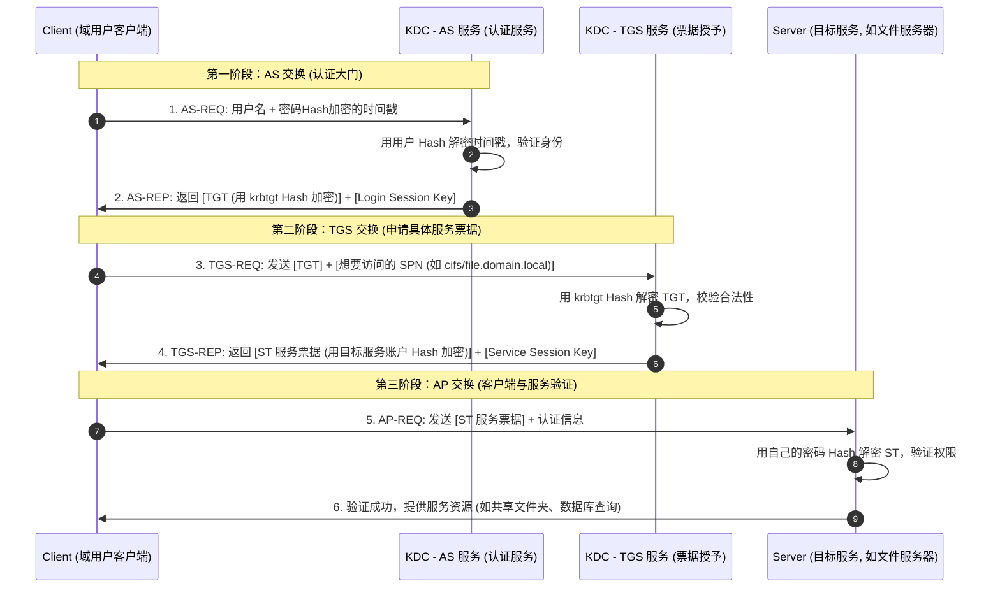

# Windows域渗透专精：Kerberos认证协议、黄金白银票据与PTH/PTT实战

---

## 0. 基础前置知识扫盲：从生活比喻彻底搞懂 Kerberos

> [!NOTE] 模块前置语言与工具清单
> - **前置通关必备**：零基础读者强烈建议先通读全局导航 **[[01-零基础入门前置指南与黑话工具字典]]**，掌握安全法律红线、终端命令行、HTTP 报文骨架与黑话字典！
> - **环境依赖**：具备基础 Web 浏览器（Chrome/Firefox）抓包认知或轻量 Python 脚本执行能力。


在初涉 Windows 域渗透时，许多人会被 `KDC`、`AS`、`TGS`、`TGT`、`ST`、`SPN`、`krbtgt` 这些英文缩写搞得晕头转向。
其实，Kerberos（希腊神话中守卫冥界的三头犬）的设计逻辑非常生活化。

### 1. 通俗生活类比：迪士尼乐园门票系统
把企业域环境想象成一个**大型迪士尼游乐园**：
- **你（Client / 域用户）**：普通游客。
- **KDC（密钥分发中心，运行在域控上）**：游乐园的总服务中心，由两个窗口组成：
  1. **AS 窗口（认证服务 Authentication Service）**：**大门售票处**。你向售票处出示身份证（密码 Hash），售票处验证无误后，发给你一张**全园区通行证（TGT）**。
  2. **TGS 窗口（票据授予服务 Ticket Granting Service）**：**园区内各游乐项目的换票处**。你拿着大门通行证（TGT），告诉工作人员：“我想玩过山车”，工作人员核对通行证后，发给你一张专门针对过山车的**项目入场券（ST，Service Ticket）**。
- **目标服务（Server，如 CIFS 文件共享、MSSQL、WEB）**：各个具体的**游乐项目（如过山车）**。项目检票员只认入场券（ST），检票员甚至不需要联网询问售票处，只要用自己的私钥能验开这张入场券，就放你进去。
- **krbtgt 账户**：**大门售票处的专属印章钢印**。整个园区只有大门售票处拥有这枚钢印，所有 TGT 通行证都盖有这个钢印。

---

## 1. Kerberos 核心三阶段认证流程深度拆解



### 1.1 协议请求与响应报文详解

1. **AS-REQ (Authentication Service Request)**：
   - 客户端在本地用用户密码计算出 NTLM Hash 或 AES 密钥。
   - 使用该密钥加密当前系统时间戳（防止重放攻击），打包为 `Authenticator` 发往域控 88 端口。
2. **AS-REP (Authentication Service Response)**：
   - KDC 从本地 Active Directory（`ntds.dit`）中查出该用户的 Hash，尝试解密时间戳。
   - 解密成功且时间在 5 分钟容差内，KDC 生成两样核心物品：
     - **TGT（Ticket Granting Ticket，黄金凭据的核心）**：里面包含了客户端用户名、域 SID、组权限以及一个临时会话密钥 `Session Key`。**该 TGT 整体使用域内置 `krbtgt` 账户的密码 Hash 进行加密**。客户端自己根本无法解密修改 TGT！
     - 客户端专属的加密会话密钥（用于后续与 TGS 通信）。
3. **TGS-REQ (Ticket Granting Service Request)**：
   - 客户端带着加密的 TGT，向 KDC 声明要访问哪个目标服务（例如 `SPN: cifs/fileserver.corp.local`）。
4. **TGS-REP (Ticket Granting Service Response)**：
   - KDC 用自己的 `krbtgt` Hash 解密 TGT，核验身份合法性。
   - 生成 **ST（Service Ticket，白银凭据的核心，也称 TGS 票据）**。**该 ST 使用目标服务对应账号（如机器账户 `fileserver$`）的密码 Hash 进行加密**。
5. **AP-REQ / AP-REP (Application Client-to-Server)**：
   - 客户端将 ST 发送给目标文件服务器。
   - 目标服务器直接用自己本机的机器账号 Hash 解密 ST，获取客户端的权限信息（PAC），放行并响应。

---

## 2. 黄金票据（Golden Ticket）攻击深度剖析

### 2.1 漏洞与攻击原理
- **本质**：**伪造 TGT（大门通行证）**。
- **利用前提**：攻击者已经完全拿下了域控制器，或者通过 DCSync 漏洞、导出了域核心账户 `krbtgt` 的 NTLM Hash 或 AES-256 Key。
- **为什么被称为“持久化之王”**：
  在 Kerberos 协议中，KDC 在第二阶段（TGS）收到客户端发来的 TGT 时，**只校验该 TGT 是否能被 `krbtgt` 的密码 Hash 正确解密**！KDC 不会去查 Active Directory 数据库确认这个用户是否真的存在，也不会校验这个 TGT 是否由 AS 签发。
  因此，只要拿到了 `krbtgt` 的 Hash，攻击者就能**无中生有**地伪造任意用户名（甚至可以伪造不存在的用户，如 `god_admin`），并为其赋予 Domain Admins（域管组 SID 512）最高权限！

### 2.2 制作黄金票据的 4 大必备要素
1. **域全限定名（FQDN）**：如 `corp.local`。
2. **域的安全标识符（SID）**：去掉最后子标识符的域 SID，如 `S-1-5-21-123456789-987654321-1122334455`。
3. **想要伪造的高权限用户名**：如 `Administrator`。
4. **`krbtgt` 账户的 NTLM Hash 或 AES-256 密钥**。

### 2.3 实战复现命令（Mimikatz 指令逐项剖析）

```text
# 步骤 1：在掌握域控时，利用 DCSync 协议导出 krbtgt 的 NTLM Hash
lsadump::dcsync /domain:corp.local /user:krbtgt

# 步骤 2：生成并注入黄金票据（Pass-the-Ticket）
kerberos::golden /user:Administrator /domain:corp.local /sid:S-1-5-21-2970049715-2244220444-1139187148 /krbtgt:29754f91e30e9f1f49e327e6eb8e40cf /ticket:golden.kirbi /ptt
```

#### 参数解析表：
| 参数 | 含义 | 作用与防错要点 |
| :--- | :--- | :--- |
| `/user` | 伪造的目标用户名 | 随意指定，一般指定为域管用户名（如 `Administrator`）。 |
| `/domain` | 域名 | 目标域全称，与当前环境保持一致。 |
| `/sid` | 域安全标识符 (SID) | 可以通过 `whoami /user` 查出，去掉结尾的 `-500` 或 `-1000` 部分。 |
| `/krbtgt` | krbtgt 密码散列 | `krbtgt` 账号的 32 位 NTLM Hash（或者用 `/aes256:` 参数）。 |
| `/ticket` | 输出文件名 | 保存为 `.kirbi` 格式票据文件供离线备用。 |
| `/ptt` | Pass The Ticket | **关键开关**。直接将伪造好的金票注入到当前 cmd/PowerShell 进程内存中，无需手动再次导入！ |

---

## 3. 白银票据（Silver Ticket）攻击深度剖析

### 3.1 漏洞与攻击原理
- **本质**：**伪造 ST（游乐项目入场券 / Service Ticket）**。
- **与黄金票据的根本差异**：
  - 白银票据伪造的是具体服务的 ST 票据，不需要 `krbtgt` 的 Hash，**只需要获取目标机器或服务账号的 Hash（如机器账户 `DC01$` 的 Hash）**。
  - **不与 KDC 进行任何网络交互**！攻击者直接拿着伪造的 ST 去敲目标服务器的门。
  - **隐蔽性极高**：因为全过程完全不经过域控（KDC），域控上的日志不会记录任何 AS-REQ 或 TGS-REQ 事件，仅目标主机会记录登录成功日志。

### 3.2 常见利用场景（伪造服务类型）
- **CIFS 服务**：文件共享服务，常用于读写目标机器的 `C$` 或 `ADMIN$` 共享并执行文件。
- **HOST 服务**：用于计划任务创建、RPC 远程管理。
- **LDAP 服务**：用于针对域控执行 DCSync 凭据导出。
- **HTTP / WSMAN**：用于 Web 或 WinRM 远程命令执行。

### 3.3 实战命令解析

```text
# 伪造目标域控 DC01 上 CIFS 服务的白银票据并直接注入内存
kerberos::golden /domain:corp.local /sid:S-1-5-21-2970049715-2244220444-1139187148 /target:DC01.corp.local /service:cifs /rc4:88e44763e3a36e021966f3750434b73f /user:Administrator /ptt
```

#### 参数解析：
- `/target`：目标主机的 FQDN，例如 `DC01.corp.local`。
- `/service`：目标服务类型，如 `cifs`、`http` 等。
- `/rc4`：**目标主机的计算机账户 Hash**（计算机账户以 `$` 结尾，如 `DC01$` 的 NTLM Hash）。
- `/ptt`：注入当前内存。执行后输入 `dir \\DC01.corp.local\c$` 即可无密码读取域控 C 盘！

---

## 4. 黄金票据 vs 白银票据 vs 哈希传递对比

| 特性对比项 | 黄金票据 (Golden Ticket) | 白银票据 (Silver Ticket) | 哈希传递 (Pass-The-Hash / PTH) |
| :--- | :--- | :--- | :--- |
| **伪造对象** | TGT（票据授予票据） | ST（服务票据 / TGS） | NTLM 质询/响应协议中的 Hash 认证 |
| **获取的前提凭据**| 域控 `krbtgt` 账户的 Hash | 目标单台机器账户的 Hash | 本地管理员或域管理员的 NTLM Hash |
| **是否访问域控(KDC)**| **是**（伪造 TGT 后需向 KDC 申请 ST） | **否**（完全不经过 KDC，直接打目标机）| **取决于认证协议**（访问本地则不需要） |
| **影响控制范围** | **全域最高权限**（直接通杀所有机器） | **单台主机或单项服务** | 取决于该 Hash 拥有者在各主机的管理权限 |
| **检测与告警特征** | KDC 端票据加密类型异常、域管票据生存期异常 | 目标服务器出现异常 SPN 登录，KDC 无记录 | 4624 登录类型 3，大量网络认证行为 |

---

## 5. 离线票据破解战术：Kerberoasting 与 AS-REP Roasting

除了凭空伪造票据外，Kerberos 协议的加密机制还衍生出了两类经典的“离线密码爆破”攻击面：

### 5.1 Kerberoasting 攻击（利用 SPN 服务票据）
- **原理**：域内任何合法普通用户（甚至毫无特权的访客用户）都有权限向 KDC 申请访问任意注册了 **SPN（服务主体名称）** 的服务的 ST 票据。
- **攻击链**：
  1. 攻击者以低权限用户身份登录，请求注册了 SPN 的服务账户（如运行 MSSQL 的 `sqlservice` 域用户）的 ST 票据。
  2. KDC 返回的 ST 票据是用 `sqlservice` 用户的密码 NTLM Hash 加密的。
  3. 攻击者从本机内存中导出该 ST 票据（`.kirbi` 格式）。
  4. 将票据拉到攻击机本地，使用 Hashcat 或 John the Ripper 离线进行字典爆破（**不产生任何在线登录失败日志，绝不锁账号**）。
  5. 若服务账号使用了弱口令，可轻易离线破解出明文密码！

```bash
# Hashcat 离线破解 Kerberoasting 导出的票据 (模式 13100)
hashcat -m 13100 -a 0 kerberoast_hash.txt /usr/share/wordlists/rockyou.txt
```

### 5.2 AS-REP Roasting 攻击（针对未开启预认证的账户）
- **原理**：默认情况下，Kerberos 在第一步（AS-REQ）要求客户端用自己的密码加密时间戳（**预认证机制**），以防他人随意请求票据。
- **脆弱点**：如果在 Active Directory 中为某个用户勾选了 **“不需要 Kerberos 预身份验证”（Do not require Kerberos preauthentication）**，任何人都可以伪造该用户的名字向 KDC 发送 AS-REQ 请求。
- **利用**：KDC 会直接返回用该用户 Hash 加密的 AS-REP 密文包。攻击者捕获该密文包后，同样可以在本地使用 Hashcat（模式 18200）离线暴力破解密码！

---

## 6. 蓝队纵深防御与应急响应手册

### 6.1 黄金票据应急处理“黄金法则”
黄金票据依赖 `krbtgt` 的密码 Hash。如果内网遭受了黄金票据攻击，仅仅修改域管密码是**完全无效**的！
- **必须连续修改两次 `krbtgt` 账户的密码**：
  - Windows 域中保留了当前密码和上一版本密码（用于防止旧票据在更改瞬间立即失效导致服务雪崩）。
  - 因此，必须重置 `krbtgt` 密码，等待全域复制同步（通常等待数小时或 1 天），然后**再次重置一次** `krbtgt` 密码，彻底作废所有历史签发的黄金票据。

### 6.2 票据防护与活动目录加固策略
1. **服务账户强制使用强密码或 gMSA（组受管理的信任账户）**：
   - 彻底防范 Kerberoasting 攻击，避免弱口令。
2. **禁止高权限域管理员账号登录非受信的工作站或跳板机**：
   - 实施分级管理模式（Tier 0 / Tier 1 / Tier 2 隔离架构），域管仅在域控和受保护的管理堡垒机上登录，防止 LSASS 凭据被抓取。
3. **启用严格日志审计**：
   - 监控事件 ID **4768**（TGT 请求）与 **4769**（服务票据请求）。
   - 重点关注加密类型为 `0x17`（RC4-HMAC，老旧弱加密，常见于伪造票据）而非 `0x12`（AES-256）的异常请求。
