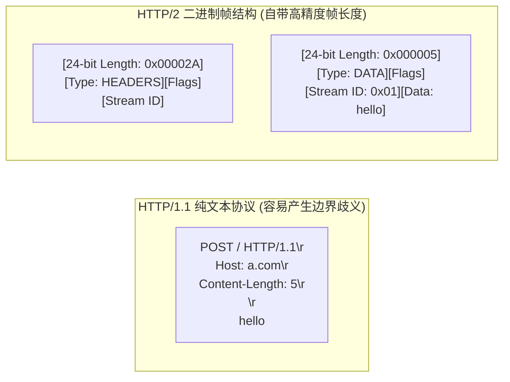
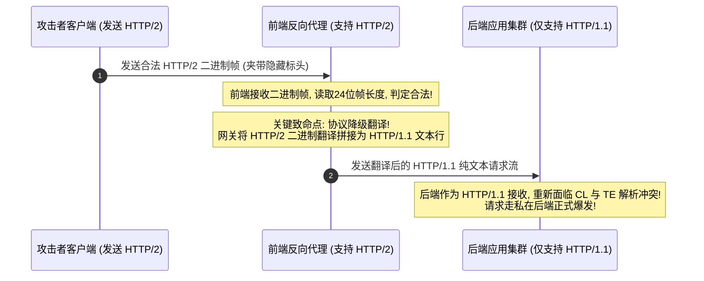
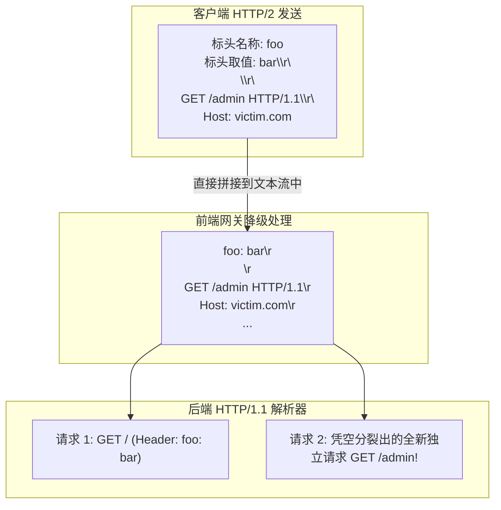

# HTTP/2请求走私、请求走私变异与高阶漏洞挖掘

---

## 0. 基础前置知识扫盲：HTTP/2 的革新与“安全幻觉”

> [!NOTE] 模块前置语言与工具清单
> - **前置通关必备**：零基础读者强烈建议先通读全局导航 **[[01-零基础入门前置指南与黑话工具字典]]**，掌握安全法律红线、终端命令行、HTTP 报文骨架与黑话字典！
> - **环境依赖**：具备基础 Web 浏览器（Chrome/Firefox）抓包认知或轻量 Python 脚本执行能力。


在上一篇笔记中，我们深刻理解了基于 HTTP/1.1 文本边界歧义的 CL.TE 与 TE.CL 请求走私。
很多安全开发人员在读完上一篇后会得出结论：“既然 HTTP/1.1 的文本行定界那么容易出问题，只要我们全站升级到 **HTTP/2**，请求走私不就彻底绝迹了吗？”

这个看似美好的假设，在 2021 年全球顶级安全峰会 Black Hat 上，被知名安全研究员 James Kettle 用一篇轰动业界的重磅议题——**《HTTP/2: The Sequel is Always Worse》（HTTP/2：续集往往更糟糕）** 彻底粉碎！

### 1. HTTP/2 协议的基础底层特性
为了理解为什么 HTTP/2 依然存在走私，必须先了解 HTTP/2 的核心变化：
- **二进制分帧（Binary Framing）**：
  HTTP/1.1 是纯 ASCII 文本协议；而 HTTP/2 是**纯二进制协议**。所有数据被切分成独立的“帧”（Frame），如 HEADERS 帧、DATA 帧。
- **显式长度标识**：
  每个二进制帧的最前部都有固定的 **24 位长度字段（Length Field）**。接收方只需要按字节数精准读取即可，从根本上**不需要**依赖 `Content-Length` 或 `Transfer-Encoding: chunked` 来界定消息结束！
- **伪标头（Pseudo-Headers）**：
  HTTP/2 将请求行拆分为以冒号开头的特殊标头，如 `:method: GET`、`:path: /index.html`、`:authority: example.com`、`:scheme: https`。



---

## 1. 致命裂痕：HTTP/2 协议降级（HTTP/2 Downgrading）

如果整个网络链路从客户端浏览器 $\to$ CDN/WAF $\to$ 后端服务器**全链路运行纯粹的 HTTP/2**，请求走私确实很难发生。
然而，在当今互联网的真实商业架构中，现实非常骨感：

### 1.1 降级架构的产生原因
- **前端接入层（CDN/反向代理/云 WAF）**：为了提供极速的用户体验，普遍开启了对客户端浏览器的 **HTTP/2 支持**；
- **后端业务集群（Tomcat、Node.js、Django、Go 微服务）**：由于历史技术栈沉重或内部中间件老旧，内部通信仍然使用 **HTTP/1.1 协议**！
- **协议降级转换（HTTP/2 Downgrading）**：
  前端反向代理在接收到客户端的 HTTP/2 二进制请求后，**必须在内存中将其“翻译并重写”为老旧的 HTTP/1.1 纯文本格式**，再通过内部 TCP 连接转发给后端！



---

## 2. H2.CL 与 H2.TE 降级走私模型深度拆解

在 HTTP/2 中，规范明确指出不需要 `content-length` 和 `transfer-encoding` 标头。但如果客户端在发包时**故意硬塞进这两个标头**，前端代理在翻译降级为 HTTP/1.1 时就会引发灾难。

### 2.1 H2.CL 攻击模型（前端读 H2 帧长，后端读降级后的 CL）

- **攻击机制**：
  攻击者向前端发送一个 HTTP/2 请求，但在标头中显式注入了一个**比实际数据体更小**的 `content-length: 0`（或较小值）。
  1. **前端代理**：通过 HTTP/2 的 DATA 帧准确接收到全部数据（例如 30 个字节），判定请求有效；
  2. **降级转换**：前端代理将请求转换为 HTTP/1.1 文本，并忠实地将 `content-length: 0` 写入 HTTP/1.1 标头；
  3. **后端服务器**：后端收到 HTTP/1.1 请求，读取 `content-length: 0`，认为请求体没有数据，直接结束处理！
  4. **走私成功**：剩余的 30 个字节被遗留在后端的 TCP 复用连接中，作为下一个请求的前缀被走私！

#### Burp Suite HTTP/2 请求构造示例（H2.CL）：
```http
:method: POST
:path: /
:authority: victim.com
:scheme: https
content-type: application/x-www-form-urlencoded
content-length: 0

SMUGGLED_REQUEST_PREFIX
```

---

### 2.2 H2.TE 攻击模型（利用降级透传 Transfer-Encoding）

- **攻击机制**：
  RFC 7540（HTTP/2 标准）明确规定：在 HTTP/2 请求中禁止包含 `transfer-encoding: chunked` 标头。
  然而，很多前端代理并未对 HTTP/2 请求的标头做严格的黑名单过滤。
  1. 攻击者发送带有 `transfer-encoding: chunked` 的 HTTP/2 请求；
  2. 前端代理将该标头透传并降级为 HTTP/1.1 发送给后端；
  3. 后端如果是优先支持 `Transfer-Encoding` 的老旧服务器，就会被提前发送的 `0\r\n\r\n` 截断，产生走私残余！

---

## 3. HTTP/2 独门绝技：CRLF 标头注入与任意请求拆分（Request Splitting）

这是 HTTP/2 降级走私中最具杀伤力、最让安全界震惊的技术。

### 3.1 为什么 HTTP/1.1 无法在标头值中注入 CRLF？
在传统的 HTTP/1.1 中，如果攻击者试图在 Header 的值里写入回车换行（`\r\n`，十六进制 `0x0D 0x0A`），客户端或代理会立即将 `\r\n` 识别为“这个 Header 已经结束了，下一行是新的 Header”。

### 3.2 HTTP/2 二进制帧的致命特性
在 HTTP/2 中，每一个标头（Key-Value）都被打包成一个独立的二进制字段，其**长度是显式指定的字符串长度**！
- HTTP/2 允许标头的值中包含**任意二进制字节**，包括 `\r` (0x0D) 和 `\n` (0x0A)！
- 客户端在 HTTP/2 帧中发送包含 `\r\n` 的标头值，在 HTTP/2 协议看来这只是普通的二进制字符，完全合法！

### 3.3 降级时的“化学反应”：直接分裂出第二个请求
当前端代理把这个包含二进制 `\r\n` 的标头翻译并写入 HTTP/1.1 纯文本数据流时：
二进制的 `\r\n` **直接蜕变成了 HTTP/1.1 的文本换行符！**



通过这种手法，攻击者可以在**完全合法的 HTTP/2 语法掩护下**，在后端任意凭空注入、分裂出第二个请求，彻底绕过 WAF 的一切正则拦截！

---

## 4. 响应队列投毒（Response Queue Poisoning）：无差别劫持用户会话

在更严重的多路复用去同步场景下，走私攻击能够引发**响应队列投毒（Response Queue Poisoning）**。

### 4.1 错位灾难的发生机制
后端服务器按照先来后到的顺序（FIFO 队列）处理请求并返回响应：
1. 攻击者走私了一个完整的请求，导致后端收到的请求总数变成了 $N + 1$ 个，而后端只返回给前端 $N$ 个请求的对应关系；
2. **队列整体错位 1 位**：
   - 当无辜受害者 A 发送请求时，后端返回的却是攻击者刚才走私请求的响应！
   - 当无辜受害者 B 登录系统请求用户个人资料时，后端返回的却是受害者 A 包含敏感账单的响应！
3. 攻击者只要在公网不断发包，就能持续捕获其他所有同时在线用户的全部私密响应内容（包括明文凭据、个人隐私数据）！

---

## 5. CTF 顶尖赛题实战：利用 H2.CL 降级打穿内部微服务

### 赛题环境：
- 入口反向代理：Envoy 代理（面向公网开启 HTTP/2）；
- 内部后端微服务：老旧 Python 内部服务（仅支持 HTTP/1.1，复用 TCP 连接）；
- 目标：内网只对带有内部身份标头 `X-Internal-Token: secret_pass` 的请求开放 `/flag` 接口。

### 攻击实操链条：

#### 步骤 1：使用 Burp Suite 2021+ 切换为 HTTP/2 协议
在 Burp Suite Repeater 中，将请求协议下拉菜单从 `HTTP/1.1` 切换为 `HTTP/2`。在 Inspector 面板中可以直观编辑伪标头。

#### 步骤 2：构造 H2.CL 降级载荷
在 HTTP/2 标头中添加自定义的 `content-length: 0`，并在请求体中写入走私请求的前半段：

```http
:method: POST
:path: /public_api
:authority: ctf.game.org
:scheme: https
content-type: application/x-www-form-urlencoded
content-length: 0

GET /flag HTTP/1.1
Host: ctf.game.org
X-Internal-Token: secret_pass
X-Ignore: 
```

#### 步骤 3：走私触发与利用
1. 发送上述 HTTP/2 请求：
   - Envoy 按 HTTP/2 二进制帧接收，确认是向 `/public_api` 发起的有效请求；
   - Envoy 降级为 HTTP/1.1 发送给 Python 后端，写入了 `content-length: 0`；
   - Python 后端收到后，认为 POST 请求体长度为 0，立即返回 `/public_api` 的结果；
   - 走私数据 `GET /flag... X-Ignore: ` 残留在 Python 后端的连接缓冲区中！
2. 紧接着发送第二个普通请求，触发后端将残留的走私头部拼接：
   Python 后端将走私的 `GET /flag` 作为优先请求执行，检测到合法的 `X-Internal-Token: secret_pass`，成功返回：
   `flag{H2_CL_D0wngr4d1ng_Smuggl1ng_M4st3r}`！

---

## 6. 企业级纵深防御与修复方案

要从根本上抵御 HTTP/2 走私及其降级变种，必须实施以下系统级改造：

1. **推行端到端全链路 HTTP/2（End-to-End HTTP/2）**：
   - 彻底废除“前端 HTTP/2 + 后端 HTTP/1.1”的混合降级架构；
   - 前端代理到后端微服务之间全面启用 HTTP/2 通信，消除任何协议转换与文本拼接的可能。
2. **前端网关启用严格的标头净化过滤（Header Sanitization）**：
   - 在将 HTTP/2 请求降级转换为 HTTP/1.1 之前，**强制丢弃**客户端传入的 `transfer-encoding` 和不合规的 `content-length` 标头；
   - **严格校验标头值中的非法控制字符**：凡是在标头名（Header Name）或标头值（Header Value）中包含 `\r` (0x0D)、`\n` (0x0A)、`\0` (0x00) 的 HTTP/2 请求，一律直接返回 `400 Bad Request` 重置流（RST_STREAM）。
3. **禁用后端连接复用（Connection Pooling Isolation）**：
   - 对敏感接口配置独立的后端连接，避免将不同外部客户端的请求混杂在同一条持久长连接上。
