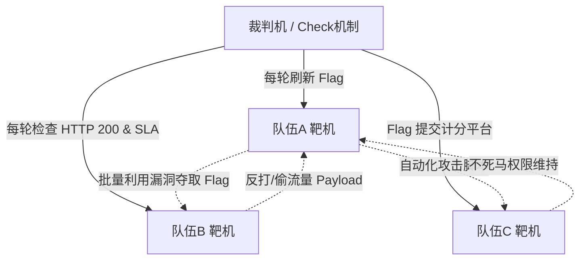
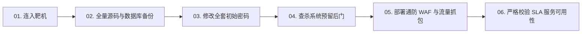

# AWD攻防赛制生存法则：黄金十分钟应急加固、代码备份与弱口令排查

---


> [!TIP] 🛠️ 工具实操指引：Seay 源代码审计系统安装与使用
> - **是什么**：国内最经典易用的自动化 PHP 白盒代码审计工具，采用正则表达式与规则引擎快速定位危险函数调用点。
> - **怎么装**：
>   1. 基于 .NET Framework 开发，Windows 下直接下载解压版绿色运行；
>   2. macOS/Linux 用户可通过 Mono 环境或跨平台代码审计工具（如 Semgrep / CodeQL）替代。
> - **第一个实操**：
>   1. 双击打开 `Seay.exe` -> 点击上方菜单 `新建项目` -> 选择目标 PHP 源码所在的文件夹；
>   2. 点击 `自动审计` 按钮，工具会自动扫描全站 PHP 文件，并在左侧面板分类展示所有潜在高危触发点（如 SQL 注入、代码执行、文件包含），双击条目即可直接高亮查看源码！

## 0. 基础前置知识扫盲：AWD 赛制到底是怎么玩的？

> [!NOTE] 模块前置语言与工具清单
> - **前置通关必备**：零基础读者强烈建议先通读全局导航 **[[01-零基础入门前置指南与黑话工具字典]]**，掌握安全法律红线、终端命令行、HTTP 报文骨架与黑话字典！
> - **环境依赖**：具备基础 Web 浏览器（Chrome/Firefox）抓包认知或轻量 Python 脚本执行能力。


对于只参加过解题赛（Jeopardy / 夺旗赛）的初学者来说，第一次面对 **AWD（Attack With Defense，攻防兼备赛）** 往往会感到极度震撼甚至手忙脚乱。

### 1. 什么是 AWD 比赛？
- **解题赛（Jeopardy）**：像“做试卷”。题目放在公共靶场，你一个人安静地做题解密，什么时候做出来就什么时候提交 Flag，没人会来打你的电脑。
- **AWD 攻防赛**：像**“中世纪城堡混战”**！
  - 组织方给每个参赛队伍分配一台完全相同的虚拟机（**靶机**），上面运行着一套带有多个安全漏洞的 Web 系统和数据库；
  - 每个队伍既是**防守方**（必须守护好自己的靶机不被攻破），又是**进攻方**（必须挖出漏洞，攻击其他所有队伍的靶机）；
  - 比赛以“轮次（Round）”为周期滚动（通常 1 到 5 分钟为一个 Round），每一轮系统会在所有靶机上更新一次新的 Flag；
  - **得分规则**：
    - 成功打穿别人的靶机拿到 Flag 并提交 $\to$ **加分**（从被攻击队伍的奖池中夺取分数）；
    - 自己的靶机被别人打了 $\to$ **扣分**；
    - 自己的靶机服务挂了（如数据库关了、源码被自己改崩了，未能通过裁判机的 **SLA Check**）$\to$ **被罚扣巨额分数**！



### 2. 团队三人黄金分工
在一场 4-6 小时的高强度 AWD 比赛中，团队绝不能乱成一锅粥。标准的铁三角分工是：
- **队员 A（防守与应急响应手）**：负责开局前十分钟登录靶机、备份代码、修改所有密码、部署 WAF 与监控脚本、查杀预留后门；
- **队员 B（漏洞挖掘手 / 审计手）**：将备份的代码拉回本地，迅速使用 D 盾/Seay/自动化审计工具静态分析代码漏洞，寻找 0-Day/N-Day；
- **队员 C（攻击武器库开发者）**：负责编写 Python 批量攻击框架、与提交平台的 API 对接，负责实时捕获流量并实现“回首掏”反打。

---

## 1. 黄金十分钟标准操作规程（SOP）

比赛开始的哨声一响，**前 10 分钟直接决定整场比赛的生死**！如果前十分钟没有做好防御，你的靶机会在第 1 轮被所有队伍种下“不死马”，沦为全场的公共肉鸡。



---

### 1.1 第一要务：全量源码与数据库双重备份

**绝对法则**：在做任何修改之前，第一件事必须是**备份**！如果不小心改错代码导致服务 500 报错，SLA Check 挂掉每轮扣分足以让你直接垫底。

```bash
# 1. SSH 登录靶机 (建议使用 Xshell / FinalShell / MobaXterm 快速连接)
ssh ctf@192.168.10.x

# 2. 迅速压缩备份 Web 网站根目录 (通常在 /var/www/html)
# 使用 tar 压缩并存放到隐蔽目录 (如 /tmp 或 /var/tmp)
tar -zcvf /tmp/web_backup_$(date +%s).tar.gz /var/www/html

# 3. 迅速导出全库 SQL 备份
mysqldump -u root -p root --all-databases > /tmp/mysql_backup_$(date +%s).sql

# 4. 在本地电脑通过 scp 或 SFTP 立即将备份拉回本地供审计手分析
# (在本地 Kali/Windows 终端执行)
scp ctf@192.168.10.x:/tmp/web_backup_*.tar.gz ./
```

---

### 1.2 第二要务：全面修改初始口令（断绝直接偷家）

主办方分配的靶机往往预置了极其简单、甚至全国通用的初始弱口令（如 `root/root`、`ctf/123456`）。如果不改密码，对手用一句话脚本就能批量 SSH 登录篡改你的配置！

#### 1. 修改 SSH 用户登录口令：
```bash
# 修改当前用户密码
passwd
# 输入长随机复杂口令，如: K#9xP@7$qW2!zL8

# 如果有 root 权限，强制修改 root 密码
sudo passwd root
```

#### 2. 修改 MySQL 数据库密码：
```bash
# 登录 MySQL
mysql -u root -p

# 修改 root 密码为强随机密码 (MySQL 5.7+ 语法)
ALTER USER 'root'@'localhost' IDENTIFIED BY 'MySql_Strong_P@ssw0rd_2026!';
FLUSH PRIVILEGES;
EXIT;
```
> [!CAUTION] **致命避坑点**：
> 修改完 MySQL 密码后，**必须立即同步修改 Web 网站的配置文件**（如 `config.php`、`database.php`、`.env`）中的数据库密码！否则网站连接不上数据库，裁判机 Check 判定服务挂掉，立即扣除巨额 SLA 分数！

#### 3. 修改 Web 应用后台管理员密码：
直接打开浏览器，登录预装的 CMS/应用后台，将管理员 `admin` 的密码修改为复杂字符。

---

### 1.3 第三要务：地毯式排查“官方预留后门”（Backdoors）

AWD 组织方在出题时，为了让比赛初期迅速爆发战斗，通常会在源码中**故意埋入 2 到 5 个非常显眼的预留后门**（如一句话木马、无鉴权命令执行接口、隐蔽危险函数）。

#### 快速查杀命令大全（Linux Shell 快速实战）：

```bash
# 1. 查找包含 eval() 或 assert() 的危险 PHP 文件
find /var/www/html -type f -name "*.php" | xargs grep -E "(eval|assert|system|exec|passthru|shell_exec)\s*\("

# 2. 查找接收外部参数执行的经典一句话木马
grep -rn '\$_\(POST\|GET\|REQUEST\|COOKIE\)' /var/www/html/ | grep -E '(eval|assert|call_user_func)'

# 3. 查找最近 10 分钟内被修改过的可疑文件 (防止对手已经快你一步传了木马)
find /var/www/html -mmin -10 -type f

# 4. 检查是否存在隐藏文件 (以 . 开头的隐藏 php)
find /var/www/html -name ".*.php"
```

#### 本地 D 盾 / 河马 Webshell 查杀：
审计手将刚才拉回本地的 `web_backup.tar.gz` 解压，立即拖入 **D 盾（D_Safe）** 或 **河马 Webshell 查杀工具**。
扫描结果中如果报出级别为 4 或 5 的后门文件，**立即在服务器上执行 `rm -f` 删除，或者注释掉对应的危险代码行**！

---

### 1.4 第四要务：降权与文件系统锁死加固

在保障 Web 业务正常运行的前提下，最大限度收紧文件目录的写入权限，防止对手上传 Webshell。

```bash
# 1. 将 Web 根目录所有者变更为 root，非 root 只能读
chown -R root:root /var/www/html

# 2. 将所有 PHP 文件权限设置为 555 (只读、只执行、不可写)
find /var/www/html -type f -name "*.php" -exec chmod 555 {} \;

# 3. 仅保留必须上传文件的目录 (如 uploads/ 或 runtime/) 赋予写权限
chmod 777 /var/www/html/uploads

# 4. 关键防御：在 uploads 上传目录禁止执行任何 PHP 脚本!
# 在 Nginx 配置文件对应 location 增加限制:
# location ~* ^/uploads/.*\.(php|php5|phtml)$ {
#     deny all;
# }
```

---

## 2. 守护生命线：SLA 服务可用性 Check 机制深度剖析

在 AWD 中，**“守不住比被打掉更致命”**。
很多新手一进靶机，为了防止被攻击，直接执行 `service mysql stop` 或者把 `/var/www/html` 目录删空，以为这样对手就打不进来了。
**这种行为是直接自杀！**

### 2.1 裁判机 SLA Check 是如何工作的？
- 裁判机通常是一个自动化爬虫脚本（基于 Python Requests 或 Selenium）；
- 每个 Round 开始时，裁判机模拟正常用户访问你的靶机：
  1. 访问首页，检查 HTTP 状态码是否为 `200 OK`；
  2. 访问用户注册/登录接口，模拟提交测试数据，检查数据库读写是否正常；
  3. 访问特定的业务功能（如查看文章、提交留言）。
- **扣分机制**：
  - 如果任何一个环节报错（如返回 500、404、连接超时、数据库无法连接），裁判机立即判定该队伍该轮 **“Down 机（Service Down）”**；
  - Down 机惩罚通常极其严厉：**每轮扣除当前总分的 10%~20%，或直接全场平摊扣除成百上千分**！

### 2.2 防御底线原则
- **修洞不删功能**：发现存在 SQL 注入的代码，采用预编译或 `intval()` 强转修补，绝不能直接删掉整个查询功能文件；
- **拦截不阻断合法请求**：部署 WAF 规则时，必须对合法业务参数放行，避免误杀裁判机的 Check 报文；
- **随时测试业务功能**：每做完一次代码修改，防守手必须亲自在浏览器里测试一遍首页、登录注册、内容浏览，确保业务 100% 正常。

---

## 3. AWD 黄金十分钟加固自动化 Shell 脚本模板

为了避免手工敲命令手忙脚乱，防守手应提前准备好自动化加固脚本 `defense_init.sh`，上传后一键执行：

```bash
#!/bin/bash
# ========================================================
# AWD 黄金开局一键快速应急加固脚本
# ========================================================

echo "[*] Step 1: 正在备份 Web 源码和数据库..."
TIMESTAMP=$(date +%s)
tar -zcvf /tmp/backup_html_${TIMESTAMP}.tar.gz /var/www/html > /dev/null 2>&1
mysqldump -u root -proot --all-databases > /tmp/backup_db_${TIMESTAMP}.sql > /dev/null 2>&1
echo "[+] 备份完成: /tmp/backup_html_${TIMESTAMP}.tar.gz"

echo "[*] Step 2: 正在排查并删除常见的典型预留一句话木马..."
# 删除带有常见密码的一句话木马文件
find /var/www/html/ -type f -name "*.php" | while read file; do
    if grep -E -q '(eval|assert)\s*\(.*(POST|GET|REQUEST)' "$file"; then
        echo "[-] 发现高危后门文件: $file"
        # 重命名为 .bak 隔离，防止裁判机误查同时阻止攻击利用
        mv "$file" "${file}.bak"
    fi
done

echo "[*] Step 3: 正在收紧文件权限..."
chmod -R 755 /var/www/html
find /var/www/html -type f -name "*.php" -exec chmod 555 {} \;
echo "[+] PHP 文件权限已收紧为只读 (555)"

echo "[*] Step 4: 正在展示当前登录用户与定时任务..."
who
crontab -l

echo "[+] 黄金十分钟基础加固执行完毕，请防守手立即手动修改 SSH 和 MySQL 密码!"
```

---

## 4. 黄金十分钟行动总结表

| 时间节点 | 责任人 | 核心动作 | 交付物 / 验收标准 |
| :--- | :--- | :--- | :--- |
| **0 ~ 2 分钟** | 防守手 | 登录 SSH，运行备份命令压缩源码与 SQL | `/tmp/` 下生成 `.tar.gz` 与 `.sql` 备份 |
| **2 ~ 5 分钟** | 防守手 | 迅速修改 SSH、MySQL 密码，并同步修改网站配置 | 确保 Web 首页能正常连接数据库并打开 |
| **2 ~ 8 分钟** | 审计手 | 从服务器拉取备份，在本地用 D 盾/Seay 扫预留木马 | 输出木马与漏洞文件清单，通知防守手处理 |
| **5 ~ 8 分钟** | 防守手 | 部署通防 WAF 包含文件，收紧上传目录权限 | 网站全局引入 WAF 拦截器 |
| **8 ~ 10 分钟**| 全体成员 | 验证 Web 首页、注册、登录业务，确认 SLA 正常 | 确保第一轮结算前靶机绿灯（Up 状态） |
